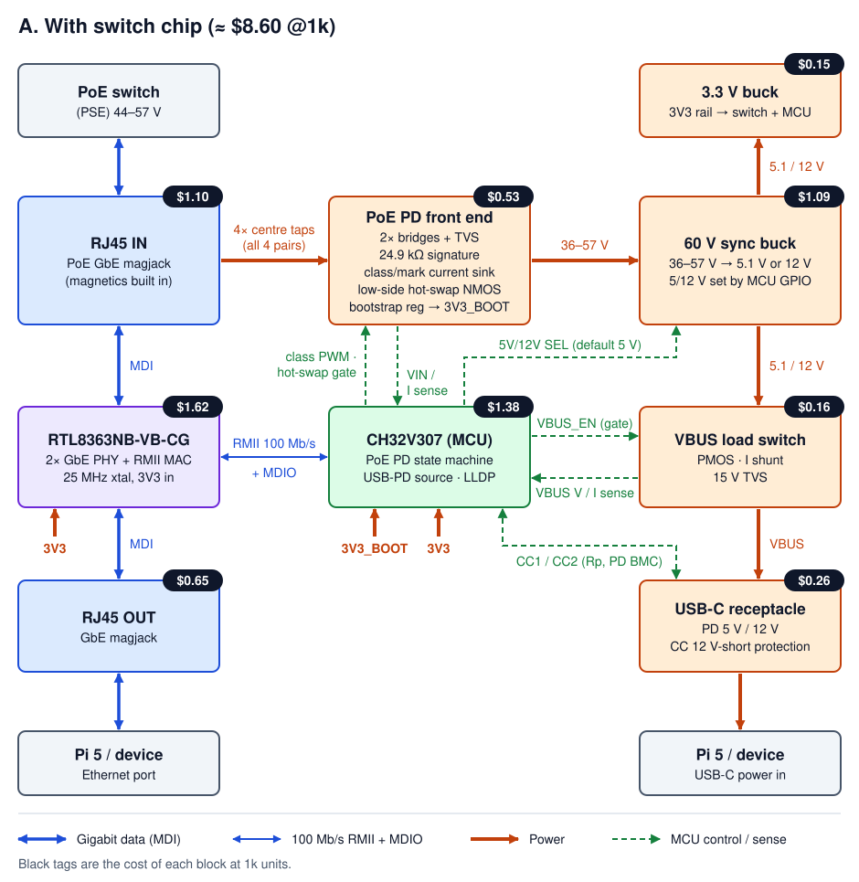
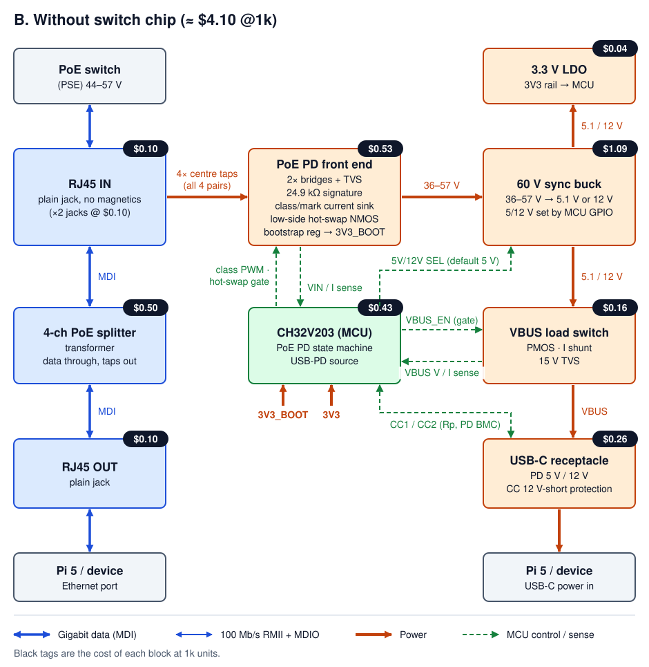

# Budget PoE to USB-C adapter

Notes, research and design material for an open source, non-isolated, very cheap and
flexible PoE to USB-C adapter that passes Ethernet through at 1 Gbit/s or faster.

The project is at the research stage. It has no schematic or PCB of the adapter.

| Resource | Location |
| --- | --- |
| Rendered documentation | [budget-poe-adapter.readthedocs.io](https://budget-poe-adapter.readthedocs.io/en/latest/) |
| Source repository | [GitHub repository](https://github.com/mithro/budget-poe-adapter) |

## Documents

The documents are grouped by the question they answer. Each group is listed in reading order.

| Group | Question it answers |
| --- | --- |
| [Design](#design) | What does the adapter contain and what does it cost? |
| [Power](#power) | How does the adapter take PoE power and hand it on over USB-C? |
| [Switch ICs](#switch-ics) | Which switch IC passes gigabit Ethernet through? |
| [LX-IS601F switch board](#lx-is601f-switch-board) | How is a bought YT9215SCH switch board built? |
| [YT921x switch programming](#yt921x-switch-programming) | How is a YT921x switch programmed? |
| [MCU and its network link](#mcu-and-its-network-link) | Which MCU runs the adapter and how does it reach the network? |
| [Datasheets](#datasheets) | Where are the vendor documents? |

### Design

| Document | Covers |
| --- | --- |
| [Block diagram and rough BOM](design/block-diagram-and-bom.md) | The blocks of both variants with their rough cost |
| [Cost and part-count reduction](research/cost-reduction.md) | Ways to cut the cost and the part count |

### Power

| Document | Covers |
| --- | --- |
| [PoE powered device](research/poe.md) | PoE standards and negotiation for a software-driven powered device |
| [USB-C power](research/usb-c-pd.md) | USB-C power standards with PD negotiation for a source that feeds a Raspberry Pi 5 |

### Switch ICs

| Document | Covers |
| --- | --- |
| [Cheap gigabit switch ICs](research/ethernet-switch.md) | Survey of cheap gigabit switch ICs with about three ports |
| [Switch IC comparison table](research/ethernet-switch-comparison.md) | The surveyed switch ICs side by side |
| [Switch ICs in detail](research/switch-detail-comparison.md) | The RTL8363NB compared with the RTL8367S and the YT9215S |
| [Embedded CPUs in the switch ICs](research/switch-embedded-cpu.md) | Whether the CPU inside a switch IC can replace the MCU |
| [Switch IC dev boards](research/switch-cpu-dev-boards.md) | Hardware to buy that carries an RTL8367S or a YT9215S |
| [Motorcomm debug pins](research/motorcomm-debug-pins.md) | Debug pins of the YT9215 variants with their routes on the LX-IS601F board |

### LX-IS601F switch board

| Document | Covers |
| --- | --- |
| [LX-IS601F debug pins](research/lx-is601f-board/README.md) | Annotated photos of where the debug pins of the YT9215SCH come out |
| [LX-IS601F schematic](research/lx-is601f-board/schematic/README.md) | Reverse-engineered KiCad schematic of the board |
| [LX-IS601F photo catalogue](research/lx-is601f-board/photos/README.md) | 34 photos of two LX-IS601F boards |

### YT921x switch programming

| Document | Covers |
| --- | --- |
| [YT921x switch programmer's guide](research/yt9215-registers/docs/index.rst) | Manual for writing a YT921x driver with a register reference |
| [YT921x source files and build commands](research/yt9215-registers/README.md) | The files behind the manual with the commands that check them |

### MCU and its network link

| Document | Covers |
| --- | --- |
| [MCU comparison](research/risc-v-mcu-comparison.md) | Candidate MCUs with their price and features |
| [Piggybacking on a gigabit link](research/gigabit-piggyback.md) | Ways to attach a small device to a gigabit Ethernet link |
| [Bit-banged 10 Mbit/s Ethernet](research/bitbang-10mbit-ethernet.md) | Whether an MCU can bit-bang 10 Mbit/s Ethernet |
| [Bit-banged USB](research/bitbang-usb.md) | Whether an MCU can bit-bang a USB device |
| [USB network card](research/usb-network-card.md) | The adapter presenting itself to the host as a USB network card |

### Datasheets

| Document | Covers |
| --- | --- |
| [Switch IC documentation](datasheets/README.md) | Vendor documents of the switch ICs |

## Block diagrams

The adapter has two variants. [Block diagram and rough BOM](design/block-diagram-and-bom.md)
explains both.

## Repository layout

| Folder | Contents |
| --- | --- |
| [`design/`](https://github.com/mithro/budget-poe-adapter/tree/main/design) | Block diagram with a rough BOM |
| [`research/`](https://github.com/mithro/budget-poe-adapter/tree/main/research) | Research notes |
| [`research/lx-is601f-board/`](https://github.com/mithro/budget-poe-adapter/tree/main/research/lx-is601f-board) | Photos and schematic of the LX-IS601F switch board |
| [`research/yt9215-registers/`](https://github.com/mithro/budget-poe-adapter/tree/main/research/yt9215-registers) | YT921x manual with register description and bindings |
| [`datasheets/`](https://github.com/mithro/budget-poe-adapter/tree/main/datasheets) | Vendor documents of the switch ICs |

[`conf.py`](https://github.com/mithro/budget-poe-adapter/blob/main/conf.py) is the Sphinx configuration of the documentation site and
[`index.md`](https://github.com/mithro/budget-poe-adapter/blob/main/index.md) holds its navigation. The site shows this file as its
landing page, so links to folders here are full GitHub addresses.

## Related repositories

* [YT9215S 5-port switch mirror](https://github.com/mithro/wu-kou-qian-zhao-jiao-huan-ji-_yt9215s_v2_0):
  mirror of an open-hardware 5-port gigabit switch built around the Motorcomm YT9215S
  (EasyEDA source, schematic, PCB, Gerbers, BOM). It is the reference design for the
  YT9215S notes here. [Switch IC documentation](datasheets/README.md) lists the datasheets
  that are also attachments of that repository.

## Licence

See [`LICENSE`](https://github.com/mithro/budget-poe-adapter/blob/main/LICENSE). Vendor datasheets under [`datasheets/`](https://github.com/mithro/budget-poe-adapter/tree/main/datasheets) remain the property of
their vendors.
