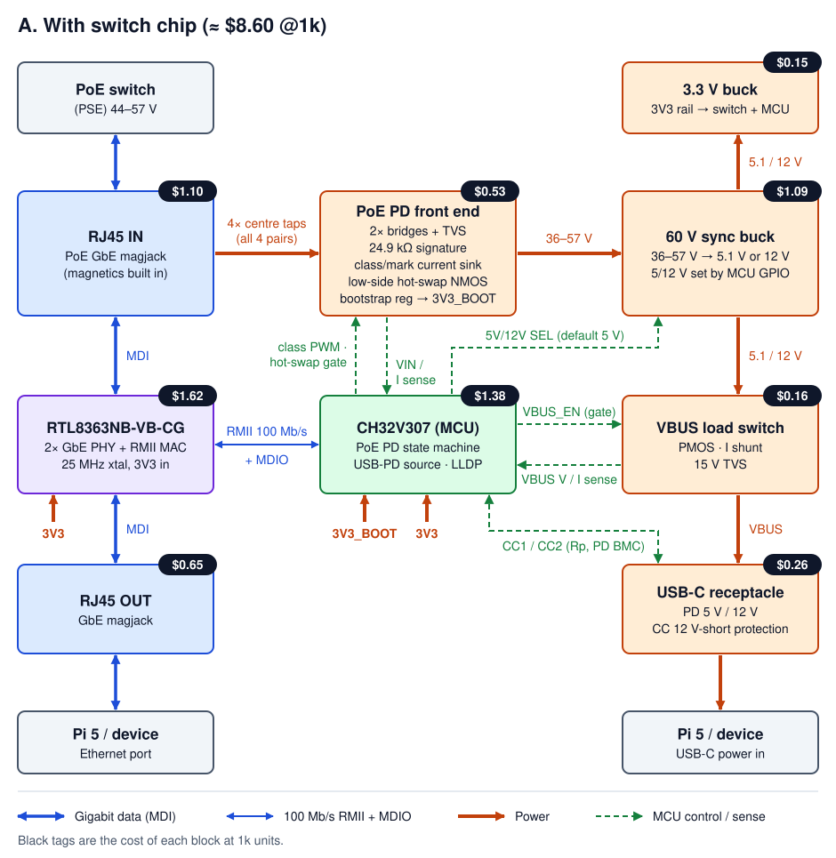
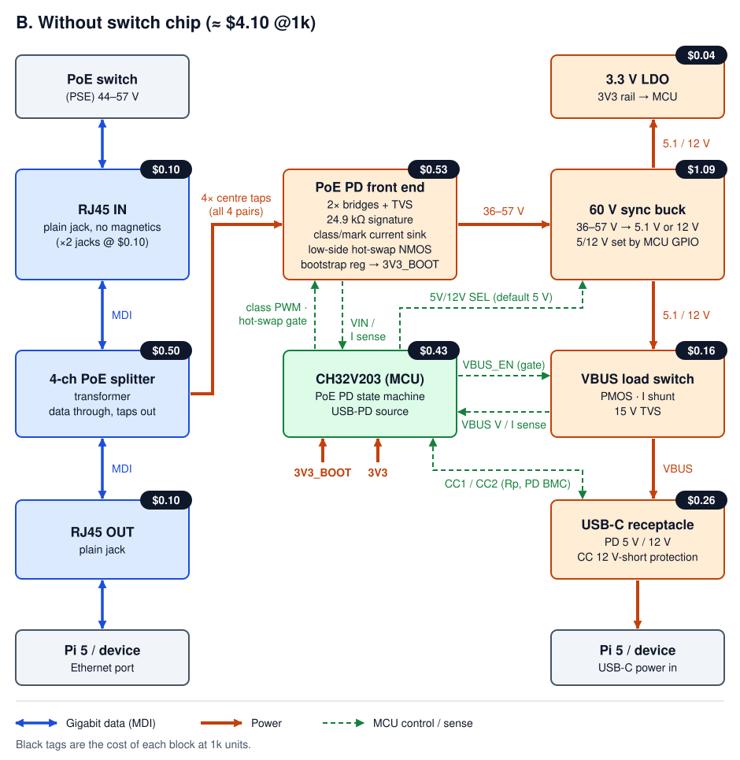

# Archive index

The current design uses only the YT9215 switch IC and its internal RISC-V CPU. The
notes here assume something else: an external MCU, a switch IC from another vendor, or
no switch at all. They are kept for reference and are not part of the current design.
The current notes are listed in the [repository README](../README.md).

Each note describes the design it assumes. Its prices, picks and recommendations apply
to that design only.

| Section | Contents |
| --- | --- |
| [Archived design](#archived-design) | Block diagram with a rough BOM |
| [Archived research: switch ICs](#archived-research-switch-ics) | Choice among switch ICs of several vendors |
| [Archived research: external MCU](#archived-research-external-mcu) | Choice of an external MCU |
| [Archived research: external MCU](#archived-research-external-mcu) | Network link of an external MCU |
| [Archived research: cost](#archived-research-cost) | Cost reduction of the archived design |
| [YT9215 material in current notes](#yt9215-material-in-current-notes) | YT9215 material of the mixed notes |

## Archived design

| File | Contents | Assumes |
| --- | --- | --- |
| [`block-diagram-and-bom.md`](design/block-diagram-and-bom.md) | Block diagram with rough BOM cost | External MCU |
| [`block-diagram-with-switch.svg`](design/block-diagram-with-switch.svg) | Figure A as SVG | RTL8363NB switch IC |
| [`block-diagram-without-switch.svg`](design/block-diagram-without-switch.svg) | Figure B as SVG | Passive Ethernet passthrough |
| [`block-diagram-with-switch.png`](design/block-diagram-with-switch.png) | Figure A as PNG | RTL8363NB switch IC |
| [`block-diagram-without-switch.png`](design/block-diagram-without-switch.png) | Figure B as PNG | Passive Ethernet passthrough |
| [`make_block_diagram.py`](design/make_block_diagram.py) | Script that draws the SVG figures | – |
| [`svg_to_png.js`](design/svg_to_png.js) | Script that renders the PNG figures | – |
| [`bom-rough.csv`](design/bom-rough.csv) | BOM table | External MCU |

## Archived research: switch ICs

| File | Covers | Assumes |
| --- | --- | --- |
| [`ethernet-switch.md`](research/ethernet-switch.md) | Cheap gigabit switch ICs with about three ports | RTL8363NB as the pick |
| [`ethernet-switch-comparison.md`](research/ethernet-switch-comparison.md) | Gigabit switch IC comparison table | RTL8363NB as the pick |
| [`switch-detail-comparison.md`](research/switch-detail-comparison.md) | Detail on the RTL8363NB | RTL8363NB as the pick |
| [`switch-detail-comparison.md`](research/switch-detail-comparison.md) | Detail on the RTL8367S | RTL8363NB as the pick |
| [`switch-detail-comparison.md`](research/switch-detail-comparison.md) | Detail on the YT9215S | RTL8363NB as the pick |
| [`switch-embedded-cpu.md`](research/switch-embedded-cpu.md) | The DW8051 CPU inside the RTL8367S | External MCU |
| [`switch-embedded-cpu.md`](research/switch-embedded-cpu.md) | The RISC-V CPU inside the YT9215S | External MCU |
| [`switch-embedded-cpu.md`](research/switch-embedded-cpu.md) | Absence of a CPU in the RTL8363NB | External MCU |
| [`switch-cpu-dev-boards.md`](research/switch-cpu-dev-boards.md) | Dev boards carrying the RTL8367S | RTL8367S as a candidate |
| [`switch-cpu-dev-boards.md`](research/switch-cpu-dev-boards.md) | Off-the-shelf hardware carrying the RTL8367S | RTL8367S as a candidate |
| [`switch-cpu-dev-boards.md`](research/switch-cpu-dev-boards.md) | Hardware carrying the YT9215S | RTL8367S as a candidate |

[`switch-embedded-cpu.md`](research/switch-embedded-cpu.md) recommends keeping an external
MCU and strapping the switch CPU off. That recommendation belongs to the archived design.
The current design runs its firmware on the YT9215 CPU.

## Archived research: external MCU

| File | Covers | Assumes |
| --- | --- | --- |
| [`risc-v-mcu-comparison.md`](research/risc-v-mcu-comparison.md) | MCU comparison | External MCU |
| [`gigabit-piggyback.md`](research/gigabit-piggyback.md) | Piggybacking on a gigabit link | External MCU |
| [`bitbang-10mbit-ethernet.md`](research/bitbang-10mbit-ethernet.md) | Bit-banged 10 Mbit/s Ethernet | RP2040 |
| [`bitbang-usb.md`](research/bitbang-usb.md) | Bit-banged USB | External MCU |
| [`usb-network-card.md`](research/usb-network-card.md) | A virtual USB network card on the MCU | CH32X035 |
| [`usb-network-card.md`](research/usb-network-card.md) | A USB network card that bridges Ethernet | CH397A |
| [`poe-software-pd.md`](research/poe-software-pd.md) | A PoE powered device measured and controlled by an MCU | External MCU |

## Archived research: cost

| File | Covers | Assumes |
| --- | --- | --- |
| [`cost-reduction.md`](research/cost-reduction.md) | Cost reduction | CH32X035 |
| [`cost-reduction.md`](research/cost-reduction.md) | Part-count reduction | Passive Ethernet passthrough |

[`cost-reduction.md`](research/cost-reduction.md) also prices the PoE front end, the buck
converter, the magnetics and the connectors. Those sections do not depend on the MCU, but
their totals are worked against [`bom-rough.csv`](design/bom-rough.csv), so the note stays
with the archived design.

## YT9215 material in current notes

Some archived notes mix YT9215 material with material on other chips. Current notes
carry the YT9215 material of two of them. The switch IC comparisons also hold YT9215
price, stock and chip data that no current note repeats in full.

| Archived note | YT9215 material | Current note |
| --- | --- | --- |
| [`switch-embedded-cpu.md`](research/switch-embedded-cpu.md) | The RISC-V CPU | [`yt9215-embedded-cpu.md`](../research/yt9215-embedded-cpu.md) |
| [`switch-cpu-dev-boards.md`](research/switch-cpu-dev-boards.md) | Boards and products | [`yt9215-boards.md`](../research/yt9215-boards.md) |
| [`switch-detail-comparison.md`](research/switch-detail-comparison.md) | YT9215S chip data table | None |
| [`ethernet-switch-comparison.md`](research/ethernet-switch-comparison.md) | YT9215 price and stock | [`yt9215-boards.md`](../research/yt9215-boards.md#chips) |
| [`ethernet-switch.md`](research/ethernet-switch.md) | YT9215S as runner-up | None |
