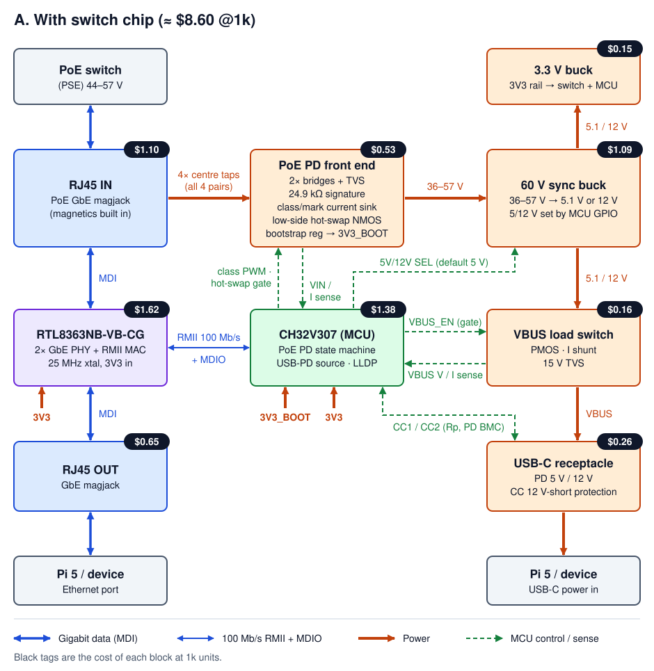
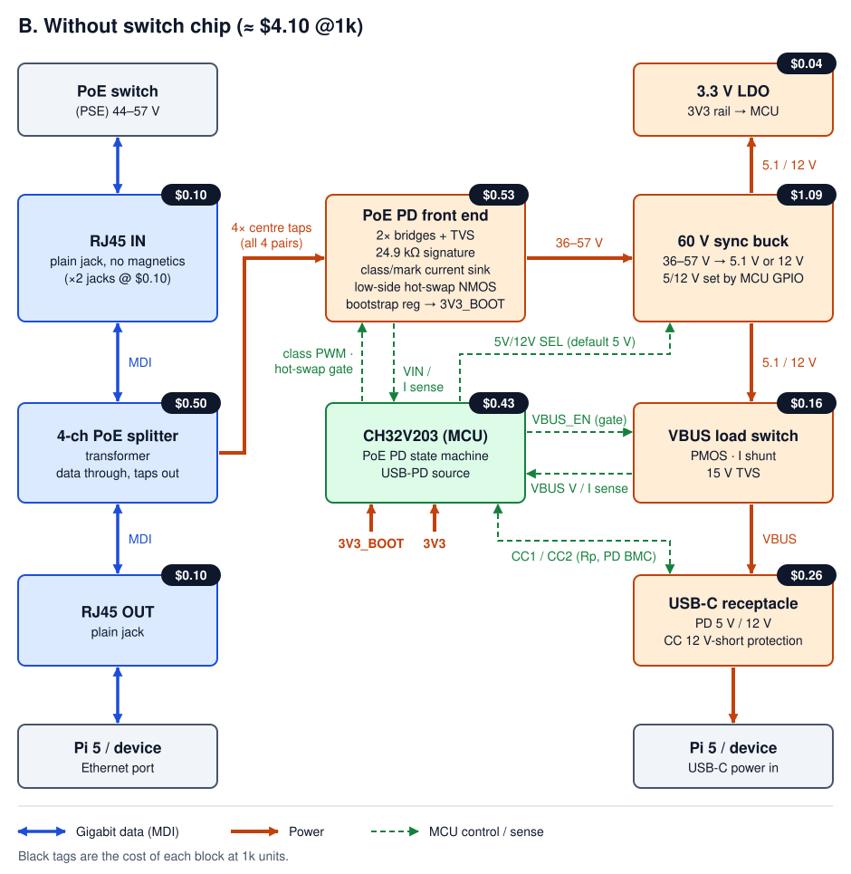
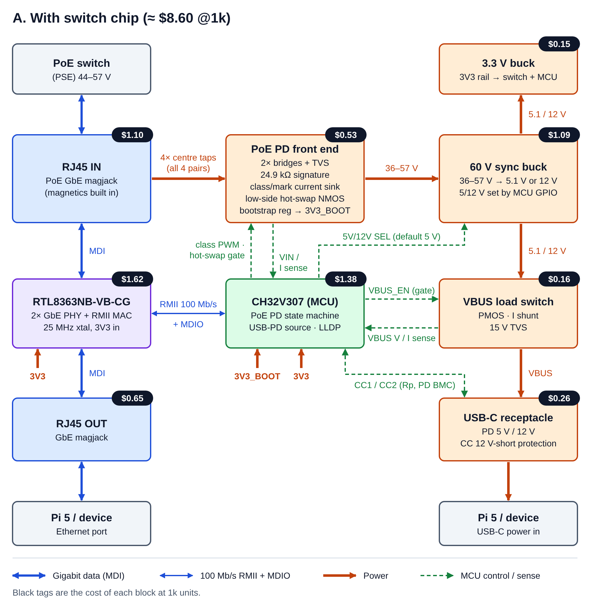

# PoE → USB-C adapter: block diagram and rough BOM cost

> **Archived.** This note is not part of the current design. It assumes an external MCU, with either an RTL8363NB switch IC or a passive Ethernet passthrough. The current design uses only the YT9215 switch IC and its internal RISC-V CPU. The [archive index](../README.md) lists every archived note.

Rough first-pass design for a 5 V and 12 V output, with prices as of 2026-10-21. Built
from [`poe.md`](../../research/poe.md), [`usb-c-pd.md`](../../research/usb-c-pd.md) and
[`ethernet-switch.md`](../research/ethernet-switch.md). Line items and per-line prices are in
[`bom-rough.csv`](bom-rough.csv). The diagrams are [`block-diagram-with-switch.svg`](block-diagram-with-switch.svg) and
[`block-diagram-without-switch.svg`](block-diagram-without-switch.svg), drawn by [`make_block_diagram.py`](make_block_diagram.py). [`svg_to_png.js`](svg_to_png.js) renders the bitmap copies.

**Pricing basis:** 1k units, LCSC parts with JLCPCB PCB + assembly. Only the
RTL8363NB price ($1.43 @1k) was checked live (in [`ethernet-switch.md`](../research/ethernet-switch.md)). Every
other price is an estimate from typical LCSC pricing for that part class and
is tagged high, medium or low confidence in [`bom-rough.csv`](bom-rough.csv). Treat the totals as ±30 %.

## Summary

| | With switch | Without switch |
|---|---|---|
| Variant | RTL8363NB with a CH32V307 | Passive passthrough |
| **Rough BOM + PCB + assembly @1k** | **≈ $8.60** | **≈ $4.10** |
| Likely range, low | $7.50 | $3.60 |
| Likely range, high | $10.50 | $5.30 |
| USB-C output: USB-PD 5 V | yes | yes |
| USB-C output: USB-PD 12 V | yes | yes |
| Gigabit to the Pi | yes | yes |
| Gigabit path | switched | passive |
| MCU on the network | yes | no |
| MCU does LLDP | yes | no |
| MCU serves stats | yes | no |
| MCU takes config over the network | yes | no |
| LLDP power negotiation | possible | no |
| Extra load on the PoE budget | ~0.5–1 W for the switch | none |
| PCB | 4-layer | 2-layer possible |

The switch costs about **$4.50 extra** per unit. Of that, $1.62 is the switch
and its crystal and passives, $0.95 is the bigger MCU, $1.05 is the second set of
magnetics, and the rest is the 4-layer board and more placements.

Adding 12 V output costs about **$0.20** per unit on either variant compared
with a 5 V-only design (see [Output voltages](#output-voltages-5-v-and-12-v)).

## Output voltages: 5 V and 12 V

The USB-C port is a USB-PD source with two fixed PDOs, **5 V and 12 V**.
That covers the Pi 5 (5 V at 5 A) and 12 V devices such as SBCs, routers,
cameras and small displays. 9, 15 and 20 V and PPS are out of scope.

### What changes in hardware compared with 5 V only

| # | Change | Alternative | Cost delta @1k |
| --- | --- | --- | ---: |
| 1 | Output voltage select | – | +$0.02 |
| 2 | Output caps | – | +$0.02 |
| 3 | VBUS PMOS drive | – | +$0.02 |
| 4 | VBUS TVS | – | +$0.01 |
| 5 | CC-pin protection against a 12 V short | A CC OVP IC | +$0.10 |
| 6 | 3.3 V rail fed from a 5–12 V rail | 16 V LDO | +$0.01–0.05 |
|  | **Total** |  | **≈ +$0.20** |

Notes on the rows of this table:

- **Output voltage select**, how: GPIO-driven NMOS adds a resistor to the buck FB divider.
- **Output voltage select**, why: Two fixed set points with no PWM "DAC".
- **Output caps**, how: Rated 16–25 V.
- **Output caps**, why: 12 V rail.
- **VBUS PMOS drive**, how: Gate zener with an NPN driver.
- **VBUS PMOS drive**, why: Keeps Vgs within limits when switching 12 V.
- **VBUS TVS**, how: 15 V part, where a 5 V-only design uses a 6–7 V part.
- **VBUS TVS**, why: Clamp level for a 12 V rail.
- **CC-pin protection against a 12 V short**, how: Series NMOS clamps.
- **CC-pin protection against a 12 V short**, why: VBUS on CC would kill 3.3 V MCU pins.
- **3.3 V rail fed from a 5–12 V rail**, how: 18 V-rated buck.
- **3.3 V rail fed from a 5–12 V rail**, why: Its source rail varies from 5 V to 12 V.

| Select GPIO state | Buck output |
|---|---|
| Low | 5 V |
| Floating | 5 V |
| High | 12 V |

Because a low or floating GPIO gives 5 V, a firmware fault can't leave 12 V
on a 5 V-only sink. VBUS can reach CC through a bad cable or a plug twist.

The buck controller, FETs and inductor do not change: 57 V → 5 V at 5 A is
still the sizing case, and 12 V is at most ~3 A. Firmware gets one extra PDO,
a GPIO toggle on Request, a VBUS-in-range check before PS_RDY, and a drop
back to 5 V on Hard Reset or detach.

### What the PoE class allows

The PDOs the adapter offers come from the PoE class it was granted (counted
class events, [`poe.md` section 4.2](../../research/poe.md#42-classification-how-much-power-do-you-want)), at roughly 90 % efficiency:

| Granted PoE class | Standard | PD input | USB-C budget | With the switch | 5 V PDO | 5 V with the Pi override | 12 V PDO |
|---|---|---|---|---|---|---|---|
| Class 3 | af | 13 W | ~11 W | – | 2.2 A | – | 0.9 A |
| Class 4 | at | 25.5 W | ~22 W | ~21 W | 3 A | 4.4 A | 1.8 A |
| Class 5 | bt | 40 W | ~35 W | – | 5 A* | – | 2.9 A |
| Class 6 | bt | 51 W | ~45 W | – | 5 A* | – | 3 A |

\* 5 A needs a captive or e-marked cable ([`usb-c-pd.md` section 5.4](../../research/usb-c-pd.md#54-cable-e-marker-for-advertising--3-a)).

**Caveat:** a 5 V + 12 V source does not follow the PD "power rules", which
expect 9 V on any source above 15 W. This only matters for certification.
Functionally, a sink that wants 12 V will request it. Phones and laptops that
only ask for 9, 15 and 20 V will fall back to 5 V, which is safe but slow.

## Block diagrams

[`block-diagram-with-switch.png`](block-diagram-with-switch.png) and [`block-diagram-without-switch.png`](block-diagram-without-switch.png) are the same figures as [the block diagrams](#block-diagram), as bitmaps:

In [the block diagrams](#block-diagram), each block is tagged with its cost @1k, and the tags of a diagram sum to its parts total. Arrowheads show signal direction, and a line with two arrowheads is bidirectional.

| | A, with switch | B, without switch |
|---|---|---|
| Block parts | $6.94 | $3.21 |
| PCB | $0.45 | $0.20 |
| PCB layers | 4 | 2 |
| JLCPCB assembly | $1.20 | $0.70 |
| MCU | CH32V307 | CH32V203 |
| MCU does PoE PD | yes | yes |
| MCU is the USB-PD source | yes | yes |
| MCU networking (LLDP) via the switch | yes | no |
| Gigabit path | switched | passive (MDI links are passive) |

All costs are USD at 1k units, LCSC and JLCPCB estimates (±30 %).

The hot-swap NMOS is low-side. The MCU and its bootstrap supply sit on VIN−, while the load side (buck, USB-C, switch) has a switched ground, so MCU I/O to the load side stays idle until the FET is on. The 36–57 V at the buck input is after cable drop and the bridges.

| Term in the diagrams | Meaning |
|---|---|
| PSE | PoE power source |
| MDI | Ethernet line side |
| RMII | MAC data bus |
| MDIO | Management bus |
| CC | USB-C configuration channel |
| Rp | Source pull-up |
| BMC | USB-PD line code |
| TVS | Surge clamp |
| 3V3_BOOT | Output of a tiny high-voltage regulator |

BMC transmit goes through a resistor divider, and BMC receive uses the MCU's on-chip op-amp as a comparator. The 3V3_BOOT regulator is on above about 12 V and supplies at most 4 mA during PoE mark events.

* **A (with switch):** RJ45 IN (PoE magjack) → RTL8363NB → RJ45 OUT. The
  CH32V307 sits on the switch's RMII port. Power path: PoE front end → 60 V
  sync buck (5 V or 12 V, selected by the MCU) → VBUS switch → USB-C.
* **B (without switch):** RJ45 IN → 4-channel PoE splitter transformer →
  RJ45 OUT ([`poe.md` section 3](../../research/poe.md#3-wiring-mode-a-mode-b-polarity-and-1000base-t) option 2; the Pi's own magnetics stay in the link).
  Option 1, back-to-back magjacks, costs about $1 more and is lower risk on
  return loss. The power path is the same as A, with a CH32V203 as the MCU.

## Cost by block (USD @1k)

| Block | With switch | Without switch |
|---|---:|---:|
| PoE front end | 0.53 | 0.53 |
| Dual-voltage output buck | 1.09 | 1.09 |
| 3.3 V logic rail | 0.15 | 0.04 |
| USB-C output | 0.42 | 0.42 |
| Ethernet magnetics and jacks | 1.75 | 0.70 |
| Switch IC with crystal and passives | 1.62 | – |
| MCU with crystal and passives | 1.38 | 0.43 |
| PCB | 0.45 | 0.20 |
| JLCPCB assembly | 1.20 | 0.70 |
| **Total** | **8.59** | **4.11** |

| Block | Contains |
|---|---|
| PoE front end | Bridges |
| PoE front end | TVS |
| PoE front end | Signature |
| PoE front end | Class sink |
| PoE front end | Bootstrap |
| PoE front end | Hot-swap |
| Output buck | Controller |
| Output buck | 2 FETs |
| Output buck | Inductor |
| Output buck | Caps |
| Output buck | FB select |
| USB-C output | Receptacle |
| USB-C output | VBUS switch |
| USB-C output | CC network |
| USB-C output | 12 V protection |
| USB-C output | ESD |
| JLCPCB assembly | Amortised setup |
| JLCPCB assembly | Extended-part fees |

Not included: enclosure (~$0.30–0.80), captive 5 A USB-C cable instead of a
receptacle (~$0.50–0.80), test and programming, shipping, duties.

## What drives the cost and where the risk is

1. **Magnetics are the biggest single uncertainty.** PoE-rated gigabit
   magjacks with centre taps vary from ~$0.70 to $2 at LCSC. Pricing these
   properly is the first thing to firm up.
2. **The 60 V buck is the second.** I assumed a cheap Chinese 60–100 V
   synchronous controller plus external FETs (~$1.09 total including the
   12 V select). An integrated 60 V 5 A converter from TI or MPS would
   be $1.50–2.50.
3. **CH32V307 is overkill as an MCU but cheap for what it brings.** It is the
   only cheap WCH part with a MAC that can talk RMII to the switch. Its price
   is an estimate ($1.10–1.60 depending on package).
4. **MCU power during PoE mark events.** [`poe.md` section 6.3](../../research/poe.md#63-the-bootstrap-problem) requires ≤ 4 mA total
   during mark events. A CH32V307 running from its internal oscillator at low
   clock may or may not fit that. If it doesn't, add a CH32V003 (~$0.12) as a
   cold-start PoE controller that wakes the CH32V307 after power-on. That adds
   about $0.15 to the switch variant.
5. **Discrete PoE front end vs a PD controller IC.** The discrete front end
   costs ~$0.53 here. Cheap PD controller ICs are roughly $0.30–1 but most only
   handle af and at, and bt-capable ones cost more. The software PD looks like a
   small cost win and the main way to get bt Class 5 and 6 cheaply, but this has
   not been verified with real quotes.
6. **Power budget.** The switch draws ~0.5–1 W (datasheet figure not found).
   On an at (PoE+) port this lowers the USB-C budget by about 1 W. On a bt
   Class 5 or Class 6 port it doesn't matter.
7. **Output voltage safety.** With 12 V possible, a firmware bug that leaves
   VBUS at 12 V on a 5 V-only sink is the main added failure mode. Mitigations:
   the buck defaults to 5 V in hardware when the select GPIO is low or
   floating, and VBUS is checked against the contract before the load switch
   closes.

## Suggested next steps

* Get real LCSC prices for 3–4 candidate magjacks and splitter transformers and
  2–3 60 V buck controllers, then update [`bom-rough.csv`](bom-rough.csv).
* Bench-check CH32V307 supply current at low clock against the 4 mA mark-event
  limit, to decide whether the CH32V003 helper is needed.
