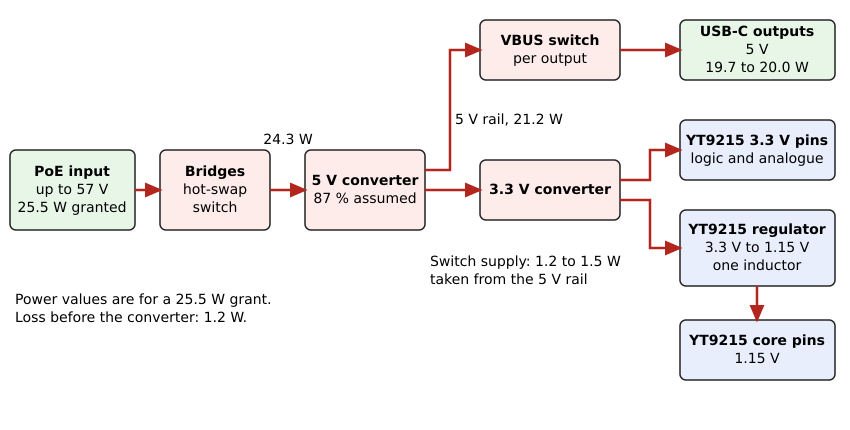

# Block diagram and BOM options

Two layouts of the adapter, each with a block diagram and a bill of materials (BOM). Both are
built around one Motorcomm YT9215 switch IC and the RISC-V CPU inside it. Every job that software
can do is given to that CPU, and each part that stays has a stated reason in
[Why each part cannot be software](#why-not-software).

| Option | RJ45 upstream | RJ45 downstream | USB-C PD outputs | Diagram | BOM |
| --- | ---: | ---: | ---: | --- | --- |
| A | 1 | 1 | 1 | [Option A](#option-a-diagram) | [BOM of option A](#bom-a) |
| B | 1 | 2 | 2 | [Option B](#option-b-diagram) | [BOM of option B](#bom-b) |

The note does not pick between alternatives. Where a block can be built in more than one way,
its section lists the ways with their cost, and the BOM states which one it counts. The USB PD
signalling has three priced builds: a [PD transceiver](#block-cc-transceiver),
[GPIO bit-bang](#block-cc-bit-bang) and the [port 9 MAC](#block-cc-mac).

## Summary

<!-- BEGIN totals -->
| Option | CC interface | Parts cost | Placements | Line items | PCB estimate | Assembly estimate | Total |
| --- | --- | ---: | ---: | ---: | ---: | ---: | ---: |
| [A](#option-a) | [PD transceiver](#block-cc-transceiver) | $5.80 | 125 | 40 | $0.40 | $1.10 | $7.30 |
| [A](#option-a) | [GPIO bit-bang](#block-cc-bit-bang) | $5.65 | 141 | 47 | $0.40 | $1.10 | $7.15 |
| [A](#option-a) | [Port 9 MAC](#block-cc-mac) | $5.68 | 147 | 48 | $0.40 | $1.10 | $7.18 |
| [B](#option-b) | [PD transceiver](#block-cc-transceiver) | $6.97 | 146 | 40 | $0.50 | $1.30 | $8.77 |
| [B](#option-b) | [GPIO bit-bang](#block-cc-bit-bang) | $6.64 | 176 | 46 | $0.50 | $1.30 | $8.44 |
| [B](#option-b) | [Port 9 MAC](#block-cc-mac) | – | – | – | – | – | – |
<!-- END totals -->

- Parts cost is the sum of the BOM rows at the [price tiers](#prices) the BOM names.
- A placement is one part put on the board. A line item is one distinct part number.
- The PCB and assembly columns are estimates [**I**](#evidence-codes) and are not BOM rows.
- The port 9 MAC serves one CC line, so it has no row for option B
  ([CC interface: port 9 MAC](#block-cc-mac)).
- With a 25.5 W PoE grant the USB-C side gets about 19.9 W in option A and about 19.7 W in
  option B, shared between its two outputs ([power budget](#power-budget)).
- 28 rows of the [assumptions table](#assumptions) wait on the three threads that study the PoE
  front end, the USB PD signalling and the CPU.

## Evidence codes

| Code | Name | Evidence |
| --- | --- | --- |
| **V** | Verified | Printed in a datasheet in [`datasheets/`](../datasheets/README.md) |
| **V** | Verified | Price and stock read from the LCSC or JLCPCB catalogue on 2026-11-19 |
| **I** | Inferred | Reasoned or estimated from other evidence |
| **U** | Unverified | Waits on bench work or on another note |

The switch datasheet is
[YT9215SCH V1.03](../datasheets/motorcomm/YT9215SCH_Datasheet_V1.03_2025-02-10.pdf). Pin numbers
in this note are those of the YT9215SCH.

## Jobs moved into software

| Job | Hardware it replaces | Runs on | Detail |
| --- | --- | --- | --- |
| Ask the PoE switch for more than 13 W | PoE controller chip with two-event detection | CPU, by LLDP | [PoE front end](#block-poe) |
| Hold downstream ports off until the grant | Supervisor and sequencing logic | CPU | [Start-up order](#start-up) |
| Hold the USB-C outputs off until the grant | Supervisor and sequencing logic | CPU | [Start-up order](#start-up) |
| Work out the USB-C offer from the grant | Fixed offer set by resistors | CPU | [Power budget](#power-budget) |
| USB PD message logic | USB PD controller chip | CPU | [CC interface](#block-cc) |
| USB PD bit timing | USB PD controller chip | CPU or port 9 MAC | [CC interface](#block-cc) |
| Share the 5 V budget between two outputs | Second converter | CPU | [USB-C power](#block-usb) |
| Switch configuration at power-on | Configuration EEPROM | Firmware image | [Switch](#block-switch) |
| Status reporting | LEDs with their resistors | CPU, over the network | [Switch](#block-switch) |
| PoE maintain-power signature | Dummy load | Switch supply current | [PoE front end](#block-poe) |

Every row depends on code running on the CPU, which is not yet shown to be possible
[**U**](#evidence-codes) ([boot](../research/yt9215-embedded-cpu.md#boot)).

## Option A: two RJ45 and one USB-C PD output

| YT9215 resource | Use |
| --- | --- |
| PHY port 0 | Upstream link with PoE input |
| PHY port 1 | Downstream link |
| PHY ports 2 to 4 | Not connected |
| CPU port 10 | LLDP frames |
| SPI flash pins | Firmware |
| One GPIO output | VBUS switch |
| I²C master 1 or port 9 pins or GPIO pins | [CC interface](#block-cc) |

Red lines carry power and black lines carry signals.

## Option B: three RJ45 and two USB-C PD outputs

| YT9215 resource | Use |
| --- | --- |
| PHY port 0 | Upstream link with PoE input |
| PHY port 1 | Downstream link 1 |
| PHY port 2 | Downstream link 2 |
| PHY ports 3 and 4 | Not connected |
| CPU port 10 | LLDP frames |
| SPI flash pins | Firmware |
| Two GPIO outputs | VBUS switches |
| I²C masters or GPIO pins | [CC interfaces](#block-cc) |

The two USB-C outputs are independent in what they negotiate and in their current limit. They
share the one 5 V converter, so both offer 5 V only and the firmware divides the budget between
them.

## Power tree

| Rail | Source | Feeds | Detail |
| --- | --- | --- | --- |
| 37 to 57 V | PoE input after the bridges | 5 V converter | [PoE front end](#block-poe) |
| 5 V | 5 V converter | USB-C outputs | [5 V converter](#block-5v) |
| 5 V | 5 V converter | 3.3 V converter | [5 V converter](#block-5v) |
| 3.3 V | 3.3 V converter | YT9215 I/O and analogue pins | [3.3 V converter](#block-3v3) |
| 1.15 V | Regulator inside the YT9215 | YT9215 core pins | [Switch](#block-switch) |

USB-C carries 5 V only. Other USB PD voltages need a converter per output with a selectable
output voltage, which adds about one [5 V converter](#block-5v) block per output
[**I**](#evidence-codes).

### Power budget

| Granted at the PoE input | Bridge loss | 5 V rail | Switch supply, option A | USB-C budget, option A | USB-C current, option A | Switch supply, option B | USB-C budget, option B | USB-C current, option B |
| ---: | ---: | ---: | ---: | ---: | ---: | ---: | ---: | ---: |
| 12.95 W | 0.6 W | 10.7 W | 1.3 W | 9.4 W | 1.9 A | 1.5 W | 9.2 W | 1.8 A |
| 25.5 W | 1.1 W | 21.2 W | 1.3 W | 19.9 W | 4.0 A | 1.5 W | 19.7 W | 3.9 A |

Every value right of the first column is an estimate [**I**](#evidence-codes):

- Bridge loss is two diode drops of 0.9 V at the lowest input voltage of each grant.
- The 5 V rail is the remainder times an assumed converter efficiency of 87 %.
- Switch supply starts from Table 28 of the switch datasheet [**V**](#evidence-codes): 663 mW
  with no link and 1613 mW with five gigabit links, so 190 mW per link. It adds the losses of
  the core regulator at an assumed 85 % and of the 3.3 V converter at an assumed 90 %.
- USB-C current in option B is the total of both outputs.

The firmware turns the budget into an offer by the rule in the
[power budget hand-off](https://github.com/mithro/budget-poe-adapter/blob/main/research/yt9215-usb-pd.md#power-budget).
Two consequences follow [**I**](#evidence-codes):

- A 25.5 W grant cannot supply 5 V at 5 A. The largest single offer is about 4 A.
- A Raspberry Pi 5 lifts its USB current limit only for a 5 A offer
  ([Raspberry Pi 5](../research/usb-c-pd.md#3-raspberry-pi-5-specifics)), so that needs a PoE grant
  above 25.5 W, which is outside this note.

### Start-up order

| Stage | Running | Off | PoE power limit |
| --- | --- | --- | ---: |
| Before the grant | Switch core with the upstream port and the CPU | Downstream ports and USB-C | 12.95 W |
| After the grant | Everything | Nothing | 25.5 W |

The stage before the grant draws about 0.9 W [**I**](#evidence-codes), far inside 12.95 W. The
USB-C side follows the
[start-up order of the USB PD note](https://github.com/mithro/budget-poe-adapter/blob/main/research/yt9215-usb-pd.md#start-up-order).
The figure shows order only, not time.

## Blocks

### Ethernet

Each port has a 24-pin LAN transformer and a plain RJ45 jack. The upstream transformer passes
the PoE current, and its four cable-side centre taps go to the
[PoE front end](#block-poe) ([wiring](../research/poe.md#3-wiring-mode-a-mode-b-polarity-and-1000base-t)).
The BOM uses one transformer part for every port to keep the line items down.

| Choice | Part | Catalogue number | Price per port | Carries PoE | Counted in the BOM |
| --- | --- | --- | ---: | --- | --- |
| Transformer with plain jack | G2415S with R-RJ45R08P-A004 | [C3003219](https://www.lcsc.com/product-detail/C3003219.html) | $0.41 | Listed as PoE | Yes |
| Transformer with plain jack | H5007NS with R-RJ45R08P-A004 | [C42418495](https://www.lcsc.com/product-detail/C42418495.html) | $0.39 | Listed as PoE | No |
| Transformer with plain jack | G24P02S with R-RJ45R08P-A004 | [C2827276](https://jlcpcb.com/partdetail/C2827276) | $0.31 | No | No |
| Jack with built-in magnetics | HR911130A | [C54408](https://www.lcsc.com/product-detail/C54408.html) | $1.61 | No | No |
| Capacitor coupling | 8 capacitors | – | $0.02 | No | No |

- The plain jack is [C385834](https://www.lcsc.com/product-detail/C385834.html), unshielded and
  without LEDs. The shielded jack with LEDs
  [C386757](https://www.lcsc.com/product-detail/C386757.html) costs $0.21.
- The PoE current rating of the G2415S and of the H5007NS is not confirmed from a datasheet
  [**U**](#evidence-codes).
- Capacitor coupling works only on a downstream port and only when the far end has its own
  transformer. It is untested here [**U**](#evidence-codes).
- Each cable-side centre tap has a 75 Ω resistor. On the upstream port each tap has its own
  1 nF 2 kV capacitor, because the taps sit at different PoE voltages. A downstream port shares
  one capacitor.

### Switch

| Variant | Catalogue number | Price | Price tier | Stock | CPU memory published | Counted in the BOM |
| --- | --- | ---: | ---: | ---: | --- | --- |
| YT9215S | [C5899183](https://www.lcsc.com/product-detail/C5899183.html) | $1.92 | 900 | 124 | No | Yes |
| YT9215SC | [C51037433](https://www.lcsc.com/product-detail/C51037433.html) | $2.89 | 900 | 139 | No | No |
| YT9215SCH | [C51045050](https://www.lcsc.com/product-detail/C51045050.html) | $9.97 | 90 | 163 | Yes | No |

The memory figures are in [Memory](../research/yt9215-embedded-cpu.md#memory). The pins of the
variants differ ([debug pins](../research/motorcomm-debug-pins.md)).

**Crystal.** The chip needs a 25 MHz reference within 50 ppm (Table 50 of the datasheet)
[**V**](#evidence-codes).

| Crystal | Catalogue number | Price | Load capacitance | Counted in the BOM |
| --- | --- | ---: | ---: | --- |
| YXC X322525MOB4SI | [C9006](https://www.lcsc.com/product-detail/C9006.html) | $0.05 | 12 pF | Yes |
| Murata XRCGB25M000F3M00R0 | [C127893](https://www.lcsc.com/product-detail/C127893.html) | $0.13 | 6 pF | No |

**Flash.** The firmware runs in place from an SPI NOR flash on pins 78, 79, 81 and 83
([boot](../research/yt9215-embedded-cpu.md#boot)). The image size is unknown
[**U**](#evidence-codes), so 4 Mbit is a guess.

| Flash | Catalogue number | Price | Size | Stock | Counted in the BOM |
| --- | --- | ---: | ---: | ---: | --- |
| Puya P25Q40SH-SSH-IT | [C2836860](https://www.lcsc.com/product-detail/C2836860.html) | $0.10 | 4 Mbit | 21,120 | Yes |
| Boya BY25Q40GVTIG | [C50176335](https://jlcpcb.com/partdetail/C50176335) | $0.05 | 4 Mbit | 200 | No |

**Straps.** Six pins need a resistor. The rest keep the level of their internal pull
(Table 19 and Table 20 of the datasheet) [**V**](#evidence-codes).

| Pin | Strap | Level needed | Internal pull | External resistor | Effect |
| ---: | --- | --- | --- | --- | --- |
| 76 | `DIS_MCU` | Low | Up | 4.7 kΩ to ground | CPU enabled |
| 77 | `DISAUTOLOAD` | Low | Up | 4.7 kΩ to ground | Loading enabled |
| 60 | `EN_SWR` | High | Not stated | 4.7 kΩ to 3.3 V | Core regulator on |
| 47 | `RESERVED_0` | High | Up | 4.7 kΩ to 3.3 V | Required by the datasheet |
| 48 | `RESERVED_1` | High | Up | 4.7 kΩ to 3.3 V | Required by the datasheet |
| 50 | `RESERVED_2` | High | Down | 4.7 kΩ to 3.3 V | Required by the datasheet |
| 75 | `EN_SPIF` | High | Up | None | Flash interface on |
| 49 | `SPF_MUX_SEL` | Low | Down | None | Flash on pins 78, 79, 81 and 83 |
| 83 | `EN_PHY` | High | Up | None | PHYs on |

The strap levels follow the [boot table](../research/motorcomm-debug-pins.md#boot-table).
Whether 4.7 kΩ overrides the internal pull-up is not confirmed [**U**](#evidence-codes).

**Supplies.** The regulator inside the chip makes the 1.15 V core rail from 3.3 V with one
external inductor, as on the
[wu-kou board](../research/switch-board-strapping.md#wk-l2). The BOM counts one 100 nF
capacitor per supply pin and two ferrite beads; the wu-kou board fits eight beads, and the
smaller number is not verified [**U**](#evidence-codes).

**Not fitted.** No LEDs, no EEPROM and no reset chip. Reset is a resistor and a capacitor.

### PoE front end

The front end is discrete and has no PoE controller chip. Its design belongs to the PoE front
end work, and the rows here are placeholders until that design exists [**U**](#evidence-codes).
The standards background is in [PoE powered device](../research/poe.md).

| Function | Parts counted | Why it is there |
| --- | --- | --- |
| Polarity bridges | 2 bridge rectifiers | Either pair set may carry either polarity |
| Surge clamp | 1 TVS diode | Cable surges |
| Detection signature | 1 resistor with 1 capacitor | The PoE switch looks for 25 kΩ before it applies power |
| Class 4 current sink | 2 transistors with 1 zener and 3 resistors | Marks the device as able to ask for 25.5 W |
| Hot-swap switch | 1 MOSFET with 1 zener, 2 resistors and 1 capacitor | Turn-on threshold and inrush limit |
| Input capacitor | 1 electrolytic capacitor | Converter input |

- The device starts at 12.95 W, and the CPU asks for 25.5 W by LLDP
  ([LLDP](../research/poe.md#45-lldp-data-link-layer-classification)).
- The class sink is on only in the classification voltage window, so it wastes nothing at 48 V.
- The switch draws more than the 10 mA a PoE switch needs to see, so no dummy load is fitted
  ([maintain power signature](../research/poe.md#44-maintain-power-signature-mps)).
- The firmware is assumed to learn the grant from LLDP alone, with no signal from the front end
  [**U**](#evidence-codes).

### 5 V converter

One converter makes 5 V for the USB-C outputs and for the 3.3 V converter. It is sized for the
25.5 W grant: 21.2 W is 4.2 A at 5 V.

| Converter | Maker | Input limit | Output current | Rectifier | Catalogue number | Price | Counted in the BOM |
| --- | --- | ---: | ---: | --- | --- | ---: | --- |
| RT6365GSP | Richtek | 60 V | 5 A | External diode | [C3024482](https://www.lcsc.com/product-detail/C3024482.html) | $0.53 | Yes |
| TPS54560DDAR-JSM | JSMSEMI | 60 V | 5 A | External diode | [C54320988](https://www.lcsc.com/product-detail/C54320988.html) | $0.50 | No |
| TX4138 | XDS | 60 V | 4 A | External diode | [C329267](https://www.lcsc.com/product-detail/C329267.html) | $0.41 | No |
| SY8513FCC | Silergy | 100 V | 3 A | External diode | [C3034281](https://www.lcsc.com/product-detail/C3034281.html) | $0.58 | No |
| SCT2650STER | SCT | 60 V | 5 A | External diode | [C2840771](https://www.lcsc.com/product-detail/C2840771.html) | $1.77 | No |
| EG1163S | EGmicro | 600 V | Set by its MOSFETs | 2 external MOSFETs | [C480648](https://jlcpcb.com/partdetail/C480648) | $0.43 | No |

- A 58 V surge clamp lets the input rise to 93.6 V at its rated surge current
  [**V**](#evidence-codes), above a 60 V part. Whether a 60 V converter survives depends on the
  PoE front end [**U**](#evidence-codes). The 100 V part in the table stops at 3 A, which is 15 W.
- No 100 V converter with built-in switches and 5 A output was found in the two catalogues.
- A converter with a diode rectifier loses about 2 W in the diode at 4.2 A
  [**I**](#evidence-codes). The EG1163S with two MOSFETs avoids that and needs its own supply of
  10 V or more.
- The feedback, frequency and compensation parts are counted and their values are not chosen.

### 3.3 V converter

The switch takes about 1.1 to 1.3 W at 3.3 V, core regulator included
([power budget](#power-budget)).

| Choice | Part | Catalogue number | Price with its inductor | Loss at 0.4 A | Counted in the BOM |
| --- | --- | --- | ---: | ---: | --- |
| Buck converter | MT2492 | [C89358](https://www.lcsc.com/product-detail/C89358.html) | $0.09 | 0.15 W | Yes |
| Linear regulator | Not selected | – | $0.03 | 0.7 W | No |

The MT2492 with its 4.7 µH inductor is the 3.3 V supply of the
[wu-kou board](../research/switch-board-strapping.md#wk-u1). The losses and the linear regulator
price are estimates [**I**](#evidence-codes).

### USB-C power

**VBUS switching.** Each output has a switch that is off at reset and that a GPIO turns on.

| Choice | Parts | Catalogue number | Price | Current limit | Counted in the BOM |
| --- | --- | --- | ---: | --- | --- |
| P-channel MOSFET with driver | AO4407A with DTC143ZCA and 1 resistor | [C16072](https://www.lcsc.com/product-detail/C16072.html) | $0.18 | None | Option A |
| Current-limited switch | SY6280AAC with 2 resistors | [C55136](https://www.lcsc.com/product-detail/C55136.html) | $0.05 | Set by a resistor up to 2 A | Option B |
| Small P-channel MOSFET with driver | AO3401A with DTC143ZCA and 1 resistor | [C15127](https://www.lcsc.com/product-detail/C15127.html) | $0.07 | None | No |

- The driver transistor is [C15236](https://www.lcsc.com/product-detail/C15236.html). Its
  built-in base resistors hold the switch off while the GPIO floats.
- In option A the current limit of the 5 V converter is the only limit, and it sits near the
  largest offer.
- In option B one converter feeds two outputs, so each output needs its own limit.
- The chip has no ADC, so the firmware cannot measure current. A fixed limit does not enforce
  an offer below it.
- No switch with a limit near 4 A and a price near $0.05 was found.

**Discharge.** A 1 kΩ resistor from VBUS to ground discharges the output after the switch
opens. It costs 25 mW while the output is on and replaces a discharge transistor
[**I**](#evidence-codes).

**Protection.** The BOM has no ESD diode on VBUS or CC and no reverse-current block. The CC
pins of the software builds have a series resistor and a clamp diode.

**Connector.**

| Choice | Part | Catalogue number | Price | Current | CC wires | Counted in the BOM |
| --- | --- | --- | ---: | ---: | ---: | --- |
| Captive cable | Not selected | – | $0.40 | 5 A | 1 | Yes |
| 6-pin receptacle | TYPE-C 6P | [C456012](https://www.lcsc.com/product-detail/C456012.html) | $0.02 | 3 A | 2 | No |
| 16-pin receptacle | TYPE-C-31-M-12 | [C165948](https://www.lcsc.com/product-detail/C165948.html) | $0.10 | 5 A | 2 | No |

- The cable price is an estimate [**I**](#evidence-codes).
- A receptacle may offer more than 3 A only after reading the cable marker, which the design
  does not do ([captive cable](https://github.com/mithro/budget-poe-adapter/blob/main/research/yt9215-usb-pd.md#captive-cable)).
- A PD transceiver handles both CC wires of a receptacle. The two software builds need their
  CC parts twice for a receptacle.

### CC interface

The CC interface detects the sink, advertises current and carries the USB PD messages. The
three builds come from
[USB-C PD from the YT9215 alone](https://github.com/mithro/budget-poe-adapter/blob/main/research/yt9215-usb-pd.md),
which holds the detail and the open questions of each.

| Build | PD bit timing done by | Outputs it can serve | Parts per output | Cost per output | Detail in the USB PD note |
| --- | --- | ---: | ---: | ---: | --- |
| [PD transceiver](#block-cc-transceiver) | Transceiver chip | 2 | 4 | $0.41 | [Option A](https://github.com/mithro/budget-poe-adapter/blob/main/research/yt9215-usb-pd.md#option-a) |
| [GPIO bit-bang](#block-cc-bit-bang) | CPU timing loops | 2 | 20 | $0.27 | [Option B](https://github.com/mithro/budget-poe-adapter/blob/main/research/yt9215-usb-pd.md#option-b) |
| [Port 9 MAC](#block-cc-mac) | MAC of port 9 | 1 | 26 | $0.30 | [Option C](https://github.com/mithro/budget-poe-adapter/blob/main/research/yt9215-usb-pd.md#option-c) |

The option letters of the USB PD note name CC builds and are not the options A and B of this
note.

**PD transceiver.** One FUSB302B per output on an I²C master of the YT9215.

| Transceiver | I²C address | Catalogue number | Price | Stock | Counted in the BOM |
| --- | --- | --- | ---: | ---: | --- |
| FUSB302BMPX | 0x22 | [C132291](https://www.lcsc.com/product-detail/C132291.html) | $0.41 | 16,532 | Yes |
| FUSB302B01MPX | 0x23 | [C488155](https://www.lcsc.com/product-detail/C488155.html) | $1.16 | 60 | No |

- Option B needs two transceivers that do not share an address. The BOM counts two FUSB302BMPX,
  one on each I²C master. I²C master 2 uses pin 81, which is also a flash pin, so the flash
  then moves to the other pin group [**U**](#evidence-codes).
- The second address variant on one I²C master avoids that and costs $0.75 more.
- The addresses are from memory of the onsemi datasheet and are not checked
  [**U**](#evidence-codes).

**GPIO bit-bang.** A buffer drives CC, a fast comparator slices it, and the CPU times every
edge. It needs GPIO registers and a timer that are not published [**U**](#evidence-codes).

**Port 9 MAC.** The MAC of extension port 9 clocks the PD bits out at 10 Mbit/s and samples
them in. The chip has one such MAC, and it captures one CC line at a time, so this build serves
one output and has no option B column.

The part choices of the two software builds are candidates picked for this note and are not
tested [**U**](#evidence-codes):

| Function | Candidate | Catalogue number | Price | Requirement | Met |
| --- | --- | --- | ---: | --- | --- |
| BMC driver buffer | 74AUP1G126GW-TP | [C51886129](https://www.lcsc.com/product-detail/C51886129.html) | $0.03 | Disabled output tolerates 3.3 V at a 1.15 V supply | Not confirmed |
| Slicer and attach comparator | TP1942-SR | [C248572](https://www.lcsc.com/product-detail/C248572.html) | $0.17 | Delay of 200 ns or less | 68 ns listed |
| VBUS at 0 V comparator | LM393DR2G | [C7955](https://www.lcsc.com/product-detail/C7955.html) | $0.03 | Slow | Yes |
| Buffer reset gate | SN74AUP1G08DCKR | [C7394036](https://www.lcsc.com/product-detail/C7394036.html) | $0.02 | Port 9 MAC build only | Yes |

## Why each part cannot be software

| Part | Block | Reason |
| --- | --- | --- |
| RJ45 jack | [Ethernet](#block-ethernet) | Mechanical connection |
| LAN transformer | [Ethernet](#block-ethernet) | Keeps 48 V off the PHY pins and brings out the PoE centre taps |
| Line termination | [Ethernet](#block-ethernet) | Analogue line matching |
| Switch IC | [Switch](#block-switch) | It is the computer that runs the software |
| Crystal | [Switch](#block-switch) | The CPU has no clock without it |
| Flash | [Switch](#block-switch) | Stores the software |
| Strap resistors | [Switch](#block-switch) | Read at reset before any code runs |
| Reset resistor and capacitor | [Switch](#block-switch) | Act before any code runs |
| Supply capacitors and beads | [Switch](#block-switch) | Energy storage and filtering |
| Core regulator inductor | [Switch](#block-switch) | Energy storage |
| Polarity bridges | [PoE front end](#block-poe) | Needed before the chip has power |
| Surge clamp | [PoE front end](#block-poe) | Acts in nanoseconds |
| Detection signature | [PoE front end](#block-poe) | Measured before power is applied |
| Class sink | [PoE front end](#block-poe) | Works before the chip has power |
| Hot-swap switch | [PoE front end](#block-poe) | Limits inrush before the CPU runs |
| Input capacitor | [PoE front end](#block-poe) | Energy storage |
| 5 V converter | [5 V converter](#block-5v) | Power conversion |
| 3.3 V converter | [3.3 V converter](#block-3v3) | Power conversion |
| VBUS switch | [USB-C power](#block-usb) | Carries 4 A and must be off without firmware |
| VBUS bleed resistor | [USB-C power](#block-usb) | Discharges VBUS with no firmware action |
| Cable or connector | [USB-C power](#block-usb) | Mechanical connection |
| Rp resistors | [CC interface](#block-cc) | Set an analogue current; software switches them |
| Comparators | [CC interface](#block-cc) | Chip inputs need 2.0 V and CC swings 1.1 V |
| BMC driver buffer | [CC interface](#block-cc) | Chip outputs swing 3.3 V and CC needs 1.1 V |
| CC series resistor and clamp | [CC interface](#block-cc) | Chip pins do not tolerate 5 V |
| PD transceiver | [CC interface](#block-cc) | Replaced by software in the two other builds |

## Bills of materials

- Prices are in US dollars, read from the LCSC and JLCPCB catalogues on 2026-11-19
  [**V**](#evidence-codes).
- The price tier is the order quantity the unit price belongs to. It is the first tier at
  1,000 pieces or more, or the highest tier the catalogue lists.
- A row with the price source "Estimate" has no selected part [**I**](#evidence-codes).
- Each option has one table of parts that are always fitted and one table per
  [CC interface](#block-cc) build. A complete BOM is the first table with one of the others.
- The same rows are in [`bom-option-a.csv`](block-diagram-and-bom/bom-option-a.csv) and
  [`bom-option-b.csv`](block-diagram-and-bom/bom-option-b.csv).

### BOM of option A

Parts that are always fitted:

<!-- BEGIN bom-a-base -->
| Block | Function | Part | Maker | Package | Value | Catalogue number | Quantity | Unit price | Price source | Price tier | Line cost |
| --- | --- | --- | --- | --- | --- | --- | ---: | ---: | --- | ---: | ---: |
| [Ethernet](#block-ethernet) | RJ45 jack | R-RJ45R08P-A004 | Ckmtw | Through-hole | – | [C385834](https://www.lcsc.com/product-detail/C385834.html) | 2 | $0.1049 | LCSC | 992 | $0.2098 |
| [Ethernet](#block-ethernet) | LAN transformer | G2415S | CND-tek | SMD 24-pin | 350 µH | [C3003219](https://www.lcsc.com/product-detail/C3003219.html) | 2 | $0.3006 | LCSC | 850 | $0.6012 |
| [Ethernet](#block-ethernet) | Line termination resistor | 0402WGF750JTCE | Uni-Royal | 0402 | 75 Ω | [C25133](https://www.lcsc.com/product-detail/C25133.html) | 8 | $0.0010 | LCSC | 1,000 | $0.0080 |
| [Ethernet](#block-ethernet) | Line termination capacitor | 1206B102K202NT | FH | 1206 | 1 nF 2 kV | [C9196](https://www.lcsc.com/product-detail/C9196.html) | 5 | $0.0105 | LCSC | 3,000 | $0.0525 |
| [Ethernet](#block-ethernet) | Chip-side centre-tap capacitor | CL05B104KO5NNNC | Samsung | 0402 | 100 nF 16 V | [C1525](https://www.lcsc.com/product-detail/C1525.html) | 8 | $0.0018 | LCSC | 1,000 | $0.0144 |
| [Switch](#block-switch) | Switch IC with CPU | YT9215S | Motorcomm | LQFP-128 | – | [C5899183](https://www.lcsc.com/product-detail/C5899183.html) | 1 | $1.9221 | LCSC | 900 | $1.9221 |
| [Switch](#block-switch) | Crystal | X322525MOB4SI | YXC | 3.2 × 2.5 mm | 25 MHz | [C9006](https://www.lcsc.com/product-detail/C9006.html) | 1 | $0.0505 | LCSC | 3,000 | $0.0505 |
| [Switch](#block-switch) | Crystal load capacitor | 0402CG180J500NT | FH | 0402 | 18 pF | [C1549](https://www.lcsc.com/product-detail/C1549.html) | 2 | $0.0014 | LCSC | 1,000 | $0.0028 |
| [Switch](#block-switch) | Firmware flash | P25Q40SH-SSH-IT | Puya | SOP-8 | 4 Mbit | [C2836860](https://www.lcsc.com/product-detail/C2836860.html) | 1 | $0.1001 | LCSC | 2,500 | $0.1001 |
| [Switch](#block-switch) | Supply pin capacitor | CL05B104KO5NNNC | Samsung | 0402 | 100 nF 16 V | [C1525](https://www.lcsc.com/product-detail/C1525.html) | 28 | $0.0018 | LCSC | 1,000 | $0.0504 |
| [Switch](#block-switch) | Supply bulk capacitor | CL10A106KP8NNNC | Samsung | 0603 | 10 µF 10 V | [C19702](https://www.lcsc.com/product-detail/C19702.html) | 4 | $0.0107 | LCSC | 4,000 | $0.0428 |
| [Switch](#block-switch) | Analogue supply bead | BLM18KG221SN1D | Murata | 0603 | 220 Ω | [C88980](https://www.lcsc.com/product-detail/C88980.html) | 2 | $0.0291 | LCSC | 4,000 | $0.0582 |
| [Switch](#block-switch) | Core regulator inductor | SWPA4018S2R2MT | Sunlord | 4 × 4 mm | 2.2 µH | [C50543](https://jlcpcb.com/partdetail/C50543) | 1 | $0.0600 | Estimate | – | $0.0600 |
| [Switch](#block-switch) | Core regulator capacitor | CL10A106KP8NNNC | Samsung | 0603 | 10 µF 10 V | [C19702](https://www.lcsc.com/product-detail/C19702.html) | 2 | $0.0107 | LCSC | 4,000 | $0.0214 |
| [Switch](#block-switch) | Strap resistor | 0402WGF4701TCE | Uni-Royal | 0402 | 4.7 kΩ | [C25900](https://www.lcsc.com/product-detail/C25900.html) | 6 | $0.0013 | LCSC | 1,000 | $0.0078 |
| [Switch](#block-switch) | Reset resistor | 0402WGF1002TCE | Uni-Royal | 0402 | 10 kΩ | [C25744](https://www.lcsc.com/product-detail/C25744.html) | 1 | $0.0011 | LCSC | 1,000 | $0.0011 |
| [Switch](#block-switch) | Reset capacitor | CL05A105KA5NQNC | Samsung | 0402 | 1 µF 25 V | [C52923](https://www.lcsc.com/product-detail/C52923.html) | 1 | $0.0042 | LCSC | 1,000 | $0.0042 |
| [PoE front end](#block-poe) | Polarity bridge | MB10S-50MIL | MDD | MBS | 1 A | [C2488](https://www.lcsc.com/product-detail/C2488.html) | 2 | $0.0145 | LCSC | 3,000 | $0.0290 |
| [PoE front end](#block-poe) | Surge clamp | SMAJ58A | Goodwork | SMA | 58 V | [C2980408](https://www.lcsc.com/product-detail/C2980408.html) | 1 | $0.0186 | LCSC | 2,000 | $0.0186 |
| [PoE front end](#block-poe) | Signature resistor | Not selected | Not selected | 0603 | 24.9 kΩ | – | 1 | $0.0015 | Estimate | – | $0.0015 |
| [PoE front end](#block-poe) | Signature capacitor | Not selected | Not selected | 0805 | 100 nF 100 V | – | 1 | $0.0100 | Estimate | – | $0.0100 |
| [PoE front end](#block-poe) | Class sink transistor | MMBT3904 | ST (Semtech) | SOT-23 | 40 V | [C84104](https://www.lcsc.com/product-detail/C84104.html) | 2 | $0.0074 | LCSC | 3,000 | $0.0148 |
| [PoE front end](#block-poe) | Class sink window zener | BZT52C15 | Goodwork | SOD-123 | 15 V | [C2932746](https://www.lcsc.com/product-detail/C2932746.html) | 1 | $0.0099 | LCSC | 3,000 | $0.0099 |
| [PoE front end](#block-poe) | Class sink resistor | Not selected | Not selected | 0402 | Set at schematic | – | 3 | $0.0011 | Estimate | – | $0.0033 |
| [PoE front end](#block-poe) | Hot-swap MOSFET | NCE0130KA | NCE | TO-252 | 100 V | [C502817](https://www.lcsc.com/product-detail/C502817.html) | 1 | $0.3143 | LCSC | 2,500 | $0.3143 |
| [PoE front end](#block-poe) | Gate clamp zener | BZT52C15 | Goodwork | SOD-123 | 15 V | [C2932746](https://www.lcsc.com/product-detail/C2932746.html) | 1 | $0.0099 | LCSC | 3,000 | $0.0099 |
| [PoE front end](#block-poe) | Turn-on threshold resistor | Not selected | Not selected | 0402 | Set at schematic | – | 2 | $0.0011 | Estimate | – | $0.0022 |
| [PoE front end](#block-poe) | Gate capacitor | CL05B104KB54PNC | Samsung | 0402 | 100 nF 50 V | [C307331](https://www.lcsc.com/product-detail/C307331.html) | 1 | $0.0064 | LCSC | 1,000 | $0.0064 |
| [PoE front end](#block-poe) | Input bulk capacitor | ERM1KM220E12OT | Aishi | 6.3 × 12 mm | 22 µF 100 V | [C106608](https://www.lcsc.com/product-detail/C106608.html) | 1 | $0.0250 | LCSC | 1,000 | $0.0250 |
| [5 V converter](#block-5v) | Converter IC | RT6365GSP | Richtek | SOP-8-EP | 60 V 5 A | [C3024482](https://www.lcsc.com/product-detail/C3024482.html) | 1 | $0.5319 | LCSC | 1,000 | $0.5319 |
| [5 V converter](#block-5v) | Catch diode | SS56 | MDD | SMA | 60 V 5 A | [C65009](https://www.lcsc.com/product-detail/C65009.html) | 1 | $0.0353 | LCSC | 1,000 | $0.0353 |
| [5 V converter](#block-5v) | Inductor | MWSA1005S-100MT | Sunlord | 11.5 × 10 mm | 10 µH | [C17700185](https://jlcpcb.com/partdetail/C17700185) | 1 | $0.1786 | JLCPCB | 5,000 | $0.1786 |
| [5 V converter](#block-5v) | Input capacitor | CS3225X7R225K101NRK | Samwha | 1210 | 2.2 µF 100 V | [C2900749](https://www.lcsc.com/product-detail/C2900749.html) | 2 | $0.0658 | LCSC | 2,000 | $0.1316 |
| [5 V converter](#block-5v) | Output capacitor | CL31A226KAHNNNE | Samsung | 1206 | 22 µF 25 V | [C12891](https://www.lcsc.com/product-detail/C12891.html) | 2 | $0.0646 | LCSC | 2,000 | $0.1292 |
| [5 V converter](#block-5v) | Bootstrap capacitor | CL05B104KO5NNNC | Samsung | 0402 | 100 nF 16 V | [C1525](https://www.lcsc.com/product-detail/C1525.html) | 1 | $0.0018 | LCSC | 1,000 | $0.0018 |
| [5 V converter](#block-5v) | Feedback resistor | Not selected | Not selected | 0402 | Set at schematic | – | 2 | $0.0011 | Estimate | – | $0.0022 |
| [5 V converter](#block-5v) | Frequency resistor | Not selected | Not selected | 0402 | Set at schematic | – | 1 | $0.0011 | Estimate | – | $0.0011 |
| [5 V converter](#block-5v) | Compensation resistor | Not selected | Not selected | 0402 | Set at schematic | – | 1 | $0.0011 | Estimate | – | $0.0011 |
| [5 V converter](#block-5v) | Compensation capacitor | Not selected | Not selected | 0402 | Set at schematic | – | 2 | $0.0020 | Estimate | – | $0.0040 |
| [3.3 V converter](#block-3v3) | Converter IC | MT2492 | Aerosemi | SOT-23-6 | 2 A | [C89358](https://www.lcsc.com/product-detail/C89358.html) | 1 | $0.0361 | LCSC | 1,000 | $0.0361 |
| [3.3 V converter](#block-3v3) | Inductor | SWPA4030S4R7NT | Sunlord | 4 × 4 mm | 4.7 µH | [C193025](https://jlcpcb.com/partdetail/C193025) | 1 | $0.0563 | JLCPCB | 10,000 | $0.0563 |
| [3.3 V converter](#block-3v3) | Feedback top resistor | 0402WGF1802TCE | Uni-Royal | 0402 | 18 kΩ | [C25762](https://www.lcsc.com/product-detail/C25762.html) | 1 | $0.0011 | LCSC | 1,000 | $0.0011 |
| [3.3 V converter](#block-3v3) | Feedback bottom resistor | 0402WGF2001TCE | Uni-Royal | 0402 | 2 kΩ | [C4109](https://www.lcsc.com/product-detail/C4109.html) | 2 | $0.0015 | LCSC | 1,000 | $0.0030 |
| [3.3 V converter](#block-3v3) | Input capacitor | CL10A106KP8NNNC | Samsung | 0603 | 10 µF 10 V | [C19702](https://www.lcsc.com/product-detail/C19702.html) | 1 | $0.0107 | LCSC | 4,000 | $0.0107 |
| [3.3 V converter](#block-3v3) | Output capacitor | CL10A106KP8NNNC | Samsung | 0603 | 10 µF 10 V | [C19702](https://www.lcsc.com/product-detail/C19702.html) | 2 | $0.0107 | LCSC | 4,000 | $0.0214 |
| [3.3 V converter](#block-3v3) | Bootstrap capacitor | CL05B104KO5NNNC | Samsung | 0402 | 100 nF 16 V | [C1525](https://www.lcsc.com/product-detail/C1525.html) | 1 | $0.0018 | LCSC | 1,000 | $0.0018 |
| [USB-C power](#block-usb) | VBUS switch MOSFET | AO4407A | AOS | SOIC-8 | 30 V 12 A | [C16072](https://www.lcsc.com/product-detail/C16072.html) | 1 | $0.1683 | LCSC | 3,000 | $0.1683 |
| [USB-C power](#block-usb) | VBUS switch driver | DTC143ZCA | JSCJ | SOT-23 | 4.7 kΩ 47 kΩ | [C15236](https://www.lcsc.com/product-detail/C15236.html) | 1 | $0.0142 | LCSC | 3,000 | $0.0142 |
| [USB-C power](#block-usb) | VBUS gate pull-up | 0402WGF1002TCE | Uni-Royal | 0402 | 10 kΩ | [C25744](https://www.lcsc.com/product-detail/C25744.html) | 1 | $0.0011 | LCSC | 1,000 | $0.0011 |
| [USB-C power](#block-usb) | VBUS bleed resistor | 0402WGF1001TCE | Uni-Royal | 0402 | 1 kΩ | [C11702](https://www.lcsc.com/product-detail/C11702.html) | 1 | $0.0011 | LCSC | 1,000 | $0.0011 |
| [USB-C power](#block-usb) | VBUS capacitor | CL05A105KA5NQNC | Samsung | 0402 | 1 µF 25 V | [C52923](https://www.lcsc.com/product-detail/C52923.html) | 1 | $0.0042 | LCSC | 1,000 | $0.0042 |
| [USB-C power](#block-usb) | Captive cable | USB-C plug on a cable | Not selected | Soldered wires | 5 A | – | 1 | $0.4000 | Estimate | – | $0.4000 |
<!-- END bom-a-base -->

Added for the [PD transceiver](#block-cc-transceiver) build:

<!-- BEGIN bom-a-transceiver -->
| Block | Function | Part | Maker | Package | Value | Catalogue number | Quantity | Unit price | Price source | Price tier | Line cost |
| --- | --- | --- | --- | --- | --- | --- | ---: | ---: | --- | ---: | ---: |
| [CC interface: PD transceiver](#block-cc-transceiver) | PD transceiver | FUSB302BMPX | onsemi | WQFN-14 | – | [C132291](https://www.lcsc.com/product-detail/C132291.html) | 1 | $0.4080 | LCSC | 1,000 | $0.4080 |
| [CC interface: PD transceiver](#block-cc-transceiver) | I²C pull-up | 0402WGF4701TCE | Uni-Royal | 0402 | 4.7 kΩ | [C25900](https://www.lcsc.com/product-detail/C25900.html) | 2 | $0.0013 | LCSC | 1,000 | $0.0026 |
| [CC interface: PD transceiver](#block-cc-transceiver) | Supply pin capacitor | CL05B104KO5NNNC | Samsung | 0402 | 100 nF 16 V | [C1525](https://www.lcsc.com/product-detail/C1525.html) | 1 | $0.0018 | LCSC | 1,000 | $0.0018 |
<!-- END bom-a-transceiver -->

Added for the [GPIO bit-bang](#block-cc-bit-bang) build:

<!-- BEGIN bom-a-bit-bang -->
| Block | Function | Part | Maker | Package | Value | Catalogue number | Quantity | Unit price | Price source | Price tier | Line cost |
| --- | --- | --- | --- | --- | --- | --- | ---: | ---: | --- | ---: | ---: |
| [CC interface: GPIO bit-bang](#block-cc-bit-bang) | BMC driver buffer | 74AUP1G126GW-TP | Tech Public | SOT-353 | – | [C51886129](https://www.lcsc.com/product-detail/C51886129.html) | 1 | $0.0304 | LCSC | 3,000 | $0.0304 |
| [CC interface: GPIO bit-bang](#block-cc-bit-bang) | Receiver capacitor | Not selected | Not selected | 0402 | Set at schematic | – | 1 | $0.0020 | Estimate | – | $0.0020 |
| [CC interface: GPIO bit-bang](#block-cc-bit-bang) | Driver series resistor | 0402WGF470JTCE | Uni-Royal | 0402 | 47 Ω | [C25118](https://www.lcsc.com/product-detail/C25118.html) | 1 | $0.0009 | LCSC | 1,000 | $0.0009 |
| [CC interface: GPIO bit-bang](#block-cc-bit-bang) | Fast dual comparator | TP1942-SR | 3PEAK | SOIC-8 | 68 ns | [C248572](https://www.lcsc.com/product-detail/C248572.html) | 1 | $0.1742 | LCSC | 2,500 | $0.1742 |
| [CC interface: GPIO bit-bang](#block-cc-bit-bang) | Threshold divider resistor | Not selected | Not selected | 0402 | Set at schematic | – | 4 | $0.0011 | Estimate | – | $0.0044 |
| [CC interface: GPIO bit-bang](#block-cc-bit-bang) | CC series resistor | 0402WGF1001TCE | Uni-Royal | 0402 | 1 kΩ | [C11702](https://www.lcsc.com/product-detail/C11702.html) | 1 | $0.0011 | LCSC | 1,000 | $0.0011 |
| [CC interface: GPIO bit-bang](#block-cc-bit-bang) | CC clamp diode | BAV99 | R+O | SOT-23 | 70 V | [C7420336](https://www.lcsc.com/product-detail/C7420336.html) | 1 | $0.0080 | LCSC | 3,000 | $0.0080 |
| [CC interface: GPIO bit-bang](#block-cc-bit-bang) | Rp for 1.5 A | 0402WGF1202TCE | Uni-Royal | 0402 | 12 kΩ | [C25752](https://www.lcsc.com/product-detail/C25752.html) | 1 | $0.0010 | LCSC | 1,000 | $0.0010 |
| [CC interface: GPIO bit-bang](#block-cc-bit-bang) | Rp step to 3 A | 0402WGF7501TCE | Uni-Royal | 0402 | 7.5 kΩ | [C25918](https://www.lcsc.com/product-detail/C25918.html) | 1 | $0.0017 | LCSC | 1,000 | $0.0017 |
| [CC interface: GPIO bit-bang](#block-cc-bit-bang) | Slow dual comparator | LM393DR2G | onsemi | SOIC-8 | 1.3 µs | [C7955](https://www.lcsc.com/product-detail/C7955.html) | 1 | $0.0323 | LCSC | 2,500 | $0.0323 |
| [CC interface: GPIO bit-bang](#block-cc-bit-bang) | VBUS threshold resistor | Not selected | Not selected | 0402 | Set at schematic | – | 2 | $0.0011 | Estimate | – | $0.0022 |
| [CC interface: GPIO bit-bang](#block-cc-bit-bang) | Comparator output pull-up | 0402WGF1002TCE | Uni-Royal | 0402 | 10 kΩ | [C25744](https://www.lcsc.com/product-detail/C25744.html) | 1 | $0.0011 | LCSC | 1,000 | $0.0011 |
| [CC interface: GPIO bit-bang](#block-cc-bit-bang) | Buffer enable pull-down | 0402WGF1003TCE | Uni-Royal | 0402 | 100 kΩ | [C25741](https://www.lcsc.com/product-detail/C25741.html) | 1 | $0.0007 | LCSC | 1,000 | $0.0007 |
| [CC interface: GPIO bit-bang](#block-cc-bit-bang) | Supply pin capacitor | CL05B104KO5NNNC | Samsung | 0402 | 100 nF 16 V | [C1525](https://www.lcsc.com/product-detail/C1525.html) | 3 | $0.0018 | LCSC | 1,000 | $0.0054 |
<!-- END bom-a-bit-bang -->

Added for the [port 9 MAC](#block-cc-mac) build:

<!-- BEGIN bom-a-mac -->
| Block | Function | Part | Maker | Package | Value | Catalogue number | Quantity | Unit price | Price source | Price tier | Line cost |
| --- | --- | --- | --- | --- | --- | --- | ---: | ---: | --- | ---: | ---: |
| [CC interface: port 9 MAC](#block-cc-mac) | BMC driver buffer | 74AUP1G126GW-TP | Tech Public | SOT-353 | – | [C51886129](https://www.lcsc.com/product-detail/C51886129.html) | 1 | $0.0304 | LCSC | 3,000 | $0.0304 |
| [CC interface: port 9 MAC](#block-cc-mac) | Buffer reset gate | SN74AUP1G08DCKR | UMW | SC-70-5 | – | [C7394036](https://www.lcsc.com/product-detail/C7394036.html) | 1 | $0.0240 | LCSC | 3,000 | $0.0240 |
| [CC interface: port 9 MAC](#block-cc-mac) | Receiver capacitor | Not selected | Not selected | 0402 | Set at schematic | – | 1 | $0.0020 | Estimate | – | $0.0020 |
| [CC interface: port 9 MAC](#block-cc-mac) | Driver series resistor | 0402WGF470JTCE | Uni-Royal | 0402 | 47 Ω | [C25118](https://www.lcsc.com/product-detail/C25118.html) | 1 | $0.0009 | LCSC | 1,000 | $0.0009 |
| [CC interface: port 9 MAC](#block-cc-mac) | Fast dual comparator | TP1942-SR | 3PEAK | SOIC-8 | 68 ns | [C248572](https://www.lcsc.com/product-detail/C248572.html) | 1 | $0.1742 | LCSC | 2,500 | $0.1742 |
| [CC interface: port 9 MAC](#block-cc-mac) | Threshold divider resistor | Not selected | Not selected | 0402 | Set at schematic | – | 4 | $0.0011 | Estimate | – | $0.0044 |
| [CC interface: port 9 MAC](#block-cc-mac) | CC series resistor | 0402WGF1001TCE | Uni-Royal | 0402 | 1 kΩ | [C11702](https://www.lcsc.com/product-detail/C11702.html) | 1 | $0.0011 | LCSC | 1,000 | $0.0011 |
| [CC interface: port 9 MAC](#block-cc-mac) | CC clamp diode | BAV99 | R+O | SOT-23 | 70 V | [C7420336](https://www.lcsc.com/product-detail/C7420336.html) | 1 | $0.0080 | LCSC | 3,000 | $0.0080 |
| [CC interface: port 9 MAC](#block-cc-mac) | Rp for 1.5 A | 0402WGF1202TCE | Uni-Royal | 0402 | 12 kΩ | [C25752](https://www.lcsc.com/product-detail/C25752.html) | 1 | $0.0010 | LCSC | 1,000 | $0.0010 |
| [CC interface: port 9 MAC](#block-cc-mac) | Rp step to 3 A | 0402WGF7501TCE | Uni-Royal | 0402 | 7.5 kΩ | [C25918](https://www.lcsc.com/product-detail/C25918.html) | 1 | $0.0017 | LCSC | 1,000 | $0.0017 |
| [CC interface: port 9 MAC](#block-cc-mac) | Slow dual comparator | LM393DR2G | onsemi | SOIC-8 | 1.3 µs | [C7955](https://www.lcsc.com/product-detail/C7955.html) | 1 | $0.0323 | LCSC | 2,500 | $0.0323 |
| [CC interface: port 9 MAC](#block-cc-mac) | VBUS threshold resistor | Not selected | Not selected | 0402 | Set at schematic | – | 2 | $0.0011 | Estimate | – | $0.0022 |
| [CC interface: port 9 MAC](#block-cc-mac) | Comparator output pull-up | 0402WGF1002TCE | Uni-Royal | 0402 | 10 kΩ | [C25744](https://www.lcsc.com/product-detail/C25744.html) | 1 | $0.0011 | LCSC | 1,000 | $0.0011 |
| [CC interface: port 9 MAC](#block-cc-mac) | Receive tie resistor | 0402WGF4701TCE | Uni-Royal | 0402 | 4.7 kΩ | [C25900](https://www.lcsc.com/product-detail/C25900.html) | 3 | $0.0013 | LCSC | 1,000 | $0.0039 |
| [CC interface: port 9 MAC](#block-cc-mac) | Clock strap resistor | 0402WGF4701TCE | Uni-Royal | 0402 | 4.7 kΩ | [C25900](https://www.lcsc.com/product-detail/C25900.html) | 1 | $0.0013 | LCSC | 1,000 | $0.0013 |
| [CC interface: port 9 MAC](#block-cc-mac) | Gate pull-down | 0402WGF1003TCE | Uni-Royal | 0402 | 100 kΩ | [C25741](https://www.lcsc.com/product-detail/C25741.html) | 1 | $0.0007 | LCSC | 1,000 | $0.0007 |
| [CC interface: port 9 MAC](#block-cc-mac) | Supply pin capacitor | CL05B104KO5NNNC | Samsung | 0402 | 100 nF 16 V | [C1525](https://www.lcsc.com/product-detail/C1525.html) | 4 | $0.0018 | LCSC | 1,000 | $0.0072 |
<!-- END bom-a-mac -->

### BOM of option B

Parts that are always fitted:

<!-- BEGIN bom-b-base -->
| Block | Function | Part | Maker | Package | Value | Catalogue number | Quantity | Unit price | Price source | Price tier | Line cost |
| --- | --- | --- | --- | --- | --- | --- | ---: | ---: | --- | ---: | ---: |
| [Ethernet](#block-ethernet) | RJ45 jack | R-RJ45R08P-A004 | Ckmtw | Through-hole | – | [C385834](https://www.lcsc.com/product-detail/C385834.html) | 3 | $0.1049 | LCSC | 992 | $0.3147 |
| [Ethernet](#block-ethernet) | LAN transformer | G2415S | CND-tek | SMD 24-pin | 350 µH | [C3003219](https://www.lcsc.com/product-detail/C3003219.html) | 3 | $0.3006 | LCSC | 850 | $0.9018 |
| [Ethernet](#block-ethernet) | Line termination resistor | 0402WGF750JTCE | Uni-Royal | 0402 | 75 Ω | [C25133](https://www.lcsc.com/product-detail/C25133.html) | 12 | $0.0010 | LCSC | 1,000 | $0.0120 |
| [Ethernet](#block-ethernet) | Line termination capacitor | 1206B102K202NT | FH | 1206 | 1 nF 2 kV | [C9196](https://www.lcsc.com/product-detail/C9196.html) | 6 | $0.0105 | LCSC | 3,000 | $0.0630 |
| [Ethernet](#block-ethernet) | Chip-side centre-tap capacitor | CL05B104KO5NNNC | Samsung | 0402 | 100 nF 16 V | [C1525](https://www.lcsc.com/product-detail/C1525.html) | 12 | $0.0018 | LCSC | 1,000 | $0.0216 |
| [Switch](#block-switch) | Switch IC with CPU | YT9215S | Motorcomm | LQFP-128 | – | [C5899183](https://www.lcsc.com/product-detail/C5899183.html) | 1 | $1.9221 | LCSC | 900 | $1.9221 |
| [Switch](#block-switch) | Crystal | X322525MOB4SI | YXC | 3.2 × 2.5 mm | 25 MHz | [C9006](https://www.lcsc.com/product-detail/C9006.html) | 1 | $0.0505 | LCSC | 3,000 | $0.0505 |
| [Switch](#block-switch) | Crystal load capacitor | 0402CG180J500NT | FH | 0402 | 18 pF | [C1549](https://www.lcsc.com/product-detail/C1549.html) | 2 | $0.0014 | LCSC | 1,000 | $0.0028 |
| [Switch](#block-switch) | Firmware flash | P25Q40SH-SSH-IT | Puya | SOP-8 | 4 Mbit | [C2836860](https://www.lcsc.com/product-detail/C2836860.html) | 1 | $0.1001 | LCSC | 2,500 | $0.1001 |
| [Switch](#block-switch) | Supply pin capacitor | CL05B104KO5NNNC | Samsung | 0402 | 100 nF 16 V | [C1525](https://www.lcsc.com/product-detail/C1525.html) | 28 | $0.0018 | LCSC | 1,000 | $0.0504 |
| [Switch](#block-switch) | Supply bulk capacitor | CL10A106KP8NNNC | Samsung | 0603 | 10 µF 10 V | [C19702](https://www.lcsc.com/product-detail/C19702.html) | 4 | $0.0107 | LCSC | 4,000 | $0.0428 |
| [Switch](#block-switch) | Analogue supply bead | BLM18KG221SN1D | Murata | 0603 | 220 Ω | [C88980](https://www.lcsc.com/product-detail/C88980.html) | 2 | $0.0291 | LCSC | 4,000 | $0.0582 |
| [Switch](#block-switch) | Core regulator inductor | SWPA4018S2R2MT | Sunlord | 4 × 4 mm | 2.2 µH | [C50543](https://jlcpcb.com/partdetail/C50543) | 1 | $0.0600 | Estimate | – | $0.0600 |
| [Switch](#block-switch) | Core regulator capacitor | CL10A106KP8NNNC | Samsung | 0603 | 10 µF 10 V | [C19702](https://www.lcsc.com/product-detail/C19702.html) | 2 | $0.0107 | LCSC | 4,000 | $0.0214 |
| [Switch](#block-switch) | Strap resistor | 0402WGF4701TCE | Uni-Royal | 0402 | 4.7 kΩ | [C25900](https://www.lcsc.com/product-detail/C25900.html) | 6 | $0.0013 | LCSC | 1,000 | $0.0078 |
| [Switch](#block-switch) | Reset resistor | 0402WGF1002TCE | Uni-Royal | 0402 | 10 kΩ | [C25744](https://www.lcsc.com/product-detail/C25744.html) | 1 | $0.0011 | LCSC | 1,000 | $0.0011 |
| [Switch](#block-switch) | Reset capacitor | CL05A105KA5NQNC | Samsung | 0402 | 1 µF 25 V | [C52923](https://www.lcsc.com/product-detail/C52923.html) | 1 | $0.0042 | LCSC | 1,000 | $0.0042 |
| [PoE front end](#block-poe) | Polarity bridge | MB10S-50MIL | MDD | MBS | 1 A | [C2488](https://www.lcsc.com/product-detail/C2488.html) | 2 | $0.0145 | LCSC | 3,000 | $0.0290 |
| [PoE front end](#block-poe) | Surge clamp | SMAJ58A | Goodwork | SMA | 58 V | [C2980408](https://www.lcsc.com/product-detail/C2980408.html) | 1 | $0.0186 | LCSC | 2,000 | $0.0186 |
| [PoE front end](#block-poe) | Signature resistor | Not selected | Not selected | 0603 | 24.9 kΩ | – | 1 | $0.0015 | Estimate | – | $0.0015 |
| [PoE front end](#block-poe) | Signature capacitor | Not selected | Not selected | 0805 | 100 nF 100 V | – | 1 | $0.0100 | Estimate | – | $0.0100 |
| [PoE front end](#block-poe) | Class sink transistor | MMBT3904 | ST (Semtech) | SOT-23 | 40 V | [C84104](https://www.lcsc.com/product-detail/C84104.html) | 2 | $0.0074 | LCSC | 3,000 | $0.0148 |
| [PoE front end](#block-poe) | Class sink window zener | BZT52C15 | Goodwork | SOD-123 | 15 V | [C2932746](https://www.lcsc.com/product-detail/C2932746.html) | 1 | $0.0099 | LCSC | 3,000 | $0.0099 |
| [PoE front end](#block-poe) | Class sink resistor | Not selected | Not selected | 0402 | Set at schematic | – | 3 | $0.0011 | Estimate | – | $0.0033 |
| [PoE front end](#block-poe) | Hot-swap MOSFET | NCE0130KA | NCE | TO-252 | 100 V | [C502817](https://www.lcsc.com/product-detail/C502817.html) | 1 | $0.3143 | LCSC | 2,500 | $0.3143 |
| [PoE front end](#block-poe) | Gate clamp zener | BZT52C15 | Goodwork | SOD-123 | 15 V | [C2932746](https://www.lcsc.com/product-detail/C2932746.html) | 1 | $0.0099 | LCSC | 3,000 | $0.0099 |
| [PoE front end](#block-poe) | Turn-on threshold resistor | Not selected | Not selected | 0402 | Set at schematic | – | 2 | $0.0011 | Estimate | – | $0.0022 |
| [PoE front end](#block-poe) | Gate capacitor | CL05B104KB54PNC | Samsung | 0402 | 100 nF 50 V | [C307331](https://www.lcsc.com/product-detail/C307331.html) | 1 | $0.0064 | LCSC | 1,000 | $0.0064 |
| [PoE front end](#block-poe) | Input bulk capacitor | ERM1KM220E12OT | Aishi | 6.3 × 12 mm | 22 µF 100 V | [C106608](https://www.lcsc.com/product-detail/C106608.html) | 1 | $0.0250 | LCSC | 1,000 | $0.0250 |
| [5 V converter](#block-5v) | Converter IC | RT6365GSP | Richtek | SOP-8-EP | 60 V 5 A | [C3024482](https://www.lcsc.com/product-detail/C3024482.html) | 1 | $0.5319 | LCSC | 1,000 | $0.5319 |
| [5 V converter](#block-5v) | Catch diode | SS56 | MDD | SMA | 60 V 5 A | [C65009](https://www.lcsc.com/product-detail/C65009.html) | 1 | $0.0353 | LCSC | 1,000 | $0.0353 |
| [5 V converter](#block-5v) | Inductor | MWSA1005S-100MT | Sunlord | 11.5 × 10 mm | 10 µH | [C17700185](https://jlcpcb.com/partdetail/C17700185) | 1 | $0.1786 | JLCPCB | 5,000 | $0.1786 |
| [5 V converter](#block-5v) | Input capacitor | CS3225X7R225K101NRK | Samwha | 1210 | 2.2 µF 100 V | [C2900749](https://www.lcsc.com/product-detail/C2900749.html) | 2 | $0.0658 | LCSC | 2,000 | $0.1316 |
| [5 V converter](#block-5v) | Output capacitor | CL31A226KAHNNNE | Samsung | 1206 | 22 µF 25 V | [C12891](https://www.lcsc.com/product-detail/C12891.html) | 2 | $0.0646 | LCSC | 2,000 | $0.1292 |
| [5 V converter](#block-5v) | Bootstrap capacitor | CL05B104KO5NNNC | Samsung | 0402 | 100 nF 16 V | [C1525](https://www.lcsc.com/product-detail/C1525.html) | 1 | $0.0018 | LCSC | 1,000 | $0.0018 |
| [5 V converter](#block-5v) | Feedback resistor | Not selected | Not selected | 0402 | Set at schematic | – | 2 | $0.0011 | Estimate | – | $0.0022 |
| [5 V converter](#block-5v) | Frequency resistor | Not selected | Not selected | 0402 | Set at schematic | – | 1 | $0.0011 | Estimate | – | $0.0011 |
| [5 V converter](#block-5v) | Compensation resistor | Not selected | Not selected | 0402 | Set at schematic | – | 1 | $0.0011 | Estimate | – | $0.0011 |
| [5 V converter](#block-5v) | Compensation capacitor | Not selected | Not selected | 0402 | Set at schematic | – | 2 | $0.0020 | Estimate | – | $0.0040 |
| [3.3 V converter](#block-3v3) | Converter IC | MT2492 | Aerosemi | SOT-23-6 | 2 A | [C89358](https://www.lcsc.com/product-detail/C89358.html) | 1 | $0.0361 | LCSC | 1,000 | $0.0361 |
| [3.3 V converter](#block-3v3) | Inductor | SWPA4030S4R7NT | Sunlord | 4 × 4 mm | 4.7 µH | [C193025](https://jlcpcb.com/partdetail/C193025) | 1 | $0.0563 | JLCPCB | 10,000 | $0.0563 |
| [3.3 V converter](#block-3v3) | Feedback top resistor | 0402WGF1802TCE | Uni-Royal | 0402 | 18 kΩ | [C25762](https://www.lcsc.com/product-detail/C25762.html) | 1 | $0.0011 | LCSC | 1,000 | $0.0011 |
| [3.3 V converter](#block-3v3) | Feedback bottom resistor | 0402WGF2001TCE | Uni-Royal | 0402 | 2 kΩ | [C4109](https://www.lcsc.com/product-detail/C4109.html) | 2 | $0.0015 | LCSC | 1,000 | $0.0030 |
| [3.3 V converter](#block-3v3) | Input capacitor | CL10A106KP8NNNC | Samsung | 0603 | 10 µF 10 V | [C19702](https://www.lcsc.com/product-detail/C19702.html) | 1 | $0.0107 | LCSC | 4,000 | $0.0107 |
| [3.3 V converter](#block-3v3) | Output capacitor | CL10A106KP8NNNC | Samsung | 0603 | 10 µF 10 V | [C19702](https://www.lcsc.com/product-detail/C19702.html) | 2 | $0.0107 | LCSC | 4,000 | $0.0214 |
| [3.3 V converter](#block-3v3) | Bootstrap capacitor | CL05B104KO5NNNC | Samsung | 0402 | 100 nF 16 V | [C1525](https://www.lcsc.com/product-detail/C1525.html) | 1 | $0.0018 | LCSC | 1,000 | $0.0018 |
| [USB-C power](#block-usb) | Current-limited VBUS switch | SY6280AAC | Silergy | SOT-23-5 | 2 A | [C55136](https://www.lcsc.com/product-detail/C55136.html) | 2 | $0.0505 | LCSC | 3,000 | $0.1010 |
| [USB-C power](#block-usb) | Current limit resistor | Not selected | Not selected | 0402 | Set at schematic | – | 2 | $0.0011 | Estimate | – | $0.0022 |
| [USB-C power](#block-usb) | Switch enable pull-down | 0402WGF1003TCE | Uni-Royal | 0402 | 100 kΩ | [C25741](https://www.lcsc.com/product-detail/C25741.html) | 2 | $0.0007 | LCSC | 1,000 | $0.0014 |
| [USB-C power](#block-usb) | VBUS bleed resistor | 0402WGF1001TCE | Uni-Royal | 0402 | 1 kΩ | [C11702](https://www.lcsc.com/product-detail/C11702.html) | 2 | $0.0011 | LCSC | 1,000 | $0.0022 |
| [USB-C power](#block-usb) | VBUS capacitor | CL05A105KA5NQNC | Samsung | 0402 | 1 µF 25 V | [C52923](https://www.lcsc.com/product-detail/C52923.html) | 2 | $0.0042 | LCSC | 1,000 | $0.0084 |
| [USB-C power](#block-usb) | Captive cable | USB-C plug on a cable | Not selected | Soldered wires | 5 A | – | 2 | $0.4000 | Estimate | – | $0.8000 |
<!-- END bom-b-base -->

Added for the [PD transceiver](#block-cc-transceiver) build:

<!-- BEGIN bom-b-transceiver -->
| Block | Function | Part | Maker | Package | Value | Catalogue number | Quantity | Unit price | Price source | Price tier | Line cost |
| --- | --- | --- | --- | --- | --- | --- | ---: | ---: | --- | ---: | ---: |
| [CC interface: PD transceiver](#block-cc-transceiver) | PD transceiver | FUSB302BMPX | onsemi | WQFN-14 | – | [C132291](https://www.lcsc.com/product-detail/C132291.html) | 2 | $0.4080 | LCSC | 1,000 | $0.8160 |
| [CC interface: PD transceiver](#block-cc-transceiver) | I²C pull-up | 0402WGF4701TCE | Uni-Royal | 0402 | 4.7 kΩ | [C25900](https://www.lcsc.com/product-detail/C25900.html) | 4 | $0.0013 | LCSC | 1,000 | $0.0052 |
| [CC interface: PD transceiver](#block-cc-transceiver) | Supply pin capacitor | CL05B104KO5NNNC | Samsung | 0402 | 100 nF 16 V | [C1525](https://www.lcsc.com/product-detail/C1525.html) | 2 | $0.0018 | LCSC | 1,000 | $0.0036 |
<!-- END bom-b-transceiver -->

Added for the [GPIO bit-bang](#block-cc-bit-bang) build:

<!-- BEGIN bom-b-bit-bang -->
| Block | Function | Part | Maker | Package | Value | Catalogue number | Quantity | Unit price | Price source | Price tier | Line cost |
| --- | --- | --- | --- | --- | --- | --- | ---: | ---: | --- | ---: | ---: |
| [CC interface: GPIO bit-bang](#block-cc-bit-bang) | BMC driver buffer | 74AUP1G126GW-TP | Tech Public | SOT-353 | – | [C51886129](https://www.lcsc.com/product-detail/C51886129.html) | 2 | $0.0304 | LCSC | 3,000 | $0.0608 |
| [CC interface: GPIO bit-bang](#block-cc-bit-bang) | Receiver capacitor | Not selected | Not selected | 0402 | Set at schematic | – | 2 | $0.0020 | Estimate | – | $0.0040 |
| [CC interface: GPIO bit-bang](#block-cc-bit-bang) | Driver series resistor | 0402WGF470JTCE | Uni-Royal | 0402 | 47 Ω | [C25118](https://www.lcsc.com/product-detail/C25118.html) | 2 | $0.0009 | LCSC | 1,000 | $0.0018 |
| [CC interface: GPIO bit-bang](#block-cc-bit-bang) | Fast dual comparator | TP1942-SR | 3PEAK | SOIC-8 | 68 ns | [C248572](https://www.lcsc.com/product-detail/C248572.html) | 2 | $0.1742 | LCSC | 2,500 | $0.3484 |
| [CC interface: GPIO bit-bang](#block-cc-bit-bang) | Threshold divider resistor | Not selected | Not selected | 0402 | Set at schematic | – | 8 | $0.0011 | Estimate | – | $0.0088 |
| [CC interface: GPIO bit-bang](#block-cc-bit-bang) | CC series resistor | 0402WGF1001TCE | Uni-Royal | 0402 | 1 kΩ | [C11702](https://www.lcsc.com/product-detail/C11702.html) | 2 | $0.0011 | LCSC | 1,000 | $0.0022 |
| [CC interface: GPIO bit-bang](#block-cc-bit-bang) | CC clamp diode | BAV99 | R+O | SOT-23 | 70 V | [C7420336](https://www.lcsc.com/product-detail/C7420336.html) | 2 | $0.0080 | LCSC | 3,000 | $0.0160 |
| [CC interface: GPIO bit-bang](#block-cc-bit-bang) | Rp for 1.5 A | 0402WGF1202TCE | Uni-Royal | 0402 | 12 kΩ | [C25752](https://www.lcsc.com/product-detail/C25752.html) | 2 | $0.0010 | LCSC | 1,000 | $0.0020 |
| [CC interface: GPIO bit-bang](#block-cc-bit-bang) | Rp step to 3 A | 0402WGF7501TCE | Uni-Royal | 0402 | 7.5 kΩ | [C25918](https://www.lcsc.com/product-detail/C25918.html) | 2 | $0.0017 | LCSC | 1,000 | $0.0034 |
| [CC interface: GPIO bit-bang](#block-cc-bit-bang) | Slow dual comparator | LM393DR2G | onsemi | SOIC-8 | 1.3 µs | [C7955](https://www.lcsc.com/product-detail/C7955.html) | 1 | $0.0323 | LCSC | 2,500 | $0.0323 |
| [CC interface: GPIO bit-bang](#block-cc-bit-bang) | VBUS threshold resistor | Not selected | Not selected | 0402 | Set at schematic | – | 4 | $0.0011 | Estimate | – | $0.0044 |
| [CC interface: GPIO bit-bang](#block-cc-bit-bang) | Comparator output pull-up | 0402WGF1002TCE | Uni-Royal | 0402 | 10 kΩ | [C25744](https://www.lcsc.com/product-detail/C25744.html) | 2 | $0.0011 | LCSC | 1,000 | $0.0022 |
| [CC interface: GPIO bit-bang](#block-cc-bit-bang) | Buffer enable pull-down | 0402WGF1003TCE | Uni-Royal | 0402 | 100 kΩ | [C25741](https://www.lcsc.com/product-detail/C25741.html) | 2 | $0.0007 | LCSC | 1,000 | $0.0014 |
| [CC interface: GPIO bit-bang](#block-cc-bit-bang) | Supply pin capacitor | CL05B104KO5NNNC | Samsung | 0402 | 100 nF 16 V | [C1525](https://www.lcsc.com/product-detail/C1525.html) | 5 | $0.0018 | LCSC | 1,000 | $0.0090 |
<!-- END bom-b-bit-bang -->

### Cost by block

<!-- BEGIN blocks -->
| Block | Option A cost | Option A placements | Option B cost | Option B placements |
| --- | ---: | ---: | ---: | ---: |
| [Ethernet](#block-ethernet) | $0.89 | 25 | $1.31 | 36 |
| [Switch](#block-switch) | $2.32 | 50 | $2.32 | 50 |
| [PoE front end](#block-poe) | $0.44 | 17 | $0.44 | 17 |
| [5 V converter](#block-5v) | $1.02 | 14 | $1.02 | 14 |
| [3.3 V converter](#block-3v3) | $0.13 | 9 | $0.13 | 9 |
| [USB-C power](#block-usb) | $0.59 | 6 | $0.92 | 12 |
| [CC interface: PD transceiver](#block-cc-transceiver) | $0.41 | 4 | $0.82 | 8 |
| [CC interface: GPIO bit-bang](#block-cc-bit-bang) | $0.27 | 20 | $0.50 | 38 |
| [CC interface: port 9 MAC](#block-cc-mac) | $0.30 | 26 | – | – |
<!-- END blocks -->

Option B costs more than option A by one Ethernet port, one captive cable and one CC interface.
Its VBUS switches are cheaper because they are the 2 A current-limited kind.

## Assumptions not yet verified

| Assumption | Waits on | If it is wrong |
| --- | --- | --- |
| Code can be loaded and run on the CPU | CPU study | No option works as drawn |
| The CPU can send and receive LLDP frames | CPU study | No grant above 12.95 W |
| A 4 Mbit flash holds the firmware | CPU study | Larger flash |
| GPIO pins float at reset | CPU study | VBUS switch needs a hardware gate |
| GPIO registers are usable by firmware | CPU study | No VBUS control |
| The flash works on pins 78, 79, 81 and 83 with these straps | CPU study | Strap changes |
| 4.7 kΩ overrides the internal strap pull-ups | Bench | Other resistor value |
| Two ferrite beads are enough | Schematic work | Up to six more beads |
| The reset circuit needs no diode | Schematic work | One more diode |
| The YT9215S behaves as the YT9215SCH datasheet says | CPU study | Dearer variant |
| Switch supply is 1.3 W to 1.5 W | Bench | USB-C budget changes |
| The PoE front end parts are as listed | PoE front end design | PoE rows change |
| A Class 4 signature with LLDP gets 25.5 W | PoE front end design | 12.95 W only |
| The firmware learns the grant from LLDP alone | PoE front end design | One more signal |
| A 60 V converter survives behind the surge clamp | PoE front end design | 100 V converter |
| Bridge loss is 1.1 W at 25.5 W | PoE front end design | USB-C budget changes |
| The 5 V converter reaches 87 % | Bench | USB-C budget changes |
| The G2415S carries the PoE current | Datasheet check | Other transformer |
| An unshielded jack passes emissions | Bench | Shielded jack |
| The I²C master can drive a PD transceiver | USB PD study | Bit-banged I²C |
| I²C master 2 and the flash can coexist | USB PD study | Second address variant |
| The FUSB302B addresses are 0x22 and 0x23 | Datasheet check | Other variant |
| CPU timing is good enough for bit-bang | USB PD study | Build not usable |
| The port 9 MAC can send and capture PD bits | USB PD study | Build not usable |
| The candidate buffer tolerates 3.3 V when disabled | Datasheet check | Other buffer |
| The candidate comparator slices BMC cleanly | Bench | Other comparator |
| A fixed current limit is acceptable for option A | USB PD study | Current-limited switch |
| No ESD parts are needed on USB-C | Bench | One or two diodes per output |

## Further reductions not counted

| Idea | Saves | Risk |
| --- | --- | --- |
| Capacitor coupling on downstream ports | About $0.39 per port | Untested |
| Drop the line termination | About $0.02 per port | Emissions |
| Linear regulator for 3.3 V | About $0.06 | 0.5 W less for USB-C |
| Cheaper flash | About $0.05 | Low stock |
| One CC resistor and one comparator with no PD | About $0.25 to $0.38 per output | No PD offer |

The last row is the
[no PD baseline](https://github.com/mithro/budget-poe-adapter/blob/main/research/yt9215-usb-pd.md#option-0)
of the USB PD note.

## Files

| File | Contents |
| --- | --- |
| [`make_bom.py`](block-diagram-and-bom/make_bom.py) | Part list; writes the CSV files and the BOM tables of this note |
| [`bom-option-a.csv`](block-diagram-and-bom/bom-option-a.csv) | BOM rows of option A |
| [`bom-option-b.csv`](block-diagram-and-bom/bom-option-b.csv) | BOM rows of option B |
| [`make_diagrams.py`](block-diagram-and-bom/make_diagrams.py) | Draws the two block diagrams and the power tree |
| [`start-up.json`](block-diagram-and-bom/start-up.json) | WaveDrom source of the start-up figure |
| [`render_wavedrom.py`](block-diagram-and-bom/render_wavedrom.py) | Renders the WaveDrom source to SVG |
