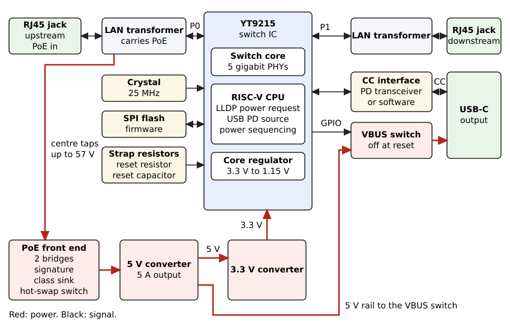
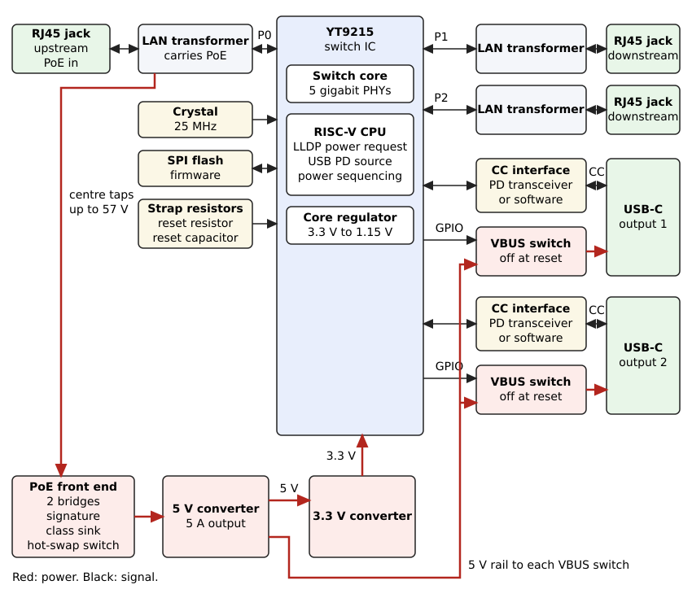
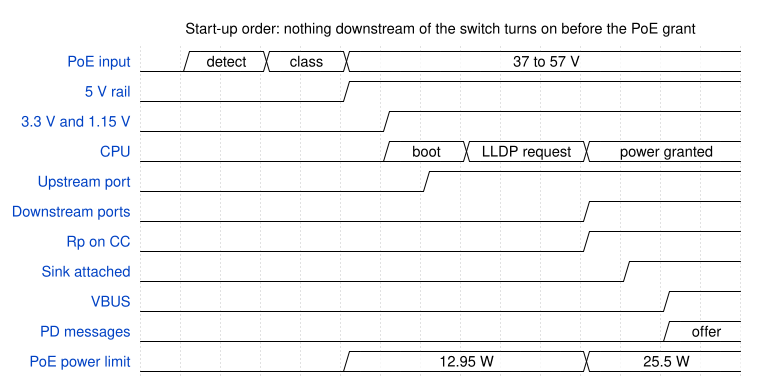

# Block diagram and BOM options

Two layouts of the adapter, each with a block diagram and a bill of materials (BOM). Both are
built around one Motorcomm YT9215 switch IC and the RISC-V CPU inside it. Every job that software
can do is given to that CPU, and each part that stays has a stated reason in
[Why each part cannot be software](#why-not-software).

| Option | RJ45 upstream | RJ45 downstream | USB-C outputs | Diagram | BOM |
| --- | ---: | ---: | ---: | --- | --- |
| A | 1 | 1 | 1 | [Option A](#option-a-diagram) | [BOM of option A](#bom-a) |
| B | 1 | 2 | 2 | [Option B](#option-b-diagram) | [BOM of option B](#bom-b) |

The note does not pick between alternatives. Where a block can be built in more than one way,
its section lists the ways with their cost and says which one the BOM counts. The USB PD
signalling has three priced builds, each with its own BOM table: a
[PD transceiver](#block-cc-transceiver), [GPIO bit-bang](#block-cc-bit-bang) and the
[port 9 MAC](#block-cc-mac).

## Summary

<!-- BEGIN totals -->
| Option | CC interface | Parts cost | Placements | Line items | PCB estimate | Assembly estimate | Total |
| --- | --- | ---: | ---: | ---: | ---: | ---: | ---: |
| [A](#option-a) | [PD transceiver](#block-cc-transceiver) | $6.80 | 131 | 43 | $0.40 | $1.10 | $8.30 |
| [A](#option-a) | [GPIO bit-bang](#block-cc-bit-bang) | $6.65 | 146 | 50 | $0.40 | $1.10 | $8.15 |
| [A](#option-a) | [Port 9 MAC](#block-cc-mac) | $6.68 | 152 | 51 | $0.40 | $1.10 | $8.18 |
| [B](#option-b) | [PD transceiver](#block-cc-transceiver) | $8.24 | 155 | 43 | $0.50 | $1.30 | $10.04 |
| [B](#option-b) | [GPIO bit-bang](#block-cc-bit-bang) | $7.90 | 182 | 50 | $0.50 | $1.30 | $9.70 |
| [B](#option-b) | [Port 9 MAC](#block-cc-mac) | – | – | – | – | – | – |
<!-- END totals -->

- Parts cost is the sum of the BOM rows at the [price tiers](#prices) the BOM names.
- A placement is one part put on the board. A line item is one distinct part number. Parts
  whose value is not yet set share one line item, so the line item count is a lower bound.
- The PCB and assembly columns are estimates [**I**](#evidence-codes) and are not BOM rows.
- The port 9 MAC serves one CC line, so it has no figures for option B
  ([port 9 MAC](#block-cc-mac)).
- With a 25.5 W PoE grant the USB-C side gets about 19.8 W in option A and about 19.5 W in
  option B, where the two outputs share it ([power budget](#power-budget)).
- A 25.5 W grant is too small for a 5 V, 5 A offer, and a 12.95 W grant is under the 3 A of a
  standard PD offer ([power budget](#power-budget)).
- The open points are in [Assumptions not yet verified](#assumptions).

## Evidence codes

| Code | Name | Evidence |
| --- | --- | --- |
| **V** | Verified | Printed in a datasheet in [`datasheets/`](../datasheets/README.md) |
| **P** | Catalogue read | Figure read from a parts catalogue listing |
| **I** | Inferred | Reasoned or estimated from other evidence |
| **U** | Unverified | Not yet checked |

The switch datasheet is [YT9215SCH V1.03](../datasheets/motorcomm/YT9215SCH_Datasheet_V1.03_2025-02-10.pdf). The
[YT9215SC and YT9215SCH](../research/motorcomm-debug-pins.md#yt9215sc-and-yt9215sch) share
their pin numbers, and this note uses those numbers.

- The catalogues are those of LCSC and JLCPCB.
- Every price, stock figure and part rating in the comparison tables of [Blocks](#blocks) is a
  catalogue read [**P**](#evidence-codes).
- An unverified point waits on bench work, on a datasheet check or on another note.

## Jobs done in software

| Job | Hardware not fitted | Runs on | Detail |
| --- | --- | --- | --- |
| Ask the PoE switch for more than 12.95 W | Two-event detection circuit | CPU | [PoE front end](#block-poe) |
| Hold downstream ports off until the grant | Supervisor chip | CPU | [Start-up order](#start-up) |
| Hold the USB-C outputs off until the grant | Supervisor chip | CPU | [Start-up order](#start-up) |
| Work out the USB-C offer from the grant | Fixed offer resistors | CPU | [Power budget](#power-budget) |
| USB PD message logic | USB PD controller chip | CPU | [CC interface](#block-cc) |
| USB PD bit timing | USB PD controller chip | Depends on the CC build | [CC interface](#block-cc) |
| Share the 5 V budget between two outputs | Second converter | CPU | [USB-C power](#block-usb) |
| Switch configuration at power-on | Configuration EEPROM | Firmware image | [Switch](#block-switch) |
| Status reporting | LEDs | CPU | [Switch](#block-switch) |
| PoE maintain-power signature | Dummy load | Switch supply current | [PoE front end](#block-poe) |

Every row depends on code running on the CPU, which is not yet shown to be possible
[**U**](#evidence-codes) ([boot](../research/yt9215-embedded-cpu.md#boot)).

## Option A: two RJ45 and one USB-C output

| YT9215 resource | Use |
| --- | --- |
| PHY port 0 | Upstream link with PoE input |
| PHY port 1 | Downstream link |
| PHY port 2 | Not connected |
| PHY port 3 | Not connected |
| PHY port 4 | Not connected |
| CPU port 10 | LLDP frames |
| SPI flash pins | Firmware |
| GPIO5 on pin 44 | VBUS switch |
| Pins of the chosen CC build | [CC interface](#block-cc) |

## Option B: three RJ45 and two USB-C outputs

| YT9215 resource | Use |
| --- | --- |
| PHY port 0 | Upstream link with PoE input |
| PHY port 1 | Downstream link 1 |
| PHY port 2 | Downstream link 2 |
| PHY port 3 | Not connected |
| PHY port 4 | Not connected |
| CPU port 10 | LLDP frames |
| SPI flash pins | Firmware |
| GPIO5 on pin 44 | VBUS switch of output 1 |
| GPIO6 on pin 46 | VBUS switch of output 2 |
| Pins of the chosen CC build | [CC interfaces](#block-cc) |

The two USB-C outputs negotiate independently. They share the one 5 V converter, so both offer
5 V only and the firmware divides the budget between them.

### Pins that hold an output off at reset

Table 19 of the [switch datasheet](../datasheets/motorcomm/YT9215SCH_Datasheet_V1.03_2025-02-10.pdf) gives most GPIO pins an internal pull-up and five an
internal pull-down [**V**](#evidence-codes). A signal that must be off before the firmware runs
uses one of the five.

| Pin | GPIO | Strap on the pin | Internal pull | Use in option A | Use in option B |
| ---: | --- | --- | --- | --- | --- |
| 44 | GPIO5 | None | Down | VBUS switch | VBUS switch 1 |
| 46 | GPIO6 | `SWITCH_ID_1` | Down | Free | VBUS switch 2 |
| 49 | GPIO9 | `SPF_MUX_SEL` | Down | Free | Buffer enable 1 |
| 51 | GPIO11 | `SWITCH_ID_0` | Down | Buffer enable | Buffer enable 2 |
| 50 | GPIO10 | `RESERVED_2` | Down | Tied high | Tied high |

- The buffer enables belong to the [GPIO bit-bang](#block-cc-bit-bang) build only.
- The [port 9 MAC](#block-cc-mac) build uses pins 46 to 57 for port 9, which leaves pin 44.
- An Rp resistor fed from a pin with a pull-up is weakly on at reset. The pull value is not
  published [**U**](#evidence-codes).
- In the port 9 MAC build the buffer reset gate also sits on a pin with a pull-up. Its 10 kΩ
  pull-down works against that unpublished pull [**U**](#evidence-codes).
- Option B with the [PD transceiver](#block-cc-transceiver) on two I²C masters needs pin 49
  high, which the buffer enables do not use in that build.

## Power tree

| Rail | Source | Feeds | Detail |
| --- | --- | --- | --- |
| PoE voltage | Bridges | 5 V converter | [PoE front end](#block-poe) |
| 5 V | 5 V converter | USB-C outputs | [5 V converter](#block-5v) |
| 5 V | 5 V converter | 3.3 V converter | [5 V converter](#block-5v) |
| 3.3 V | 3.3 V converter | YT9215 logic and analogue pins | [3.3 V converter](#block-3v3) |
| 1.15 V | Regulator inside the YT9215 | YT9215 core pins | [Switch](#block-switch) |

The PoE voltage at the device is 37 to 57 V at 12.95 W and 42.5 to 57 V at 25.5 W
([minimum voltage by class](../research/poe.md#minimum-pd-side-voltage-by-assigned-class-and-pse-type)).

USB-C carries 5 V only. Other USB PD voltages need a converter per output with a selectable
output voltage, which adds about one [5 V converter](#block-5v) block per output
[**I**](#evidence-codes).

### Power budget

| Granted at the PoE input | Bridge loss | 5 V rail | Switch supply in option A | USB-C budget in option A | USB-C current in option A | Switch supply in option B | USB-C budget in option B | USB-C current in option B |
| ---: | ---: | ---: | ---: | ---: | ---: | ---: | ---: | ---: |
| 12.95 W | 0.8 W | 10.6 W | 1.2 W | 9.4 W | 1.9 A | 1.5 W | 9.1 W | 1.8 A |
| 25.5 W | 1.3 W | 21.0 W | 1.2 W | 19.8 W | 4.0 A | 1.5 W | 19.5 W | 3.9 A |

Every column except "Granted at the PoE input" is an estimate [**I**](#evidence-codes):

- Bridge loss is two diode drops of 1.1 V at the lowest input voltage of each grant. LCSC lists
  1.1 V at 0.4 A for the counted bridge [**P**](#evidence-codes).
- The 5 V rail is the remainder times an assumed converter efficiency of 87 %.
- Switch supply starts from Table 28 of the [switch datasheet](../datasheets/motorcomm/YT9215SCH_Datasheet_V1.03_2025-02-10.pdf)
  [**V**](#evidence-codes): 663 mW with no link and 1613 mW with five gigabit links, so 190 mW
  per link. The table is that of the YT9215SCH and is applied here to the YT9215SC. It adds the losses of the core regulator at an assumed 85 % and of the 3.3 V
  converter at an assumed 90 %.
- USB-C current in option B is the total of both outputs.
- The [budget in the PoE note](../research/poe.md#5-raspberry-pi-5-power-budget-against-poe-classes)
  is higher, 22.5 W at 25.5 W, because it assumes 90 % and no switch supply.

The firmware turns the budget into an offer by the rule in the
[power budget hand-off](https://github.com/mithro/budget-poe-adapter/blob/main/research/yt9215-usb-pd.md#power-budget).
These consequences follow [**I**](#evidence-codes):

- A 25.5 W grant cannot supply 5 V at 5 A. The largest single offer is about 4 A.
- At 12.95 W the budget is under 3 A. The rule leaves open whether an output under 3 A sends a
  PD offer at its available current or advertises by Rp alone.
- In option B at 25.5 W the firmware can give one output 3 A and the other 0.9 A, or split the
  3.9 A some other way.
- In option B at 12.95 W the 1.8 A total covers two outputs at the default USB current of
  0.9 A each. It does not cover one output at 1.5 A with the other at 0.9 A.
- An output held at 0.9 A needs the default-current Rp value, which is a third resistor in the
  two software builds ([CC interface](#block-cc)).
- A 5 V source above 15 W is outside the USB PD power rules, which add 9 V above 15 W
  ([USB power standards](../research/usb-c-pd.md#2-usb-power-standards-voltages-and-currents)).
  Whether sinks accept 5 V at about 4 A is not tested [**U**](#evidence-codes).
- A Raspberry Pi 5 lifts its USB current limit only for a 5 A offer
  ([Raspberry Pi 5](../research/usb-c-pd.md#3-raspberry-pi-5-specifics)). That needs a PoE
  grant above 25.5 W, which this note does not cover.

### Start-up order

| Item | Before the grant | After the grant |
| --- | --- | --- |
| Switch core | On | On |
| Upstream port | On | On |
| CPU | On | On |
| Downstream ports | Off | On |
| USB-C outputs | Off | On |
| PoE power limit | 12.95 W | 25.5 W |

The state before the grant draws about 1.0 W from the 5 V rail [**I**](#evidence-codes), far
inside 12.95 W. The USB-C side follows the
[start-up order of the USB PD note](https://github.com/mithro/budget-poe-adapter/blob/main/research/yt9215-usb-pd.md#start-up-order).
The figure shows order only, not time.

## Blocks

### Ethernet

Each port has a 24-pin LAN transformer and a plain RJ45 jack. The upstream transformer passes
the PoE current, and its four cable-side centre taps go to the
[PoE front end](#block-poe) ([wiring](../research/poe.md#3-wiring-mode-a-mode-b-polarity-and-1000base-t)).
The BOM uses one transformer part for every port to keep the line items down.

| Choice | Magnetics part | Catalogue number | Jack | Price per port | PoE in the JLCPCB listing | Counted in the BOM |
| --- | --- | --- | --- | ---: | --- | --- |
| Transformer | G2415S | [C3003219](https://www.lcsc.com/product-detail/C3003219.html) | Plain | $0.41 | Yes | Yes |
| Transformer | H5007NS | [C42418495](https://www.lcsc.com/product-detail/C42418495.html) | Plain | $0.39 | Yes | No |
| Transformer | G24P02S | [C2827276](https://www.lcsc.com/product-detail/C2827276.html) | Plain | $0.27 | No | No |
| Jack with built-in magnetics | HR911130A | [C54408](https://www.lcsc.com/product-detail/C54408.html) | Built in | $1.61 | No | No |
| Capacitor coupling | 8 capacitors | – | Plain | $0.12 | No | No |

- The plain jack is the R-RJ45R08P-A004,
  [C385834](https://www.lcsc.com/product-detail/C385834.html), at $0.10, unshielded and without
  LEDs. The shielded jack with LEDs
  [C386757](https://www.lcsc.com/product-detail/C386757.html) costs $0.21.
- The PoE current rating of the G2415S and of the H5007NS is not confirmed from a datasheet
  [**U**](#evidence-codes).
- Capacitor coupling works only on a downstream port and only when the far end has its own
  transformer. It is untested here [**U**](#evidence-codes).
- Each cable-side centre tap has a 75 Ω resistor. On the upstream port each tap has its own
  1 nF 2 kV capacitor, because the taps sit at different PoE voltages. A downstream port shares
  one capacitor.

### Switch

| Variant | Catalogue number | Price | Price tier | Stock | Pin numbers of this note | Counted in the BOM |
| --- | --- | ---: | ---: | ---: | --- | --- |
| YT9215S | [C5899183](https://www.lcsc.com/product-detail/C5899183.html) | $1.92 | 900 | 124 | No | No |
| YT9215SC | [C51037433](https://www.lcsc.com/product-detail/C51037433.html) | $2.89 | 900 | 139 | Yes | Yes |
| YT9215SCH | [C51045050](https://www.lcsc.com/product-detail/C51045050.html) | $9.97 | 90 | 163 | Yes | No |

- The CPU memory figures are published for the YT9215SCH only
  ([memory](../research/yt9215-embedded-cpu.md#memory)).
- The YT9215S saves $0.97 and has two conflicts
  ([SPI flash on the YT9215S](../research/motorcomm-debug-pins.md#spi-flash-on-the-yt9215s)):
  its default flash pins include the pins of I²C master 1, and its flash chip-select pin is the
  `DISAUTOLOAD` strap, which must be low at reset.
- The chip needs a 2.49 kΩ 1 % resistor from pin 12 to ground (Table 24 of the
  [switch datasheet](../datasheets/motorcomm/YT9215SCH_Datasheet_V1.03_2025-02-10.pdf)) [**V**](#evidence-codes).

**Crystal.** The chip needs a 25 MHz reference within 50 ppm with at most 50 Ω series
resistance (Table 50 of the [switch datasheet](../datasheets/motorcomm/YT9215SCH_Datasheet_V1.03_2025-02-10.pdf)) [**V**](#evidence-codes). The BOM counts
the YXC X322525MOB4SI, [C9006](https://www.lcsc.com/product-detail/C9006.html), at $0.05 with
two 18 pF load capacitors. LCSC lists it with 50 Ω series resistance and a 12 pF load
[**P**](#evidence-codes), so it sits on the limit with no margin.

**Flash.** The firmware runs in place from an SPI NOR flash on pins 78, 79, 81 and 83
([boot](../research/yt9215-embedded-cpu.md#boot)). The BOM counts the 4 Mbit Puya
P25Q40SH-SSH-IT, [C2836860](https://www.lcsc.com/product-detail/C2836860.html), at $0.10. The
image size is unknown [**U**](#evidence-codes), so 4 Mbit is a guess.

**Straps.** Six pins need a resistor. The rest keep the level of their internal pull
(Table 19 and Table 20 of the [switch datasheet](../datasheets/motorcomm/YT9215SCH_Datasheet_V1.03_2025-02-10.pdf)) [**V**](#evidence-codes).

| Pin | Strap | Level needed | Internal pull | External resistor | Effect |
| ---: | --- | --- | --- | --- | --- |
| 76 | `DIS_MCU` | Low | Up | 4.7 kΩ to ground | CPU enabled |
| 77 | `DISAUTOLOAD` | Low | Up | 4.7 kΩ to ground | Loading enabled |
| 60 | `EN_SWR` | High | Not stated | 4.7 kΩ to 3.3 V | Core regulator on |
| 47 | `RESERVED_0` | High | Up | 4.7 kΩ to 3.3 V | Required by the datasheet |
| 48 | `RESERVED_1` | High | Up | 4.7 kΩ to 3.3 V | Required by the datasheet |
| 50 | `RESERVED_2` | High | Down | 4.7 kΩ to 3.3 V | Required by the datasheet |
| 75 | `EN_SPIF` | High | Up | None | Flash interface on |
| 49 | `SPF_MUX_SEL` | Low | Down | None | Flash on pin group SPF1 |
| 83 | `EN_PHY` | High | Up | None | PHYs on |

- The strap levels follow the [boot table](../research/motorcomm-debug-pins.md#boot-table).
- Pin group SPF1 is pins 78, 79, 81 and 83. Pin group SPF0 is pins 49, 50, 54 and 55.
- 4.7 kΩ to ground is the value the
  [wu-kou board](../research/switch-board-strapping.md#wk-configuration-pins) uses on its strap
  pins.

**Supplies.** The regulator inside the chip makes the 1.15 V core rail from 3.3 V with one
external inductor, as on the
[wu-kou board](../research/switch-board-strapping.md#wk-l2). The BOM counts one 100 nF
capacitor for each of the 29 supply pins (Table 21 of the
[switch datasheet](../datasheets/motorcomm/YT9215SCH_Datasheet_V1.03_2025-02-10.pdf)) [**V**](#evidence-codes) and two ferrite beads. The wu-kou board fits eight beads, and the
smaller number is not verified [**U**](#evidence-codes).

**Reset.** Reset is a 4.7 kΩ resistor and a 10 µF capacitor, the values of the
[wu-kou board](../research/switch-board-strapping.md#wk-c51). Their 47 ms time constant covers
the 10 ms that Table 32 of the [switch datasheet](../datasheets/motorcomm/YT9215SCH_Datasheet_V1.03_2025-02-10.pdf) asks for after
the supplies settle [**V**](#evidence-codes). The discharge diode of the wu-kou board is not counted [**U**](#evidence-codes).

**Not fitted.** No LEDs, no EEPROM and no reset chip.

### PoE front end

The front end is discrete and has no PoE controller chip. It is not designed in this note. The
BOM rows are placeholders for its functions, with part values left open
[**U**](#evidence-codes). The standards background is in
[PoE powered device](../research/poe.md).

| Function | Reason |
| --- | --- |
| Polarity bridges | Either pair set may carry either polarity |
| Surge clamp | Cable surges |
| Detection signature | The PoE switch looks for 25 kΩ before it applies power |
| Class 4 current sink | Marks the device as able to ask for 25.5 W |
| Hot-swap switch | Turn-on threshold with inrush limit |

| Way to get 25.5 W | Extra parts | Extra cost | Works with a PoE switch that has no LLDP | Counted in the BOM |
| --- | ---: | ---: | --- | --- |
| LLDP request from the CPU | 0 | $0.00 | No | Yes |
| Two-event detection circuit | About 4 | About $0.03 | Yes | No |

- The device starts at 12.95 W, and the CPU asks for 25.5 W by LLDP
  ([LLDP](../research/poe.md#45-lldp-data-link-layer-classification)).
- IEEE 802.3at expects a 25.5 W device to understand both ways. A PoE source without LLDP
  signals 25.5 W by two class events, and a device that cannot see them stays at 12.95 W
  ([classification](../research/poe.md#42-classification-how-much-power-do-you-want)).
- The two-event circuit is not designed, and its figures are a guess [**I**](#evidence-codes).
- The class sink has to turn off above the classification window so that it draws nothing at
  48 V. The placeholder rows may not be enough for that [**U**](#evidence-codes).
- The class sink transistor dissipates about 1 W for up to 105 ms during classification
  ([minimal external parts](../research/poe.md#64-minimal-external-parts-architecture-b)).
  Whether the counted SOT-23 part survives that pulse is not checked [**U**](#evidence-codes).
- The hot-swap switch has to stay off at the 20.5 V of classification and be fully on at 37 V.
  A resistor divider alone cannot do that, so the BOM counts a threshold zener with no
  selected part [**U**](#evidence-codes).
- A resistor across the PoE input sees 57 V, and 93.6 V in a surge. An 0402 resistor is rated
  50 V, so the BOM counts the class sink and threshold resistors as 0805 parts [**I**](#evidence-codes).
- The signature resistor dissipates 0.13 W at 57 V, so the BOM counts a 1206 part. That loss is
  not in the [power budget](#power-budget).
- With power on two pairs, one bridge carries the whole current and dissipates up to 1.3 W.
  Whether the MBS package can shed that is not checked [**U**](#evidence-codes).
- The USB-C ground connects to the PoE input through the converters, with no isolation. That
  does not meet the 1500 V isolation of IEEE 802.3
  ([isolation and safety](../research/poe.md#8-isolation-and-safety-non-isolated-design)) [**U**](#evidence-codes).
- The hot-swap MOSFET is $0.31 of this block. A cheaper 100 V part is not selected.
- The switch draws more than the 10 mA a PoE switch needs to see, so no dummy load is fitted
  ([maintain power signature](../research/poe.md#44-maintain-power-signature-mps)).
- The firmware is assumed to learn the grant from LLDP alone, with no signal from the front end
  [**U**](#evidence-codes).

### 5 V converter

One converter makes 5 V for the USB-C outputs and for the 3.3 V converter. It is sized for the
25.5 W grant: 21.0 W is 4.2 A at 5 V.

| Converter | Maker | Input limit | Output current | Rectifier | Catalogue number | Price | Counted in the BOM |
| --- | --- | ---: | ---: | --- | --- | ---: | --- |
| RT6365GSP | Richtek | 60 V | 5 A | External diode | [C3024482](https://www.lcsc.com/product-detail/C3024482.html) | $0.53 | Yes |
| TPS54560DDAR-JSM | JSMSEMI | 60 V | 5 A | External diode | [C54320988](https://www.lcsc.com/product-detail/C54320988.html) | $0.50 | No |
| TX4138 | XDS | 60 V | 4 A | External diode | [C329267](https://www.lcsc.com/product-detail/C329267.html) | $0.41 | No |
| SY8513FCC | Silergy | 100 V | 3 A | External diode | [C3034281](https://www.lcsc.com/product-detail/C3034281.html) | $0.58 | No |
| SCT2650STER | SCT | 60 V | 5 A | External diode | [C2840771](https://www.lcsc.com/product-detail/C2840771.html) | $1.77 | No |
| EG1163S | EG Micro | 600 V | Set by its MOSFETs | 2 external MOSFETs | [C480648](https://www.lcsc.com/product-detail/C480648.html) | $0.45 | No |

- A 58 V surge clamp lets the input rise to 93.6 V at its rated surge current
  [**P**](#evidence-codes). That is above the 60 V rating of the counted converter and of the counted
  SS56 catch diode. Whether 60 V parts survive depends on the [PoE front end](#block-poe)
  [**U**](#evidence-codes).
- The SY8513FCC stops at 3 A, which is 15 W, and the TX4138 at 4 A, under the 4.2 A needed.
- The LCSC and JLCPCB searches for this note turned up no 100 V converter with built-in
  switches and 5 A output.
- A diode rectifier loses about 2 W at 4.2 A [**I**](#evidence-codes). That is more than the
  counted SMA diode can shed, so the diode package and the assumed 87 % are open
  [**U**](#evidence-codes). The EG1163S with two MOSFETs avoids the diode and needs its own
  supply of 10 V or more.
- The feedback, frequency and compensation parts are counted and their values are not chosen.

### 3.3 V converter

The switch takes about 1.1 to 1.3 W at 3.3 V, core regulator included
([power budget](#power-budget)).

| Choice | Part | Catalogue number | Price with its inductor | Loss at 0.4 A | Counted in the BOM |
| --- | --- | --- | ---: | ---: | --- |
| Buck converter | MT2492 | [C89358](https://www.lcsc.com/product-detail/C89358.html) | $0.10 | 0.15 W | Yes |
| Linear regulator | Not selected | – | $0.03 | 0.7 W | No |

The MT2492 with a 4.7 µH inductor is the 3.3 V supply of the
[wu-kou board](../research/switch-board-strapping.md#wk-u1). The losses and the linear regulator
price are estimates [**I**](#evidence-codes).

### USB-C power

**VBUS switching.** Each output has a switch that a GPIO turns on. Its GPIO is one of the
[pins with a pull-down](#reset-pins), so the switch is off at reset.

| Choice | Switch part | Catalogue number | Driver part | Price per output | Current limit | Counted in the BOM |
| --- | --- | --- | --- | ---: | --- | --- |
| P-channel MOSFET | AO4407A | [C16072](https://www.lcsc.com/product-detail/C16072.html) | DTC143ZCA | $0.18 | None | Yes |
| Current-limited switch | SY6280AAC | [C55136](https://www.lcsc.com/product-detail/C55136.html) | None | $0.05 | 2 A | No |

- The driver transistor is [C15236](https://www.lcsc.com/product-detail/C15236.html), with one
  10 kΩ gate pull-up.
- With the MOSFET the only current limit is that of the 5 V converter. In option A it sits near
  the largest offer. In option B it cannot protect each output by itself
  [**U**](#evidence-codes).
- The SY6280AAC gives each output its own limit. Its 2 A ceiling keeps an output under 3 A, so
  that output gets no PD offer ([power budget](#power-budget)).
- The LCSC and JLCPCB searches for this note turned up no switch with a limit near 4 A at a
  price near $0.05.
- No ADC is documented for the chip [**U**](#evidence-codes), so the firmware is assumed unable to
  measure current. A fixed limit does not enforce an offer under it.
- LCSC lists the AO4407A at 38 mΩ with a 5 V gate drive [**P**](#evidence-codes). At 4 A that is
  0.6 W and a 0.15 V drop, which are not in the [power budget](#power-budget).
- The driver switches the MOSFET on with no slew limit. The inrush into a sink can dip the 5 V
  rail, which also feeds the 3.3 V converter and, in option B, the other output
  [**U**](#evidence-codes).

**Discharge.** A 1 kΩ resistor from VBUS to ground discharges the output after the switch
opens. It costs 25 mW while the output is on and stands in for a discharge transistor
[**I**](#evidence-codes).

**Protection.** The BOM has no ESD diode on VBUS or CC and no reverse-current block. The CC
pins of the two software builds have a series resistor and a clamp diode.

**Connector.**

| Choice | Part | Catalogue number | Price | Current | CC wires | Counted in the BOM |
| --- | --- | --- | ---: | ---: | ---: | --- |
| Captive cable | Not selected | – | $0.40 | 5 A | 1 | Yes |
| 6-pin receptacle | TYPE-C 6P | [C456012](https://www.lcsc.com/product-detail/C456012.html) | $0.02 | 3 A | 2 | No |
| 16-pin receptacle | TYPE-C-31-M-12 | [C165948](https://www.lcsc.com/product-detail/C165948.html) | $0.11 | 5 A | 2 | No |

- The cable price is an estimate with no quote behind it [**I**](#evidence-codes).
- A receptacle may offer more than 3 A only after reading the cable marker, which the design
  does not do ([captive cable](https://github.com/mithro/budget-poe-adapter/blob/main/research/yt9215-usb-pd.md#captive-cable)).
- A PD transceiver handles both CC wires of a receptacle. The two software builds need their
  CC parts twice for a receptacle, with a switch that routes the signals to the wire in use.

### CC interface

The CC interface detects the sink, advertises current and carries the USB PD messages. The
three builds come from [USB-C PD from the YT9215 alone](https://github.com/mithro/budget-poe-adapter/blob/main/research/yt9215-usb-pd.md),
which holds the detail and the open questions of each. Their costs are in
[cost by block](#cost-by-block).

| Build | PD bit timing done by | Outputs it can serve | BOM for option A | BOM for option B | Detail in the USB PD note |
| --- | --- | ---: | --- | --- | --- |
| [PD transceiver](#block-cc-transceiver) | Transceiver chip | 2 | [Table](#bom-a-transceiver) | [Table](#bom-b-transceiver) | [Option A](https://github.com/mithro/budget-poe-adapter/blob/main/research/yt9215-usb-pd.md#option-a) |
| [GPIO bit-bang](#block-cc-bit-bang) | CPU timing loops | 2 | [Table](#bom-a-bit-bang) | [Table](#bom-b-bit-bang) | [Option B](https://github.com/mithro/budget-poe-adapter/blob/main/research/yt9215-usb-pd.md#option-b) |
| [Port 9 MAC](#block-cc-mac) | MAC of port 9 | 1 | [Table](#bom-a-mac) | – | [Option C](https://github.com/mithro/budget-poe-adapter/blob/main/research/yt9215-usb-pd.md#option-c) |

The option letters of the USB PD note name CC builds. They are not the options A and B of this
note.

**PD transceiver.** One FUSB302B per output on an I²C master of the YT9215.

| Transceiver | I²C address | Catalogue number | Price | Stock | Counted in the BOM |
| --- | --- | --- | ---: | ---: | --- |
| FUSB302BMPX | 0x22 | [C132291](https://www.lcsc.com/product-detail/C132291.html) | $0.41 | 16,532 | Yes |
| FUSB302B01MPX | 0x23 | [C488155](https://www.lcsc.com/product-detail/C488155.html) | $1.16 | 60 | No |

- Option B needs two transceivers that do not share an address on one bus. The BOM counts two
  FUSB302BMPX, one on each I²C master. I²C master 2 uses pin 81 of flash pin group SPF1, so the
  flash moves to pin group SPF0 and `SPF_MUX_SEL` gets a pull-up, counted in the
  [option B table](#bom-b-transceiver) ([straps](#straps)) [**U**](#evidence-codes).
- The second address variant on I²C master 1 avoids that move and costs $0.75 more.
- The two addresses are not checked against the onsemi datasheet [**U**](#evidence-codes).
- The BOM counts a 100 nF and a 1 µF supply capacitor and one receiver capacitor on CC per
  transceiver. That list is from memory of the onsemi reference circuit and is not checked
  against the datasheet [**U**](#evidence-codes).
- Other transceiver chips are compared in the
  [fixed-function chips](https://github.com/mithro/budget-poe-adapter/blob/main/research/yt9215-usb-pd.md#fixed-function-chips) table of the USB PD note.

**GPIO bit-bang.** A buffer drives CC, a fast comparator slices it, and the CPU times every
edge. It needs GPIO registers and a timer that are not published [**U**](#evidence-codes).

Both software builds count three Rp resistors per output: 36 kΩ for the default current, 12 kΩ
for 1.5 A and 7.5 kΩ in parallel for 3 A. Each takes a GPIO, and the GPIO count is not checked
against the free pins [**U**](#evidence-codes).

**Port 9 MAC.** The MAC of extension port 9 clocks the PD bits out at 10 Mbit/s and samples
them in. The chip has one such MAC, and it captures one CC line at a time, so this build serves
one output and option B has no table for it.

The parts of the two software builds are untested candidates [**U**](#evidence-codes):

| Function | Candidate | Catalogue number | Price | Requirement | Status |
| --- | --- | --- | ---: | --- | --- |
| BMC driver buffer | 74AUP1G126GW-TP | [C51886129](https://www.lcsc.com/product-detail/C51886129.html) | $0.03 | Disabled output tolerates 3.3 V | Not confirmed |
| Slicer comparator | TP1942-SR | [C248572](https://www.lcsc.com/product-detail/C248572.html) | $0.17 | Delay of 200 ns at most | 68 ns listed |
| VBUS at 0 V comparator | LM393DR2G | [C7955](https://www.lcsc.com/product-detail/C7955.html) | $0.03 | None | Met |
| Buffer reset gate | SN74AUP1G08DCKR | [C7394036](https://www.lcsc.com/product-detail/C7394036.html) | $0.02 | None | Met |

- The TP1942-SR also does attach detection with its second channel. LCSC lists it as a single
  comparator, and the channel count is not checked against the 3PEAK datasheet
  [**U**](#evidence-codes).
- The buffer reset gate belongs to the port 9 MAC build only.
- A PD transceiver senses VBUS itself, so the VBUS comparator is a part of the two software
  builds.

## Why each part cannot be software

| Part | Block | Reason |
| --- | --- | --- |
| RJ45 jack | [Ethernet](#block-ethernet) | Mechanical connection |
| LAN transformer | [Ethernet](#block-ethernet) | Blocks 48 V from the PHY pins |
| Line termination | [Ethernet](#block-ethernet) | Analogue line matching |
| Switch IC | [Switch](#block-switch) | Runs the software |
| Crystal | [Switch](#block-switch) | Clock of the CPU |
| Flash | [Switch](#block-switch) | Stores the software |
| Strap resistors | [Switch](#block-switch) | Read at reset before code runs |
| Bias resistor | [Switch](#block-switch) | Analogue reference |
| Reset parts | [Switch](#block-switch) | Act before code runs |
| Supply capacitors | [Switch](#block-switch) | Energy storage |
| Ferrite beads | [Switch](#block-switch) | Supply filtering |
| Core regulator inductor | [Switch](#block-switch) | Energy storage |
| Polarity bridges | [PoE front end](#block-poe) | Needed before the chip has power |
| Surge clamp | [PoE front end](#block-poe) | Acts in nanoseconds |
| Detection signature | [PoE front end](#block-poe) | Measured before power is applied |
| Class sink | [PoE front end](#block-poe) | Works before the chip has power |
| Hot-swap switch | [PoE front end](#block-poe) | Limits inrush before the CPU runs |
| 5 V converter | [5 V converter](#block-5v) | Power conversion |
| 3.3 V converter | [3.3 V converter](#block-3v3) | Power conversion |
| VBUS switch | [USB-C power](#block-usb) | Carries the output current |
| VBUS bleed resistor | [USB-C power](#block-usb) | Works with no firmware action |
| Cable | [USB-C power](#block-usb) | Mechanical connection |
| Rp resistors | [CC interface](#block-cc) | Set an analogue current |
| Comparators | [CC interface](#block-cc) | Chip inputs cannot read a 1.1 V swing |
| BMC driver buffer | [CC interface](#block-cc) | Chip outputs cannot make a 1.1 V swing |
| CC series resistor | [CC interface](#block-cc) | Chip pins do not tolerate 5 V |
| CC clamp diode | [CC interface](#block-cc) | Chip pins do not tolerate 5 V |
| PD transceiver | [CC interface](#block-cc) | Makes and reads the 1.1 V CC swing |

## Bills of materials

- Prices are in US dollars, read from the LCSC and JLCPCB catalogues on 2026-11-19
  [**P**](#evidence-codes).
- The price tier is the order quantity the unit price belongs to. It is the first tier at
  1,000 pieces or more, or the highest tier the catalogue lists.
- A row with the price source "Estimate" has no selected part [**I**](#evidence-codes).
- Each option has one table of parts that are always fitted and one table per
  [CC interface](#block-cc) build. A complete BOM is the always-fitted table with one build
  table.
- The same rows are in [`bom-option-a.csv`](block-diagram-and-bom/bom-option-a.csv) and
  [`bom-option-b.csv`](block-diagram-and-bom/bom-option-b.csv).
- The PCB estimates are $0.40 and $0.50 and the assembly estimates $1.10 and $1.30, with no
  quote behind them [**I**](#evidence-codes).

### BOM of option A

Parts that are always fitted in option A:

<!-- BEGIN bom-a-base -->
| Block | Function | Part | Maker | Package | Value | Rating | Catalogue number | Quantity | Unit price | Price source | Price tier | Line cost |
| --- | --- | --- | --- | --- | --- | --- | --- | ---: | ---: | --- | ---: | ---: |
| [Ethernet](#block-ethernet) | RJ45 jack | R-RJ45R08P-A004 | Ckmtw | Through-hole | – | – | [C385834](https://www.lcsc.com/product-detail/C385834.html) | 2 | $0.1049 | LCSC | 992 | $0.2098 |
| [Ethernet](#block-ethernet) | LAN transformer | G2415S | CND-tek | SMD 24-pin | 350 µH | – | [C3003219](https://www.lcsc.com/product-detail/C3003219.html) | 2 | $0.3006 | LCSC | 850 | $0.6012 |
| [Ethernet](#block-ethernet) | Line termination resistor | 0402WGF750JTCE | Uni-Royal | 0402 | 75 Ω | – | [C25133](https://www.lcsc.com/product-detail/C25133.html) | 8 | $0.0010 | LCSC | 1,000 | $0.0080 |
| [Ethernet](#block-ethernet) | Line termination capacitor | 1206B102K202NT | FH | 1206 | 1 nF | 2 kV | [C9196](https://www.lcsc.com/product-detail/C9196.html) | 5 | $0.0105 | LCSC | 3,000 | $0.0525 |
| [Ethernet](#block-ethernet) | Chip-side centre-tap capacitor | CL05B104KO5NNNC | Samsung | 0402 | 100 nF | 16 V | [C1525](https://www.lcsc.com/product-detail/C1525.html) | 8 | $0.0018 | LCSC | 1,000 | $0.0144 |
| [Switch](#block-switch) | Switch IC with CPU | YT9215SC | Motorcomm | LQFP-128 | – | – | [C51037433](https://www.lcsc.com/product-detail/C51037433.html) | 1 | $2.8893 | LCSC | 900 | $2.8893 |
| [Switch](#block-switch) | Crystal | X322525MOB4SI | YXC | 3.2 × 2.5 mm | 25 MHz | – | [C9006](https://www.lcsc.com/product-detail/C9006.html) | 1 | $0.0505 | LCSC | 3,000 | $0.0505 |
| [Switch](#block-switch) | Crystal load capacitor | 0402CG180J500NT | FH | 0402 | 18 pF | 50 V | [C1549](https://www.lcsc.com/product-detail/C1549.html) | 2 | $0.0014 | LCSC | 1,000 | $0.0028 |
| [Switch](#block-switch) | Firmware flash | P25Q40SH-SSH-IT | Puya | SOP-8 | 4 Mbit | – | [C2836860](https://www.lcsc.com/product-detail/C2836860.html) | 1 | $0.1001 | LCSC | 2,500 | $0.1001 |
| [Switch](#block-switch) | Bias resistor | RC0402FR-072K49L | Yageo | 0402 | 2.49 kΩ | – | [C145071](https://www.lcsc.com/product-detail/C145071.html) | 1 | $0.0016 | LCSC | 1,000 | $0.0016 |
| [Switch](#block-switch) | Flash chip-select pull-up | 0402WGF1002TCE | Uni-Royal | 0402 | 10 kΩ | – | [C25744](https://www.lcsc.com/product-detail/C25744.html) | 1 | $0.0011 | LCSC | 1,000 | $0.0011 |
| [Switch](#block-switch) | Supply pin capacitor | CL05B104KO5NNNC | Samsung | 0402 | 100 nF | 16 V | [C1525](https://www.lcsc.com/product-detail/C1525.html) | 29 | $0.0018 | LCSC | 1,000 | $0.0522 |
| [Switch](#block-switch) | Supply bulk capacitor | CL10A106KP8NNNC | Samsung | 0603 | 10 µF | 10 V | [C19702](https://www.lcsc.com/product-detail/C19702.html) | 4 | $0.0107 | LCSC | 4,000 | $0.0428 |
| [Switch](#block-switch) | Analogue supply bead | BLM18KG221SN1D | Murata | 0603 | 220 Ω | 2.2 A | [C88980](https://www.lcsc.com/product-detail/C88980.html) | 2 | $0.0291 | LCSC | 4,000 | $0.0582 |
| [Switch](#block-switch) | Core regulator inductor | SWPA4018S2R2MT | Sunlord | 4 × 4 mm | 2.2 µH | – | [C50543](https://jlcpcb.com/partdetail/C50543) | 1 | $0.0407 | JLCPCB | 3,000 | $0.0407 |
| [Switch](#block-switch) | Core regulator capacitor | CL10A106KP8NNNC | Samsung | 0603 | 10 µF | 10 V | [C19702](https://www.lcsc.com/product-detail/C19702.html) | 2 | $0.0107 | LCSC | 4,000 | $0.0214 |
| [Switch](#block-switch) | Strap resistor | 0402WGF4701TCE | Uni-Royal | 0402 | 4.7 kΩ | – | [C25900](https://www.lcsc.com/product-detail/C25900.html) | 6 | $0.0013 | LCSC | 1,000 | $0.0078 |
| [Switch](#block-switch) | Reset resistor | 0402WGF4701TCE | Uni-Royal | 0402 | 4.7 kΩ | – | [C25900](https://www.lcsc.com/product-detail/C25900.html) | 1 | $0.0013 | LCSC | 1,000 | $0.0013 |
| [Switch](#block-switch) | Reset capacitor | CL10A106KP8NNNC | Samsung | 0603 | 10 µF | 10 V | [C19702](https://www.lcsc.com/product-detail/C19702.html) | 1 | $0.0107 | LCSC | 4,000 | $0.0107 |
| [PoE front end](#block-poe) | Polarity bridge | MB10S-50MIL | MDD | MBS | – | 1 A | [C2488](https://www.lcsc.com/product-detail/C2488.html) | 2 | $0.0145 | LCSC | 3,000 | $0.0290 |
| [PoE front end](#block-poe) | Surge clamp | SMAJ58A | Goodwork | SMA | – | 58 V | [C2980408](https://www.lcsc.com/product-detail/C2980408.html) | 1 | $0.0186 | LCSC | 2,000 | $0.0186 |
| [PoE front end](#block-poe) | Signature resistor | Not selected | Not selected | 1206 | 24.9 kΩ | – | – | 1 | $0.0030 | Estimate | – | $0.0030 |
| [PoE front end](#block-poe) | Signature capacitor | Not selected | Not selected | 0805 | 100 nF | 100 V | – | 1 | $0.0100 | Estimate | – | $0.0100 |
| [PoE front end](#block-poe) | Class sink transistor | MMBT5551 | JSCJ | SOT-23 | – | 160 V | [C2145](https://www.lcsc.com/product-detail/C2145.html) | 2 | $0.0096 | LCSC | 3,000 | $0.0192 |
| [PoE front end](#block-poe) | Class sink window zener | Not selected | Not selected | SOD-123 | Set by the PoE design | – | – | 1 | $0.0100 | Estimate | – | $0.0100 |
| [PoE front end](#block-poe) | Class sink resistor | Not selected | Not selected | 0805 | Set at schematic | 150 V | – | 3 | $0.0020 | Estimate | – | $0.0060 |
| [PoE front end](#block-poe) | Hot-swap MOSFET | NCE0130KA | NCE | TO-252 | – | 100 V | [C502817](https://www.lcsc.com/product-detail/C502817.html) | 1 | $0.3143 | LCSC | 2,500 | $0.3143 |
| [PoE front end](#block-poe) | Gate clamp zener | BZT52C15 | Goodwork | SOD-123 | 15 V | – | [C2932746](https://www.lcsc.com/product-detail/C2932746.html) | 1 | $0.0099 | LCSC | 3,000 | $0.0099 |
| [PoE front end](#block-poe) | Turn-on threshold zener | Not selected | Not selected | SOD-123 | Set by the PoE design | – | – | 1 | $0.0100 | Estimate | – | $0.0100 |
| [PoE front end](#block-poe) | Turn-on threshold resistor | Not selected | Not selected | 0805 | Set at schematic | 150 V | – | 2 | $0.0020 | Estimate | – | $0.0040 |
| [PoE front end](#block-poe) | Gate capacitor | CL05B104KB54PNC | Samsung | 0402 | 100 nF | 50 V | [C307331](https://www.lcsc.com/product-detail/C307331.html) | 1 | $0.0064 | LCSC | 1,000 | $0.0064 |
| [5 V converter](#block-5v) | Converter IC | RT6365GSP | Richtek | SOP-8-EP | 5 A | 60 V | [C3024482](https://www.lcsc.com/product-detail/C3024482.html) | 1 | $0.5319 | LCSC | 1,000 | $0.5319 |
| [5 V converter](#block-5v) | Catch diode | SS56 | MDD | SMA | 5 A | 60 V | [C65009](https://www.lcsc.com/product-detail/C65009.html) | 1 | $0.0353 | LCSC | 1,000 | $0.0353 |
| [5 V converter](#block-5v) | Inductor | MWSA1005S-100MT | Sunlord | 11.5 × 10 mm | 10 µH | 8 A | [C17700185](https://jlcpcb.com/partdetail/C17700185) | 1 | $0.1872 | JLCPCB | 2,500 | $0.1872 |
| [5 V converter](#block-5v) | Input bulk capacitor | ERM1KM220E12OT | Aishi | 6.3 × 12 mm | 22 µF | 100 V | [C106608](https://www.lcsc.com/product-detail/C106608.html) | 1 | $0.0250 | LCSC | 1,000 | $0.0250 |
| [5 V converter](#block-5v) | Input capacitor | CS3225X7R225K101NRK | Samwha | 1210 | 2.2 µF | 100 V | [C2900749](https://www.lcsc.com/product-detail/C2900749.html) | 2 | $0.0658 | LCSC | 2,000 | $0.1316 |
| [5 V converter](#block-5v) | Output capacitor | CL31A226KAHNNNE | Samsung | 1206 | 22 µF | 25 V | [C12891](https://www.lcsc.com/product-detail/C12891.html) | 2 | $0.0646 | LCSC | 2,000 | $0.1292 |
| [5 V converter](#block-5v) | Bootstrap capacitor | CL05B104KO5NNNC | Samsung | 0402 | 100 nF | 16 V | [C1525](https://www.lcsc.com/product-detail/C1525.html) | 1 | $0.0018 | LCSC | 1,000 | $0.0018 |
| [5 V converter](#block-5v) | Feedback resistor | Not selected | Not selected | 0402 | Set at schematic | – | – | 2 | $0.0011 | Estimate | – | $0.0022 |
| [5 V converter](#block-5v) | Frequency resistor | Not selected | Not selected | 0402 | Set at schematic | – | – | 1 | $0.0011 | Estimate | – | $0.0011 |
| [5 V converter](#block-5v) | Compensation resistor | Not selected | Not selected | 0402 | Set at schematic | – | – | 1 | $0.0011 | Estimate | – | $0.0011 |
| [5 V converter](#block-5v) | Compensation capacitor | Not selected | Not selected | 0402 | Set at schematic | – | – | 2 | $0.0020 | Estimate | – | $0.0040 |
| [3.3 V converter](#block-3v3) | Converter IC | MT2492 | Aerosemi | SOT-23-6 | 2 A | – | [C89358](https://www.lcsc.com/product-detail/C89358.html) | 1 | $0.0361 | LCSC | 1,000 | $0.0361 |
| [3.3 V converter](#block-3v3) | Inductor | SWPA4030S4R7NT | Sunlord | 4 × 4 mm | 4.7 µH | 2 A | [C193025](https://jlcpcb.com/partdetail/C193025) | 1 | $0.0614 | JLCPCB | 2,000 | $0.0614 |
| [3.3 V converter](#block-3v3) | Feedback top resistor | 0402WGF1802TCE | Uni-Royal | 0402 | 18 kΩ | – | [C25762](https://www.lcsc.com/product-detail/C25762.html) | 1 | $0.0011 | LCSC | 1,000 | $0.0011 |
| [3.3 V converter](#block-3v3) | Feedback bottom resistor | 0402WGF2001TCE | Uni-Royal | 0402 | 2 kΩ | – | [C4109](https://www.lcsc.com/product-detail/C4109.html) | 2 | $0.0015 | LCSC | 1,000 | $0.0030 |
| [3.3 V converter](#block-3v3) | Input capacitor | CL10A106KP8NNNC | Samsung | 0603 | 10 µF | 10 V | [C19702](https://www.lcsc.com/product-detail/C19702.html) | 1 | $0.0107 | LCSC | 4,000 | $0.0107 |
| [3.3 V converter](#block-3v3) | Output capacitor | CL10A106KP8NNNC | Samsung | 0603 | 10 µF | 10 V | [C19702](https://www.lcsc.com/product-detail/C19702.html) | 2 | $0.0107 | LCSC | 4,000 | $0.0214 |
| [3.3 V converter](#block-3v3) | Bootstrap capacitor | CL05B104KO5NNNC | Samsung | 0402 | 100 nF | 16 V | [C1525](https://www.lcsc.com/product-detail/C1525.html) | 1 | $0.0018 | LCSC | 1,000 | $0.0018 |
| [USB-C power](#block-usb) | VBUS switch MOSFET | AO4407A | AOS | SOIC-8 | 12 A | 30 V | [C16072](https://www.lcsc.com/product-detail/C16072.html) | 1 | $0.1683 | LCSC | 3,000 | $0.1683 |
| [USB-C power](#block-usb) | VBUS switch driver | DTC143ZCA | JSCJ | SOT-23 | 4.7 kΩ | 50 V | [C15236](https://www.lcsc.com/product-detail/C15236.html) | 1 | $0.0142 | LCSC | 3,000 | $0.0142 |
| [USB-C power](#block-usb) | VBUS gate pull-up | 0402WGF1002TCE | Uni-Royal | 0402 | 10 kΩ | – | [C25744](https://www.lcsc.com/product-detail/C25744.html) | 1 | $0.0011 | LCSC | 1,000 | $0.0011 |
| [USB-C power](#block-usb) | VBUS bleed resistor | 0402WGF1001TCE | Uni-Royal | 0402 | 1 kΩ | – | [C11702](https://www.lcsc.com/product-detail/C11702.html) | 1 | $0.0011 | LCSC | 1,000 | $0.0011 |
| [USB-C power](#block-usb) | VBUS capacitor | CL05A105KA5NQNC | Samsung | 0402 | 1 µF | 25 V | [C52923](https://www.lcsc.com/product-detail/C52923.html) | 1 | $0.0042 | LCSC | 1,000 | $0.0042 |
| [USB-C power](#block-usb) | Captive cable | USB-C plug on a cable | Not selected | Soldered wires | – | 5 A | – | 1 | $0.4000 | Estimate | – | $0.4000 |
<!-- END bom-a-base -->

Added to option A for the [PD transceiver](#block-cc-transceiver) build:

<!-- BEGIN bom-a-transceiver -->
| Block | Function | Part | Maker | Package | Value | Rating | Catalogue number | Quantity | Unit price | Price source | Price tier | Line cost |
| --- | --- | --- | --- | --- | --- | --- | --- | ---: | ---: | --- | ---: | ---: |
| [CC interface: PD transceiver](#block-cc-transceiver) | PD transceiver | FUSB302BMPX | onsemi | WQFN-14 | – | – | [C132291](https://www.lcsc.com/product-detail/C132291.html) | 1 | $0.4080 | LCSC | 1,000 | $0.4080 |
| [CC interface: PD transceiver](#block-cc-transceiver) | I²C pull-up | 0402WGF4701TCE | Uni-Royal | 0402 | 4.7 kΩ | – | [C25900](https://www.lcsc.com/product-detail/C25900.html) | 2 | $0.0013 | LCSC | 1,000 | $0.0026 |
| [CC interface: PD transceiver](#block-cc-transceiver) | Supply pin capacitor | CL05B104KO5NNNC | Samsung | 0402 | 100 nF | 16 V | [C1525](https://www.lcsc.com/product-detail/C1525.html) | 1 | $0.0018 | LCSC | 1,000 | $0.0018 |
| [CC interface: PD transceiver](#block-cc-transceiver) | Supply bulk capacitor | CL05A105KA5NQNC | Samsung | 0402 | 1 µF | 25 V | [C52923](https://www.lcsc.com/product-detail/C52923.html) | 1 | $0.0042 | LCSC | 1,000 | $0.0042 |
| [CC interface: PD transceiver](#block-cc-transceiver) | Receiver capacitor | Not selected | Not selected | 0402 | Set at schematic | – | – | 1 | $0.0020 | Estimate | – | $0.0020 |
<!-- END bom-a-transceiver -->

Added to option A for the [GPIO bit-bang](#block-cc-bit-bang) build:

<!-- BEGIN bom-a-bit-bang -->
| Block | Function | Part | Maker | Package | Value | Rating | Catalogue number | Quantity | Unit price | Price source | Price tier | Line cost |
| --- | --- | --- | --- | --- | --- | --- | --- | ---: | ---: | --- | ---: | ---: |
| [CC interface: GPIO bit-bang](#block-cc-bit-bang) | BMC driver buffer | 74AUP1G126GW-TP | Tech Public | SOT-353 | – | – | [C51886129](https://www.lcsc.com/product-detail/C51886129.html) | 1 | $0.0304 | LCSC | 3,000 | $0.0304 |
| [CC interface: GPIO bit-bang](#block-cc-bit-bang) | Receiver capacitor | Not selected | Not selected | 0402 | Set at schematic | – | – | 1 | $0.0020 | Estimate | – | $0.0020 |
| [CC interface: GPIO bit-bang](#block-cc-bit-bang) | Driver series resistor | 0402WGF470JTCE | Uni-Royal | 0402 | 47 Ω | – | [C25118](https://www.lcsc.com/product-detail/C25118.html) | 1 | $0.0009 | LCSC | 1,000 | $0.0009 |
| [CC interface: GPIO bit-bang](#block-cc-bit-bang) | Fast dual comparator | TP1942-SR | 3PEAK | SOIC-8 | 68 ns | – | [C248572](https://www.lcsc.com/product-detail/C248572.html) | 1 | $0.1742 | LCSC | 2,500 | $0.1742 |
| [CC interface: GPIO bit-bang](#block-cc-bit-bang) | Threshold divider resistor | Not selected | Not selected | 0402 | Set at schematic | – | – | 4 | $0.0011 | Estimate | – | $0.0044 |
| [CC interface: GPIO bit-bang](#block-cc-bit-bang) | CC series resistor | 0402WGF1001TCE | Uni-Royal | 0402 | 1 kΩ | – | [C11702](https://www.lcsc.com/product-detail/C11702.html) | 1 | $0.0011 | LCSC | 1,000 | $0.0011 |
| [CC interface: GPIO bit-bang](#block-cc-bit-bang) | CC clamp diode | BAV99 | R+O | SOT-23 | – | 70 V | [C7420336](https://www.lcsc.com/product-detail/C7420336.html) | 1 | $0.0080 | LCSC | 3,000 | $0.0080 |
| [CC interface: GPIO bit-bang](#block-cc-bit-bang) | Rp for default current | Not selected | Not selected | 0402 | 36 kΩ | – | – | 1 | $0.0010 | Estimate | – | $0.0010 |
| [CC interface: GPIO bit-bang](#block-cc-bit-bang) | Rp for 1.5 A | 0402WGF1202TCE | Uni-Royal | 0402 | 12 kΩ | – | [C25752](https://www.lcsc.com/product-detail/C25752.html) | 1 | $0.0010 | LCSC | 1,000 | $0.0010 |
| [CC interface: GPIO bit-bang](#block-cc-bit-bang) | Rp step to 3 A | 0402WGF7501TCE | Uni-Royal | 0402 | 7.5 kΩ | – | [C25918](https://www.lcsc.com/product-detail/C25918.html) | 1 | $0.0017 | LCSC | 1,000 | $0.0017 |
| [CC interface: GPIO bit-bang](#block-cc-bit-bang) | Slow dual comparator | LM393DR2G | onsemi | SOIC-8 | 1.3 µs | – | [C7955](https://www.lcsc.com/product-detail/C7955.html) | 1 | $0.0323 | LCSC | 2,500 | $0.0323 |
| [CC interface: GPIO bit-bang](#block-cc-bit-bang) | VBUS threshold resistor | Not selected | Not selected | 0402 | Set at schematic | – | – | 2 | $0.0011 | Estimate | – | $0.0022 |
| [CC interface: GPIO bit-bang](#block-cc-bit-bang) | Comparator output pull-up | 0402WGF1002TCE | Uni-Royal | 0402 | 10 kΩ | – | [C25744](https://www.lcsc.com/product-detail/C25744.html) | 1 | $0.0011 | LCSC | 1,000 | $0.0011 |
| [CC interface: GPIO bit-bang](#block-cc-bit-bang) | Buffer enable pull-down | 0402WGF1002TCE | Uni-Royal | 0402 | 10 kΩ | – | [C25744](https://www.lcsc.com/product-detail/C25744.html) | 1 | $0.0011 | LCSC | 1,000 | $0.0011 |
| [CC interface: GPIO bit-bang](#block-cc-bit-bang) | Supply pin capacitor | CL05B104KO5NNNC | Samsung | 0402 | 100 nF | 16 V | [C1525](https://www.lcsc.com/product-detail/C1525.html) | 3 | $0.0018 | LCSC | 1,000 | $0.0054 |
<!-- END bom-a-bit-bang -->

Added to option A for the [port 9 MAC](#block-cc-mac) build:

<!-- BEGIN bom-a-mac -->
| Block | Function | Part | Maker | Package | Value | Rating | Catalogue number | Quantity | Unit price | Price source | Price tier | Line cost |
| --- | --- | --- | --- | --- | --- | --- | --- | ---: | ---: | --- | ---: | ---: |
| [CC interface: port 9 MAC](#block-cc-mac) | BMC driver buffer | 74AUP1G126GW-TP | Tech Public | SOT-353 | – | – | [C51886129](https://www.lcsc.com/product-detail/C51886129.html) | 1 | $0.0304 | LCSC | 3,000 | $0.0304 |
| [CC interface: port 9 MAC](#block-cc-mac) | Buffer reset gate | SN74AUP1G08DCKR | UMW | SC-70-5 | – | – | [C7394036](https://www.lcsc.com/product-detail/C7394036.html) | 1 | $0.0240 | LCSC | 3,000 | $0.0240 |
| [CC interface: port 9 MAC](#block-cc-mac) | Receiver capacitor | Not selected | Not selected | 0402 | Set at schematic | – | – | 1 | $0.0020 | Estimate | – | $0.0020 |
| [CC interface: port 9 MAC](#block-cc-mac) | Driver series resistor | 0402WGF470JTCE | Uni-Royal | 0402 | 47 Ω | – | [C25118](https://www.lcsc.com/product-detail/C25118.html) | 1 | $0.0009 | LCSC | 1,000 | $0.0009 |
| [CC interface: port 9 MAC](#block-cc-mac) | Fast dual comparator | TP1942-SR | 3PEAK | SOIC-8 | 68 ns | – | [C248572](https://www.lcsc.com/product-detail/C248572.html) | 1 | $0.1742 | LCSC | 2,500 | $0.1742 |
| [CC interface: port 9 MAC](#block-cc-mac) | Threshold divider resistor | Not selected | Not selected | 0402 | Set at schematic | – | – | 4 | $0.0011 | Estimate | – | $0.0044 |
| [CC interface: port 9 MAC](#block-cc-mac) | CC series resistor | 0402WGF1001TCE | Uni-Royal | 0402 | 1 kΩ | – | [C11702](https://www.lcsc.com/product-detail/C11702.html) | 1 | $0.0011 | LCSC | 1,000 | $0.0011 |
| [CC interface: port 9 MAC](#block-cc-mac) | CC clamp diode | BAV99 | R+O | SOT-23 | – | 70 V | [C7420336](https://www.lcsc.com/product-detail/C7420336.html) | 1 | $0.0080 | LCSC | 3,000 | $0.0080 |
| [CC interface: port 9 MAC](#block-cc-mac) | Rp for default current | Not selected | Not selected | 0402 | 36 kΩ | – | – | 1 | $0.0010 | Estimate | – | $0.0010 |
| [CC interface: port 9 MAC](#block-cc-mac) | Rp for 1.5 A | 0402WGF1202TCE | Uni-Royal | 0402 | 12 kΩ | – | [C25752](https://www.lcsc.com/product-detail/C25752.html) | 1 | $0.0010 | LCSC | 1,000 | $0.0010 |
| [CC interface: port 9 MAC](#block-cc-mac) | Rp step to 3 A | 0402WGF7501TCE | Uni-Royal | 0402 | 7.5 kΩ | – | [C25918](https://www.lcsc.com/product-detail/C25918.html) | 1 | $0.0017 | LCSC | 1,000 | $0.0017 |
| [CC interface: port 9 MAC](#block-cc-mac) | Slow dual comparator | LM393DR2G | onsemi | SOIC-8 | 1.3 µs | – | [C7955](https://www.lcsc.com/product-detail/C7955.html) | 1 | $0.0323 | LCSC | 2,500 | $0.0323 |
| [CC interface: port 9 MAC](#block-cc-mac) | VBUS threshold resistor | Not selected | Not selected | 0402 | Set at schematic | – | – | 2 | $0.0011 | Estimate | – | $0.0022 |
| [CC interface: port 9 MAC](#block-cc-mac) | Comparator output pull-up | 0402WGF1002TCE | Uni-Royal | 0402 | 10 kΩ | – | [C25744](https://www.lcsc.com/product-detail/C25744.html) | 1 | $0.0011 | LCSC | 1,000 | $0.0011 |
| [CC interface: port 9 MAC](#block-cc-mac) | Receive tie resistor | 0402WGF4701TCE | Uni-Royal | 0402 | 4.7 kΩ | – | [C25900](https://www.lcsc.com/product-detail/C25900.html) | 3 | $0.0013 | LCSC | 1,000 | $0.0039 |
| [CC interface: port 9 MAC](#block-cc-mac) | Clock strap resistor | 0402WGF4701TCE | Uni-Royal | 0402 | 4.7 kΩ | – | [C25900](https://www.lcsc.com/product-detail/C25900.html) | 1 | $0.0013 | LCSC | 1,000 | $0.0013 |
| [CC interface: port 9 MAC](#block-cc-mac) | Gate pull-down | 0402WGF1002TCE | Uni-Royal | 0402 | 10 kΩ | – | [C25744](https://www.lcsc.com/product-detail/C25744.html) | 1 | $0.0011 | LCSC | 1,000 | $0.0011 |
| [CC interface: port 9 MAC](#block-cc-mac) | Supply pin capacitor | CL05B104KO5NNNC | Samsung | 0402 | 100 nF | 16 V | [C1525](https://www.lcsc.com/product-detail/C1525.html) | 4 | $0.0018 | LCSC | 1,000 | $0.0072 |
<!-- END bom-a-mac -->

### BOM of option B

Parts that are always fitted in option B:

<!-- BEGIN bom-b-base -->
| Block | Function | Part | Maker | Package | Value | Rating | Catalogue number | Quantity | Unit price | Price source | Price tier | Line cost |
| --- | --- | --- | --- | --- | --- | --- | --- | ---: | ---: | --- | ---: | ---: |
| [Ethernet](#block-ethernet) | RJ45 jack | R-RJ45R08P-A004 | Ckmtw | Through-hole | – | – | [C385834](https://www.lcsc.com/product-detail/C385834.html) | 3 | $0.1049 | LCSC | 992 | $0.3147 |
| [Ethernet](#block-ethernet) | LAN transformer | G2415S | CND-tek | SMD 24-pin | 350 µH | – | [C3003219](https://www.lcsc.com/product-detail/C3003219.html) | 3 | $0.3006 | LCSC | 850 | $0.9018 |
| [Ethernet](#block-ethernet) | Line termination resistor | 0402WGF750JTCE | Uni-Royal | 0402 | 75 Ω | – | [C25133](https://www.lcsc.com/product-detail/C25133.html) | 12 | $0.0010 | LCSC | 1,000 | $0.0120 |
| [Ethernet](#block-ethernet) | Line termination capacitor | 1206B102K202NT | FH | 1206 | 1 nF | 2 kV | [C9196](https://www.lcsc.com/product-detail/C9196.html) | 6 | $0.0105 | LCSC | 3,000 | $0.0630 |
| [Ethernet](#block-ethernet) | Chip-side centre-tap capacitor | CL05B104KO5NNNC | Samsung | 0402 | 100 nF | 16 V | [C1525](https://www.lcsc.com/product-detail/C1525.html) | 12 | $0.0018 | LCSC | 1,000 | $0.0216 |
| [Switch](#block-switch) | Switch IC with CPU | YT9215SC | Motorcomm | LQFP-128 | – | – | [C51037433](https://www.lcsc.com/product-detail/C51037433.html) | 1 | $2.8893 | LCSC | 900 | $2.8893 |
| [Switch](#block-switch) | Crystal | X322525MOB4SI | YXC | 3.2 × 2.5 mm | 25 MHz | – | [C9006](https://www.lcsc.com/product-detail/C9006.html) | 1 | $0.0505 | LCSC | 3,000 | $0.0505 |
| [Switch](#block-switch) | Crystal load capacitor | 0402CG180J500NT | FH | 0402 | 18 pF | 50 V | [C1549](https://www.lcsc.com/product-detail/C1549.html) | 2 | $0.0014 | LCSC | 1,000 | $0.0028 |
| [Switch](#block-switch) | Firmware flash | P25Q40SH-SSH-IT | Puya | SOP-8 | 4 Mbit | – | [C2836860](https://www.lcsc.com/product-detail/C2836860.html) | 1 | $0.1001 | LCSC | 2,500 | $0.1001 |
| [Switch](#block-switch) | Bias resistor | RC0402FR-072K49L | Yageo | 0402 | 2.49 kΩ | – | [C145071](https://www.lcsc.com/product-detail/C145071.html) | 1 | $0.0016 | LCSC | 1,000 | $0.0016 |
| [Switch](#block-switch) | Flash chip-select pull-up | 0402WGF1002TCE | Uni-Royal | 0402 | 10 kΩ | – | [C25744](https://www.lcsc.com/product-detail/C25744.html) | 1 | $0.0011 | LCSC | 1,000 | $0.0011 |
| [Switch](#block-switch) | Supply pin capacitor | CL05B104KO5NNNC | Samsung | 0402 | 100 nF | 16 V | [C1525](https://www.lcsc.com/product-detail/C1525.html) | 29 | $0.0018 | LCSC | 1,000 | $0.0522 |
| [Switch](#block-switch) | Supply bulk capacitor | CL10A106KP8NNNC | Samsung | 0603 | 10 µF | 10 V | [C19702](https://www.lcsc.com/product-detail/C19702.html) | 4 | $0.0107 | LCSC | 4,000 | $0.0428 |
| [Switch](#block-switch) | Analogue supply bead | BLM18KG221SN1D | Murata | 0603 | 220 Ω | 2.2 A | [C88980](https://www.lcsc.com/product-detail/C88980.html) | 2 | $0.0291 | LCSC | 4,000 | $0.0582 |
| [Switch](#block-switch) | Core regulator inductor | SWPA4018S2R2MT | Sunlord | 4 × 4 mm | 2.2 µH | – | [C50543](https://jlcpcb.com/partdetail/C50543) | 1 | $0.0407 | JLCPCB | 3,000 | $0.0407 |
| [Switch](#block-switch) | Core regulator capacitor | CL10A106KP8NNNC | Samsung | 0603 | 10 µF | 10 V | [C19702](https://www.lcsc.com/product-detail/C19702.html) | 2 | $0.0107 | LCSC | 4,000 | $0.0214 |
| [Switch](#block-switch) | Strap resistor | 0402WGF4701TCE | Uni-Royal | 0402 | 4.7 kΩ | – | [C25900](https://www.lcsc.com/product-detail/C25900.html) | 6 | $0.0013 | LCSC | 1,000 | $0.0078 |
| [Switch](#block-switch) | Reset resistor | 0402WGF4701TCE | Uni-Royal | 0402 | 4.7 kΩ | – | [C25900](https://www.lcsc.com/product-detail/C25900.html) | 1 | $0.0013 | LCSC | 1,000 | $0.0013 |
| [Switch](#block-switch) | Reset capacitor | CL10A106KP8NNNC | Samsung | 0603 | 10 µF | 10 V | [C19702](https://www.lcsc.com/product-detail/C19702.html) | 1 | $0.0107 | LCSC | 4,000 | $0.0107 |
| [PoE front end](#block-poe) | Polarity bridge | MB10S-50MIL | MDD | MBS | – | 1 A | [C2488](https://www.lcsc.com/product-detail/C2488.html) | 2 | $0.0145 | LCSC | 3,000 | $0.0290 |
| [PoE front end](#block-poe) | Surge clamp | SMAJ58A | Goodwork | SMA | – | 58 V | [C2980408](https://www.lcsc.com/product-detail/C2980408.html) | 1 | $0.0186 | LCSC | 2,000 | $0.0186 |
| [PoE front end](#block-poe) | Signature resistor | Not selected | Not selected | 1206 | 24.9 kΩ | – | – | 1 | $0.0030 | Estimate | – | $0.0030 |
| [PoE front end](#block-poe) | Signature capacitor | Not selected | Not selected | 0805 | 100 nF | 100 V | – | 1 | $0.0100 | Estimate | – | $0.0100 |
| [PoE front end](#block-poe) | Class sink transistor | MMBT5551 | JSCJ | SOT-23 | – | 160 V | [C2145](https://www.lcsc.com/product-detail/C2145.html) | 2 | $0.0096 | LCSC | 3,000 | $0.0192 |
| [PoE front end](#block-poe) | Class sink window zener | Not selected | Not selected | SOD-123 | Set by the PoE design | – | – | 1 | $0.0100 | Estimate | – | $0.0100 |
| [PoE front end](#block-poe) | Class sink resistor | Not selected | Not selected | 0805 | Set at schematic | 150 V | – | 3 | $0.0020 | Estimate | – | $0.0060 |
| [PoE front end](#block-poe) | Hot-swap MOSFET | NCE0130KA | NCE | TO-252 | – | 100 V | [C502817](https://www.lcsc.com/product-detail/C502817.html) | 1 | $0.3143 | LCSC | 2,500 | $0.3143 |
| [PoE front end](#block-poe) | Gate clamp zener | BZT52C15 | Goodwork | SOD-123 | 15 V | – | [C2932746](https://www.lcsc.com/product-detail/C2932746.html) | 1 | $0.0099 | LCSC | 3,000 | $0.0099 |
| [PoE front end](#block-poe) | Turn-on threshold zener | Not selected | Not selected | SOD-123 | Set by the PoE design | – | – | 1 | $0.0100 | Estimate | – | $0.0100 |
| [PoE front end](#block-poe) | Turn-on threshold resistor | Not selected | Not selected | 0805 | Set at schematic | 150 V | – | 2 | $0.0020 | Estimate | – | $0.0040 |
| [PoE front end](#block-poe) | Gate capacitor | CL05B104KB54PNC | Samsung | 0402 | 100 nF | 50 V | [C307331](https://www.lcsc.com/product-detail/C307331.html) | 1 | $0.0064 | LCSC | 1,000 | $0.0064 |
| [5 V converter](#block-5v) | Converter IC | RT6365GSP | Richtek | SOP-8-EP | 5 A | 60 V | [C3024482](https://www.lcsc.com/product-detail/C3024482.html) | 1 | $0.5319 | LCSC | 1,000 | $0.5319 |
| [5 V converter](#block-5v) | Catch diode | SS56 | MDD | SMA | 5 A | 60 V | [C65009](https://www.lcsc.com/product-detail/C65009.html) | 1 | $0.0353 | LCSC | 1,000 | $0.0353 |
| [5 V converter](#block-5v) | Inductor | MWSA1005S-100MT | Sunlord | 11.5 × 10 mm | 10 µH | 8 A | [C17700185](https://jlcpcb.com/partdetail/C17700185) | 1 | $0.1872 | JLCPCB | 2,500 | $0.1872 |
| [5 V converter](#block-5v) | Input bulk capacitor | ERM1KM220E12OT | Aishi | 6.3 × 12 mm | 22 µF | 100 V | [C106608](https://www.lcsc.com/product-detail/C106608.html) | 1 | $0.0250 | LCSC | 1,000 | $0.0250 |
| [5 V converter](#block-5v) | Input capacitor | CS3225X7R225K101NRK | Samwha | 1210 | 2.2 µF | 100 V | [C2900749](https://www.lcsc.com/product-detail/C2900749.html) | 2 | $0.0658 | LCSC | 2,000 | $0.1316 |
| [5 V converter](#block-5v) | Output capacitor | CL31A226KAHNNNE | Samsung | 1206 | 22 µF | 25 V | [C12891](https://www.lcsc.com/product-detail/C12891.html) | 2 | $0.0646 | LCSC | 2,000 | $0.1292 |
| [5 V converter](#block-5v) | Bootstrap capacitor | CL05B104KO5NNNC | Samsung | 0402 | 100 nF | 16 V | [C1525](https://www.lcsc.com/product-detail/C1525.html) | 1 | $0.0018 | LCSC | 1,000 | $0.0018 |
| [5 V converter](#block-5v) | Feedback resistor | Not selected | Not selected | 0402 | Set at schematic | – | – | 2 | $0.0011 | Estimate | – | $0.0022 |
| [5 V converter](#block-5v) | Frequency resistor | Not selected | Not selected | 0402 | Set at schematic | – | – | 1 | $0.0011 | Estimate | – | $0.0011 |
| [5 V converter](#block-5v) | Compensation resistor | Not selected | Not selected | 0402 | Set at schematic | – | – | 1 | $0.0011 | Estimate | – | $0.0011 |
| [5 V converter](#block-5v) | Compensation capacitor | Not selected | Not selected | 0402 | Set at schematic | – | – | 2 | $0.0020 | Estimate | – | $0.0040 |
| [3.3 V converter](#block-3v3) | Converter IC | MT2492 | Aerosemi | SOT-23-6 | 2 A | – | [C89358](https://www.lcsc.com/product-detail/C89358.html) | 1 | $0.0361 | LCSC | 1,000 | $0.0361 |
| [3.3 V converter](#block-3v3) | Inductor | SWPA4030S4R7NT | Sunlord | 4 × 4 mm | 4.7 µH | 2 A | [C193025](https://jlcpcb.com/partdetail/C193025) | 1 | $0.0614 | JLCPCB | 2,000 | $0.0614 |
| [3.3 V converter](#block-3v3) | Feedback top resistor | 0402WGF1802TCE | Uni-Royal | 0402 | 18 kΩ | – | [C25762](https://www.lcsc.com/product-detail/C25762.html) | 1 | $0.0011 | LCSC | 1,000 | $0.0011 |
| [3.3 V converter](#block-3v3) | Feedback bottom resistor | 0402WGF2001TCE | Uni-Royal | 0402 | 2 kΩ | – | [C4109](https://www.lcsc.com/product-detail/C4109.html) | 2 | $0.0015 | LCSC | 1,000 | $0.0030 |
| [3.3 V converter](#block-3v3) | Input capacitor | CL10A106KP8NNNC | Samsung | 0603 | 10 µF | 10 V | [C19702](https://www.lcsc.com/product-detail/C19702.html) | 1 | $0.0107 | LCSC | 4,000 | $0.0107 |
| [3.3 V converter](#block-3v3) | Output capacitor | CL10A106KP8NNNC | Samsung | 0603 | 10 µF | 10 V | [C19702](https://www.lcsc.com/product-detail/C19702.html) | 2 | $0.0107 | LCSC | 4,000 | $0.0214 |
| [3.3 V converter](#block-3v3) | Bootstrap capacitor | CL05B104KO5NNNC | Samsung | 0402 | 100 nF | 16 V | [C1525](https://www.lcsc.com/product-detail/C1525.html) | 1 | $0.0018 | LCSC | 1,000 | $0.0018 |
| [USB-C power](#block-usb) | VBUS switch MOSFET | AO4407A | AOS | SOIC-8 | 12 A | 30 V | [C16072](https://www.lcsc.com/product-detail/C16072.html) | 2 | $0.1683 | LCSC | 3,000 | $0.3366 |
| [USB-C power](#block-usb) | VBUS switch driver | DTC143ZCA | JSCJ | SOT-23 | 4.7 kΩ | 50 V | [C15236](https://www.lcsc.com/product-detail/C15236.html) | 2 | $0.0142 | LCSC | 3,000 | $0.0284 |
| [USB-C power](#block-usb) | VBUS gate pull-up | 0402WGF1002TCE | Uni-Royal | 0402 | 10 kΩ | – | [C25744](https://www.lcsc.com/product-detail/C25744.html) | 2 | $0.0011 | LCSC | 1,000 | $0.0022 |
| [USB-C power](#block-usb) | VBUS bleed resistor | 0402WGF1001TCE | Uni-Royal | 0402 | 1 kΩ | – | [C11702](https://www.lcsc.com/product-detail/C11702.html) | 2 | $0.0011 | LCSC | 1,000 | $0.0022 |
| [USB-C power](#block-usb) | VBUS capacitor | CL05A105KA5NQNC | Samsung | 0402 | 1 µF | 25 V | [C52923](https://www.lcsc.com/product-detail/C52923.html) | 2 | $0.0042 | LCSC | 1,000 | $0.0084 |
| [USB-C power](#block-usb) | Captive cable | USB-C plug on a cable | Not selected | Soldered wires | – | 5 A | – | 2 | $0.4000 | Estimate | – | $0.8000 |
<!-- END bom-b-base -->

Added to option B for the [PD transceiver](#block-cc-transceiver) build:

<!-- BEGIN bom-b-transceiver -->
| Block | Function | Part | Maker | Package | Value | Rating | Catalogue number | Quantity | Unit price | Price source | Price tier | Line cost |
| --- | --- | --- | --- | --- | --- | --- | --- | ---: | ---: | --- | ---: | ---: |
| [CC interface: PD transceiver](#block-cc-transceiver) | PD transceiver | FUSB302BMPX | onsemi | WQFN-14 | – | – | [C132291](https://www.lcsc.com/product-detail/C132291.html) | 2 | $0.4080 | LCSC | 1,000 | $0.8160 |
| [CC interface: PD transceiver](#block-cc-transceiver) | I²C pull-up | 0402WGF4701TCE | Uni-Royal | 0402 | 4.7 kΩ | – | [C25900](https://www.lcsc.com/product-detail/C25900.html) | 4 | $0.0013 | LCSC | 1,000 | $0.0052 |
| [CC interface: PD transceiver](#block-cc-transceiver) | Supply pin capacitor | CL05B104KO5NNNC | Samsung | 0402 | 100 nF | 16 V | [C1525](https://www.lcsc.com/product-detail/C1525.html) | 2 | $0.0018 | LCSC | 1,000 | $0.0036 |
| [CC interface: PD transceiver](#block-cc-transceiver) | Supply bulk capacitor | CL05A105KA5NQNC | Samsung | 0402 | 1 µF | 25 V | [C52923](https://www.lcsc.com/product-detail/C52923.html) | 2 | $0.0042 | LCSC | 1,000 | $0.0084 |
| [CC interface: PD transceiver](#block-cc-transceiver) | Receiver capacitor | Not selected | Not selected | 0402 | Set at schematic | – | – | 2 | $0.0020 | Estimate | – | $0.0040 |
| [CC interface: PD transceiver](#block-cc-transceiver) | Flash pin group strap | 0402WGF4701TCE | Uni-Royal | 0402 | 4.7 kΩ | – | [C25900](https://www.lcsc.com/product-detail/C25900.html) | 1 | $0.0013 | LCSC | 1,000 | $0.0013 |
<!-- END bom-b-transceiver -->

Added to option B for the [GPIO bit-bang](#block-cc-bit-bang) build:

<!-- BEGIN bom-b-bit-bang -->
| Block | Function | Part | Maker | Package | Value | Rating | Catalogue number | Quantity | Unit price | Price source | Price tier | Line cost |
| --- | --- | --- | --- | --- | --- | --- | --- | ---: | ---: | --- | ---: | ---: |
| [CC interface: GPIO bit-bang](#block-cc-bit-bang) | BMC driver buffer | 74AUP1G126GW-TP | Tech Public | SOT-353 | – | – | [C51886129](https://www.lcsc.com/product-detail/C51886129.html) | 2 | $0.0304 | LCSC | 3,000 | $0.0608 |
| [CC interface: GPIO bit-bang](#block-cc-bit-bang) | Receiver capacitor | Not selected | Not selected | 0402 | Set at schematic | – | – | 2 | $0.0020 | Estimate | – | $0.0040 |
| [CC interface: GPIO bit-bang](#block-cc-bit-bang) | Driver series resistor | 0402WGF470JTCE | Uni-Royal | 0402 | 47 Ω | – | [C25118](https://www.lcsc.com/product-detail/C25118.html) | 2 | $0.0009 | LCSC | 1,000 | $0.0018 |
| [CC interface: GPIO bit-bang](#block-cc-bit-bang) | Fast dual comparator | TP1942-SR | 3PEAK | SOIC-8 | 68 ns | – | [C248572](https://www.lcsc.com/product-detail/C248572.html) | 2 | $0.1742 | LCSC | 2,500 | $0.3484 |
| [CC interface: GPIO bit-bang](#block-cc-bit-bang) | Threshold divider resistor | Not selected | Not selected | 0402 | Set at schematic | – | – | 8 | $0.0011 | Estimate | – | $0.0088 |
| [CC interface: GPIO bit-bang](#block-cc-bit-bang) | CC series resistor | 0402WGF1001TCE | Uni-Royal | 0402 | 1 kΩ | – | [C11702](https://www.lcsc.com/product-detail/C11702.html) | 2 | $0.0011 | LCSC | 1,000 | $0.0022 |
| [CC interface: GPIO bit-bang](#block-cc-bit-bang) | CC clamp diode | BAV99 | R+O | SOT-23 | – | 70 V | [C7420336](https://www.lcsc.com/product-detail/C7420336.html) | 2 | $0.0080 | LCSC | 3,000 | $0.0160 |
| [CC interface: GPIO bit-bang](#block-cc-bit-bang) | Rp for default current | Not selected | Not selected | 0402 | 36 kΩ | – | – | 2 | $0.0010 | Estimate | – | $0.0020 |
| [CC interface: GPIO bit-bang](#block-cc-bit-bang) | Rp for 1.5 A | 0402WGF1202TCE | Uni-Royal | 0402 | 12 kΩ | – | [C25752](https://www.lcsc.com/product-detail/C25752.html) | 2 | $0.0010 | LCSC | 1,000 | $0.0020 |
| [CC interface: GPIO bit-bang](#block-cc-bit-bang) | Rp step to 3 A | 0402WGF7501TCE | Uni-Royal | 0402 | 7.5 kΩ | – | [C25918](https://www.lcsc.com/product-detail/C25918.html) | 2 | $0.0017 | LCSC | 1,000 | $0.0034 |
| [CC interface: GPIO bit-bang](#block-cc-bit-bang) | Slow dual comparator | LM393DR2G | onsemi | SOIC-8 | 1.3 µs | – | [C7955](https://www.lcsc.com/product-detail/C7955.html) | 1 | $0.0323 | LCSC | 2,500 | $0.0323 |
| [CC interface: GPIO bit-bang](#block-cc-bit-bang) | VBUS threshold resistor | Not selected | Not selected | 0402 | Set at schematic | – | – | 4 | $0.0011 | Estimate | – | $0.0044 |
| [CC interface: GPIO bit-bang](#block-cc-bit-bang) | Comparator output pull-up | 0402WGF1002TCE | Uni-Royal | 0402 | 10 kΩ | – | [C25744](https://www.lcsc.com/product-detail/C25744.html) | 2 | $0.0011 | LCSC | 1,000 | $0.0022 |
| [CC interface: GPIO bit-bang](#block-cc-bit-bang) | Buffer enable pull-down | 0402WGF1002TCE | Uni-Royal | 0402 | 10 kΩ | – | [C25744](https://www.lcsc.com/product-detail/C25744.html) | 2 | $0.0011 | LCSC | 1,000 | $0.0022 |
| [CC interface: GPIO bit-bang](#block-cc-bit-bang) | Supply pin capacitor | CL05B104KO5NNNC | Samsung | 0402 | 100 nF | 16 V | [C1525](https://www.lcsc.com/product-detail/C1525.html) | 5 | $0.0018 | LCSC | 1,000 | $0.0090 |
<!-- END bom-b-bit-bang -->

### Cost by block

<!-- BEGIN blocks -->
| Block | Option A cost | Option A placements | Option B cost | Option B placements |
| --- | ---: | ---: | ---: | ---: |
| [Ethernet](#block-ethernet) | $0.89 | 25 | $1.31 | 36 |
| [Switch](#block-switch) | $3.28 | 53 | $3.28 | 53 |
| [PoE front end](#block-poe) | $0.44 | 17 | $0.44 | 17 |
| [5 V converter](#block-5v) | $1.05 | 15 | $1.05 | 15 |
| [3.3 V converter](#block-3v3) | $0.14 | 9 | $0.14 | 9 |
| [USB-C power](#block-usb) | $0.59 | 6 | $1.18 | 12 |
| [CC interface: PD transceiver](#block-cc-transceiver) | $0.42 | 6 | $0.84 | 13 |
| [CC interface: GPIO bit-bang](#block-cc-bit-bang) | $0.27 | 21 | $0.50 | 40 |
| [CC interface: port 9 MAC](#block-cc-mac) | $0.30 | 27 | – | – |
<!-- END blocks -->

Option B costs more than option A by one Ethernet port, one USB-C output and one CC interface.

## Assumptions not yet verified

| Assumption | Waits on | If it is wrong |
| --- | --- | --- |
| Code can be loaded and run on the CPU | CPU study | No option works as drawn |
| The CPU can send and receive LLDP frames | CPU study | No grant above 12.95 W |
| A 4 Mbit flash holds the firmware | CPU study | Larger flash |
| GPIO registers are usable by firmware | CPU study | No VBUS control |
| Pins 44 and 46 stay low until firmware drives them | CPU study | Hardware gate on VBUS |
| The flash works on pin group SPF1 with these straps | CPU study | Strap changes |
| Two ferrite beads are enough | Schematic work | Up to six more beads |
| The reset circuit needs no diode | Schematic work | One more diode |
| Table 28 of the YT9215SCH holds for the YT9215SC | Bench | USB-C budget changes |
| A crystal on the 50 Ω limit starts reliably | Bench | Other crystal |
| Switch supply matches the power budget | Bench | USB-C budget changes |
| The PoE front end parts are as listed | PoE front end design | PoE rows change |
| LLDP alone is an acceptable way to 25.5 W | PoE front end design | Two-event detection circuit |
| The firmware learns the grant from LLDP alone | PoE front end design | One more signal |
| 60 V converter parts survive behind the surge clamp | PoE front end design | 100 V parts |
| The class sink transistor survives the class pulse | Datasheet check | Larger transistor |
| One threshold zener makes the hot-swap switch work | PoE front end design | PoE rows change |
| One bridge can shed 1.3 W | Schematic work | Schottky bridge |
| A non-isolated design is acceptable | PoE front end design | Isolated converter |
| Bridge loss is 1.3 W at 25.5 W | PoE front end design | USB-C budget changes |
| The 5 V converter reaches 87 % | Bench | USB-C budget changes |
| The catch diode can shed its loss | Schematic work | Larger diode |
| The G2415S carries the PoE current | Datasheet check | Other transformer |
| An unshielded jack passes emissions | Bench | Shielded jack |
| The I²C master can drive a PD transceiver | USB PD study | Bit-banged I²C |
| I²C master 2 works with the flash on pin group SPF0 | USB PD study | Second address variant |
| The two FUSB302B variants differ in address | Datasheet check | Other variant |
| The FUSB302B needs only the counted passives | Datasheet check | More passives |
| Sinks accept 5 V above 15 W | Bench | Converter per output |
| Three Rp resistors per output fit the free GPIOs | USB PD study | Fewer current levels |
| CPU timing is good enough for bit-bang | USB PD study | Build not usable |
| The port 9 MAC can send and capture PD bits | USB PD study | Build not usable |
| The candidate buffer tolerates 3.3 V when disabled | Datasheet check | Other buffer |
| The TP1942-SR has two channels | Datasheet check | Second comparator |
| The candidate comparator slices BMC cleanly | Bench | Other comparator |
| The internal pull-ups leave Rp off enough at reset | Bench | Rp on a pull-down pin |
| One shared current limit is acceptable | USB PD study | Current-limited switch |
| The chip has no ADC | CPU study | Current measurement possible |
| VBUS turn-on does not dip the 5 V rail | Bench | Gate capacitor |
| No reverse-current block is needed | Bench | Second MOSFET per output |
| No ESD parts are needed on USB-C | Bench | ESD diodes |

## Further reductions not counted

| Idea | Saves | Risk |
| --- | --- | --- |
| Capacitor coupling on downstream ports | About $0.29 per port | Untested |
| Drop the line termination | About $0.01 per downstream port | Emissions |
| Linear regulator for 3.3 V | About $0.07 | 0.5 W less for USB-C |
| YT9215S in place of the YT9215SC | $0.97 | [Two pin conflicts](#block-switch) |
| Rp resistor with one comparator in place of PD | About $0.24 per output at least | No PD offer |

The Rp resistor with one comparator is the [no PD baseline](https://github.com/mithro/budget-poe-adapter/blob/main/research/yt9215-usb-pd.md#option-0)
of the USB PD note.

## Files

| File | Contents |
| --- | --- |
| [`make_bom.py`](block-diagram-and-bom/make_bom.py) | Part list that writes the CSV files with the BOM tables of this note |
| [`bom-option-a.csv`](block-diagram-and-bom/bom-option-a.csv) | BOM rows of option A |
| [`bom-option-b.csv`](block-diagram-and-bom/bom-option-b.csv) | BOM rows of option B |
| [`make_diagrams.py`](block-diagram-and-bom/make_diagrams.py) | Draws the two block diagrams with the power tree |
| [`start-up.json`](block-diagram-and-bom/start-up.json) | WaveDrom source of the start-up figure |
| [`render_wavedrom.py`](block-diagram-and-bom/render_wavedrom.py) | Renders the WaveDrom source to SVG |
