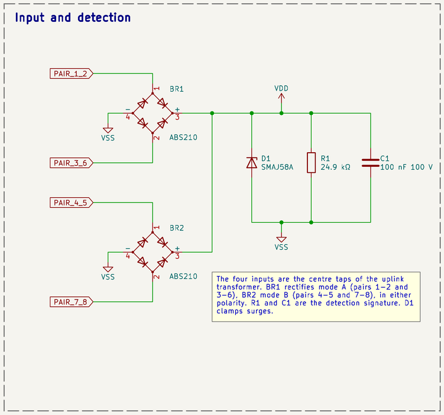
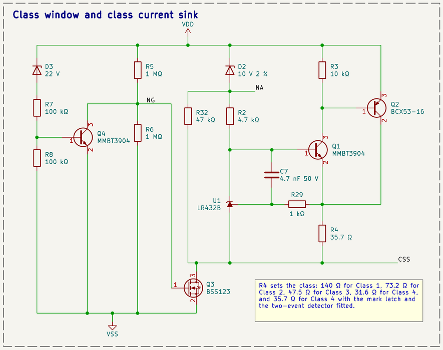
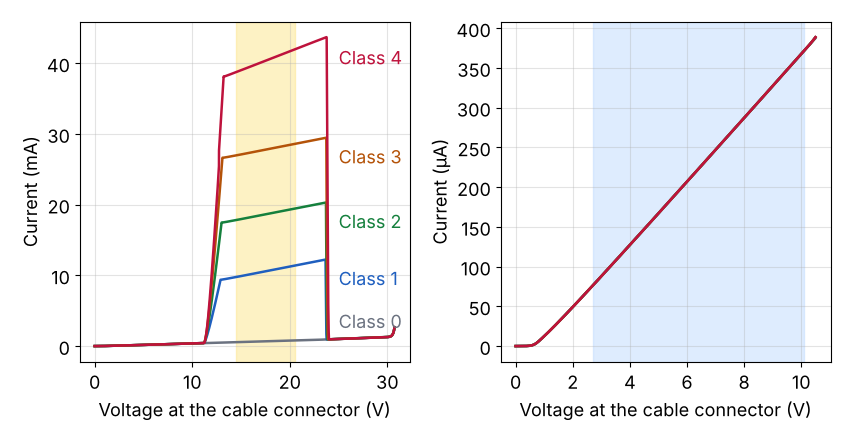
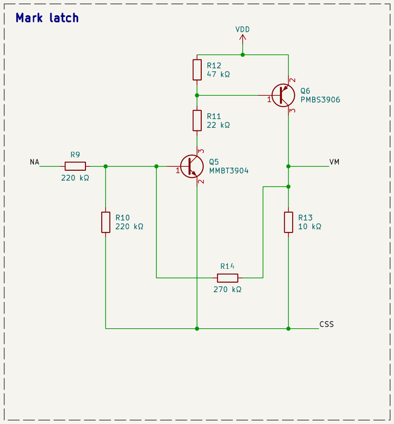
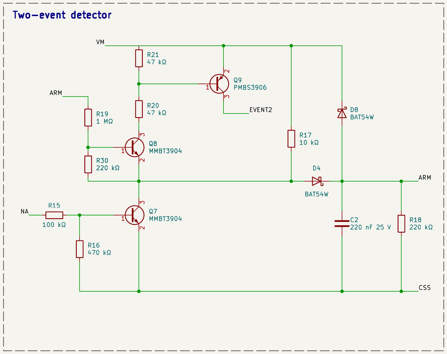
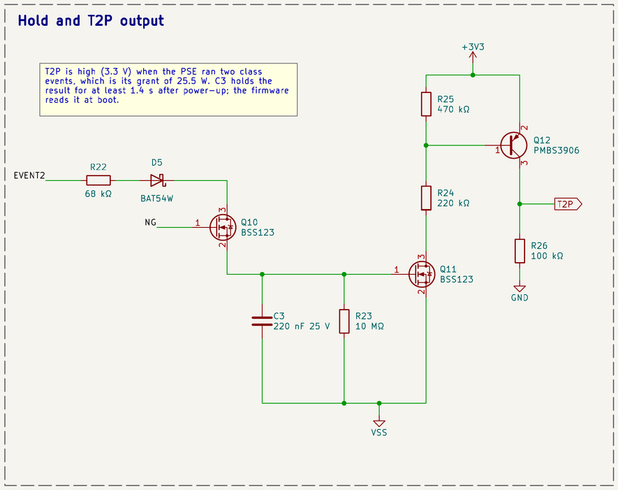
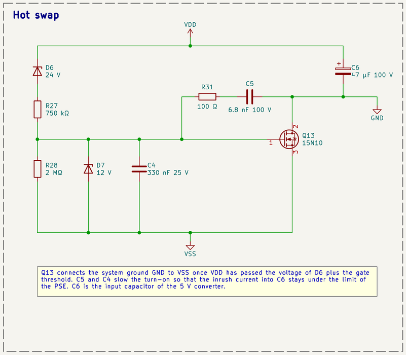
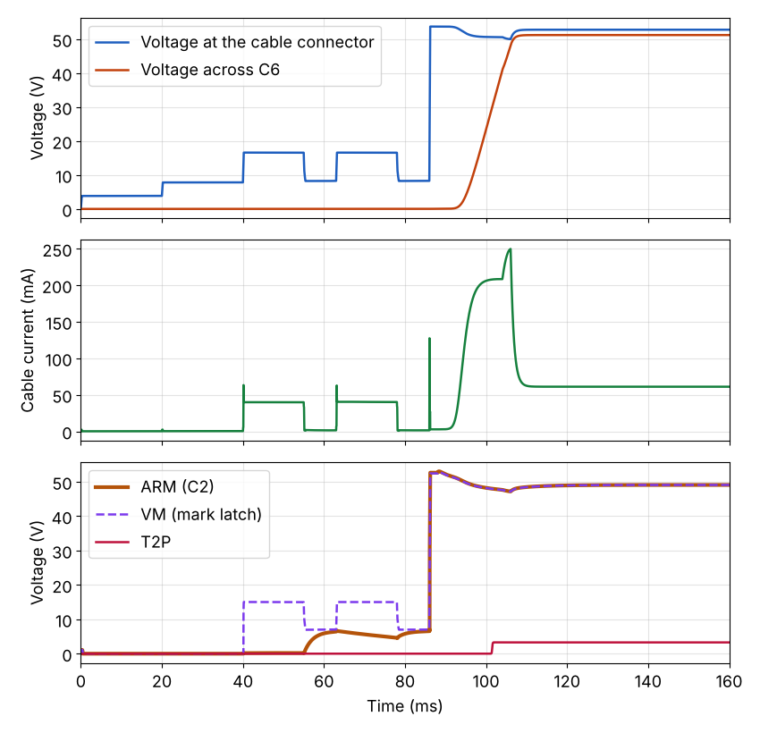

# Discrete PoE front end

The PoE powered device (PD) interface of the adapter, built from resistors, diodes and small
transistors. It sits between the uplink transformer and the 5 V converter and does what a
PD controller IC does: it shows the power sourcing equipment (PSE, the PoE switch or injector)
a valid detection signature, sinks the class current, limits the inrush current and tells the
firmware of the YT9215 whether the PSE granted 13 W or 25.5 W.

Terms used in this note:

| Term | Meaning |
| --- | --- |
| Type 1 | PSE or PD of IEEE 802.3af, up to 12.95 W at the PD |
| Type 2 | PSE or PD of IEEE 802.3at, up to 25.5 W at the PD |
| Type 3 | PSE of IEEE 802.3bt, up to 51 W at the PD |
| Type 4 | PSE of IEEE 802.3bt, up to 71.3 W at the PD |
| Mode A | Power on the pairs of pins 1-2 and 3-6 |
| Mode B | Power on the pairs of pins 4-5 and 7-8 |
| Class event | Period in which the PSE applies 14.5 V to 20.5 V and measures the current of the PD |
| Mark event | Period after a class event in which the PSE applies 6.9 V to 10 V |
| T2P | "Type 2 PSE" signal: logic output that tells the firmware that the PSE granted 25.5 W |
| LLDP | Link Layer Discovery Protocol, the Ethernet frames in which a PSE and a PD can agree on power |
| Single-signature PD | PD that shows one detection signature for both pair sets together |

The design is simulated and drawn. It is not built and not measured. The section
[Limits and open points](#limits-and-open-points) lists what a first board has to prove.

| Section | Contents |
| --- | --- |
| [Evidence marks](#evidence-marks) | Meaning of the marks on numbers |
| [Summary](#summary) | Variants with part count and cost |
| [Requirements](#requirements) | Limits of IEEE 802.3 with source and result |
| [Circuit](#circuit) | Schematic and how each block works |
| [Behaviour with each kind of PSE](#behaviour-with-each-kind-of-pse) | Result for each PSE type and for passive supplies |
| [Getting more than 13 W](#getting-more-than-13-w) | Ways to obtain a 25.5 W grant |
| [Power sequencing](#power-sequencing) | What runs before the grant is known |
| [Discrete parts or a PD controller IC](#discrete-parts-or-a-pd-controller-ic) | Cost and function side by side |
| [Simulation](#simulation) | Method and results |
| [Interfaces](#interfaces) | Signals to the converter and the firmware |
| [Limits and open points](#limits-and-open-points) | Non-isolated design, untested points |
| [Bill of materials](#bill-of-materials) | Every part with LCSC number and price |
| [Files](#files) | Files of this folder |
| [Sources](#sources) | Documents the numbers come from |

<a id="evidence-marks"></a>

## Evidence marks

A mark after a number says where the number comes from. Each mark links to this table.

| Mark | Meaning |
| --- | --- |
| IEEE draft | Read in an IEEE 802.3 task force document that quotes the text of the standard |
| UNH-IOL test suite | Read in the conformance test suite for powered devices of the UNH InterOperability Laboratory |
| TI datasheet | Read in the [TPS2378 datasheet](../../datasheets/components/TI_TPS2378.pdf) of Texas Instruments, which restates the limits of the standard |
| TI application note | Read in the application note SLVA233A of Texas Instruments on transient immunity for PoE |
| Ethernet Alliance | Read in the 802.3bt overview white paper of the Ethernet Alliance |
| Part datasheet | Read in the datasheet of the part, stored in this repository |
| LCSC | Price for 1,000 pieces read from lcsc.com |
| Simulated | Result of the ngspice runs in [`sim/`](sim/) |
| Calculated | Worked out from part values in this note |
| Assumed | Chosen for this note without a measurement |

The documents behind the first five marks are listed under [Sources](#sources). None of the
marks stands for the text of IEEE 802.3-2022 clause 33 itself; the note relies on documents that
quote or restate it.

## Summary

The discrete front end comes in three variants that share one layout. Parts of a block that is
not wanted are left off the board. The last row is the same function built around a PD controller
IC; see [Discrete parts or a PD controller IC](#discrete-parts-or-a-pd-controller-ic).

<!-- variants:begin -->
| Variant | Parts | Cost (USD) |
| --- | --- | --- |
| Discrete: Class 0 | 13 | 0.22 |
| Discrete: one class from 1 to 4 | 30 | 0.41 |
| Discrete: Class 4 with two-event detection | 62 | 0.59 |
| PD controller IC: [TMI7303B](#tmi7303b) with two-event detection | 8 | 0.33 |
<!-- variants:end -->

Prices carry the mark [LCSC](#evidence-marks). The 47 µF input capacitor of the 5 V converter is not
counted; it is listed under [Other parts](#other-parts).

| Variant | Power from a Type 1 PSE (W) | Power from a Type 2 PSE (W) |
| --- | --- | --- |
| Class 0 | 12.95 | 12.95 |
| Class 1 | 3.84 | 3.84 |
| Class 2 | 6.49 | 6.49 |
| Class 3 | 12.95 | 12.95 |
| Class 4 | 12.95 | 12.95 |
| Class 4 with two-event detection | 12.95 | 25.5 |
| PD controller IC with two-event detection | 12.95 | 25.5 |

The Class 4 variant without two-event detection can also reach 25.5 W, but only after its
firmware has negotiated over LLDP; see [Getting more than 13 W](#getting-more-than-13-w).
The power figures are the maximum average input power of the PD for each class,
[Ethernet Alliance](#evidence-marks).

## Requirements

All voltages are at the cable connector of the PD, in front of the bridges.

| ID | Quantity | Minimum | Maximum | Unit | Source | Result minimum | Result maximum | Result from |
| --- | --- | --- | --- | --- | --- | --- | --- | --- |
| <a id="req-1"></a>REQ-1 | Detection slope between 2.7 V and 10.1 V | 23.75 | 26.25 | kΩ | [UNH-IOL test suite](#evidence-marks) | 24.72 | 25.55 | [Simulated](#evidence-marks) |
| <a id="req-2"></a>REQ-2 | Detection voltage offset | – | 1.9 | V | [UNH-IOL test suite](#evidence-marks) | 0.92 | 0.92 | [Simulated](#evidence-marks) |
| <a id="req-3"></a>REQ-3 | Detection capacitance | 50 | 120 | nF | [TI datasheet](#evidence-marks) | 97 | 118 | [Calculated](#evidence-marks) |
| <a id="req-4"></a>REQ-4 | Non-valid signature slope, low side | – | 12 | kΩ | [UNH-IOL test suite](#evidence-marks) | 7.1 | 7.1 | [Calculated](#evidence-marks) |
| <a id="req-5"></a>REQ-5 | Class 0 current between 14.5 V and 20.5 V | 0 | 4 | mA | [UNH-IOL test suite](#evidence-marks) | 0.54 | 0.80 | [Simulated](#evidence-marks) |
| <a id="req-6"></a>REQ-6 | Class 1 current between 14.5 V and 20.5 V | 9 | 12 | mA | [UNH-IOL test suite](#evidence-marks) | 9.59 | 11.56 | [Simulated](#evidence-marks) |
| <a id="req-7"></a>REQ-7 | Class 2 current between 14.5 V and 20.5 V | 17 | 20 | mA | [UNH-IOL test suite](#evidence-marks) | 17.53 | 19.75 | [Simulated](#evidence-marks) |
| <a id="req-8"></a>REQ-8 | Class 3 current between 14.5 V and 20.5 V | 26 | 30 | mA | [UNH-IOL test suite](#evidence-marks) | 26.53 | 29.04 | [Simulated](#evidence-marks) |
| <a id="req-9"></a>REQ-9 | Class 4 current between 14.5 V and 20.5 V | 36 | 44 | mA | [UNH-IOL test suite](#evidence-marks) | 38.13 | 42.67 | [Simulated](#evidence-marks) |
| <a id="req-10"></a>REQ-10 | Mark event current between 6.9 V and 10 V | 0.25 | 4 | mA | [Ethernet Alliance](#evidence-marks) | 1.06 | 1.66 | [Simulated](#evidence-marks) |
| <a id="req-11"></a>REQ-11 | Voltage at which the mark state resets | 2.81 | 6.9 | V | [IEEE draft](#evidence-marks) | 3.83 | 4.14 | [Simulated](#evidence-marks) |
| <a id="req-12"></a>REQ-12 | Voltage at which the PD turns on | – | 42 | V | [UNH-IOL test suite](#evidence-marks) | 39.7 | 39.8 | [Simulated](#evidence-marks) |
| <a id="req-13"></a>REQ-13 | Voltage at which the PD turns off | 30 | 36 | V | [UNH-IOL test suite](#evidence-marks) | 34.3 | 34.4 | [Simulated](#evidence-marks) |
| <a id="req-14"></a>REQ-14 | Input capacitance that lets the PSE limit the inrush current | – | 180 | µF | [IEEE draft](#evidence-marks) | 47 | 47 | [Part datasheet](#evidence-marks) |
| <a id="req-15"></a>REQ-15 | Peak inrush current | – | 400 | mA | [TI datasheet](#evidence-marks) | 174 | 309 | [Simulated](#evidence-marks) |
| <a id="req-16"></a>REQ-16 | Current that keeps the port powered | 10 | – | mA | [TI datasheet](#evidence-marks) | 15 | – | [Calculated](#evidence-marks) |
| <a id="req-17"></a>REQ-17 | Isolation between the cable and accessible conductors | 1500 | – | V | [TI application note](#evidence-marks) | 0 | 0 | [Calculated](#evidence-marks) |

Notes on the rows:

- [REQ-3](#req-3): [C1](#c1) at ±10 %, plus about 7 nF through the series path of [C6](#c6), [C5](#c5), [R31](#r31) and [C4](#c4) and
  the capacitance of [D1](#d1) and [Q13](#q13).
- [REQ-4](#req-4): a signature is non-valid below 12 kΩ or above 45 kΩ. The front end uses the low side: in the
  mark state [R13](#r13) lies in parallel with [R1](#r1).
- [REQ-11](#req-11): the PSE resets a PD by going below 2.81 V, and a mark event goes down to 6.9 V. The
  mark latch has to hold at 6.9 V and has to release before 2.81 V. The 2.81 V figure is read in a
  task force presentation.
- [REQ-12](#req-12) and [REQ-13](#req-13): [Q13](#q13) only connects the ground. The turn-on and turn-off points are set by
  the enable input of the 5 V converter; see [Interfaces](#interfaces).
- [REQ-15](#req-15): a PSE limits the current to between 400 mA and 450 mA for up to 75 ms after power-up.
  The front end stays under 400 mA so that the PSE never reaches its limit.
- [REQ-16](#req-16): the YT9215SCH alone draws 0.66 W with no link
  ([Table 28 of its datasheet](../../datasheets/motorcomm/YT9215SCH_Datasheet_V1.03_2025-02-10.pdf)).
  Through a converter of 90 % efficiency that is 12.9 mA at 57 V, and with the front end's own
  2.7 mA the port carries at least 15 mA.
- [REQ-17](#req-17): the design is non-isolated on purpose and does not meet this requirement; see
  [Limits and open points](#limits-and-open-points).

Two more requirements have no number. A PD that wants more than 12.95 W has to present Class 4,
has to recognise two class events, and has to support classification over LLDP as well
([IEEE draft](#evidence-marks), item PD13 of the conformance statement). Until the PSE has, by a
second class event or over LLDP,
granted more, the PD has to stay within 12.95 W, and in any case for the first 80 ms after
power-up ([TI datasheet](#evidence-marks)).

## Circuit

The whole sheet as a PDF: [`schematic/poe-front-end.pdf`](schematic/poe-front-end.pdf). The KiCad
file is [`schematic/poe-front-end.kicad_sch`](schematic/poe-front-end.kicad_sch).

Net names used in the text:

| Net | Meaning |
| --- | --- |
| VDD | Positive rail after the bridges |
| VSS | Negative rail after the bridges |
| GND | System ground of the adapter |
| CSS | Return of the class sink, the mark latch and the two-event detector |
| NG | Gate of [Q3](#q3) and of [Q10](#q10) |
| NA | Anode of [D2](#d2) |
| VM | Output of the mark latch |
| ARM | Voltage on [C2](#c2) |
| EVENT2 | Pulse during a second class event |
| T2P | Logic output to the firmware |

[Q13](#q13) connects GND to VSS, and [Q3](#q3) connects CSS to VSS. NA rises above CSS whenever VDD
exceeds 10 V.

<a id="input-block"></a>

### Input and detection



[BR1](#br1) and [BR2](#br2) rectify the two pair sets, so power is accepted in mode A, in mode B and in either
polarity. [R1](#r1) and [C1](#c1) are the detection signature. [D1](#d1) clamps surges from the cable.

The bridges are plain silicon bridges. Their forward drop of 1.2 V to 1.9 V is part of every
threshold of the class sink. A Schottky bridge would move the thresholds down by about 0.7 V,
which uses up the margin at the 10.1 V end of the detection range, and its reverse leakage
would add to the detection current.

<a id="class-block"></a>

### Class window and class current sink



[Q3](#q3) connects CSS to VSS while the port voltage is in the range where a PSE classifies. Its gate
sits at half of VDD through [R5](#r5) and [R6](#r6), so [Q3](#q3) conducts from a few volts upward. Above about 23 V,
[D3](#d3) conducts and [Q4](#q4) pulls the gate down. [Q3](#q3) then opens and everything that returns to CSS stops
drawing current. A powered adapter therefore wastes nothing in the class sink.

The sink itself starts when VDD exceeds the 10 V of [D2](#d2). [U1](#u1) is a 1.24 V shunt reference. It
holds 1.24 V across [R4](#r4) by steering [Q1](#q1), and [Q2](#q2) carries most of the current. The class current is
1.24 V divided by [R4](#r4), plus the bias through [R2](#r2) and the current of [R1](#r1). [R29](#r29) and [C7](#c7) keep the loop
stable. [R3](#r3) is the base pull-up of [Q2](#q2), and [R7](#r7) with [R8](#r8) sets the current at
which [Q4](#q4) switches. [R32](#r32) carries the leakage current of [D2](#d2) to CSS. Without it that current would flow
into the base of [Q1](#q1), be amplified by [Q1](#q1) and [Q2](#q2) and bend the detection signature. [R4](#r4) selects the class; see [Class resistor R4](#class-resistor-r4).



The left plot shows the current for each class, with the classification range shaded. The right
plot shows the detection range, where all variants draw the same current as a 24.9 kΩ resistor
behind a bridge.

<a id="mark-block"></a>

### Mark latch



A PSE that grants 25.5 W lowers the voltage to between 6.9 V and 10 V between two class events.
This is the mark event. The PD has to draw between 0.25 mA and 4 mA there and must not look
like a valid detection signature.

[Q5](#q5) and [Q6](#q6) form a latch. The first class event sets it through [R9](#r9). [R14](#r14) holds it while the
voltage is in the mark range, where [D2](#d2) no longer conducts. While the latch is set, [R13](#r13) loads the
port: that is the mark current, and [R13](#r13) in parallel with [R1](#r1) gives the non-valid signature of
[REQ-4](#req-4). The latch releases at about 4 V, so a PSE that returns to detection finds the plain
signature again.

<a id="twoevent-block"></a>

### Two-event detector



The detector answers one question: did the PSE run a second class event?

[Q7](#q7) conducts during every class event and pulls the emitter of [Q8](#q8) to CSS. During a mark event
[Q7](#q7) is off and VM is present, so [R17](#r17) and [D4](#d4) charge [C2](#c2). [C2](#c2) remembers that a mark event followed a
class event. When the next class event arrives, [Q7](#q7) conducts again while [C2](#c2) is still charged.
[Q8](#q8) then conducts, turns [Q9](#q9) on, and EVENT2 rises to VM.

[D8](#d8) empties [C2](#c2) when the latch releases, and [R18](#r18) empties it within a few tens of milliseconds.
A PSE that runs one class event, drops to zero and then powers up does not produce EVENT2.

<a id="hold-block"></a>

### Hold and T2P output



EVENT2 charges [C3](#c3) through [R22](#r22), [D5](#d5) and [Q10](#q10). The gate of [Q10](#q10) is NG, so [Q10](#q10) closes when the class
window closes and [C3](#c3) keeps its charge while the port rises to the operating voltage. [Q11](#q11) and [Q12](#q12)
turn the charge into a logic level referred to GND: T2P is at 3.3 V when two class events were
seen and at 0 V otherwise.

[R22](#r22) and [C3](#c3) form a 15 ms time constant. A class event lasts at least 6 ms and charges [C3](#c3) to more
than 4 V. The fraction of a millisecond in which a rising port voltage crosses the classification
range charges it to about 0.3 V, which is under the gate threshold of [Q11](#q11).

[C3](#c3) discharges through [R23](#r23). T2P stays valid for between 1.4 s and 5.1 s after power-up
([Simulated](#evidence-marks)); the time depends on the gate threshold of [Q11](#q11) and on the length of
the class events. The firmware has to read T2P within that time.

<a id="hotswap-block"></a>

### Hot swap



[Q13](#q13) sits in the return path. Its gate is driven from VDD through [D6](#d6), [R27](#r27) and [R28](#r28), so it starts to
conduct when VDD is about 26 V, above the classification range. [C5](#c5) feeds the falling drain
voltage back to the gate. This sets the rate at which [C6](#c6) charges and with it the inrush current:
about 31 µA of gate current through 6.8 nF gives 4.5 V per millisecond, which is 210 mA into
47 µF ([Calculated](#evidence-marks)). [D7](#d7) limits the gate voltage to 12 V. [C4](#c4) delays the
turn-on and filters the gate, and [R31](#r31) damps the feedback path.

[Q13](#q13) is a switch, not an undervoltage lockout. The lockout with hysteresis is the enable input of
the 5 V converter; see [Interfaces](#interfaces).



The plot shows one complete start: detection at 4 V and 8 V, two class events with a mark event
after each, then power. The class current is 41 mA. [C6](#c6) charges with a peak current of 250 mA,
after which the converter draws a 3 W load. T2P rises as soon as the 3.3 V rail is present. The
short current spikes at the voltage steps are the charging current of [C1](#c1).

## Behaviour with each kind of PSE

| PSE | Standard | Class events | Class 0 to 3 variant gets (W) | Class 4 variant gets (W) | T2P | Result from |
| --- | --- | --- | --- | --- | --- | --- |
| Type 1 | 802.3af | 1 | Class power | 12.95 | Low | [Simulated](#evidence-marks) |
| Type 2 that grants by class events | 802.3at | 2 | Class power | 25.5 | High | [Simulated](#evidence-marks) |
| Type 2 that grants by LLDP | 802.3at | 1 | Class power | 12.95 | Low | [Simulated](#evidence-marks) |
| Type 3 or Type 4 | 802.3bt | 3 | Class power | 25.5 | High | [Simulated](#evidence-marks) |
| Passive 48 V supply | None | 0 | Unknown | Unknown | Low | [Simulated](#evidence-marks) |
| Passive 24 V supply | None | 0 | Does not start | Does not start | Low | [Calculated](#evidence-marks) |

Notes on the rows:

- **Mode A and mode B.** Every row holds for both. A 4-pair PSE feeds both bridges at once; the
  front end is a single-signature PD.
- **Type 1.** A Type 1 PSE treats a Class 4 current as Class 0 and supplies 15.4 W, which is
  12.95 W at the PD.
- **Type 2 that grants by LLDP.** Such a PSE supplies Class 3 power until the PD asks for more in
  an LLDP frame.
- **Type 3 or Type 4.** A Class 4 PD is given at most Class 4. The front end does not present
  the Class 5 to 8 signatures of 802.3bt, which need a different class current in the third
  event.
- **Passive 48 V supply.** The front end starts, because nothing in it waits for a detection.
  The firmware cannot know what the supply can deliver.
- **Passive 24 V supply.** [Q13](#q13) needs about 26 V and the converter 38 V.

## Getting more than 13 W

A Type 2 PSE can grant 25.5 W in two ways, and it chooses which. The front end can support
either or both. The options are set side by side here; none is picked.

| Option | Mark latch fitted | Two-event detector fitted | Parts | Cost (USD) | Needs firmware | 25.5 W from a PSE that grants by class events | 25.5 W from a PSE that grants by LLDP |
| --- | --- | --- | --- | --- | --- | --- | --- |
| <a id="option-a"></a>A: two-event detection in hardware | Yes | Yes | 62 | 0.59 | No | Yes | No |
| <a id="option-b"></a>B: LLDP in firmware | No | No | 30 | 0.41 | Yes | No | Yes |
| <a id="option-c"></a>C: both | Yes | Yes | 62 | 0.59 | Yes | Yes | Yes |
| <a id="option-d"></a>D: PD controller IC with a T2P output | Inside the IC | Inside the IC | 8 | 0.33 | No | Yes | No |

The parts and the cost are those of the whole front end ([LCSC](#evidence-marks)). Option D is
detailed under [Discrete parts or a PD controller IC](#discrete-parts-or-a-pd-controller-ic); with
LLDP firmware added it covers both kinds of PSE in the same way as option C.

What each option depends on:

- [Option A](#option-a) works with no firmware at all. T2P is a hardware signal, so it can also gate
  hardware directly. It cannot help with a PSE that runs one class event and waits for LLDP.
- [Option B](#option-b) adds no parts. With a PSE that grants by class events it leaves the
  adapter at 13 W, although the PSE has reserved 30 W, unless the PSE also reports its
  allocation over LLDP. The firmware has to receive and send LLDP frames. The switch can trap
  LLDP frames to its CPU; whether custom firmware can be loaded at all is the open question
  described in [The RISC-V CPU inside the YT9215](../../research/yt9215-embedded-cpu.md).
- [Option C](#option-c) covers both ways of granting. Supporting both is item PD13 of the conformance
  statement for a Type 2 PD ([Requirements](#requirements)).
- [Option D](#option-d) is the same function as option A in one package. Its T2P output is active low.

A Class 4 PD is also expected to behave in the mark event. With option B alone the
[Mark latch](#mark-block) is absent. The front end then draws only the current of [R1](#r1), which is
0.24 mA at 6.9 V and 0.37 mA at 10 V ([Calculated](#evidence-marks)). The low end misses the
0.25 mA of [REQ-10](#req-10), and the signature in the mark range stays a valid one, which is
outside [REQ-4](#req-4). Fitting the mark latch without the detector costs 8 parts.

## Power sequencing

The grant is not known when the adapter starts, so the adapter starts small. The switch core, the
uplink port and the CPU run first. The downstream ports and the USB-C output stay off until the
firmware knows the power level, from T2P or from LLDP.

| Load | Power (W) | Source |
| --- | --- | --- |
| YT9215SCH with no link | 0.66 | [Part datasheet](#evidence-marks) |
| YT9215SCH with five gigabit links and traffic | 1.70 | [Part datasheet](#evidence-marks) |
| Front end at 57 V | 0.15 | [Simulated](#evidence-marks) |

The switch with every port active fits into the 3.84 W of Class 1, so the start-up state is safe
on every PSE. Sequencing has a second use: the converter starts into a light load while [C6](#c6) is
still charging. A converter that starts into the full load at once can pull [C6](#c6) back under its
stop threshold before the PSE voltage has settled. The simulated power-up therefore starts with
3 W and applies the full load 0.2 s later; a start into the full load is not among the checks.

Power left for the USB-C output, at the lowest voltage a PSE may deliver to the PD:

| Grant (W) | PD voltage (V) | Bridge loss (W) | Front end loss (W) | Converter input (W) | Converter output (W) | Switch (W) | USB-C output (W) | USB-C current at 5 V (A) |
| --- | --- | --- | --- | --- | --- | --- | --- | --- |
| 12.95 | 37 | 0.60 | 0.11 | 12.24 | 11.0 | 2.0 | 9.0 | 1.8 |
| 25.5 | 42.5 | 1.02 | 0.15 | 24.33 | 21.9 | 2.0 | 19.9 | 4.0 |

The table is [Calculated](#evidence-marks) from these inputs: 0.85 V per bridge diode
([Assumed](#evidence-marks) from the 1.0 V at 2 A in the bridge datasheet), 0.1 Ω for [Q13](#q13)
([Part datasheet](#evidence-marks)), 2.7 mA for the front end itself ([Simulated](#evidence-marks)),
90 % converter efficiency ([Assumed](#evidence-marks)) and
2.0 W at the 5 V rail for the switch with its own regulators ([Assumed](#evidence-marks)).

## Discrete parts or a PD controller IC

A PD controller IC replaces the [Class sink](#class-block), the [Mark latch](#mark-block), the
[Two-event detector](#twoevent-block) and the [Hot swap](#hotswap-block) blocks. It still needs the
[Input](#input-block) block and a class resistor. The cheapest one found at LCSC is the
[TMI7303B](#tmi7303b). Both columns are given; none is picked.

| Property | Discrete, Class 4 with two-event detection | TMI7303B with the input block |
| --- | --- | --- |
| Parts | 62 | 8 |
| Cost (USD) | 0.59 | 0.33 |
| Detection and class current | Yes | Yes |
| Two-event detection with T2P output | Yes | Yes |
| Inrush current, lowest (mA) | 174 | 180 |
| Inrush current, highest (mA) | 309 | 180 |
| Current limit in operation | No | Yes |
| Thermal shutdown | No | Yes |
| Power-good output for the converter | No | Yes |
| Undervoltage lockout | In the converter | Built in |
| Resistance of the pass switch (Ω) | 0.1 | 0.48 |
| Loss in the pass switch at 0.6 A (W) | 0.04 | 0.17 |
| Second source | Every part is generic | One maker |
| Evidence | [Simulated](#evidence-marks) | [Part datasheet](#evidence-marks) |

The TMI7303B column counts the input block, the IC, its class resistor and a pull-up resistor
for its T2P output, which is open drain and active low. The discrete Class 0 variant costs
0.22 USD and the discrete variant with one class from 1 to 4 costs 0.41 USD
([Summary](#summary)). The [TMI7303B](#tmi7303b) figures are from its datasheet alone; the part
is not simulated and not tested. The [TPS2378](#tps2378) of Texas Instruments is a part of the
same kind whose datasheet restates the limits of the standard.

## Simulation

[`sim/frontend.py`](sim/frontend.py) builds an ngspice netlist of the front end.
[`sim/checks.py`](sim/checks.py) runs it against the [Requirements](#requirements) and writes
[`sim/results.md`](sim/results.md). [`sim/plots.py`](sim/plots.py) draws the two plots of this note.

```
cd design/poe-front-end/sim
python3 checks.py
python3 plots.py
```

The PSE is a voltage source behind a diode and the loop resistance of the cable. The 5 V
converter is a constant-power load that starts at 38 V and stops at 32.5 V across [C6](#c6). The
transistor and diode models are generic ones with the parameters of the part classes, not vendor
models.

Each variant with a class sink is run at 32 corners and at the nominal point. The Class 0
variant has no sink and is run at the nominal point and at the two temperatures. The corners combine 0 °C
and 70 °C, the 10 V zener at ±2 %, the 22 V zener at ±5 %, the reference at ±1.5 % and a
transistor gain of 60 and 300. Two more runs per variant give [D2](#d2) a leakage of 2 µA at 70 °C,
ten times its limit at 25 °C. Resistor tolerances are not varied.

Detection signature, [REQ-1](#req-1) and [REQ-2](#req-2):

<!-- results1:begin -->
| Variant | Slope minimum (kΩ) | Slope maximum (kΩ) | Voltage offset (V) | Runs | Verdict |
| --- | --- | --- | --- | --- | --- |
| Class 0 | 24.83 | 25.55 | 0.92 | 3 | Pass |
| Class 1 | 24.73 | 25.51 | 0.92 | 35 | Pass |
| Class 2 | 24.73 | 25.51 | 0.92 | 35 | Pass |
| Class 3 | 24.73 | 25.51 | 0.92 | 35 | Pass |
| Class 4 | 24.73 | 25.51 | 0.92 | 35 | Pass |
| Class 4 with two-event block | 24.72 | 25.51 | 0.92 | 35 | Pass |
<!-- results1:end -->

Class current, [REQ-5](#req-5) to [REQ-9](#req-9):

<!-- results2:begin -->
| Variant | Current minimum (mA) | Current maximum (mA) | Limit minimum (mA) | Limit maximum (mA) | Verdict |
| --- | --- | --- | --- | --- | --- |
| Class 0 | 0.54 | 0.80 | 0 | 4 | Pass |
| Class 1 | 9.59 | 11.56 | 9 | 12 | Pass |
| Class 2 | 17.53 | 19.75 | 17 | 20 | Pass |
| Class 3 | 26.53 | 29.04 | 26 | 30 | Pass |
| Class 4 | 39.45 | 42.36 | 36 | 44 | Pass |
| Class 4 with two-event block | 38.13 | 42.67 | 36 | 44 | Pass |
<!-- results2:end -->

Voltage at which the class sink turns on and off. It has to turn on between 10.1 V and 14.5 V
and off between 20.5 V and 30 V:

<!-- results3:begin -->
| Variant | Turn-on minimum (V) | Turn-on maximum (V) | Turn-off minimum (V) | Turn-off maximum (V) | Verdict |
| --- | --- | --- | --- | --- | --- |
| Class 1 | 11.6 | 12.1 | 22.4 | 25.2 | Pass |
| Class 2 | 11.4 | 11.9 | 22.5 | 25.3 | Pass |
| Class 3 | 11.3 | 11.8 | 22.6 | 25.4 | Pass |
| Class 4 | 11.2 | 11.8 | 22.7 | 25.5 | Pass |
| Class 4 with two-event block | 11.3 | 11.8 | 22.7 | 25.5 | Pass |
<!-- results3:end -->

Complete PSE sequences into the Class 4 variant with two-event detection and a 3 W load:

<!-- results4:begin -->
| Sequence | Cable loop (Ω) | T2P expected | T2P simulated | Mark current minimum (mA) | Mark current maximum (mA) | Peak inrush current (mA) | Verdict |
| --- | --- | --- | --- | --- | --- | --- | --- |
| Type 2 PSE with two events at mid values | 12.5 | High | High | 1.37 | 1.37 | 250 | Pass |
| Type 2 PSE with two events at the shortest times and lowest voltages | 20 | High | High | 1.06 | 1.10 | 196 | Pass |
| Type 2 PSE with two events at the longest times and highest voltages | 0.5 | High | High | 1.63 | 1.66 | 309 | Pass |
| Type 3 PSE with a long first event and three events | 12.5 | High | High | 1.36 | 1.36 | 249 | Pass |
| Type 1 PSE with one event then power | 20 | Low | Low | – | – | 174 | Pass |
| Type 1 PSE with one event then 0 V for 20 ms | 20 | Low | Low | – | – | 174 | Pass |
| Type 1 PSE with one event then 0 V for 3 ms | 0.5 | Low | Low | – | – | 309 | Pass |
| Type 1 PSE with one event then 0 V for 3 ms and a 1 ms rise | 0.5 | Low | Low | – | – | 309 | Pass |
| Type 1 PSE with one event then 8 V for 5 ms and a 1 ms rise | 12.5 | Low | Low | 1.35 | 1.35 | 192 | Pass |
| Type 1 PSE with 1 µF at its output released for 3 ms and a 1 ms rise | 12.5 | Low | Low | – | – | 192 | Pass |
| Passive 48 V supply applied at once | 2 | Low | Low | – | – | 221 | Pass |
<!-- results4:end -->

Other quantities. The part corners here are the gate threshold of the small MOSFETs at 1.0 V
and 2.5 V, the transistor gain at 60 and 300, and 0 °C and 70 °C. Six sequences are run at each
of the eight corners: the two Type 2 sequences at the extreme values and the four Type 1
sequences that have a 3 ms gap or a 1 ms rise:

<!-- results5:begin -->
| Quantity | Value | Unit | Limit minimum | Limit maximum | Verdict |
| --- | --- | --- | --- | --- | --- |
| Sequence runs decided correctly at the part corners | 48 | of 48 | 48 | 48 | Pass |
| Mark latch release voltage at 0 °C | 4.14 | V | 2.81 | 6.9 | Pass |
| Mark latch release voltage at 70 °C | 3.83 | V | 2.81 | 6.9 | Pass |
| Front end current at 57 V | 2.70 | mA | – | – | Information |
| T2P stays high after the mid sequence with a gate threshold of 1.0 V | 5.1 | s | – | – | Information |
| T2P stays high after the mid sequence with a gate threshold of 2.5 V | 2.0 | s | – | – | Information |
| T2P stays high after the shortest sequence with a gate threshold of 1.0 V | 4.0 | s | – | – | Information |
| T2P stays high after the shortest sequence with a gate threshold of 2.5 V | 1.4 | s | – | – | Information |
<!-- results5:end -->

Power-up, load step and brown-out. The load is 3 W at first and steps to the full value after
0.2 s. The PSE voltage then falls to 26 V and returns. The cycling columns give the range of PSE
voltage, below the valid range, in which the converter starts and stops repeatedly:

<!-- results6:begin -->
| Case | PSE voltage (V) | Runs at that voltage | Converter stops at (V) | Restarts | Cycling from (V) | Cycling to (V) | [Q13](#q13) drop (mV) | Verdict |
| --- | --- | --- | --- | --- | --- | --- | --- | --- |
| 12.5 W converter load on a 20 Ω loop | 44 | Yes | 34.3 | Yes | 39.7 | 43.1 | 29 | Pass |
| 24.5 W converter load on a 12.5 Ω loop | 50 | Yes | 34.4 | Yes | 39.8 | 45.8 | 47 | Pass |
<!-- results6:end -->

## Interfaces

| Signal | Direction | Minimum (V) | Maximum (V) | Reference | Meaning |
| --- | --- | --- | --- | --- | --- |
| PAIR_1_2 | In | 0 | 57 | Other pair set | Centre tap of the uplink transformer for pins 1-2 |
| PAIR_3_6 | In | 0 | 57 | Other pair set | Centre tap of the uplink transformer for pins 3-6 |
| PAIR_4_5 | In | 0 | 57 | Other pair set | Centre tap of the uplink transformer for pins 4-5 |
| PAIR_7_8 | In | 0 | 57 | Other pair set | Centre tap of the uplink transformer for pins 7-8 |
| VDD | Out | 30 | 57 | GND | Input of the 5 V converter |
| GND | Out | 0 | 0 | GND | System ground |
| +3V3 | In | 3.3 | 3.3 | GND | Supply of the T2P output stage |
| T2P | Out | 0 | 3.3 | GND | High when the PSE ran two or more class events |

What the front end needs from the 5 V converter:

| Property | Value | Unit | Reason |
| --- | --- | --- | --- |
| Enable threshold, rising | 38 | V | [REQ-12](#req-12) |
| Enable threshold, falling | 32.5 | V | [REQ-13](#req-13) |
| Input voltage rating | 100 | V | Clamp voltage of [D1](#d1) |
| Tolerance of the enable thresholds | 4 | % | [REQ-12](#req-12) |
| Input capacitance | 47 | µF | [REQ-14](#req-14) |
| Load at start-up | 3 | W | [Power sequencing](#power-sequencing) |

With the bridge drop added, an enable threshold more than 4 % high puts the turn-on point over
42 V or the turn-off point over 36 V. The simulation uses the nominal thresholds. [D1](#d1) clamps at
93.6 V only for its rated pulse of 4.3 A; [Q3](#q3), [Q13](#q13), [C1](#c1), [C5](#c5) and [C6](#c6) are 100 V parts as well. The thresholds are measured across [C6](#c6). The clamp voltage of [D1](#d1) is from its datasheet
([Part datasheet](#evidence-marks)).

What the front end needs from the firmware, in order:

1. Keep the downstream ports and the USB-C output off at reset.
2. Read T2P within 1 s of the port reaching its operating voltage. T2P is valid for 1.4 s at the worst corner.
3. With T2P high, use the 25.5 W budget.
4. With T2P low, use the 12.95 W budget. A Class 1 or Class 2 variant has the budget of its class.
5. With LLDP support, ask the PSE for more and follow its answer.

## Limits and open points

**Non-isolated.** The standard asks for 1500 V of isolation between the cable and anything a
person or another device can touch ([REQ-17](#req-17)). Here GND, the USB-C shell and the Raspberry Pi
are connected to the negative PoE rail through [Q13](#q13). Three consequences follow:

- The adapter is not compliant with IEEE 802.3 and cannot be sold as such.
- A PSE output floats, so one connection to earth does no harm. A Pi that is also earthed
  through a monitor or another cable ties the negative PoE rail to earth. A PSE whose positive
  rail is earthed would then be shorted through that path.
- Surges on the Ethernet cable reach the Pi's ground. [D1](#d1) limits the differential part to 93.6 V at its rated
  pulse current; nothing limits the common-mode part.

Before [Q13](#q13) closes, GND floats and can sit at up to VDD above VSS. The front end is the only part
of the adapter that refers to VSS. Its T2P stage links the two grounds: while GND floats high and
[Q11](#q11) conducts, up to 0.26 mA flows from the unpowered 3.3 V rail through [Q12](#q12) and [R24](#r24) to VSS.

**Bridge pin numbers.** The schematic symbol of [BR1](#br1) and [BR2](#br2) carries the pin numbers of the ABS210
datasheet: pins 1 and 2 are the AC pins, pin 3 is positive and pin 4 negative. Bridges in the same
package from other makers can be numbered differently, and so can a SOT-89 transistor that
replaces [Q2](#q2).

**Not built.** Every result is simulated or calculated. A first board has to confirm the
detection slope, the class currents, the sink window, the mark latch and the T2P decision on real
Type 1 and Type 2 PSEs.

**No thermal protection.** During a class event [Q2](#q2) dissipates up to 0.96 W. A class event lasts
at most 105 ms, so the average is small. A PSE that stayed in the classification range for
seconds would overheat [Q2](#q2). A PD controller IC switches off in that case.

**No current limit in operation.** After start-up [Q13](#q13) is fully on. A short at the converter
input is limited only by the PSE.

**False T2P.** T2P is wrong if a PSE runs one class event, rests in the mark range for 2 ms or
more and then takes longer than about 2 ms to rise to its operating voltage. The port voltage
then spends long enough in the classification range to look like a second class event. With a
rise of 1 ms the hold node reaches 0.33 V and T2P stays low; with a rise of 3 ms it reaches
0.95 V, which is at the lowest gate threshold of [Q11](#q11) ([Simulated](#evidence-marks)). A Type 1 PSE is
not meant to rest in the mark range, and the six simulated Type 1 sequences give the right
result. In the failing case the adapter draws 25.5 W from a 15.4 W port and the PSE switches it
off.

**T2P expires.** T2P is valid for 1.4 s at worst, counted from the port reaching its operating
voltage. Firmware that boots more slowly needs a latch on the 3.3 V side.

**Leakage at the hold node.** The hold node sits on 10 MΩ. A leakage of 100 nA into it from a
net at VDD lifts it by 1 V, which is the lowest gate threshold of [Q11](#q11) and reads as T2P high. The
leakage limits of [Q10](#q10) and of the board surface are not part of the simulation. The node needs a
guard trace and a clean board.

**No inrush limit after a short interruption.** The gate of [Q13](#q13) discharges with a time constant
of 0.66 s. A supply that returns within about 1.5 s finds [Q13](#q13) still on and charges [C6](#c6) without a
limit: 4.2 A to 6.7 A through a 2 Ω loop ([Simulated](#evidence-marks), not among the checks). A
PSE limits this current itself and detects again before it reapplies power; a passive supply
does not. In that time the detection signature is not valid either, because [C6](#c6) holds VDD up.

**Loop stability.** The class current loop around [U1](#u1) is simulated with a behavioural model of
the reference. The LR432B datasheet has no stability chart, so the loop has to be checked with an
oscilloscope on the first board.

**Class current margin.** The Class 2 current comes within 0.25 mA of its upper limit at the
worst corner, and the Class 1 and Class 3 currents within 0.6 mA of a limit ([REQ-6](#req-6), [REQ-7](#req-7), [REQ-8](#req-8)), and the tolerance of
[R4](#r4) is not part of the corners.

**Converter cycling.** With a PSE voltage below its valid range the converter starts and stops
repeatedly, because the cable drop disappears each time the load switches off. A start-up delay
in the converter slows this to a hiccup.

**No 802.3bt classes.** The front end stops at Class 4. Class 5 to 8 need a class current that
changes after the second event, and a count of up to five events.

## Bill of materials

Prices are for 1,000 pieces ([LCSC](#evidence-marks)). [`bom.py`](bom.py) reads them from lcsc.com into
[`bom.json`](bom.json) and writes the tables of this note. The part list is [`parts.py`](parts.py).

The parts of the [Hold and T2P output](#hold-block) are counted in the two-event detector block.

<!-- cost:begin -->
| Block | Parts | Cost (USD) |
| --- | --- | --- |
| [Input](#input-block) | 5 | 0.074 |
| [Hot swap](#hotswap-block) | 8 | 0.147 |
| [Class sink](#class-block) | 17 | 0.193 |
| [Mark latch](#mark-block) | 8 | 0.035 |
| [Two-event detector](#twoevent-block) | 24 | 0.141 |
<!-- cost:end -->

<!-- bom:begin -->
| Reference | Block | Value | Rating | Package | Part | Maker | LCSC | Datasheet | Price (USD) |
| --- | --- | --- | --- | --- | --- | --- | --- | --- | --- |
| <a id="br1"></a>BR1 | [Input](#input-block) | ABS210 | – | ABS | ABS210 | YONGYUTAI | [C2892567](https://www.lcsc.com/product-detail/C2892567.html) | [PDF](../../datasheets/components/Yongyutai_ABS2-ABS210_Series.pdf) | 0.0189 |
| <a id="br2"></a>BR2 | [Input](#input-block) | ABS210 | – | ABS | ABS210 | YONGYUTAI | [C2892567](https://www.lcsc.com/product-detail/C2892567.html) | [PDF](../../datasheets/components/Yongyutai_ABS2-ABS210_Series.pdf) | 0.0189 |
| <a id="c1"></a>C1 | [Input](#input-block) | 100 nF | 100 V | 0805 | CL21B104KCFNNNE | Samsung Electro-Mechanics | [C28233](https://www.lcsc.com/product-detail/C28233.html) | [PDF](../../datasheets/components/Samsung_CL_MLCC_Series.pdf) | 0.0103 |
| <a id="d1"></a>D1 | [Input](#input-block) | SMAJ58A | – | SMA | SMAJ58A | GOODWORK | [C2980408](https://www.lcsc.com/product-detail/C2980408.html) | [LCSC](https://datasheet.lcsc.com/datasheet/pdf/a80e1e10308b613a2995351971a1558c.pdf?productCode=C2980408) | 0.0226 |
| <a id="r1"></a>R1 | [Input](#input-block) | 24.9 kΩ | – | 1206 | FRC1206F2492TS | FOJAN | [C2930420](https://www.lcsc.com/product-detail/C2930420.html) | [PDF](../../datasheets/components/Fojan_FRC_Chip_Resistor_Series.pdf) | 0.0037 |
| <a id="c4"></a>C4 | [Hot swap](#hotswap-block) | 330 nF | 25 V | 0603 | 0603B334K250NT | FH | [C1615](https://www.lcsc.com/product-detail/C1615.html) | [PDF](../../datasheets/components/FH_MLCC_Series.pdf) | 0.0126 |
| <a id="c5"></a>C5 | [Hot swap](#hotswap-block) | 6.8 nF | 100 V | 0603 | 0603B682K101NT | FH | [C81355](https://www.lcsc.com/product-detail/C81355.html) | [PDF](../../datasheets/components/FH_MLCC_Series.pdf) | 0.0065 |
| <a id="d6"></a>D6 | [Hot swap](#hotswap-block) | 24 V | – | SOD-123 | BZT52C24 | R+O | [C19077416](https://www.lcsc.com/product-detail/C19077416.html) | [PDF](../../datasheets/components/RO_BZT52C_Series.pdf) | 0.0145 |
| <a id="d7"></a>D7 | [Hot swap](#hotswap-block) | 12 V | – | SOD-123 | BZT52C12 | R+O | [C19077410](https://www.lcsc.com/product-detail/C19077410.html) | [PDF](../../datasheets/components/RO_BZT52C_Series.pdf) | 0.0102 |
| <a id="q13"></a>Q13 | [Hot swap](#hotswap-block) | 15N10 | – | TO-252 | 15N10 | UMW | [C359106](https://www.lcsc.com/product-detail/C359106.html) | [PDF](../../datasheets/components/UMW_15N10.pdf) | 0.0974 |
| <a id="r27"></a>R27 | [Hot swap](#hotswap-block) | 750 kΩ | – | 0805 | 0805W8F7503T5E | UNI-ROYAL | [C17817](https://www.lcsc.com/product-detail/C17817.html) | [PDF](../../datasheets/components/UniRoyal_Chip_Resistor_Series.pdf) | 0.0024 |
| <a id="r28"></a>R28 | [Hot swap](#hotswap-block) | 2 MΩ | – | 0603 | 0603WAF2004T5E | UNI-ROYAL | [C22976](https://www.lcsc.com/product-detail/C22976.html) | [PDF](../../datasheets/components/UniRoyal_Chip_Resistor_Series.pdf) | 0.0020 |
| <a id="r31"></a>R31 | [Hot swap](#hotswap-block) | 100 Ω | – | 0603 | 0603WAF1000T5E | UNI-ROYAL | [C22775](https://www.lcsc.com/product-detail/C22775.html) | [PDF](../../datasheets/components/UniRoyal_Chip_Resistor_Series.pdf) | 0.0015 |
| <a id="c7"></a>C7 | [Class sink](#class-block) | 4.7 nF | 50 V | 0603 | 0603B472K500NT | FH | [C53987](https://www.lcsc.com/product-detail/C53987.html) | [PDF](../../datasheets/components/FH_MLCC_Series.pdf) | 0.0036 |
| <a id="d2"></a>D2 | [Class sink](#class-block) | 10 V | 2 % | SOD-123 | BZT52B10 | R+O | [C22395568](https://www.lcsc.com/product-detail/C22395568.html) | [PDF](../../datasheets/components/RO_BZT52B_Series.pdf) | 0.0141 |
| <a id="d3"></a>D3 | [Class sink](#class-block) | 22 V | – | SOD-123 | BZT52C22 | R+O | [C22375295](https://www.lcsc.com/product-detail/C22375295.html) | [PDF](../../datasheets/components/RO_BZT52C_Series.pdf) | 0.0140 |
| <a id="q1"></a>Q1 | [Class sink](#class-block) | MMBT3904 | – | SOT-23 | MMBT3904 | ST(Semtech) | [C84104](https://www.lcsc.com/product-detail/C84104.html) | [PDF](../../datasheets/components/Semtech_MMBT3904.pdf) | 0.0092 |
| <a id="q2"></a>Q2 | [Class sink](#class-block) | BCX53-16 | – | SOT-89 | BCX53-16 | R+O | [C41375135](https://www.lcsc.com/product-detail/C41375135.html) | [PDF](../../datasheets/components/RO_BCX53_Series.pdf) | 0.0384 |
| <a id="q3"></a>Q3 | [Class sink](#class-block) | BSS123 | – | SOT-23 | BSS123 | MDD(Microdiode Semiconductor) | [C427379](https://www.lcsc.com/product-detail/C427379.html) | [PDF](../../datasheets/components/MDD_BSS123.pdf) | 0.0166 |
| <a id="q4"></a>Q4 | [Class sink](#class-block) | MMBT3904 | – | SOT-23 | MMBT3904 | ST(Semtech) | [C84104](https://www.lcsc.com/product-detail/C84104.html) | [PDF](../../datasheets/components/Semtech_MMBT3904.pdf) | 0.0092 |
| <a id="r2"></a>R2 | [Class sink](#class-block) | 4.7 kΩ | – | 0603 | 0603WAF4701T5E | UNI-ROYAL | [C23162](https://www.lcsc.com/product-detail/C23162.html) | [PDF](../../datasheets/components/UniRoyal_Chip_Resistor_Series.pdf) | 0.0023 |
| <a id="r3"></a>R3 | [Class sink](#class-block) | 10 kΩ | – | 0603 | 0603WAF1002T5E | UNI-ROYAL | [C25804](https://www.lcsc.com/product-detail/C25804.html) | [PDF](../../datasheets/components/UniRoyal_Chip_Resistor_Series.pdf) | 0.0016 |
| <a id="r4"></a>R4 | [Class sink](#class-block) | [Class table](#class-resistor-r4) | – | 0603 | – | – | – | – | 0.0016 |
| <a id="r5"></a>R5 | [Class sink](#class-block) | 1 MΩ | – | 0805 | 0805W8F1004T5E | UNI-ROYAL | [C17514](https://www.lcsc.com/product-detail/C17514.html) | [PDF](../../datasheets/components/UniRoyal_Chip_Resistor_Series.pdf) | 0.0035 |
| <a id="r6"></a>R6 | [Class sink](#class-block) | 1 MΩ | – | 0603 | 0603WAF1004T5E | UNI-ROYAL | [C22935](https://www.lcsc.com/product-detail/C22935.html) | [PDF](../../datasheets/components/UniRoyal_Chip_Resistor_Series.pdf) | 0.0014 |
| <a id="r7"></a>R7 | [Class sink](#class-block) | 100 kΩ | – | 0603 | 0603WAF1003T5E | UNI-ROYAL | [C25803](https://www.lcsc.com/product-detail/C25803.html) | [PDF](../../datasheets/components/UniRoyal_Chip_Resistor_Series.pdf) | 0.0023 |
| <a id="r8"></a>R8 | [Class sink](#class-block) | 100 kΩ | – | 0603 | 0603WAF1003T5E | UNI-ROYAL | [C25803](https://www.lcsc.com/product-detail/C25803.html) | [PDF](../../datasheets/components/UniRoyal_Chip_Resistor_Series.pdf) | 0.0023 |
| <a id="r29"></a>R29 | [Class sink](#class-block) | 1 kΩ | – | 0603 | 0603WAF1001T5E | UNI-ROYAL | [C21190](https://www.lcsc.com/product-detail/C21190.html) | [PDF](../../datasheets/components/UniRoyal_Chip_Resistor_Series.pdf) | 0.0014 |
| <a id="r32"></a>R32 | [Class sink](#class-block) | 47 kΩ | – | 0603 | RC0603FR-0747KL | YAGEO | [C105579](https://www.lcsc.com/product-detail/C105579.html) | [PDF](../../datasheets/components/Yageo_RC_Chip_Resistor_Series.pdf) | 0.0025 |
| <a id="u1"></a>U1 | [Class sink](#class-block) | LR432B | – | SOT-23 | LR432BTLT1G | LRC | [C411185](https://www.lcsc.com/product-detail/C411185.html) | [PDF](../../datasheets/components/LRC_LR432B.pdf) | 0.0697 |
| <a id="q5"></a>Q5 | [Mark latch](#mark-block) | MMBT3904 | – | SOT-23 | MMBT3904 | ST(Semtech) | [C84104](https://www.lcsc.com/product-detail/C84104.html) | [PDF](../../datasheets/components/Semtech_MMBT3904.pdf) | 0.0092 |
| <a id="q6"></a>Q6 | [Mark latch](#mark-block) | PMBS3906 | – | SOT-23 | PMBS3906,215 | Nexperia | [C8669](https://www.lcsc.com/product-detail/C8669.html) | [PDF](../../datasheets/components/Nexperia_PMBS3906.pdf) | 0.0142 |
| <a id="r9"></a>R9 | [Mark latch](#mark-block) | 220 kΩ | – | 0603 | 0603WAF2203T5E | UNI-ROYAL | [C22961](https://www.lcsc.com/product-detail/C22961.html) | [PDF](../../datasheets/components/UniRoyal_Chip_Resistor_Series.pdf) | 0.0012 |
| <a id="r10"></a>R10 | [Mark latch](#mark-block) | 220 kΩ | – | 0603 | 0603WAF2203T5E | UNI-ROYAL | [C22961](https://www.lcsc.com/product-detail/C22961.html) | [PDF](../../datasheets/components/UniRoyal_Chip_Resistor_Series.pdf) | 0.0012 |
| <a id="r11"></a>R11 | [Mark latch](#mark-block) | 22 kΩ | – | 0603 | 0603WAF2202T5E | UNI-ROYAL | [C31850](https://www.lcsc.com/product-detail/C31850.html) | [PDF](../../datasheets/components/UniRoyal_Chip_Resistor_Series.pdf) | 0.0032 |
| <a id="r12"></a>R12 | [Mark latch](#mark-block) | 47 kΩ | – | 0603 | RC0603FR-0747KL | YAGEO | [C105579](https://www.lcsc.com/product-detail/C105579.html) | [PDF](../../datasheets/components/Yageo_RC_Chip_Resistor_Series.pdf) | 0.0025 |
| <a id="r13"></a>R13 | [Mark latch](#mark-block) | 10 kΩ | – | 0603 | 0603WAF1002T5E | UNI-ROYAL | [C25804](https://www.lcsc.com/product-detail/C25804.html) | [PDF](../../datasheets/components/UniRoyal_Chip_Resistor_Series.pdf) | 0.0016 |
| <a id="r14"></a>R14 | [Mark latch](#mark-block) | 270 kΩ | – | 0603 | 0603WAF2703T5E | UNI-ROYAL | [C22965](https://www.lcsc.com/product-detail/C22965.html) | [PDF](../../datasheets/components/UniRoyal_Chip_Resistor_Series.pdf) | 0.0014 |
| <a id="c2"></a>C2 | [Two-event detector](#twoevent-block) | 220 nF | 25 V | 0603 | CL10B224KA8NNNC | Samsung Electro-Mechanics | [C21120](https://www.lcsc.com/product-detail/C21120.html) | [PDF](../../datasheets/components/Samsung_CL_MLCC_Series.pdf) | 0.0072 |
| <a id="c3"></a>C3 | [Two-event detector](#twoevent-block) | 220 nF | 25 V | 0603 | CL10B224KA8NNNC | Samsung Electro-Mechanics | [C21120](https://www.lcsc.com/product-detail/C21120.html) | [PDF](../../datasheets/components/Samsung_CL_MLCC_Series.pdf) | 0.0072 |
| <a id="d4"></a>D4 | [Two-event detector](#twoevent-block) | BAT54W | – | SOD-123 | BAT54W | R+O | [C7502705](https://www.lcsc.com/product-detail/C7502705.html) | [PDF](../../datasheets/components/RO_BAT54W.pdf) | 0.0074 |
| <a id="d5"></a>D5 | [Two-event detector](#twoevent-block) | BAT54W | – | SOD-123 | BAT54W | R+O | [C7502705](https://www.lcsc.com/product-detail/C7502705.html) | [PDF](../../datasheets/components/RO_BAT54W.pdf) | 0.0074 |
| <a id="d8"></a>D8 | [Two-event detector](#twoevent-block) | BAT54W | – | SOD-123 | BAT54W | R+O | [C7502705](https://www.lcsc.com/product-detail/C7502705.html) | [PDF](../../datasheets/components/RO_BAT54W.pdf) | 0.0074 |
| <a id="q7"></a>Q7 | [Two-event detector](#twoevent-block) | MMBT3904 | – | SOT-23 | MMBT3904 | ST(Semtech) | [C84104](https://www.lcsc.com/product-detail/C84104.html) | [PDF](../../datasheets/components/Semtech_MMBT3904.pdf) | 0.0092 |
| <a id="q8"></a>Q8 | [Two-event detector](#twoevent-block) | MMBT3904 | – | SOT-23 | MMBT3904 | ST(Semtech) | [C84104](https://www.lcsc.com/product-detail/C84104.html) | [PDF](../../datasheets/components/Semtech_MMBT3904.pdf) | 0.0092 |
| <a id="q9"></a>Q9 | [Two-event detector](#twoevent-block) | PMBS3906 | – | SOT-23 | PMBS3906,215 | Nexperia | [C8669](https://www.lcsc.com/product-detail/C8669.html) | [PDF](../../datasheets/components/Nexperia_PMBS3906.pdf) | 0.0142 |
| <a id="q10"></a>Q10 | [Two-event detector](#twoevent-block) | BSS123 | – | SOT-23 | BSS123 | MDD(Microdiode Semiconductor) | [C427379](https://www.lcsc.com/product-detail/C427379.html) | [PDF](../../datasheets/components/MDD_BSS123.pdf) | 0.0166 |
| <a id="q11"></a>Q11 | [Two-event detector](#twoevent-block) | BSS123 | – | SOT-23 | BSS123 | MDD(Microdiode Semiconductor) | [C427379](https://www.lcsc.com/product-detail/C427379.html) | [PDF](../../datasheets/components/MDD_BSS123.pdf) | 0.0166 |
| <a id="q12"></a>Q12 | [Two-event detector](#twoevent-block) | PMBS3906 | – | SOT-23 | PMBS3906,215 | Nexperia | [C8669](https://www.lcsc.com/product-detail/C8669.html) | [PDF](../../datasheets/components/Nexperia_PMBS3906.pdf) | 0.0142 |
| <a id="r15"></a>R15 | [Two-event detector](#twoevent-block) | 100 kΩ | – | 0603 | 0603WAF1003T5E | UNI-ROYAL | [C25803](https://www.lcsc.com/product-detail/C25803.html) | [PDF](../../datasheets/components/UniRoyal_Chip_Resistor_Series.pdf) | 0.0023 |
| <a id="r16"></a>R16 | [Two-event detector](#twoevent-block) | 470 kΩ | – | 0603 | 0603WAF4703T5E | UNI-ROYAL | [C23178](https://www.lcsc.com/product-detail/C23178.html) | [PDF](../../datasheets/components/UniRoyal_Chip_Resistor_Series.pdf) | 0.0024 |
| <a id="r17"></a>R17 | [Two-event detector](#twoevent-block) | 10 kΩ | – | 0603 | 0603WAF1002T5E | UNI-ROYAL | [C25804](https://www.lcsc.com/product-detail/C25804.html) | [PDF](../../datasheets/components/UniRoyal_Chip_Resistor_Series.pdf) | 0.0016 |
| <a id="r18"></a>R18 | [Two-event detector](#twoevent-block) | 220 kΩ | – | 0603 | 0603WAF2203T5E | UNI-ROYAL | [C22961](https://www.lcsc.com/product-detail/C22961.html) | [PDF](../../datasheets/components/UniRoyal_Chip_Resistor_Series.pdf) | 0.0012 |
| <a id="r19"></a>R19 | [Two-event detector](#twoevent-block) | 1 MΩ | – | 0603 | 0603WAF1004T5E | UNI-ROYAL | [C22935](https://www.lcsc.com/product-detail/C22935.html) | [PDF](../../datasheets/components/UniRoyal_Chip_Resistor_Series.pdf) | 0.0014 |
| <a id="r20"></a>R20 | [Two-event detector](#twoevent-block) | 47 kΩ | – | 0603 | RC0603FR-0747KL | YAGEO | [C105579](https://www.lcsc.com/product-detail/C105579.html) | [PDF](../../datasheets/components/Yageo_RC_Chip_Resistor_Series.pdf) | 0.0025 |
| <a id="r21"></a>R21 | [Two-event detector](#twoevent-block) | 47 kΩ | – | 0603 | RC0603FR-0747KL | YAGEO | [C105579](https://www.lcsc.com/product-detail/C105579.html) | [PDF](../../datasheets/components/Yageo_RC_Chip_Resistor_Series.pdf) | 0.0025 |
| <a id="r22"></a>R22 | [Two-event detector](#twoevent-block) | 68 kΩ | – | 0603 | 0603WAF6802T5E | UNI-ROYAL | [C23231](https://www.lcsc.com/product-detail/C23231.html) | [PDF](../../datasheets/components/UniRoyal_Chip_Resistor_Series.pdf) | 0.0012 |
| <a id="r23"></a>R23 | [Two-event detector](#twoevent-block) | 10 MΩ | – | 0603 | 0603WAF1005T5E | UNI-ROYAL | [C7250](https://www.lcsc.com/product-detail/C7250.html) | [PDF](../../datasheets/components/UniRoyal_Chip_Resistor_Series.pdf) | 0.0017 |
| <a id="r24"></a>R24 | [Two-event detector](#twoevent-block) | 220 kΩ | – | 0603 | 0603WAF2203T5E | UNI-ROYAL | [C22961](https://www.lcsc.com/product-detail/C22961.html) | [PDF](../../datasheets/components/UniRoyal_Chip_Resistor_Series.pdf) | 0.0012 |
| <a id="r25"></a>R25 | [Two-event detector](#twoevent-block) | 470 kΩ | – | 0603 | 0603WAF4703T5E | UNI-ROYAL | [C23178](https://www.lcsc.com/product-detail/C23178.html) | [PDF](../../datasheets/components/UniRoyal_Chip_Resistor_Series.pdf) | 0.0024 |
| <a id="r26"></a>R26 | [Two-event detector](#twoevent-block) | 100 kΩ | – | 0603 | 0603WAF1003T5E | UNI-ROYAL | [C25803](https://www.lcsc.com/product-detail/C25803.html) | [PDF](../../datasheets/components/UniRoyal_Chip_Resistor_Series.pdf) | 0.0023 |
| <a id="r30"></a>R30 | [Two-event detector](#twoevent-block) | 220 kΩ | – | 0603 | 0603WAF2203T5E | UNI-ROYAL | [C22961](https://www.lcsc.com/product-detail/C22961.html) | [PDF](../../datasheets/components/UniRoyal_Chip_Resistor_Series.pdf) | 0.0012 |
<!-- bom:end -->

### Class resistor R4

<!-- r4:begin -->
| Variant | R4 (Ω) | Part | Maker | LCSC | Datasheet | Price (USD) |
| --- | --- | --- | --- | --- | --- | --- |
| Class 1 | 140 | 0603WAF1400T5E | UNI-ROYAL | [C22876](https://www.lcsc.com/product-detail/C22876.html) | [PDF](../../datasheets/components/UniRoyal_Chip_Resistor_Series.pdf) | 0.0015 |
| Class 2 | 73.2 | ARG03FTC73R2 | Viking | [C218138](https://www.lcsc.com/product-detail/C218138.html) | [PDF](../../datasheets/components/Viking_AR_Chip_Resistor_Series.pdf) | 0.0058 |
| Class 3 | 47.5 | 0603WAF475JT5E | UNI-ROYAL | [C23062](https://www.lcsc.com/product-detail/C23062.html) | [PDF](../../datasheets/components/UniRoyal_Chip_Resistor_Series.pdf) | 0.0022 |
| Class 4 | 31.6 | RC0603FR-0731R6L | YAGEO | [C273790](https://www.lcsc.com/product-detail/C273790.html) | [PDF](../../datasheets/components/Yageo_RC_Chip_Resistor_Series.pdf) | 0.0016 |
| Class 4 with the mark latch and two-event detector | 35.7 | RTT0335R7FTP | RALEC | [C158925](https://www.lcsc.com/product-detail/C158925.html) | [PDF](../../datasheets/components/Ralec_RTT_Chip_Resistor_Series.pdf) | 0.0009 |
<!-- r4:end -->

The Class 0 variant has no [R4](#r4) and no class sink.

### Other parts

Parts named in this note that are not in the front end: the input capacitor of the converter, the
two PD controller ICs of the [comparison](#discrete-parts-or-a-pd-controller-ic), a second source
for [U1](#u1) and a smaller bridge.

<!-- other:begin -->
| Part | Role | Package | Maker | LCSC | Datasheet | Price (USD) | Price quantity |
| --- | --- | --- | --- | --- | --- | --- | --- |
| <a id="c6"></a>RV100V47M8X10 | 47 µF 100 V | 8 mm can | JIERR | [C48935391](https://www.lcsc.com/product-detail/C48935391.html) | [PDF](../../datasheets/components/Jierr_RV_Series.pdf) | 0.0768 | 500 |
| <a id="tmi7303b"></a>TMI7303B | 802.3at PD controller | DFN-10 | TMI | [C29779845](https://www.lcsc.com/product-detail/C29779845.html) | [PDF](../../datasheets/components/TMI_TMI7303B.pdf) | 0.2500 | 1000 |
| <a id="tps2378"></a>TPS2378DDAR | 802.3at PD controller | SO-8 | TI | [C337500](https://www.lcsc.com/product-detail/C337500.html) | [PDF](../../datasheets/components/TI_TPS2378.pdf) | 0.7189 | 1000 |
| <a id="tlv431a"></a>TLV431ASN1T1G | 1.24 V shunt reference | SOT-23 | onsemi | [C127592](https://www.lcsc.com/product-detail/C127592.html) | [PDF](../../datasheets/components/onsemi_TLV431A.pdf) | 0.1110 | 500 |
| <a id="mb10f"></a>MB10F | 1 A bridge | MBF | HANGYU MICROELECTRONICS | [C52023840](https://www.lcsc.com/product-detail/C52023840.html) | [PDF](../../datasheets/components/Hangyu_MB10F.pdf) | 0.0111 | 500 |
<!-- other:end -->

## Files

| File | Contents |
| --- | --- |
| [`parts.py`](parts.py) | Part list with the LCSC number of every part |
| [`bom.py`](bom.py) | Reads prices from lcsc.com and writes the tables of this note |
| [`bom.json`](bom.json) | Price, stock and datasheet link of every part as read from lcsc.com |
| [`datasheets.json`](datasheets.json) | Datasheet file in [`datasheets/components/`](../../datasheets/components/) for every LCSC number |
| [`schematic/gen_schematic.py`](schematic/gen_schematic.py) | Draws the schematic and compares its netlist with the simulated circuit |
| [`schematic/poe-front-end.kicad_sch`](schematic/poe-front-end.kicad_sch) | KiCad schematic |
| [`schematic/poe-front-end.pdf`](schematic/poe-front-end.pdf) | Schematic as PDF |
| [`schematic/renders/`](schematic/renders/) | Schematic images of this note |
| [`schematic/renders/sheet.png`](schematic/renders/sheet.png) | Image of the whole sheet |
| [`sim/frontend.py`](sim/frontend.py) | ngspice model of the front end |
| [`sim/checks.py`](sim/checks.py) | Checks against the requirements |
| [`sim/results.md`](sim/results.md) | Result tables written by the checks |
| [`sim/plots.py`](sim/plots.py) | Draws the plots |
| [`sim/signature.png`](sim/signature.png) | Plot of current against voltage |
| [`sim/two-event-sequence.png`](sim/two-event-sequence.png) | Plot of a start-up with two class events |

The schematic generator uses the drawing helpers of the LX-IS601F schematic,
[`kisch.py`](../../research/lx-is601f-board/schematic/kisch.py).

## Sources

| Mark | Document | Used for |
| --- | --- | --- |
| [IEEE draft](#evidence-marks) | [IEEE 802.3at draft D3.0, conformance statement of clause 33](https://www.ieee802.org/3/at/comments/D3.0/attach/nadeau/802.3at%20Draft%20PICS%20v0.3.pdf) | Duties of a Type 2 PD |
| [IEEE draft](#evidence-marks) | [Text of clause 33.3 as circulated in the 802.3bt task force](https://www.ieee802.org/3/4PPOE/email/pdfrCowflqhcH.pdf) | Mark event and inrush limits |
| [IEEE draft](#evidence-marks) | [Extended classification using two classification events, 802.3at task force, 2007](https://www.ieee802.org/3/poep_study/email/pdf00033.pdf) | Reset range of the PSE |
| [UNH-IOL test suite](#evidence-marks) | [Clause 33 PD parametric test suite, version 1.5](https://www.iol.unh.edu/sites/default/files/testsuites/ethernet/CL33_PD/PD_Test_Suite_v1.5.pdf) | Limits of detection and classification |
| [TI datasheet](#evidence-marks) | [TPS2378 datasheet](../../datasheets/components/TI_TPS2378.pdf) | Limits after power-up |
| [TI application note](#evidence-marks) | [SLVA233A, electrical transient immunity for PoE](https://www.ti.com/lit/an/slva233a/slva233a.pdf) | Clamp diode and isolation requirement |
| [Ethernet Alliance](#evidence-marks) | [Overview of 802.3bt Power over Ethernet](https://ethernetalliance.org/wp-content/uploads/2019/12/WP_EA_Overview8023bt_V2p1_FINAL.pdf) | Class power and mark current |

The class sink follows a published discrete PD front end:
[Discrete components enable bold PoE solutions, Electronic Design](https://electronicdesign.com/technologies/power/power-supply/dc-dc-converters/article/21188917/discrete-components-enable-bold-poe-solutions).
The standards background is in [PoE powered device](../../research/poe.md).
