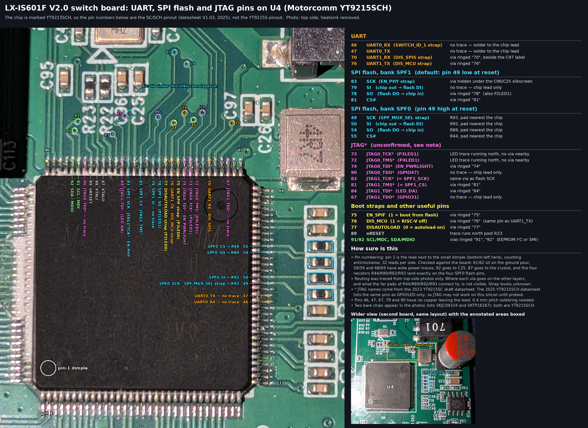
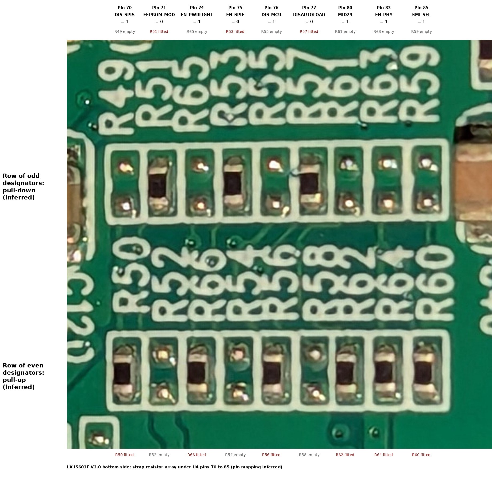

# LX-IS601F V2.0 switch board

Photos of a bought PoE switch board (silkscreen `LX-IS601F V2.0`, four PoE ports, one uplink port and one SFP port), with annotated
images showing where the UART, SPI flash and JTAG pins of its switch IC come out and
where its strap resistors sit. Two boards with the same layout were photographed; they are called board A and board B.

The switch IC is a **YT9215SCH**. Its pinout differs from the YT9215S used on the
open-hardware board mirrored at
[mithro/wu-kou-qian-zhao-jiao-huan-ji-_yt9215s_v2_0](https://github.com/mithro/wu-kou-qian-zhao-jiao-huan-ji-_yt9215s_v2_0);
see [`../motorcomm-debug-pins.md`](../motorcomm-debug-pins.md).

| File | Kind | Board | Side | Shows |
| --- | --- | --- | --- | --- |
| [`lx-is601f-debug-pins-annotated.png`](lx-is601f-debug-pins-annotated.png) | Annotated image | B | Top | Debug pins of U4 with a pin table |
| [`strap-resistors-annotated.jpg`](strap-resistors-annotated.jpg) | Annotated image | Not known | Bottom | Strap resistor array with decoded levels |
| [`photo-u4-macro.jpg`](photo-u4-macro.jpg) | Source photo | B | Top | Close-up of U4 with the heatsink removed |
| [`photo-u4-wide.jpg`](photo-u4-wide.jpg) | Source photo | A | Top | Area around U4 |
| [`photo-board-b-top.jpg`](photo-board-b-top.jpg) | Source photo | B | Top | Whole board |
| [`photo-bottom-under-u4.jpg`](photo-bottom-under-u4.jpg) | Source photo | Not known | Bottom | Area under U4 with the strap resistor array |
| [`photo-poe-module.jpg`](photo-poe-module.jpg) | Source photo | B | Top | Plug-in PoE module |
| [`annotate.py`](annotate.py) | Script | None | None | Draws the debug pin annotations |

Run [`annotate.py`](annotate.py) with `python3 annotate.py`; it needs Pillow. The strap resistor image has no script. The
strap resistors are explained in [`../switch-board-strapping.md`](../switch-board-strapping.md).

## How the debug pins were found

* Pin numbers are from the [YT9215SCH datasheet V1.03](../../datasheets/motorcomm/YT9215SCH_Datasheet_V1.03_2025-02-10.pdf). JTAG names are from
  the [YT9215SC Draft_07 datasheet](../../datasheets/motorcomm/YT9215SC_Datasheet_Draft_07_2023-02-28.pdf); the V1.03 datasheet does not list them, so
  JTAG is unconfirmed.
* Pin 1 is the lead beside the small dimple on the package. Leads were counted from
  there, 32 per side, and checked against the ground pour (61/62), the wide power traces
  (58/59, 68/69), the decoupling capacitor on pin 82 and the crystal.
* Routing was traced from top-side photos only. Where the vias go on other layers, and
  what the far pads of R44, R89, R92 and R93 connect to are not known. The strap levels
  are worked out in [`../switch-board-strapping.md`](../switch-board-strapping.md).
