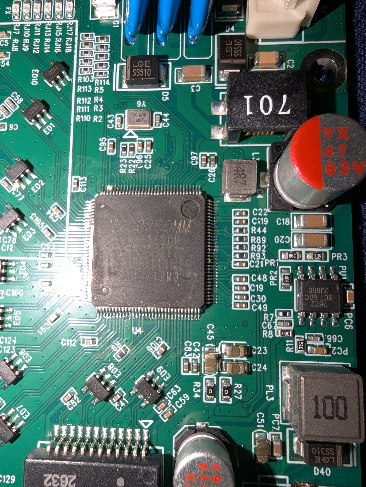

# LX-IS601F V2.0 switch board: debug pins

Photos of a bought 5-port switch board (silkscreen `LX-IS601F V2.0`) and an annotated
image showing where the UART, SPI flash and JTAG pins of its switch IC come out.

The switch IC, U4, is a **YT9215SCH**. Its pinout differs from that of the YT9215S on the
open-hardware board mirrored at
[mithro/wu-kou-qian-zhao-jiao-huan-ji-_yt9215s_v2_0](https://github.com/mithro/wu-kou-qian-zhao-jiao-huan-ji-_yt9215s_v2_0).
The pin tables of both parts, and the route of each debug pin on this board, are in
[`../motorcomm-debug-pins.md`](../motorcomm-debug-pins.md#lx-is601f-v20-boards).

## Files

| File | Kind | Shows |
| --- | --- | --- |
| [`lx-is601f-debug-pins-annotated.png`](lx-is601f-debug-pins-annotated.png) | Annotated image | Debug pins of U4 |
| [`photo-u4-macro.jpg`](photo-u4-macro.jpg) | Source photo | Close-up of U4 with the heatsink removed |
| [`photo-u4-wide.jpg`](photo-u4-wide.jpg) | Source photo | Wider view of a second board with the same layout |
| [`annotate.py`](annotate.py) | Script | Draws the annotations |

[`annotate.py`](annotate.py) needs Pillow and runs as `python3 annotate.py`. It draws on
[`photo-u4-macro.jpg`](photo-u4-macro.jpg).

## Annotated image

## Source photos

## How the pins were found

Pin numbers are from the [YT9215SCH datasheet V1.03](../../datasheets/motorcomm/YT9215SCH_Datasheet_V1.03_2025-02-10.pdf).
JTAG names are from the [YT9215SC Draft_07 datasheet](../../datasheets/motorcomm/YT9215SC_Datasheet_Draft_07_2023-02-28.pdf);
V1.03 does not list them, so JTAG is unconfirmed.

Pin 1 is the lead beside the small dimple on the package. Leads were counted from
there, 32 to a side, and checked against these landmarks:

| Landmark | Pin |
| --- | --- |
| Ground pour | 61 |
| Ground pour | 62 |
| Wide power trace | 58 |
| Wide power trace | 59 |
| Wide power trace | 68 |
| Wide power trace | 69 |
| Decoupling capacitor | 82 |
| Crystal Y6 | 87 |
| Crystal Y6 | 88 |

Routing was traced from top-side photos only. Where the vias go on other layers, the
strap levels, and what the far pads of R44, R89, R92 and R93 connect to are unknown.
