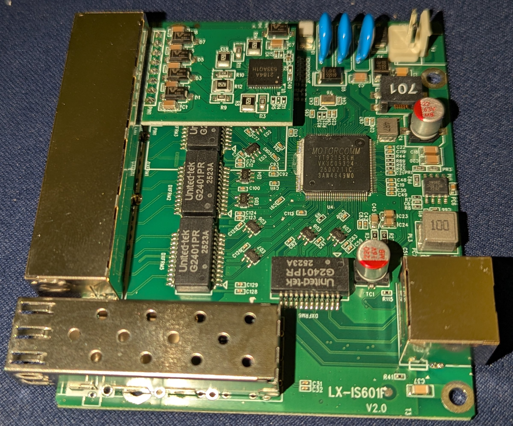

# LX-IS601F V2.0 switch board

Photos of a bought PoE switch board (silkscreen `LX-IS601F V2.0`, four PoE ports, one uplink port and one SFP port), with annotated
images showing where the UART, SPI flash and JTAG pins of its switch IC come out and
where its strap resistors sit. The photos show two boards with the same layout, called board A and board B.

The switch IC, [U4](../switch-board-strapping.md#major-components), is a **YT9215SCH**. Its pinout differs from the YT9215S used on the
open-hardware board in
[the wu-kou board repository](https://github.com/mithro/wu-kou-qian-zhao-jiao-huan-ji-_yt9215s_v2_0);
the two pinouts are compared in [`../motorcomm-debug-pins.md`](../motorcomm-debug-pins.md).

| Image | File | Kind | Board | Side | Shows |
| --- | --- | --- | --- | --- | --- |
| <a href="#photo-debug-pins">Debug pins annotated</a> | [`lx-is601f-debug-pins-annotated.png`](lx-is601f-debug-pins-annotated.png) | Annotated image | B | Top | Debug pins of [U4](../switch-board-strapping.md#major-components) with a pin table |
| <a href="#photo-strap-array">Strap array annotated</a> | [`strap-resistors-annotated.jpg`](strap-resistors-annotated.jpg) | Annotated image | Not known | Bottom | Strap resistor array with decoded levels |
| <a href="#photo-u4-close-up">U4 close-up</a> | [`photo-u4-macro.jpg`](photo-u4-macro.jpg) | Source photo | B | Top | Close-up of [U4](../switch-board-strapping.md#major-components) with the heatsink removed |
| <a href="#photo-board-a-top">Board A top</a> | [`photo-u4-wide.jpg`](photo-u4-wide.jpg) | Source photo | A | Top | Area around [U4](../switch-board-strapping.md#major-components) |
| <a href="#photo-board-b-top">Board B top</a> | [`photo-board-b-top.jpg`](photo-board-b-top.jpg) | Source photo | B | Top | Whole board |
| <a href="#photo-bottom-under-u4">Bottom under U4</a> | [`photo-bottom-under-u4.jpg`](photo-bottom-under-u4.jpg) | Source photo | Not known | Bottom | Area under [U4](../switch-board-strapping.md#major-components) with the strap resistor array |
| <a href="#photo-poe-module">PoE module</a> | [`photo-poe-module.jpg`](photo-poe-module.jpg) | Source photo | B | Top | Plug-in PoE module |
| None | [`annotate.py`](annotate.py) | Script | None | None | Draws the debug pin annotations |

Run [`annotate.py`](annotate.py) with `python3 annotate.py`; it needs Pillow. The strap resistor image has no script. The
strap resistors are explained in [`../switch-board-strapping.md`](../switch-board-strapping.md).

## Images

**Debug pins annotated**

**Strap array annotated**

**U4 close-up**

**Board A top**

**Board B top**

**Bottom under U4**

**PoE module**

## How the debug pins are identified

* Pin numbers are from the [YT9215SCH datasheet V1.03](../../datasheets/motorcomm/YT9215SCH_Datasheet_V1.03_2025-02-10.pdf). JTAG names are from
  the [YT9215SC Draft_07 datasheet, page 22](../../datasheets/motorcomm/YT9215SC_Datasheet_Draft_07_2023-02-28.pdf#page=22); the V1.03 datasheet does not list them, so
  JTAG is unconfirmed.
* Pin 1 is the lead beside the small dimple on the package. Leads are counted from
  there, 32 per side, in the <a href="#photo-u4-close-up">U4 close-up</a> and <a href="#photo-board-a-top">Board A top</a> images, and checked against features whose pins are known from
  [Table 1 of the datasheet, pages 17 to 19](../../datasheets/motorcomm/YT9215SCH_Datasheet_V1.03_2025-02-10.pdf#page=17): the ground pour on pins 61 and 62, the wide power
  traces on pins 58, 59, 68 and 69, the decoupling capacitor on pin 82, and the crystal.
* Routing is traced from the <a href="#photo-u4-close-up">U4 close-up</a> and <a href="#photo-board-a-top">Board A top</a> images only. Where the vias go on other layers is not known. What the far pads of
  [R44](../switch-board-strapping.md#other-configuration-pins), [R89](../switch-board-strapping.md#other-configuration-pins), [R92](../switch-board-strapping.md#other-configuration-pins) and [R93](../switch-board-strapping.md#other-configuration-pins) connect to is not known either. The strap levels are worked out in
  [`../switch-board-strapping.md`](../switch-board-strapping.md).

## Schematic

A reverse-engineered KiCad schematic of the whole board is described in [`schematic/README.md`](schematic/README.md). It marks
each connection as confirmed, seen, inferred or unknown, and lists the measurements that would settle the open ones.
