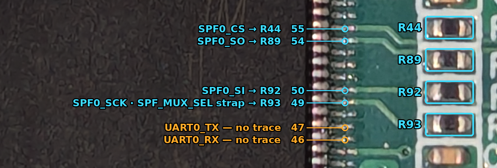
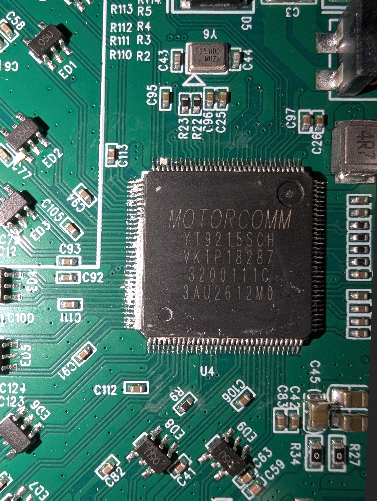

# LX-IS601F V2.0 switch board: debug pins

Photos of two bought 5-port switch boards (silkscreen `LX-IS601F V2.0`) and annotated
images showing where the UART, SPI flash and JTAG pins of its switch IC come out.

The switch IC, [U4](../motorcomm-debug-pins.md#lx-u4), is a **YT9215SCH**. Its pinout differs from that of the YT9215S on the
open-hardware board mirrored at
[mithro/wu-kou-qian-zhao-jiao-huan-ji-_yt9215s_v2_0](https://github.com/mithro/wu-kou-qian-zhao-jiao-huan-ji-_yt9215s_v2_0).
The pin tables of both parts, and the route of each debug pin on this board, are in
[`../motorcomm-debug-pins.md`](../motorcomm-debug-pins.md#lx-is601f-v20-boards).

## Files

| File | Kind | Shows |
| --- | --- | --- |
| [`u4-pin-numbering-annotated.png`](u4-pin-numbering-annotated.png) | Annotated image | Pin 1 and the pin range of each side of [U4](../motorcomm-debug-pins.md#lx-u4) |
| [`u4-pins-top-edge-annotated.png`](u4-pins-top-edge-annotated.png) | Annotated image | Pins 65 to 96 of [U4](../motorcomm-debug-pins.md#lx-u4) and their vias |
| [`u4-pins-right-edge-annotated.png`](u4-pins-right-edge-annotated.png) | Annotated image | Pins 46 to 55 of [U4](../motorcomm-debug-pins.md#lx-u4) and the SPF0 resistors |
| [`photo-u4-macro.jpg`](photo-u4-macro.jpg) | Source photo | Close-up of [U4](../motorcomm-debug-pins.md#lx-u4) with the heatsink removed |
| [`photo-u4-wide.jpg`](photo-u4-wide.jpg) | Source photo | Wider view of a second board with the same layout |
| [`annotate.py`](annotate.py) | Script | Draws the annotations |
| [`photos/`](photos/README.md) | Photo catalogue | 34 photos of the two boards |

[`annotate.py`](annotate.py) needs Pillow and runs as `python3 annotate.py`. It draws on
crops of [`photo-u4-macro.jpg`](photo-u4-macro.jpg), one crop per image, so that the labels stay
readable at the width of this page.

## Annotated images

The pin table for these images, and the confidence of each pin, are in
[`../motorcomm-debug-pins.md`](../motorcomm-debug-pins.md#lx-is601f-v20-boards). The chip is a YT9215SCH, so the pin
numbers are those of the SC and SCH pinout. Names marked `*` are JTAG names from the
YT9215SC draft datasheet. Label colours: orange for UART, cyan for SPI flash, pink for
JTAG, yellow for straps, green for SCL and SDA, grey for clock and reset.

### Pin numbering

### Top edge: pins 65 to 96

A ring with a number marks the via that the lead of that pin runs to.

### Right edge: pins 46 to 55

## Source photos

All 34 photos of the two boards are catalogued in [`photos/README.md`](photos/README.md).

## How the pins were found

Pin numbers are from the [YT9215SCH datasheet V1.03](../../datasheets/motorcomm/YT9215SCH_Datasheet_V1.03_2025-02-10.pdf).
JTAG names are from the [YT9215SC Draft_07 datasheet](../../datasheets/motorcomm/YT9215SC_Datasheet_Draft_07_2023-02-28.pdf);
V1.03 does not list them, so JTAG is unconfirmed.

Pin 1 is the lead beside the small dimple on the package. Leads were counted from
there, 32 to a side, and checked against these landmarks:

| Landmark | Pin |
| --- | --- |
| Ground pour | 61 |
| Ground pour | 62 |
| Wide power trace | 58 |
| Wide power trace | 59 |
| Wide power trace | 68 |
| Wide power trace | 69 |
| Decoupling capacitor | 82 |
| Crystal [Y6](../motorcomm-debug-pins.md#lx-y6) | [87](../motorcomm-debug-pins.md#sch-pin-87) |
| Crystal [Y6](../motorcomm-debug-pins.md#lx-y6) | [88](../motorcomm-debug-pins.md#sch-pin-88) |

Routing was traced from top-side photos only. Where the vias go on other layers, the
strap levels, and what the far pads of [R44](../motorcomm-debug-pins.md#lx-r44), [R89](../motorcomm-debug-pins.md#lx-r89), [R92](../motorcomm-debug-pins.md#lx-r92) and [R93](../motorcomm-debug-pins.md#lx-r93) connect to are unknown.

## Schematic

A reverse-engineered KiCad schematic of the whole board, with each connection marked confirmed, seen, inferred or unknown, is in [`schematic/`](schematic/). Its [README](schematic/README.md) lists what is known about the board and the measurements that would settle the rest.
