# LX-IS601F V2.0 switch board

Photos of two bought switch boards with five copper ports and one SFP port (silkscreen `LX-IS601F V2.0`) and annotated
images showing where the UART, SPI flash and JTAG pins of its switch IC come out
and where its strap resistors sit.

The switch IC, [U4](../motorcomm-debug-pins.md#lx-u4), is a **YT9215SCH**. Its pinout differs from that of the YT9215S on the
open-hardware board mirrored at
[the wu-kou board repository](https://github.com/mithro/wu-kou-qian-zhao-jiao-huan-ji-_yt9215s_v2_0).
The pin tables of both parts, and the route of each debug pin on this board, are in
[`../motorcomm-debug-pins.md`](../motorcomm-debug-pins.md#lx-is601f-v20-boards).

## Files

| File | Kind | Shows | Made from |
| --- | --- | --- | --- |
| [`u4-pin-numbering-annotated.png`](u4-pin-numbering-annotated.png) | Annotated image | Pin 1 and the pin range of each side of [U4](../motorcomm-debug-pins.md#lx-u4) | [`photo-u4-macro.jpg`](photo-u4-macro.jpg) |
| [`u4-pins-top-edge-annotated.png`](u4-pins-top-edge-annotated.png) | Annotated image | Pins 65 to 96 of [U4](../motorcomm-debug-pins.md#lx-u4) and their vias | [`photo-u4-macro.jpg`](photo-u4-macro.jpg) |
| [`u4-pins-right-edge-annotated.png`](u4-pins-right-edge-annotated.png) | Annotated image | Pins 46 to 55 of [U4](../motorcomm-debug-pins.md#lx-u4) and the SPF0 resistors | [`photo-u4-macro.jpg`](photo-u4-macro.jpg) |
| [`photo-u4-macro.jpg`](photo-u4-macro.jpg) | Source photo | Close-up of [U4](../motorcomm-debug-pins.md#lx-u4) on board B, without a heatsink | – |
| [`photo-u4-wide.jpg`](photo-u4-wide.jpg) | Source photo | Wider view of [U4](../motorcomm-debug-pins.md#lx-u4) on board A | – |
| [`u4-surroundings.jpg`](u4-surroundings.jpg) | Cropped photo | [U4](../motorcomm-debug-pins.md#lx-u4) and the named parts beside it | [`photo-u4-wide.jpg`](photo-u4-wide.jpg) |
| [`annotate.py`](annotate.py) | Script | Draws the annotations and makes the crop | – |
| [`strap-resistors-annotated.jpg`](strap-resistors-annotated.jpg) | Annotated image | Strap resistor array with the decoded levels | [`strap-resistors-source.jpg`](strap-resistors-source.jpg) |
| [`crop-bottom-strap-array.jpg`](crop-bottom-strap-array.jpg) | Cropped photo | Strap resistor array beside the EEPROM [U10](../switch-board-strapping.md#lx-u10) | [`photo-bottom-under-u4.jpg`](photo-bottom-under-u4.jpg) |
| [`crop-bottom-flash-footprint.jpg`](crop-bottom-flash-footprint.jpg) | Cropped photo | Area around the flash footprint [U6](../switch-board-strapping.md#lx-u6) | [`photo-bottom-under-u4.jpg`](photo-bottom-under-u4.jpg) |
| [`crop-board-b-switch-ic.jpg`](crop-board-b-switch-ic.jpg) | Cropped photo | Area around [U4](../motorcomm-debug-pins.md#lx-u4) on board B | [`photo-board-b-top.jpg`](photo-board-b-top.jpg) |
| [`crop-board-b-power-input.jpg`](crop-board-b-power-input.jpg) | Cropped photo | Power input parts of board B | [`photo-board-b-top.jpg`](photo-board-b-top.jpg) |
| [`crop-board-b-magnetics.jpg`](crop-board-b-magnetics.jpg) | Cropped photo | Port magnetics area around [DXFRM2](../switch-board-strapping.md#lx-dxfrm2) | [`photo-board-b-top.jpg`](photo-board-b-top.jpg) |
| [`crop-poe-module.jpg`](crop-poe-module.jpg) | Cropped photo | Plug-in PoE module on [PIN1](../switch-board-strapping.md#lx-pin1) | [`photo-poe-module.jpg`](photo-poe-module.jpg) |
| [`crop-board-a-regulator.jpg`](crop-board-a-regulator.jpg) | Cropped photo | Area around the buck regulator [PU1](../switch-board-strapping.md#lx-pu1) | [`photo-u4-wide.jpg`](photo-u4-wide.jpg) |
| [`crop-board-a-power-input.jpg`](crop-board-a-power-input.jpg) | Cropped photo | Power input parts of board A | [`photo-u4-wide.jpg`](photo-u4-wide.jpg) |
| [`crop-board-a-led-esd.jpg`](crop-board-a-led-esd.jpg) | Cropped photo | LED array area beside [ED1](../switch-board-strapping.md#lx-ed1) | [`photo-u4-wide.jpg`](photo-u4-wide.jpg) |
| [`strap-resistors-source.jpg`](strap-resistors-source.jpg) | Cropped photo | Strap resistor array without labels | [`photo-bottom-under-u4.jpg`](photo-bottom-under-u4.jpg) |
| [`photo-board-b-top.jpg`](photo-board-b-top.jpg) | Source photo | Top side of board B | – |
| [`photo-bottom-under-u4.jpg`](photo-bottom-under-u4.jpg) | Source photo | Bottom side under [U4](../motorcomm-debug-pins.md#lx-u4) | – |
| [`photo-poe-module.jpg`](photo-poe-module.jpg) | Source photo | PoE module on board B with the parts around it | – |
| [`annotate_straps.py`](annotate_straps.py) | Script | Draws the strap resistor annotations | – |
| [`crop_photos.py`](crop_photos.py) | Script | Cuts the board area crops | – |
| [`photos/`](photos/README.md) | Photo catalogue | 34 photos of the two boards | – |

[`annotate.py`](annotate.py) needs Pillow and runs as `python3 annotate.py`. It draws on
crops of [`photo-u4-macro.jpg`](photo-u4-macro.jpg), one crop per image, so that the labels stay
readable at the width of this page.

[`annotate_straps.py`](annotate_straps.py) needs Pillow and the DejaVu Sans fonts and runs as `python3 annotate_straps.py`. It draws on
[`strap-resistors-source.jpg`](strap-resistors-source.jpg). [`crop_photos.py`](crop_photos.py) needs Pillow and runs as `python3 crop_photos.py`.

## Annotated images

The pin table for these images, and the confidence of each pin, are in
[`../motorcomm-debug-pins.md`](../motorcomm-debug-pins.md#lx-is601f-v20-boards). The chip is a YT9215SCH, so the pin
numbers are those of the SC and SCH pinout. Names marked `*` are JTAG names from the
YT9215SC draft datasheet. Label colours: orange for UART, cyan for SPI flash, pink for
JTAG, yellow for straps, green for SCL and SDA, grey for clock and reset. The lilac rings
are the vias of pins 80 and 85, which are LED pins with no debug function.

### Pin numbering

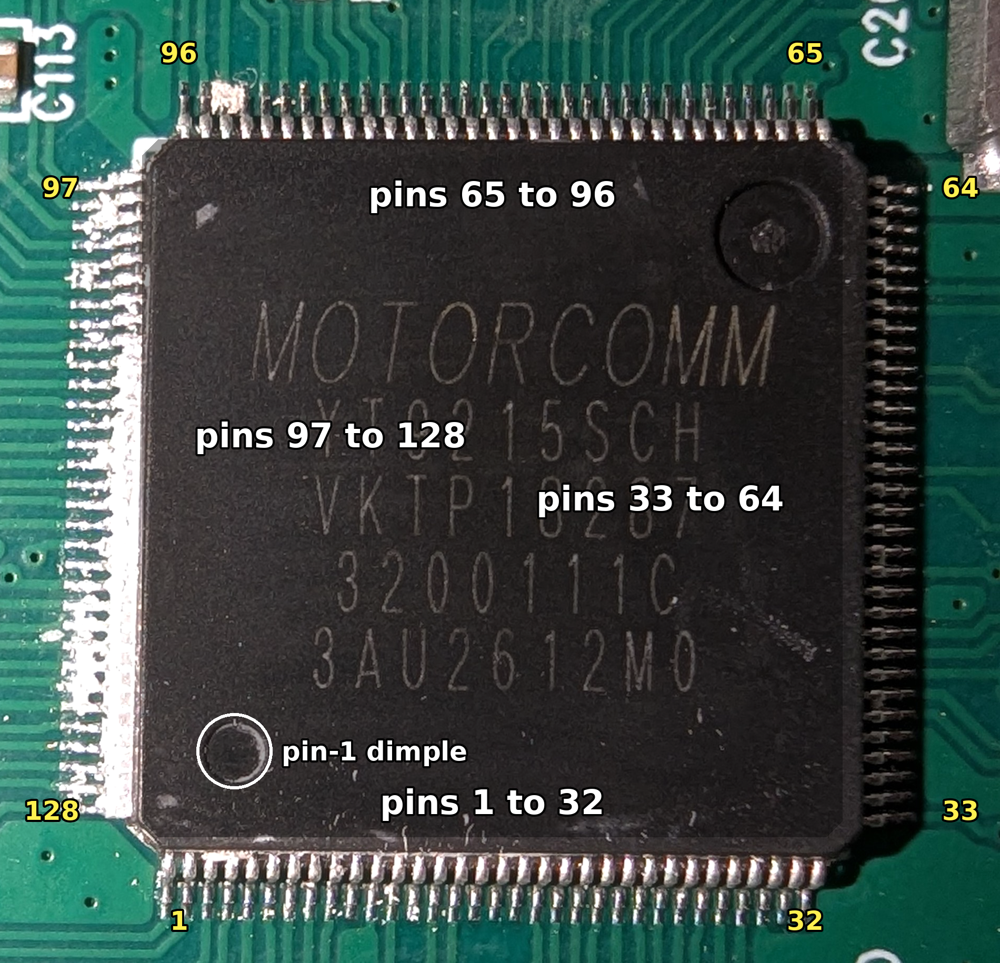

### Top edge: pins 65 to 96

A ring with a number marks the via that the lead of that pin runs to.

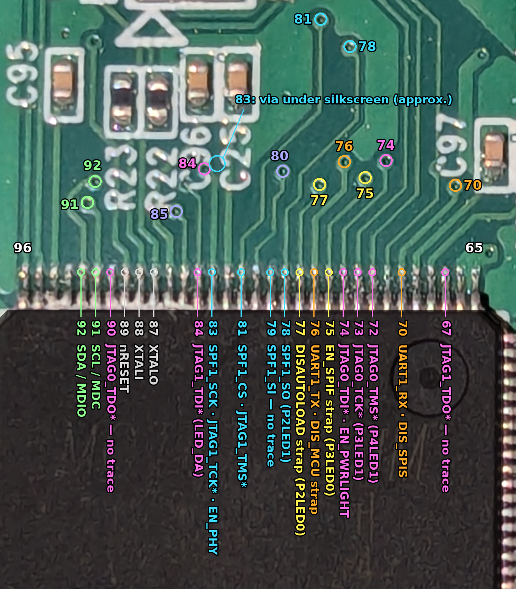

### Right edge: pins 46 to 55

## Source photos

The three annotated images of [U4](../motorcomm-debug-pins.md#lx-u4) are crops of [`photo-u4-macro.jpg`](photo-u4-macro.jpg), a close-up of
[U4](../motorcomm-debug-pins.md#lx-u4) on board B, without a heatsink. Boards A and B are told apart in [`photos/README.md`](photos/README.md).

[`photo-u4-wide.jpg`](photo-u4-wide.jpg) shows board A, which has the same layout. The crop under this paragraph keeps
[U4](../motorcomm-debug-pins.md#lx-u4) and the parts beside it whose silkscreen names the pin table uses:
[Y6](../motorcomm-debug-pins.md#lx-y6) and [R22](../motorcomm-debug-pins.md#lx-r22) above the chip, and
[R44](../motorcomm-debug-pins.md#lx-r44), [R89](../motorcomm-debug-pins.md#lx-r89),
[R92](../motorcomm-debug-pins.md#lx-r92) and [R93](../motorcomm-debug-pins.md#lx-r93) to its right.

[`photo-poe-module.jpg`](photo-poe-module.jpg) shows the PoE module on board B with the parts around it.

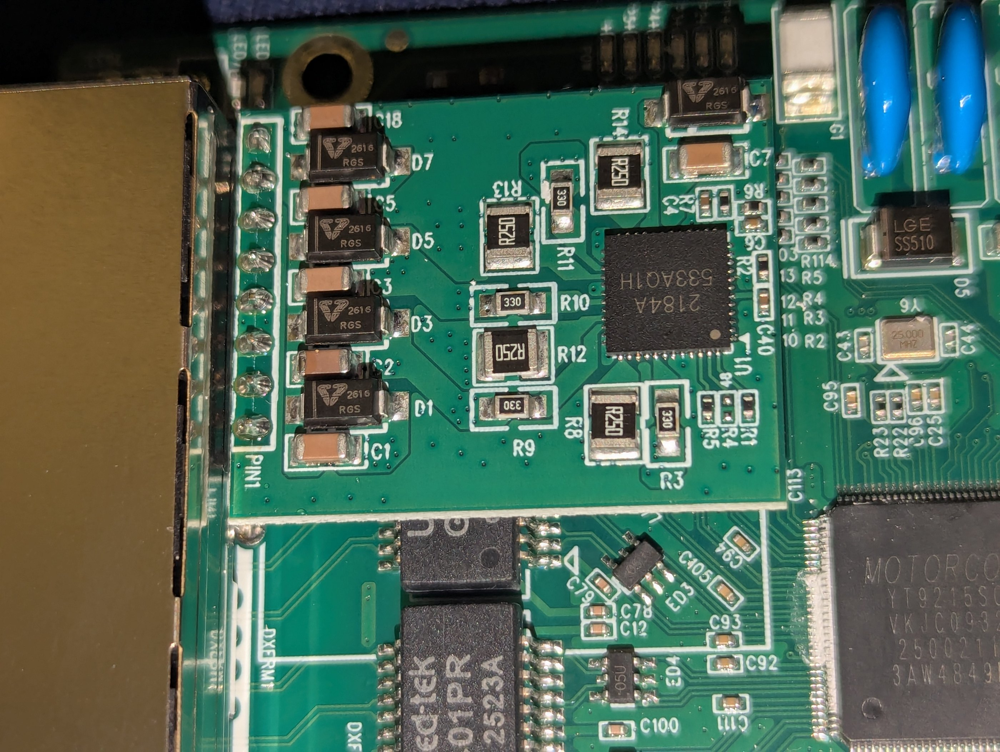

[`photo-board-b-top.jpg`](photo-board-b-top.jpg) shows the whole top side of board B, and
[`photo-bottom-under-u4.jpg`](photo-bottom-under-u4.jpg) shows the bottom side under [U4](../motorcomm-debug-pins.md#lx-u4).

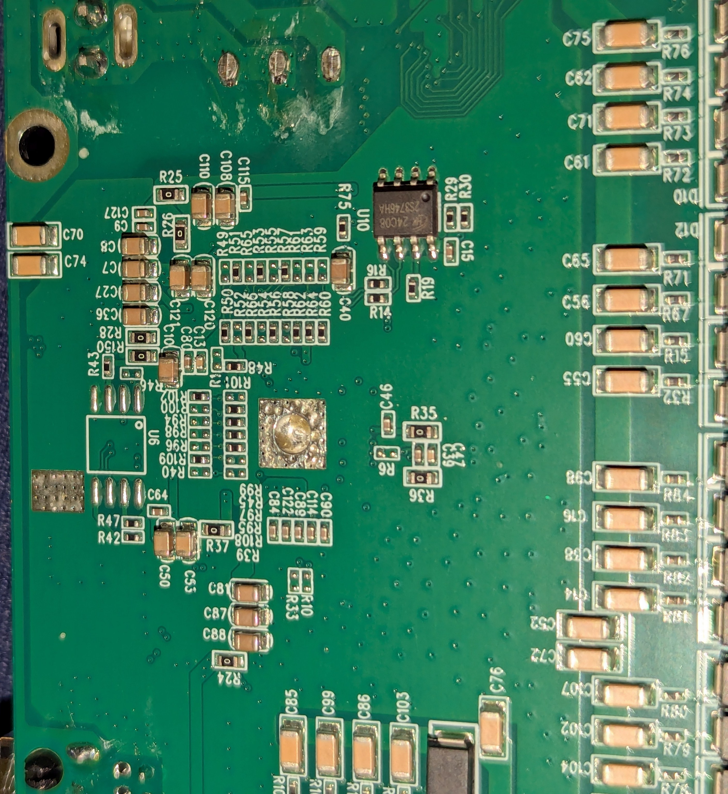

[`strap-resistors-source.jpg`](strap-resistors-source.jpg) is the strap resistor array without labels, cut from
[`photo-bottom-under-u4.jpg`](photo-bottom-under-u4.jpg).

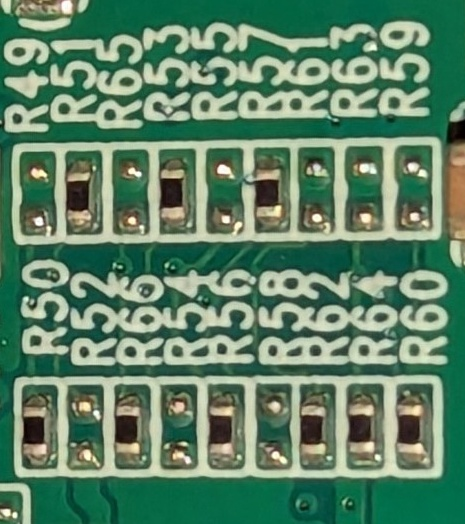

All 34 photos of the two boards are catalogued in [`photos/README.md`](photos/README.md).

## Strap resistors and board areas

The strap levels and the parts in these images are worked out in
[`../switch-board-strapping.md`](../switch-board-strapping.md#lx-is601f-v20).

### Strap resistor array

### Bottom strap array

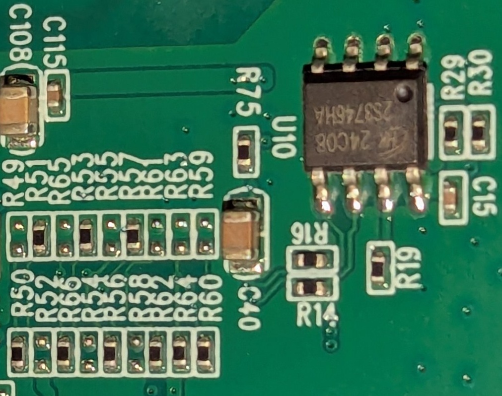

### Bottom flash footprint

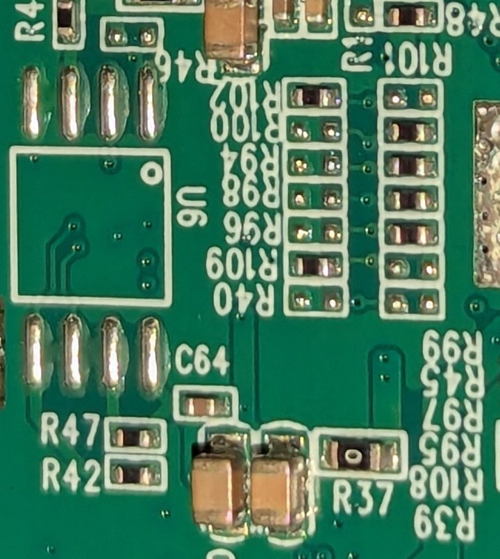

### Board B switch IC

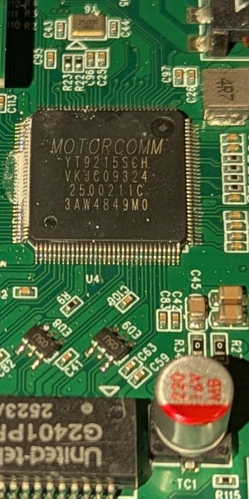

### Board B power input

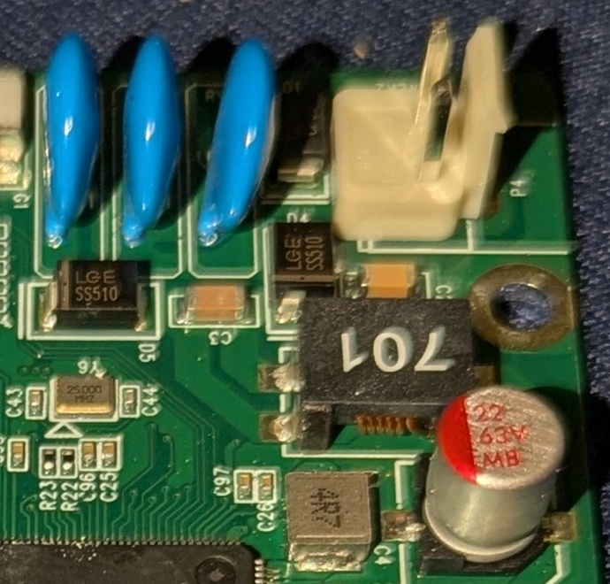

### Board B magnetics

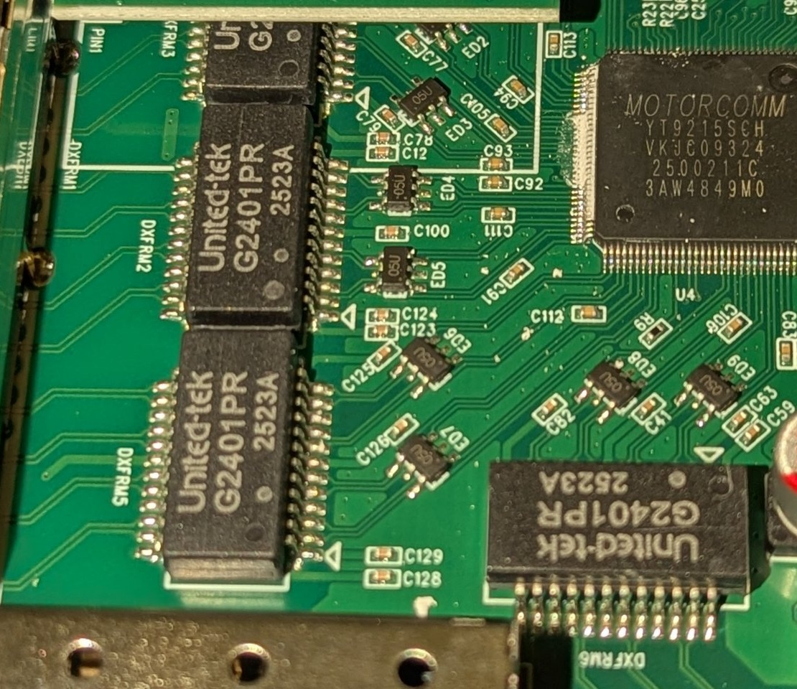

### PoE module

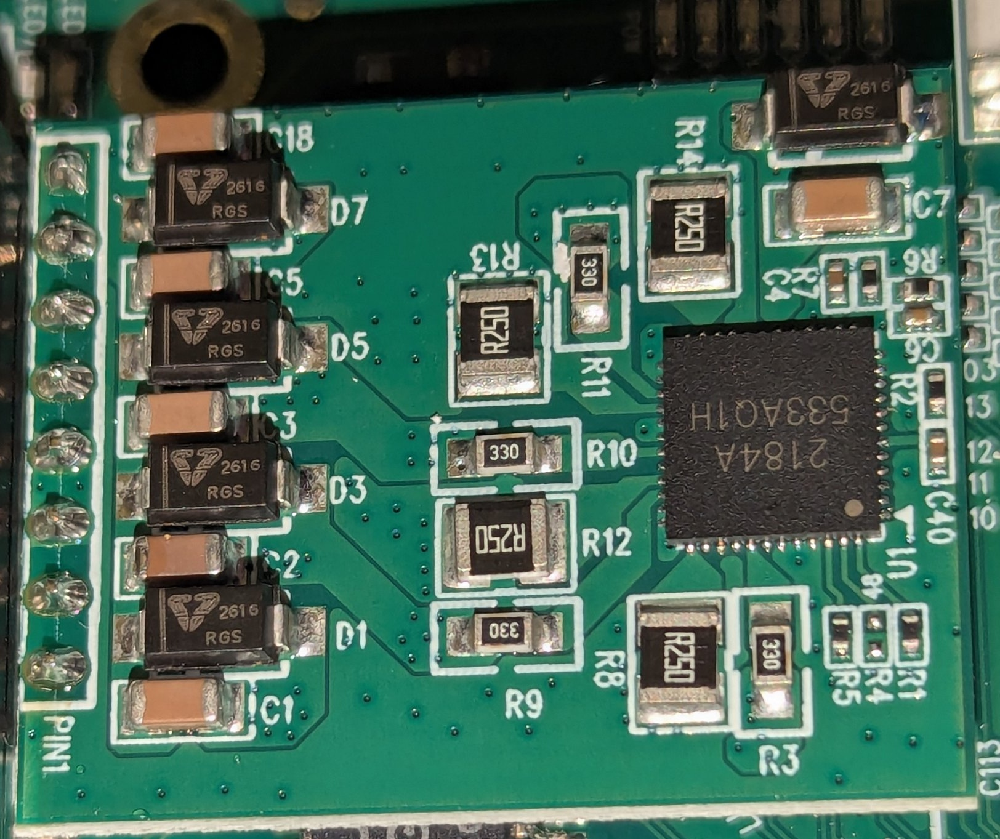

### Board A regulator

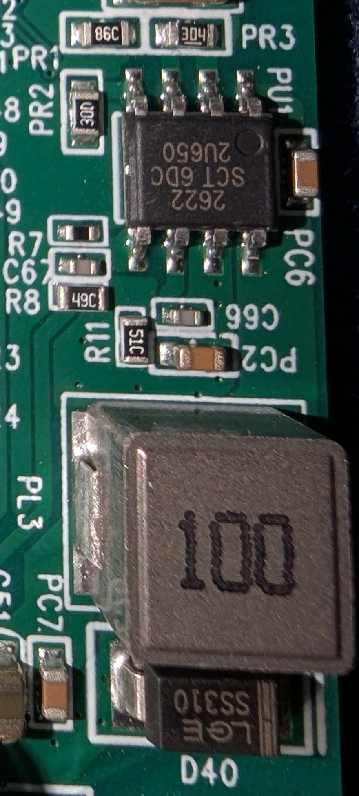

### Board A power input

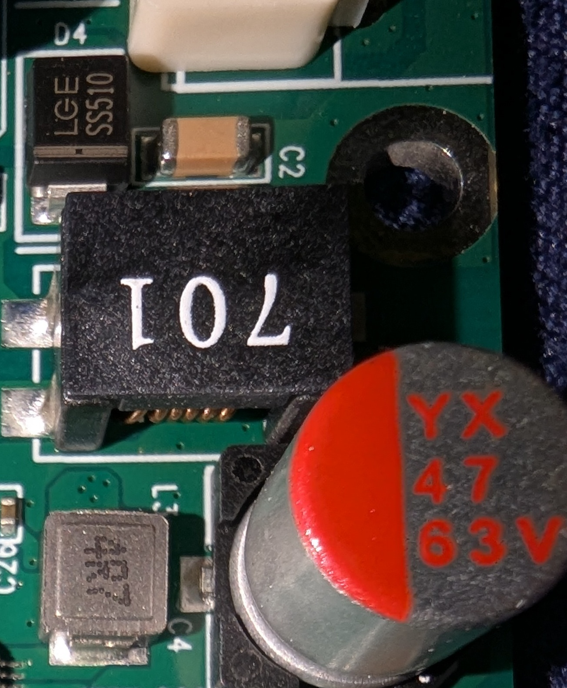

### Board A LED and ESD arrays

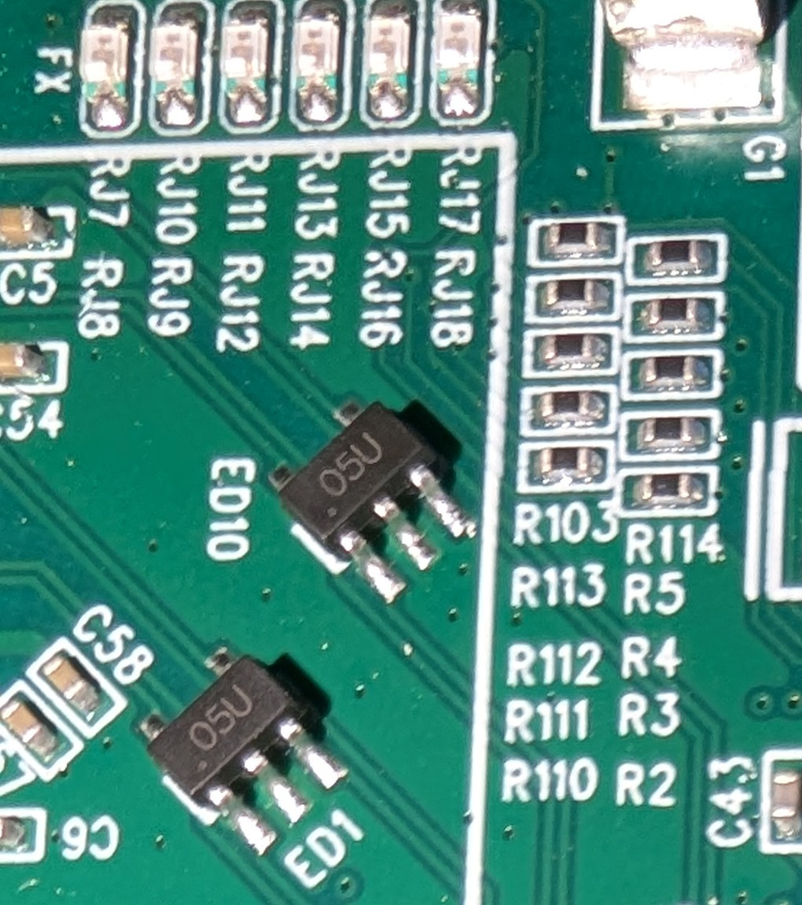

## How the pins were found

Pin numbers are from the [YT9215SCH datasheet V1.03](../../datasheets/motorcomm/YT9215SCH_Datasheet_V1.03_2025-02-10.pdf).
JTAG names are from the [YT9215SC Draft_07 datasheet](../../datasheets/motorcomm/YT9215SC_Datasheet_Draft_07_2023-02-28.pdf);
V1.03 does not list them, so JTAG is unconfirmed.

Pin 1 is the lead beside the small dimple on the package. Leads were counted from
there anticlockwise as seen from the top, 32 to a side, and checked against these landmarks:

| Landmark | Pin |
| --- | --- |
| Ground pour | 61 |
| Ground pour | 62 |
| Wide power trace | 58 |
| Wide power trace | 59 |
| Wide power trace | 68 |
| Wide power trace | 69 |
| Decoupling capacitor C25 | 82 |
| Crystal [Y6](../motorcomm-debug-pins.md#lx-y6) | [87](../motorcomm-debug-pins.md#sch-pin-87) |
| Crystal [Y6](../motorcomm-debug-pins.md#lx-y6) | [88](../motorcomm-debug-pins.md#sch-pin-88) |

The debug pin routing is traced from top-side photos only. Where the vias go on other layers and what the far pads of [R44](../motorcomm-debug-pins.md#lx-r44), [R89](../motorcomm-debug-pins.md#lx-r89), [R92](../motorcomm-debug-pins.md#lx-r92) and [R93](../motorcomm-debug-pins.md#lx-r93) connect to are unknown.
The strap levels are inferred from the bottom-side resistor array in [`../switch-board-strapping.md`](../switch-board-strapping.md#strap-resistor-array) and are not confirmed by a meter.

## Schematic

A reverse-engineered KiCad schematic of the whole board, with each connection marked confirmed, seen, inferred or unknown, is in [`schematic/`](schematic/). Its [README](schematic/README.md) lists what is known about the board and the measurements that would settle the rest.
