# LX-IS601F V2.0 photo catalogue

Tim's photos of two `LX-IS601F V2.0` PoE switch boards, taken on 2026-11-17 with a
Pixel 7 Pro. The originals (3072 x 4080) are in the
[Google Photos album](https://photos.app.goo.gl/f4gAaRwkkgGWYLGu9). This folder holds
copies resized to 1600 px (`web/`), 240 px thumbnails (`thumbs/`) and annotated
callouts (`annotated/`). EXIF data, including GPS, was stripped from every copy.
Photo numbers follow the album order.

## The two boards

Both boards carry the same `LX-IS601F V2.0` PCB and a Motorcomm **YT9215SCH** as U4.
They differ in what is fitted:

| | Board A | Board B |
| --- | --- | --- |
| U4 lot line 2 | `VKTP18287` | `VKJC09324` |
| U4 lot line 3 | `3200111C` | `2500211C` |
| U4 lot line 4 | `3AU2612M0` | `3AW4849M0` |
| Magnetics date | `2632` | `2523A` |
| PoE PSE module | Not fitted | Fitted |
| SFP cage | Not fitted | Fitted |
| U4 heatsink | Yes (removed in 04) | Not seen |
| Photos | 01-06, 13-23, 33 | 07-12, 30-32, 34 |

Board A is the non-PoE build: the 8-hole header for the PoE module is empty and U12
has only the SFP host connector, without its cage. Board B is the PoE build, with the
PSE daughterboard plugged into that header and the SFP cage fitted over U12.

The bottom-side photos (24-29) do not show anything that ties them to one board.

Parts common to both boards: United-tek `G2401PR` magnetics (DXFRM1-6), `05U`
SOT-23-6 ESD arrays (ED1-ED10), Y6 25.000 MHz crystal, PU1 `SCT2622` 3.3 V buck with
PL3 `100` (10 µH) and D40 `SS510`, L2 `701` input inductor, C4 47 µF 63 V input
capacitor, TC1 220 µF 16 V output capacitor, three blue disc capacitors next to the
J2 `POWER2` connector, and U10 `HK24C08` I²C EEPROM on the bottom.

## Catalogue

✎ marks photos with an annotated callout below. Click a thumbnail for the 1600 px copy,
or the number for the notes. Times are the camera's local time.

| # | Preview | Board | Side | View | Key items | Time |
| --- | --- | --- | --- | --- | --- | --- |
| [01](#photo-01) | [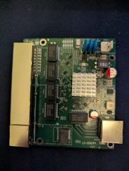](web/01.jpg) | A | Top | Whole board | Heatsink on U4 | 09:23 |
| [02](#photo-02) | [](web/02.jpg) | A | Top | Whole board | Heatsink on U4 | 09:24 |
| [03](#photo-03) | [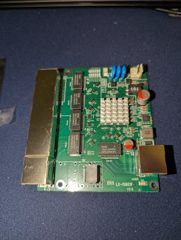](web/03.jpg) | A | Top | Whole board, angled | Heatsink on U4 | 09:24 |
| [04](#photo-04) | [](web/04.jpg) | A | Top | Whole board, rotated | Heatsink off; U12 SFP connector ✎ | 09:48 |
| [05](#photo-05) | [](web/05.jpg) | A | Top | Whole board, angled | U4 exposed | 09:48 |
| [06](#photo-06) | [](web/06.jpg) | A | Top | U4 close-up | U4 marking, Y6, debug resistors ✎ | 09:48 |
| [07](#photo-07) | [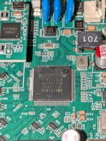](web/07.jpg) | B | Top | U4 + PoE module corner | U4 marking, PSE U1 | 09:48 |
| [08](#photo-08) | [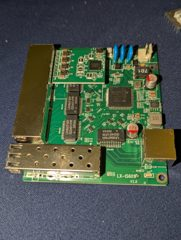](web/08.jpg) | B | Top | Whole board | PoE module, SFP cage ✎ | 09:48 |
| [09](#photo-09) | [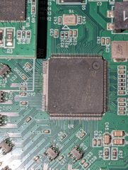](web/09.jpg) | B | Top | U4 close-up (glare) | U4 marking unreadable | 09:49 |
| [10](#photo-10) | [](web/10.jpg) | B | Top | U4 left edge, macro | Y6, R250, ESD arrays | 09:49 |
| [11](#photo-11) | [](web/11.jpg) | B | Top | U4 left edge, macro | Same as 10, sharper | 09:49 |
| [12](#photo-12) | [](web/12.jpg) | B | Top | U4 close-up | U4 marking, PSE U1 | 09:49 |
| [13](#photo-13) | [](web/13.jpg) | A | Top | U4 close-up | U4 marking, ESD arrays | 09:49 |
| [14](#photo-14) | [](web/14.jpg) | A | Top | U4 + power, angled | PU1, PL3, C4 | 09:50 |
| [15](#photo-15) | [](web/15.jpg) | A | Top | U4 + power, angled | PU1, PL3, C4 | 09:50 |
| [16](#photo-16) | [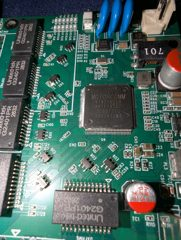](web/16.jpg) | A | Top | Centre, wide | U4, magnetics, TC1 | 09:50 |
| [17](#photo-17) | [](web/17.jpg) | A | Top | Centre, wide | U4, magnetics, TC1 | 09:50 |
| [18](#photo-18) | [](web/18.jpg) | A | Top | Centre, wide | Heatsink in frame | 09:50 |
| [19](#photo-19) | [](web/19.jpg) | A? | Top | Power corner | PU1 SCT2622, C4, L2 | 13:41 |
| [20](#photo-20) | [](web/20.jpg) | A | Top | U4 + port 6 magnetics | U4 marking, DXFRM6 | 13:41 |
| [21](#photo-21) | [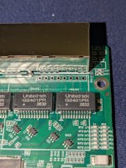](web/21.jpg) | A | Top | Port edge corner | Empty PoE header, LED pads ✎ | 13:41 |
| [22](#photo-22) | [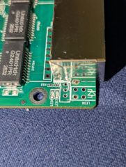](web/22.jpg) | A | Top | Port edge corner | LED6-8, R68 | 13:41 |
| [23](#photo-23) | [](web/23.jpg) | A | Top | U4, rotated 180 | U4, Y6, L2 | 13:42 |
| [24](#photo-24) | [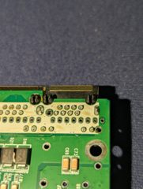](web/24.jpg) | ? | Bottom | RJ45 block pins | D19, D21, C69, C73 | 13:42 |
| [25](#photo-25) | [](web/25.jpg) | ? | Bottom | RJ45 block pins | D8-D14 port diodes | 13:42 |
| [26](#photo-26) | [](web/26.jpg) | ? | Bottom | Under U4 | U6 empty, U10 EEPROM ✎ | 13:42 |
| [27](#photo-27) | [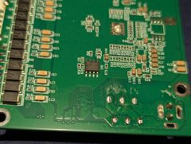](web/27.jpg) | ? | Bottom | Under U4, wider | U10, port diodes | 13:42 |
| [28](#photo-28) | [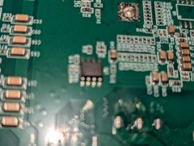](web/28.jpg) | ? | Bottom | Under U4 (blurred) | U10 | 13:42 |
| [29](#photo-29) | [](web/29.jpg) | ? | Bottom | U10 close-up | HK24C08 EEPROM | 13:43 |
| [30](#photo-30) | [](web/30.jpg) | B | Top | PoE module | U1, R250, D1-D7 | 13:43 |
| [31](#photo-31) | [](web/31.jpg) | B | Top | PoE module, angled | Diodes "RGS 2616" | 13:43 |
| [32](#photo-32) | [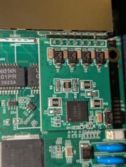](web/32.jpg) | B | Top | PoE module, macro | U1 "2184A 533AQ1H" ✎ | 13:43 |
| [33](#photo-33) | [](web/33.jpg) | A | Top | Uplink corner | Silkscreen, DXFRM6 2632 | 13:43 |
| [34](#photo-34) | [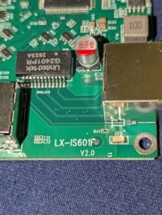](web/34.jpg) | B | Top | Uplink corner | Silkscreen, DXFRM6 2523A | 13:44 |

## Notes per photo

### Photo 01

Board A, whole top side, heatsink still on U4. The RJ45 block is on the left edge
(a long shielded block with a shorter one below it; what the shorter one is was not
checked), and a single RJ45 sits on the right edge. The PoE
module header beside the RJ45 block is empty. U12, at the bottom centre, is the SFP
host connector with no cage.

### Photo 02

Board A, same view as 01, shot square-on. Silkscreen `LX-IS601F V2.0` is at the bottom
right.

### Photo 03

Board A, same view as 02 at a slight angle.

### Photo 04

Board A after the heatsink was taken off U4 (the heatsink is at the top right, with
thermal-pad residue). The board is rotated 180° relative to 01-03.


### Photo 05

Board A at an angle, U4 bare. The `MOTORCOMM` logo is readable; the lot lines are in
glare.

### Photo 06

Board A, close-up of U4 and its neighbours. This is the best shot of the board A
marking: `MOTORCOMM / YT9215SCH / VKTP18287 / 3200111C / 3AU2612M0`. Pin 1 is next to
the small dimple at the lower left (the large circle at the upper right is a mould
mark). R44, R89, R92 and R93 are the resistors on the UART/SPI/JTAG pins traced in
[`../README.md`](../README.md).


### Photo 07

Board B, U4 with the corner of the PoE module at the top left. U4 reads
`MOTORCOMM / YT9215SCH / VKJC09324 / 2500211C / 3AW4849M0`. The module's U1 is
visible, marked `2184A / 533AQ1H`.

### Photo 08

Board B, whole top side. The PoE PSE module sits over the RJ45 block, and an SFP cage
covers U12 at the bottom left. Magnetics on this board are date-coded `2523A`.


### Photo 09

Board B, U4 close-up with heavy glare; the marking cannot be read.

### Photo 10

Board B, macro of U4's left edge and the module's lower edge: Y6, the R250 sense
resistors (R8, R12) and the ESD arrays ED3-ED5. Slightly soft.

### Photo 11

Same framing as 10, a little sharper.

### Photo 12

Board B, U4 close-up with readable marking (same as 07) and the module's U1.

### Photo 13

Board A, U4 close-up from straight above. Marking is readable. ED1-ED9 and R2-R5,
R110-R114 near the crystal are clear.

### Photo 14

Board A, U4 and the power section at an angle. PU1 (`2622 / SCT 6DC / 2U650`, an
SCT2622 buck), PL3 `100`, D40 `SS510` and C4 (`YX 47 63V`) are in frame.

### Photo 15

Board A, same as 14 from a slightly different angle.

### Photo 16

Board A, wider view of the centre: magnetics on the left, U4, and TC1
(`YX 220 16V`).

### Photo 17

Board A, same area as 16 at an angle.

### Photo 18

Board A, same area as 16, with the removed heatsink in the top right of the frame.

### Photo 19

Probably board A (taken with 20-23). Power corner: PU1 `SCT2622`, PR1-PR3 (`86C`,
`304`), PC6, C18/C20, the `4R7` inductor and C4.

### Photo 20

Board A, U4 (readable marking) and the DXFRM6 magnetics (`G2401PR 2632`) next to
the single RJ45.

### Photo 21

Board A, the corner by the RJ45 block. The PoE module header (`PIN1`, 8 holes) is
empty. The RJ7-RJ18 resistor pads for the POW and FX LEDs sit at the board edge.
LED6 is an empty through-hole footprint.


### Photo 22

Board A, the RJ45 block end: LED7, LED8, R68 and the empty LED6 footprint.

### Photo 23

Board A, U4 area rotated 180°: Y6, L2 `701`, D5 `SS510` and the blue disc
capacitors.

### Photo 24

Bottom side, under the RJ45 block. The jack pins are covered with white tape or
residue. D19, D21, C69 and C73 are visible.

### Photo 25

Bottom side, the other end of the RJ45 block. A row of SMB diodes (D8, D10-D14,
marked `P06C`) sits behind the jacks, with R71-R76 and 1206 capacitors below them.

### Photo 26

Bottom side under U4. U6 is an unpopulated 8-pin footprint (the size of an SPI flash);
U10 is an `HK24C08` (1 KB I²C EEPROM). The via field in the middle is probably under
U4's exposed pad.


### Photo 27

Bottom side, wider view of 26 including the port-diode column (D6-D12).

### Photo 28

Bottom side, near U10. Out of focus.

### Photo 29

Bottom side, U10 close-up: `HK 24C08 / 2S3746HA`, with R29, R30 and C15 next to it.

### Photo 30

Board B, the PoE PSE module from above: U1, four R250 (0.25 Ω) sense resistors
(R8, R12, R13, R14), diodes D1/D3/D5/D7, and the 8-pin header row along the RJ45
block.

### Photo 31

Board B, PoE module at an angle. The diodes are marked `RGS / 2616`.

### Photo 32

Board B, macro of the PoE module. U1 reads `2184A / 533AQ1H` (QFN). The part is not
yet identified; it is drawn as an unidentified 4-port PSE in the
[schematic](../schematic/).


### Photo 33

Board A, uplink corner: `LX-IS601F V2.0` silkscreen, DXFRM6 `G2401PR 2632`, R41,
C37.

### Photo 34

Board B, same corner as 33. DXFRM6 is `G2401PR 2523A`, which tells the two boards
apart.

## Regenerating the images

`make_photos.py` builds `web/`, `thumbs/` and `annotated/` from the album originals:

```
python3 make_photos.py /path/to/originals   # 01.jpg .. 34.jpg in album order
```

Callout positions are listed in the script as fractions of each photo's width and
height.
