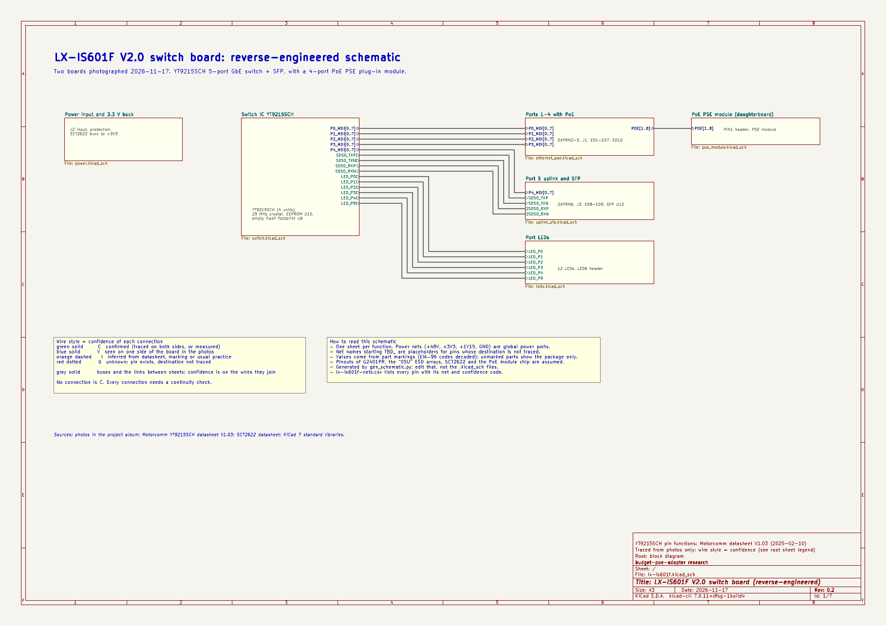
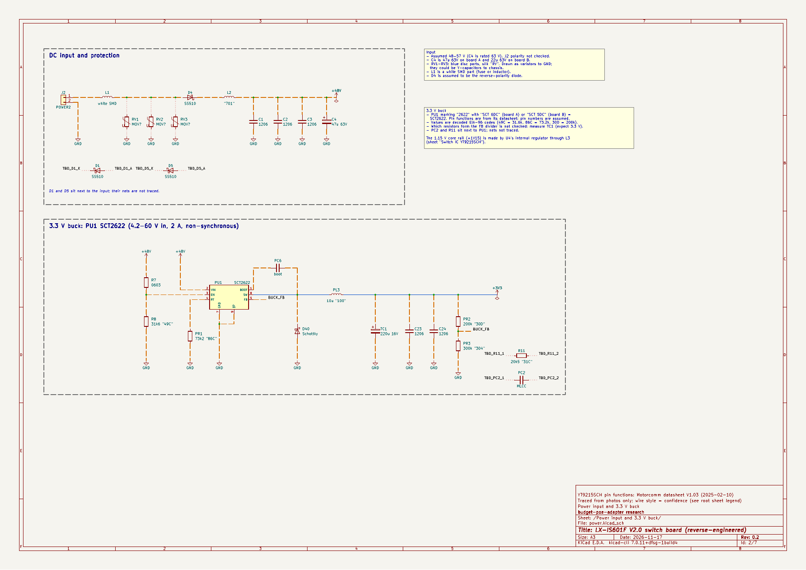
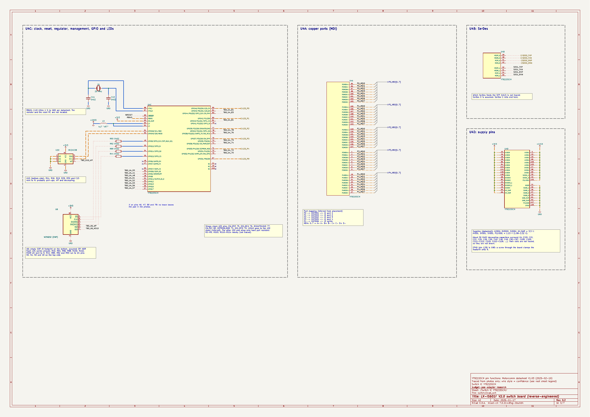
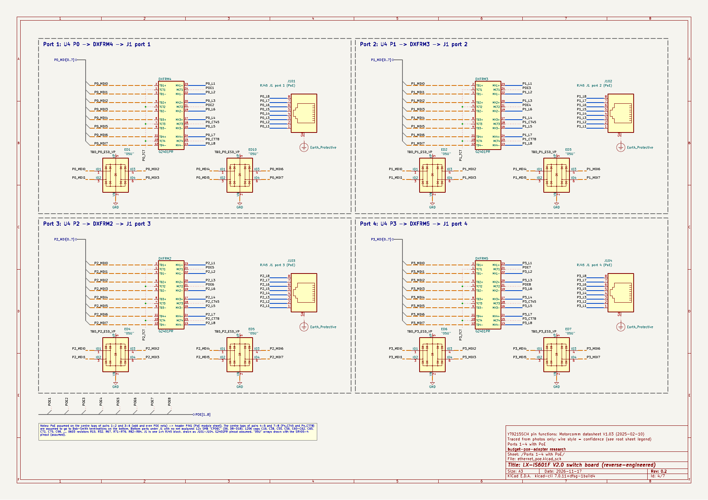
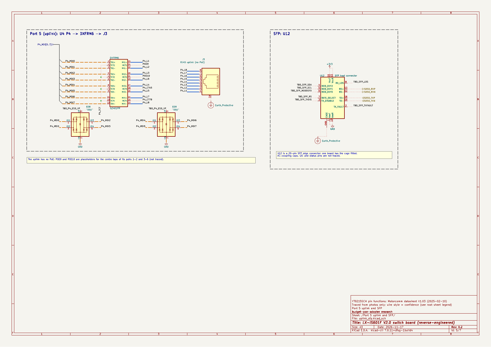
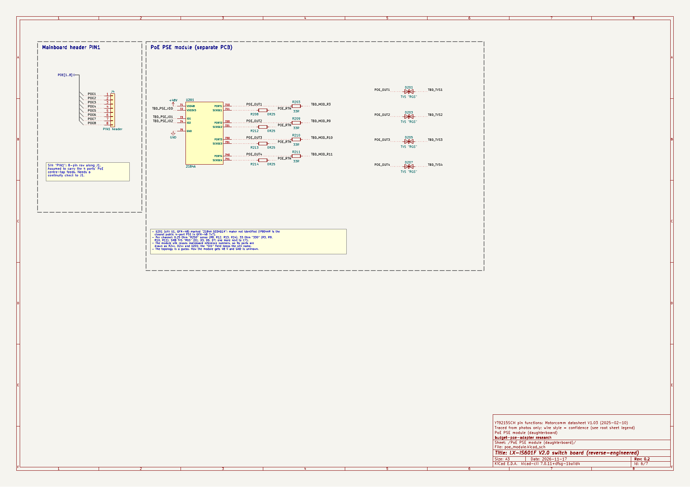
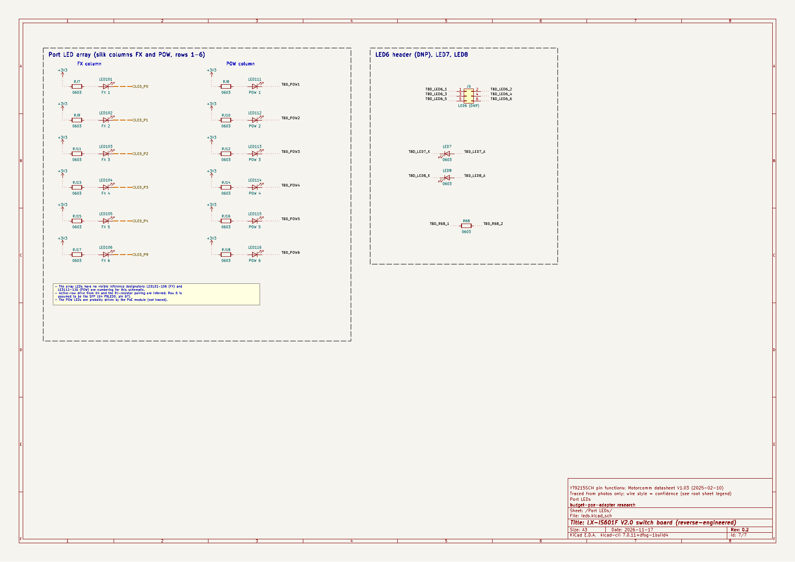

# LX-IS601F V2.0 board: reverse-engineered schematic

Traced from 34 photos of two boards. No net has been probed with a meter.

## Files

The schematic is a hierarchical KiCad 7 schematic. Open [`lx-is601f.kicad_sch`](lx-is601f.kicad_sch); the root page is a block diagram and each block is its own sheet. [`lx-is601f-schematic.pdf`](lx-is601f-schematic.pdf) holds all seven sheets.

| Sheet | Name | File | Render | Paper |
|---|---|---|---|---|
| 1 | Root: block diagram | [`lx-is601f.kicad_sch`](lx-is601f.kicad_sch) | [`1-root.png`](renders/1-root.png) | A3 |
| 2 | Power input and 3.3 V buck | [`power.kicad_sch`](power.kicad_sch) | [`2-power.png`](renders/2-power.png) | A3 |
| 3 | Switch IC YT9215SCH | [`switch.kicad_sch`](switch.kicad_sch) | [`3-switch.png`](renders/3-switch.png) | A2 |
| 4 | Ports 1-4 with PoE | [`ethernet_poe.kicad_sch`](ethernet_poe.kicad_sch) | [`4-ethernet-poe.png`](renders/4-ethernet-poe.png) | A3 |
| 5 | Port 5 uplink and SFP | [`uplink_sfp.kicad_sch`](uplink_sfp.kicad_sch) | [`5-uplink-sfp.png`](renders/5-uplink-sfp.png) | A3 |
| 6 | PoE PSE module (daughterboard) | [`poe_module.kicad_sch`](poe_module.kicad_sch) | [`6-poe-module.png`](renders/6-poe-module.png) | A3 |
| 7 | Port LEDs | [`leds.kicad_sch`](leds.kicad_sch) | [`7-leds.png`](renders/7-leds.png) | A3 |

| Sheet | Drawn on it |
|---|---|
| 1 | Block diagram |
| 1 | Confidence legend |
| 1 | How-to-read notes |
| 2 | DC input J2 |
| 2 | Input protection |
| 2 | PU1 SCT2622 3.3 V buck |
| 3 | U4 unit C: clock |
| 3 | U4 unit C: reset |
| 3 | U4 unit C: EEPROM U10 |
| 3 | U4 unit C: flash footprint U6 |
| 3 | U4 unit C: GPIO |
| 3 | U4 unit A: copper MDI |
| 3 | U4 unit B: SerDes |
| 3 | U4 unit D: supply pins |
| 4 | G2401PR magnetics |
| 4 | `05U` ESD arrays |
| 4 | J1 as four connectors J101-J104 |
| 4 | PoE centre taps |
| 5 | DXFRM6 magnetics |
| 5 | J3 uplink connector |
| 5 | U12 SFP connector |
| 6 | PIN1 header |
| 6 | PoE PSE daughterboard with U201 `2184A` |
| 7 | FX LED column |
| 7 | POW LED column |
| 7 | LED6 header |
| 7 | LED7 |
| 7 | LED8 |

| File | Purpose |
|---|---|
| [`lx-is601f-nets.csv`](lx-is601f-nets.csv) | One row per pin |
| [`gen_schematic.py`](gen_schematic.py) | Board data model and sheet layout |
| [`kisch.py`](kisch.py) | KiCad schematic file writer |
| [`renders/`](renders/) | PNG of each sheet |

Each row of [`lx-is601f-nets.csv`](lx-is601f-nets.csv) gives a pin's net, confidence code and sheet; sort by `net` to get a netlist. The `net` column is the name in the data model and the `kicad_net` column is the name KiCad's netlist gives the same net. Only the global power nets have the same name in both columns. KiCad prefixes a labelled net with its sheet path, so `P0_MDI0` is `/Ports 1-4 with PoE/P0_MDI0`. It names a wire with no label after a pin, so `VIN_P` is `Net-(D4-K)`. A pin whose `net` is `(NC)` or `(no trace seen)` has no connection and KiCad calls it `unconnected-(…)`. [`gen_schematic.py`](gen_schematic.py) generates every sheet from one data model, exports KiCad's netlist and checks it against the model, then writes the CSV, the PDF and the renders and checks that each render keeps a clear 10 mm margin. Edit the scripts, not the `.kicad_sch` files.

Parts on the PoE module are drawn as R2xx, D2xx and U201 so they don't clash with mainboard references; the silkscreen name is in each part's `Silk` field. The mainboard connectors whose silkscreen name is not a reference are drawn as follows:

| Silkscreen | Drawn as |
|---|---|
| `POWER2` | J2 |
| `PIN1` | J4 |
| `LED6` | J5 |

## Sheets

Each image links to the full-size render.

### Sheet 1: Root: block diagram

### Sheet 2: Power input and 3.3 V buck

### Sheet 3: Switch IC YT9215SCH

### Sheet 4: Ports 1-4 with PoE

### Sheet 5: Port 5 uplink and SFP

### Sheet 6: PoE PSE module (daughterboard)

### Sheet 7: Port LEDs

## Confidence codes

| Code | Name | Evidence that earns it |
|---|---|---|
| **C** | Confirmed | Traced on both sides |
| **C** | Confirmed | Measured |
| **V** | Seen | Trace visible on one side in a photo |
| **V** | Seen | Pads adjacent in a photo |
| **I** | Inferred | Datasheet |
| **I** | Inferred | Part marking |
| **I** | Inferred | Usual practice |
| **U** | Unknown | Destination not traced |

| Code | Wire colour | Wire style | Pin connections |
|---|---|---|---|
| **C** | Green | Solid | 0 |
| **V** | Blue | Solid | 107 |
| **I** | Orange | Dashed | 237 |
| **U** | Red | Dotted | 228 |
| All | | | 572 |

Buses, and the links between sheet symbols on the root sheet, are drawn grey and carry no confidence code; the code is on the wires they join.

**No net is confirmed.** The photos are handheld and oblique, and inner layers are invisible, so continuity checks are needed before anything can be marked C.

## What the board is

A 6-port managed-capable switch with 4-port PoE output (PSE), not a PoE-powered device:

- **U4** Motorcomm **YT9215SCH** (LQFP-128 with EPAD). Two boards seen: `VKTP18287 3200111C 3AU2612M0` and `VKJC09324 2500211C 3AW4849M0`. One board has a heatsink on top. A tinned pad with a solder blob sits under the EPAD on the bottom side.
- **5 copper ports**: J1 is a 1×4 RJ45 block (ports 1–4, PoE). J3 is a single RJ45 uplink (no PoE) on the opposite edge. Each port has a United-tek **G2401PR** single-port GbE transformer (DXFRM2–6; there is no DXFRM1 part, only its silkscreen).
- **1 SFP**: U12 is a 20-pin SFP host connector. One board has the cage fitted; the other has the connector only.
- **PoE module**: a daughterboard on the 8-pin **PIN1** header beside J1. It carries the part with silkscreen name U1 (drawn as U201), a QFN-48 marked **`2184A 533AQ1H`** (4-port PSE controller, maker not identified; IP804AR is the closest public match in package and function). It also has four `R250` 0.25 Ω sense resistors (silkscreen names R8, R12, R13 and R14), four `330` 33 Ω resistors (R3, R9, R10 and R11), five SMB TVS diodes marked `RGS` (D1, D3, D5, D7 and one more) and 1206 capacitors.
- **Power**: 2-pin `POWER2` input (48–57 V assumed), L1, three `SS510` Schottkys (D1, D4, D5), three blue disc parts RV1–RV3 (varistors or Y-caps), L2 `701` inductor, C4 47 µF 63 V. **PU1 SCT2622** (marking `2622 SCT 6DC`, 4.2–60 V 2 A non-synchronous buck, ESOP-8) with PL3 10 µH, D40 catch diode and TC1 220 µF 16 V makes **3.3 V**. **1.15 V** core comes from U4's internal switching regulator (LX pins 63 and 64) through **L3 4.7 µH**.
- **25 MHz crystal Y6** with C43 and C44, beside U4 XTAL pins 87 and 88.
- **Config EEPROM U10** `HK24C08` (Hangshun 24C08, 1 KB I²C) on the bottom. It is presumably on U4 pin 91 (SCL) and pin 92 (SDA). The OSHWHub YT9215S board has no EEPROM; this board does.
- **Empty SPI-flash footprint U6** (SOP-8 or WSON-8) on the bottom, with R40, R94, R96, R98, R100, R102 and R109 next to it. Together with R44, R89, R92 and R93 on the SPF0 pins, the board looks designed to take a flash chip.
- **ESD**: ED1–ED10, SOT-23-6 marked `05U`, two per copper port between U4 and the magnetics.
- **LEDs**: a 6×2 array of 0603 LEDs, columns `FX` and `POW`, rows 1–6, with RJ7–RJ18 resistors. LED7 and LED8 sit next to an unpopulated 2×3 header `LED6` (with R68).
- **Bottom edge under the RJ45s**: twelve SMB parts marked `CP06C` (D6, D8–D18, maybe bidirectional TVS), and 1206 capacitors (C16, C38, C55, C56, C60, C61, C62, C65, C71, C75 and C98 are readable) with 0603 resistors R15, R32, R67, R71 to R76 and R82 to R84. These are probably per-pair Bob-Smith terminations or PoE centre-tap filtering (inferred).

## Port mapping (inferred from placement)

U4's MDI pins come out on two sides. With pin 1 at the bottom-left (crystal on top), P0, P1 and P2 face the J1 magnetics, and P3 and P4 face the bottom. The mapping below is the shortest-route guess. Check it with a meter.

| U4 port | First MDI pin | Last MDI pin | Magnetics | Connector | Port on connector | PoE | First ESD array | Second ESD array |
|---|---|---|---|---|---|---|---|---|
| P0 | 95 | 103 | DXFRM4 | J1 | 1 | Yes | ED1 | ED10 |
| P1 | 105 | 113 | DXFRM3 | J1 | 2 | Yes | ED2 | ED3 |
| P2 | 119 | 127 | DXFRM2 | J1 | 3 | Yes | ED4 | ED5 |
| P3 | 1 | 9 | DXFRM5 | J1 | 4 | Yes | ED6 | ED7 |
| P4 | 19 | 27 | DXFRM6 | J3 | Uplink | No | ED8 | ED9 |

The SFP connector U12 has no magnetics and no ESD array. Which SerDes feeds it is not traced; the schematic draws SerDes 0.

| SerDes | First pin | Last pin | Drawn connected to |
|---|---|---|---|
| 0 | 38 | 42 | U12 SFP |
| 1 | 31 | 35 | Nothing |

## Unknowns

- G2401PR, the `05U` arrays and the `2184A` PSE have no datasheets found. Their pinouts in the schematic are assumed: a common 24-pin 1-port GbE transformer layout, the SRV05-4 pinout for the ESD arrays, and function-only pins for the PSE.
- SCT2622 pin **numbers** are assumed. The functions (BOOT, VIN, EN, RT, FB, SW, GND on the EPAD) are from its datasheet text.
- Many U4 GPIO and LED pins (44, 48, 51–53, 56, 57, 70, 72–74, 76, 78, 81, 83, 84, 93) are not traced.
- Which SerDes feeds the SFP, and where the SFP's I²C, LOS and TX_DISABLE pins go.
- What the 8 PIN1 pins carry, and how the PoE module gets 48 V and ground.

## Measurements and photos needed

### Photos

These would let most I and U nets become V.

1. **Flat, straight-down shots of each whole side** with the board lying flat and the phone parallel to it. Use diffuse light (no flash), at 2–3 overlapping tiles per side. Put a ruler in frame for scale.
2. **Both sides with the PoE module unplugged**, so the PIN1 header area and the traces under the module are visible.
3. **The PoE module on its own**, both sides, straight down.
4. **Close-ups of the bottom** around U6, U10 and the R49–R66 resistor arrays, and the bottom area under U4 (pins and vias).
5. **Macro of the SFP area** (U12) on the board without the cage.

### Continuity checks (power off; a meter in beep mode)

| Check | From part | From pin | To part | To pin | Settles |
|---|---|---|---|---|---|
| 1 | U10 | 6 | U4 | 91 | EEPROM clock pin |
| 1 | U10 | 5 | U4 | 92 | EEPROM data pin |
| 2 | U6 | 1 | R44 | Far end | U6 chip select net |
| 2 | U6 | 2 | R89 | Far end | U6 data out net |
| 2 | U6 | 5 | R92 | Far end | U6 data in net |
| 2 | U6 | 6 | R93 | Far end | U6 clock net |
| 3 | PIN1 | 1–8 | J1 | Every pin | PoE pair of each PIN1 pin |
| 3 | PIN1 | 1–8 | GND | Any | Module ground pins |
| 3 | PIN1 | 1–8 | VIN | Any | Module power pins |
| 4 | U4 | 95 | DXFRM4 | Chip side | Port mapping of P0 |
| 4 | U4 | 105 | DXFRM3 | Chip side | Port mapping of P1 |
| 4 | U4 | 119 | DXFRM2 | Chip side | Port mapping of P2 |
| 4 | U4 | 1 | DXFRM5 | Chip side | Port mapping of P3 |
| 4 | U4 | 19 | DXFRM6 | Chip side | Port mapping of P4 |
| 5 | DXFRM2–5 | Line side | J1 | Every pin | G2401PR pinout |
| 5 | DXFRM6 | Line side | J3 | Every pin | G2401PR pinout |
| 6 | PL3 | Output | U4 | 10 | AVDDH rail |
| 6 | L3 | Output | U4 | 13 | AVDDL rail |
| 7 | POWER2 | 1–2 | D1 | Both | Input polarity protection |
| 7 | POWER2 | 1–2 | D4 | Both | Input polarity protection |
| 7 | POWER2 | 1–2 | L1 | Both | Input filter |
| 7 | POWER2 | 1–2 | RV1–RV3 | Both | Input surge protection |
| 8 | U12 | 12 | U4 | 31–42 | SerDes for RD- |
| 8 | U12 | 13 | U4 | 31–42 | SerDes for RD+ |
| 8 | U12 | 18 | U4 | 31–42 | SerDes for TD+ |
| 8 | U12 | 19 | U4 | 31–42 | SerDes for TD- |
| 9 | RJ7–RJ18 | LED side | U4 | 67–85 | LED pin mapping |

Check 8 may pass through AC-coupling capacitors, so probe both sides of any capacitor on the way.

### Powered measurements (if safe to do)

- The voltage on TC1 (expect 3.3 V) and on L3's output side (expect about 1.15 V).
- Read U10 with a CH341A and SOIC-8 clip (power the board off, or lift VCC) to get the EEPROM contents.
