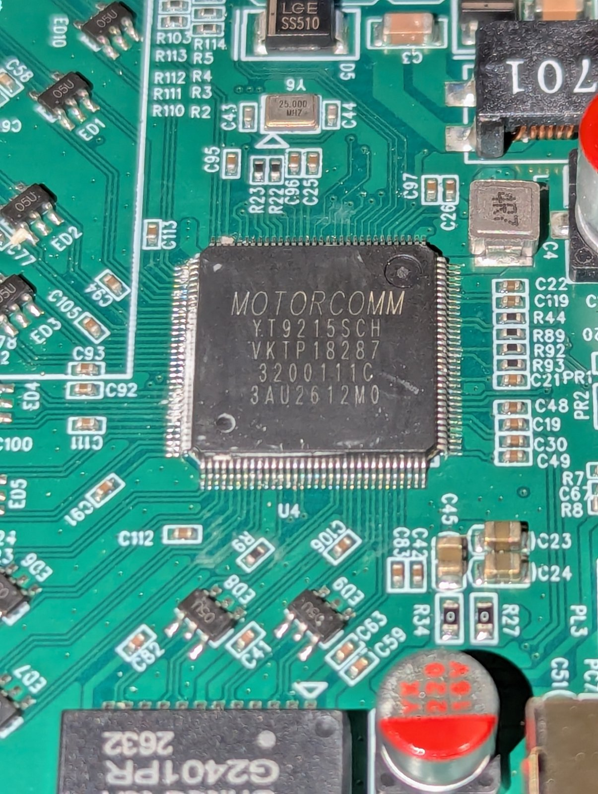
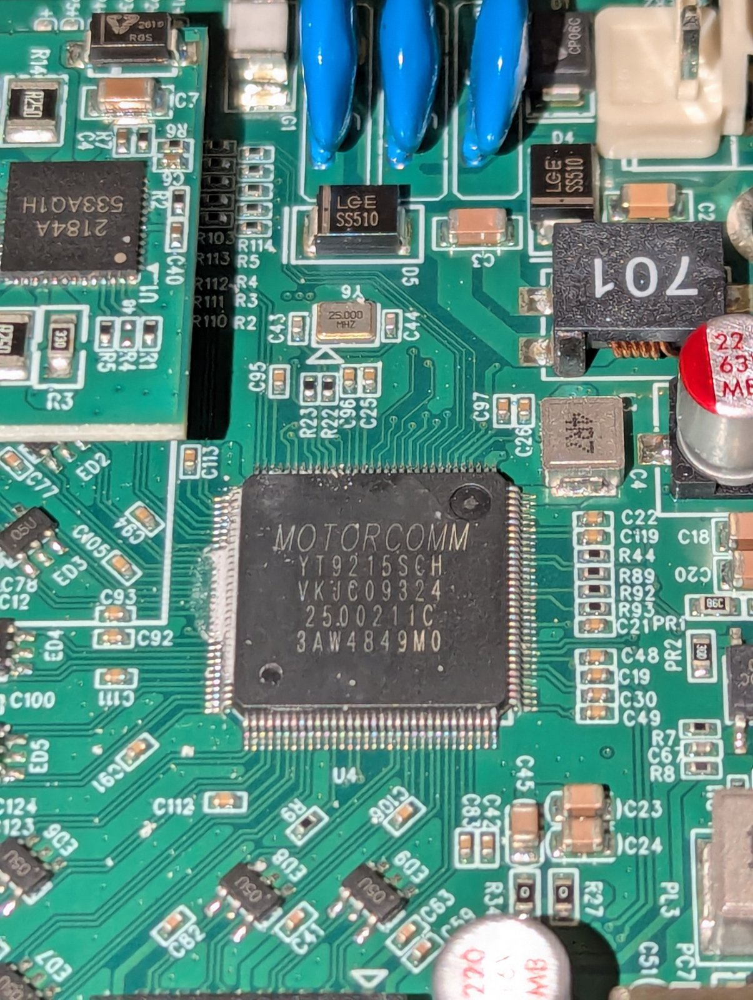
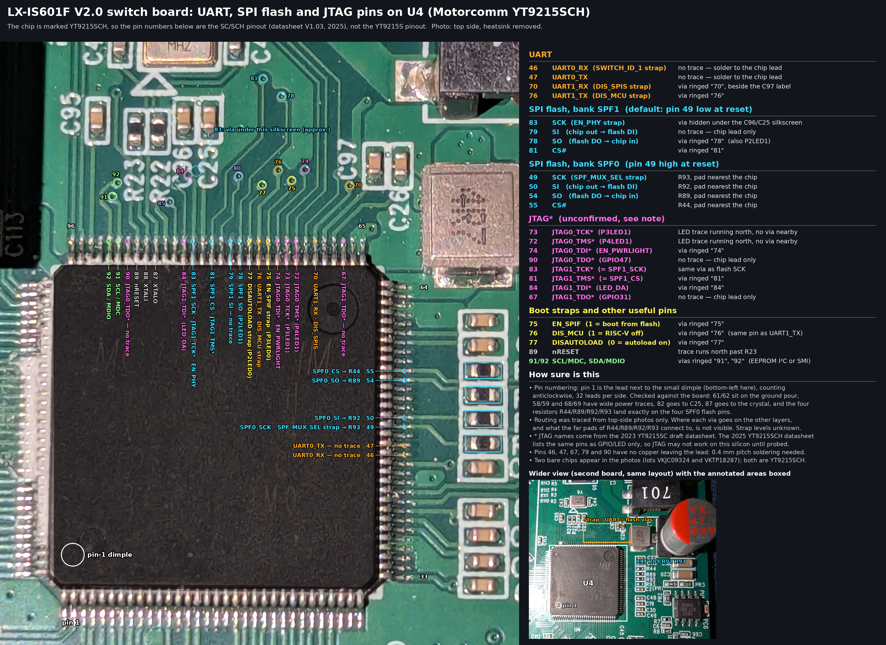

# Motorcomm switch ICs: JTAG, SPI flash and UART pins

Where the debug and boot interfaces of the YT9215 family come out: the YT9215S, the YT9215SC with its YT9215SCH revision, and the YT9215RB.

## Evidence codes

Each claim carries one of these codes.

| Code | Name | Evidence |
|---|---|---|
| **V** | Verified | Printed in a datasheet |
| **V** | Verified | Present in a board netlist |
| **V** | Verified | Read from a chip marking in a photo |
| **I** | Inferred | Reasoned from other evidence |
| **C** | Conflicting | Sources disagree |

## Headline findings

### The three variants have three different pinouts

Each variant is a pin-for-pin drop-in for a different Realtek part, according to the [Motorcomm selection guide](../datasheets/motorcomm/Motorcomm_Product_Selection_Guide_2023-03-08.pdf) (2023-03-08; the same file is [`裕太微电子产品选型20230308.pdf`](https://github.com/mithro/wu-kou-qian-zhao-jiao-huan-ji-_yt9215s_v2_0/blob/main/attachments/%E8%A3%95%E5%A4%AA%E5%BE%AE%E7%94%B5%E5%AD%90%E4%BA%A7%E5%93%81%E9%80%89%E5%9E%8B20230308.pdf) in the board repo) [**V**](#evidence-codes). Pin numbers from one variant's datasheet cannot be used for another. The crystal pins show it.

| Variant | Realtek part it matches | Lower crystal pin | Higher crystal pin | Pin tables |
|---|---|---|---|---|
| YT9215S | RTL8367S | 83 | 84 | [YT9215S](#yt9215s) |
| YT9215SC | RTL8367SC | [87](#sch-pin-87) | [88](#sch-pin-88) | [YT9215SC and YT9215SCH](#yt9215sc-and-yt9215sch) |
| YT9215SCH | RTL8367SC | [87](#sch-pin-87) | [88](#sch-pin-88) | [YT9215SC and YT9215SCH](#yt9215sc-and-yt9215sch) |
| YT9215RB | RTL8367RB-VB | 89 | 90 | [YT9215RB](#yt9215rb) |

### Every variant has the RISC-V MCU

The selection guide marks the S, the RB and the SC "内置RISC-V" (built-in RISC-V) [**V**](#evidence-codes). The S and RB datasheets both list "Integrated RISC-V microprocessor", the `DIS_MCU` strap, SPI flash, two UARTs and two JTAG groups [**V**](#evidence-codes).

### The newest datasheet has no JTAG

[YT9215SCH V1.03](../datasheets/motorcomm/YT9215SCH_Datasheet_V1.03_2025-02-10.pdf) (2025-02-10) has no JTAG pin names. The pins that [YT9215SC Draft_07](../datasheets/motorcomm/YT9215SC_Datasheet_Draft_07_2023-02-28.pdf) (2023-02-28) calls JTAG are listed there as GPIO, LED and I²C only; the UART and SPI-flash pins are in both [**V**](#evidence-codes). Either Motorcomm does not document JTAG or it is disabled in production silicon [**I**](#evidence-codes). Treat JTAG as unconfirmed until it has been probed.

### The YT9215SCH datasheet describes the MCU

[YT9215SCH V1.03](../datasheets/motorcomm/YT9215SCH_Datasheet_V1.03_2025-02-10.pdf) is the only public description of the MCU [**V**](#evidence-codes).

| Item | Value |
|---|---|
| SRAM | 64 KB |
| Boot ROM | 16 KB |
| I-cache | 2 KB |
| Largest SPI NOR flash | 8 MB |
| Flash I/O mode | Single |
| Flash I/O mode | Dual |
| Flash addressing | 3-byte |
| Boot mode | Execute in place (XIP) from flash |
| Boot mode | Flash to RAM |
| Boot mode | EEPROM to RAM |

## YT9215S

The YT9215S has the RTL8367S pinout and is the part on the [mirrored open-hardware board](https://github.com/mithro/wu-kou-qian-zhao-jiao-huan-ji-_yt9215s_v2_0).

Sources: [YT9215S Draft_01](../datasheets/motorcomm/YT9215S_Datasheet_Draft_01_2022-11-08.pdf) (2022-11-08; also [`YT9215S_Datasheet_draft_V0.1.pdf`](https://github.com/mithro/wu-kou-qian-zhao-jiao-huan-ji-_yt9215s_v2_0/blob/main/attachments/YT9215S_Datasheet_draft_V0.1.pdf) in the board repo) and [YT9215S Draft_05](../datasheets/motorcomm/YT9215S_Datasheet_Draft_05_2023-02-21.pdf) (2023-02-21; also on [LCSC](https://atta.szlcsc.com/upload/public/pdf/source/20230829/432918AE041FF2F1E459558942DE4628.pdf)). Both drafts give the same pin numbers [**V**](#evidence-codes).

The board netlist [`schematic/netlist-schematic.enet`](https://github.com/mithro/wu-kou-qian-zhao-jiao-huan-ji-_yt9215s_v2_0/blob/main/schematic/netlist-schematic.enet) uses an RTL8367S-CG symbol with the crystal on pins 83 and 84 and nRESET on pin 86, and the board's author reports that it boots with a YT9215S fitted. That confirms the shipping S silicon uses this pinout [**V**](#evidence-codes).

### SPI flash on the YT9215S

There is one flash interface, on one of two pin groups. The `SPF_MUX_SEL` strap on pin [48](#s-pin-48) picks the group. Pin [48](#s-pin-48) has an internal pull-down, so SPF1 is the default.

| Group | Signal | Pin | GPIO | Other function | Strap on pin |
|---|---|---|---|---|---|
| SPF0 | SCK | 48 | GPIO9 | RGMII TXD0 | `SPF_MUX_SEL` |
| SPF0 | SI | 49 | GPIO10 | RGMII TXCTL | – |
| SPF0 | SO | 53 | GPIO14 | RGMII RXD0 | – |
| SPF0 | CS# | 54 | GPIO15 | RGMII RXD1 | – |
| SPF1 | SCK | 77 | GPIO40 | P2LED1 | – |
| SPF1 | SI | 71 | GPIO34 | P4LED1 | – |
| SPF1 | SO | 72 | GPIO35 | P3LED1 | – |
| SPF1 | CS# | 76 | GPIO39 | – | `DISAUTOLOAD` |

| Group | Pin 48 level | Default |
|---|---|---|
| SPF0 | Pulled up | No |
| SPF1 | Low | Yes |

| Signal | Driven by | Flash pin | Flash I/O name |
|---|---|---|---|
| SI | Chip | DI | IO0 |
| SO | Flash | DO | IO1 |

- `EN_SPIF` on pin 74 (GPIO37, also P3LED0) is the enable strap: pull it up to enable flash [**V**](#evidence-codes).
- SPF0 takes over the extension-port RGMII and MII pins. If the adapter's MCU link uses that port, flash has to go on SPF1 [**I**](#evidence-codes).
- On SPF1, CS# is the `DISAUTOLOAD` strap pin. The usual CS# pull-up therefore latches DISAUTOLOAD=1, which the [YT9215SCH boot table](#boot-table) calls "no action", so nothing would load [**I**](#evidence-codes). This needs a bench test, or a pull-down on CS# during reset. The S datasheet has no boot-mode table, so this conclusion borrows the SCH table.

### JTAG on the YT9215S

There are two JTAG groups, both shared with LEDs and straps [**V**](#evidence-codes).

| Group | Signal | Pin | GPIO | Other function | Strap on pin |
|---|---|---|---|---|---|
| JTAG0 | TCK | 73 | GPIO36 | – | `EN_PWRLIGHT` |
| JTAG0 | TMS | 79 | GPIO44 | JTAG1 TCK | `EN_PHY` |
| JTAG0 | TDI | 81 | GPIO46 | LED_CK | `SMI_SEL` |
| JTAG0 | TDO | 80 | GPIO45 | LED_DA | – |
| JTAG1 | TCK | [79](#s-pin-79) | GPIO44 | JTAG0 TMS | `EN_PHY` |
| JTAG1 | TMS | [71](#s-pin-71) | GPIO34 | P4LED1 | – |
| JTAG1 | TDI | [72](#s-pin-72) | GPIO35 | P3LED1 | – |
| JTAG1 | TDO | [77](#s-pin-77) | GPIO40 | P2LED1 | – |

- Pin [79](#s-pin-79) is listed as both JTAG1 TCK and JTAG0 TMS in both drafts, so the two groups cannot be used at once [**V**](#evidence-codes).
- JTAG1 uses pins [71](#s-pin-71), [72](#s-pin-72) and [77](#s-pin-77), which are also SPF1 pins, so it cannot coexist with flash on SPF1 [**I**](#evidence-codes).
- There is no TRST and no pin that selects JTAG. Whether the pins become JTAG after reset or only after a register write is not documented. Nor is whether they reach the RISC-V debug module or only boundary scan [**I**](#evidence-codes).

### UART on the YT9215S

| UART | Signal | Pin | GPIO | Other function | Strap on pin | Evidence |
|---|---|---|---|---|---|---|
| UART0 | RX | 45 | GPIO6 | RGMII TXD3 | `SWITCH_ID_1` | [**V**](#evidence-codes) |
| UART0 | TX | 46 | GPIO7 | RGMII TXD2 | – | [**V**](#evidence-codes) |
| UART1 | RX | 19 | GPIO2 | INTERRUPT | – | [**V**](#evidence-codes) |
| UART1 | TX | 75 | GPIO38 | P2LED0 | `DIS_MCU` | [**V**](#evidence-codes) |
| UART2 | RX | [73](#s-pin-73) | GPIO36 | – | `EN_PWRLIGHT` | [**V**](#evidence-codes) |
| UART2 | TX | [75](#s-pin-75) | GPIO38 | UART1 TX | `DIS_MCU` | [**C**](#evidence-codes) |

- UART0 appears in the pin table of both drafts and in the Draft_05 UART table. The Draft_01 UART table leaves it out.
- On the RTL8367S symbol, pin [45](#s-pin-45) is labelled UART_RX and pin [46](#s-pin-46) UART_TX, so UART0 is the Realtek-compatible console position [**V**](#evidence-codes).
- The datasheet puts TX on pin [75](#s-pin-75) for both UART1 and UART2. That is probably a typo for one of them [**C**](#evidence-codes).

### Other boot-related pins on the YT9215S

| Pin | Name | Function |
|---|---|---|
| [75](#s-pin-75) | `DIS_MCU` | Pull-up disables the MCU |
| [76](#s-pin-76) | `DISAUTOLOAD` | Pull-up stops autoload |
| 70 | `EEPROM_MOD` | Selects the EEPROM size class |
| 87 | SCL | EEPROM I²C clock |
| 88 | SDA | EEPROM I²C data |

`EEPROM_MOD` tells EEPROMs above 16 Kbit from those of 16 Kbit or less. Pins [87](#s-pin-87) and [88](#s-pin-88) are GPIO48 and GPIO49 and also carry the slave management interface (MDC and MDIO).

### How the mirrored board wires these pins

All of this table is from the netlist [`schematic/netlist-schematic.enet`](https://github.com/mithro/wu-kou-qian-zhao-jiao-huan-ji-_yt9215s_v2_0/blob/main/schematic/netlist-schematic.enet) [**V**](#evidence-codes). Blank cells mean the board has nothing there, and `?` means the netlist gives no value.

| Pin | First signal | Second signal | Third signal | Board net | Strap resistor | Strap value | Pulls to | LED resistor | Test point | Strap level | Effect |
|---|---|---|---|---|---|---|---|---|---|---|---|
| [45](#s-pin-45) | UART0 RX |  |  | None |  |  |  |  | None |  |  |
| [46](#s-pin-46) | UART0 TX |  |  | None |  |  |  |  | None |  |  |
| [19](#s-pin-19) | UART1 RX |  |  | None |  |  |  |  |  |  |  |
| [48](#s-pin-48) | SPF_MUX_SEL |  |  | None | Internal |  | GND |  |  | 0 | SPF1 selected |
| [74](#s-pin-74) | EN_SPIF |  |  | P3_LED0 | R27 | 4.7 kΩ | GND | R31 |  | 0 | Flash off |
| [75](#s-pin-75) | DIS_MCU | UART1 TX | UART2 TX | P2_LED0 | R19 | 4.7 kΩ | GND | R25 |  | 0 | MCU enabled |
| [76](#s-pin-76) | DISAUTOLOAD | SPF1 CS# |  | DISAUTOLOAD | R11 | 4.7 kΩ | 3V3 |  | TP14 | 1 | No autoload |
| [73](#s-pin-73) | JTAG0 TCK | UART2 RX |  | EN_PWRLIGHT | R12 | 4.7 kΩ | 3V3 |  |  | 1 |  |
| [79](#s-pin-79) | JTAG1 TCK | JTAG0 TMS |  | P1_LED0 | R17 | ? | 3V3 | R23 |  | 1 |  |
| [80](#s-pin-80) | JTAG0 TDO |  |  | P0_LED1 | R16 | ? | 3V3 | R22 |  | 1 |  |
| [81](#s-pin-81) | JTAG0 TDI |  |  | P0_LED0 | R15 | ? | 3V3 | R21 |  | 1 |  |
| [71](#s-pin-71) | JTAG1 TMS | SPF1 SI |  | P4_LED1 | R30 | ? | 3V3 | R34 |  | 1 |  |
| [72](#s-pin-72) | JTAG1 TDI | SPF1 SO |  | P3_LED1 | R28 | ? | GND | R32 |  | 0 |  |
| [77](#s-pin-77) | JTAG1 TDO | SPF1 SCK |  | P2_LED1 | R20 | ? | GND | R26 |  | 0 |  |
| [87](#s-pin-87) | EEPROM SCL |  |  | None |  |  |  |  |  |  |  |
| [88](#s-pin-88) | EEPROM SDA |  |  | None |  |  |  |  |  |  |  |

What the wiring means:

- The board runs with the MCU enabled but with no flash and no EEPROM. DISAUTOLOAD=1 is "no action" in the [YT9215SCH boot table](#boot-table), so the MCU probably sits in its boot ROM doing nothing [**I**](#evidence-codes).
- To probe JTAG0, JTAG1 or UART2, lift the 470 Ω LED resistors and tap the 4.7 kΩ strap pads. Leaving the LEDs on loads TCK and TDO [**I**](#evidence-codes).
- UART0 has no pad, so reaching it means soldering to LQFP leads [45](#s-pin-45) and [46](#s-pin-46).

## YT9215SC and YT9215SCH

Both have the RTL8367SC pinout in an LQFP-128 package with an exposed pad.

Sources: [YT9215SC Draft_07](../datasheets/motorcomm/YT9215SC_Datasheet_Draft_07_2023-02-28.pdf) (2023-02-28; also on [LCSC](https://atta.szlcsc.com/upload/public/pdf/source/20251231/E8DA45036F659501F9799590211A88C7.pdf)) and [YT9215SCH V1.03](../datasheets/motorcomm/YT9215SCH_Datasheet_V1.03_2025-02-10.pdf) (2025-02-10; also on [LCSC](https://atta.szlcsc.com/upload/public/pdf/source/20251231/76B4B53D0DFB99DA2607FBF198C74D22.pdf)). The "In Draft_07" and "In V1.03" columns say which datasheet prints each name on each pin.

| Function | Signal | Pin | Strap on pin | In Draft_07 | In V1.03 | Evidence |
|---|---|---|---|---|---|---|
| SPF0 | SCK | 49 | `SPF_MUX_SEL` | Yes | Yes | [**V**](#evidence-codes) |
| SPF0 | SI | 50 | – | Yes | Yes | [**V**](#evidence-codes) |
| SPF0 | SO | 54 | – | Yes | Yes | [**V**](#evidence-codes) |
| SPF0 | CS | 55 | – | Yes | Yes | [**V**](#evidence-codes) |
| SPF1 | SO | 78 | – | Yes | Yes | [**V**](#evidence-codes) |
| SPF1 | SI | 79 | – | Yes | Yes | [**V**](#evidence-codes) |
| SPF1 | CS | 81 | – | Yes | Yes | [**V**](#evidence-codes) |
| SPF1 | SCK | 83 | `EN_PHY` | Yes | Yes | [**V**](#evidence-codes) |
| Strap | EN_SPIF | 75 | `EN_SPIF` | Yes | Yes | [**V**](#evidence-codes) |
| Strap | DIS_MCU | 76 | `DIS_MCU` | Yes | Yes | [**V**](#evidence-codes) |
| Strap | DISAUTOLOAD | 77 | `DISAUTOLOAD` | Yes | Yes | [**V**](#evidence-codes) |
| UART0 | RX | 46 | – | Yes | Yes | [**V**](#evidence-codes) |
| UART0 | TX | 47 | – | Yes | Yes | [**V**](#evidence-codes) |
| UART1 | RX | 70 | `DIS_SPIS` | Yes | Yes | [**V**](#evidence-codes) |
| UART1 | TX | [76](#sch-pin-76) | `DIS_MCU` | Yes | Yes | [**V**](#evidence-codes) |
| JTAG0 | TCK | 73 | – | Yes | No | [**V**](#evidence-codes) |
| JTAG0 | TMS | 72 | – | Yes | No | [**V**](#evidence-codes) |
| JTAG0 | TDI | 74 | `EN_PWRLIGHT` | Yes | No | [**V**](#evidence-codes) |
| JTAG0 | TDO | 90 | – | Yes | No | [**V**](#evidence-codes) |
| JTAG1 | TCK | [83](#sch-pin-83) | `EN_PHY` | Yes | No | [**V**](#evidence-codes) |
| JTAG1 | TMS | [81](#sch-pin-81) | – | Yes | No | [**V**](#evidence-codes) |
| JTAG1 | TDI | 84 | – | Yes | No | [**V**](#evidence-codes) |
| JTAG1 | TDO | 67 | – | Yes | No | [**V**](#evidence-codes) |
| I²C | SCL | 91 | – | Yes | Yes | [**V**](#evidence-codes) |
| I²C | SDA | 92 | – | Yes | Yes | [**V**](#evidence-codes) |
| Slave SPI | CS | [90](#sch-pin-90) | – | Yes | Yes | [**V**](#evidence-codes) |
| Slave SPI | SO | 93 | – | Yes | Yes | [**V**](#evidence-codes) |

- Pin [49](#sch-pin-49) is the `SPF_MUX_SEL` strap: a pull-up selects SPF0, and SPF1 is the default.
- V1.03 names pins [73](#sch-pin-73), [72](#sch-pin-72), [74](#sch-pin-74), [90](#sch-pin-90), [83](#sch-pin-83), [81](#sch-pin-81), [84](#sch-pin-84) and [67](#sch-pin-67) as GPIO, LED and I²C pins only. The JTAG names on them come from Draft_07.
- Pins [91](#sch-pin-91) and [92](#sch-pin-92) carry the EEPROM I²C bus, the slave management interface (MDC and MDIO) and the slave SPI clock and data input.

### YT9215SCH boot table

Table 25 of [YT9215SCH V1.03](../datasheets/motorcomm/YT9215SCH_Datasheet_V1.03_2025-02-10.pdf) lists what the chip loads at power-on, hardware reset and software reset [**V**](#evidence-codes).

| DISAUTOLOAD | DIS_MCU | EN_SPIF | DIS_SPIS | SMI_SEL | Loads from | Loads to | Evidence |
|---|---|---|---|---|---|---|---|
| 0 | 0 | 0 | 1 | 1 | EEPROM | MCU RAM | [**V**](#evidence-codes) |
| 0 | 0 | 1 | X | X | SPI flash | XIP | [**V**](#evidence-codes) |
| 0 | 1 | 0 | X | X | EEPROM | Registers | [**V**](#evidence-codes) |
| 0 | 1 | 1 | X | X | SPI flash | RAM | [**C**](#evidence-codes) |

X means the strap level does not matter. Every other strap combination loads nothing ("No Action" in the datasheet). The row marked [**C**](#evidence-codes) is as printed: it loads RAM from flash with the MCU disabled, which makes no sense as written.

## YT9215RB

The YT9215RB has the RTL8367RB-VB pinout.

Source: [YT9215RB Draft_05](../datasheets/motorcomm/YT9215RB_Datasheet_Draft_05_2023-02-16.pdf) (2023-02-16; also on [LCSC](https://datasheet.lcsc.com/datasheet/pdf/762da1ba434211a9b4be1fec673c7fcf.pdf?productCode=C5449202)). Every row of this table is printed in it [**V**](#evidence-codes).

| Function | Signal | Pin | Strap on pin |
|---|---|---|---|
| SPF0 | SCK | 44 | `SPF_MUX_SEL` |
| SPF0 | SI | 45 | – |
| SPF0 | SO | 49 | – |
| SPF0 | CS | 50 | – |
| SPF1 | SO | 80 | – |
| SPF1 | SI | 81 | – |
| SPF1 | CS | 83 | – |
| SPF1 | SCK | 84 | – |
| JTAG0 | TCK | 75 | – |
| JTAG0 | TMS | 74 | – |
| JTAG0 | TDI | 76 | – |
| JTAG0 | TDO | 92 | – |
| JTAG1 | TCK | [84](#rb-pin-84) | – |
| JTAG1 | TMS | [83](#rb-pin-83) | – |
| JTAG1 | TDI | 85 | – |
| JTAG1 | TDO | 20 | – |
| UART0 | RX | 41 | – |
| UART0 | TX | 42 | – |
| UART1 | RX | 72 | – |
| UART1 | TX | 78 | `DIS_MCU` |
| Strap | EN_SPIF | 77 | `EN_SPIF` |
| Strap | DIS_MCU | [78](#rb-pin-78) | `DIS_MCU` |
| Strap | DISAUTOLOAD | 79 | `DISAUTOLOAD` |

## Other Motorcomm parts

The [Motorcomm selection guide](../datasheets/motorcomm/Motorcomm_Product_Selection_Guide_2023-03-08.pdf) lists no CPU for the PHYs in this table. They have MDIO, LEDs and straps, and no JTAG, UART or flash interface. Their pin lists were not checked in detail.

| Part | Kind |
|---|---|
| YT8512 | PHY |
| YT8521 | PHY |
| YT8531 | PHY |
| YT8821 | PHY |
| YT8614 | QSGMII PHY |

The YT9218N and YT9218MB are 8-port relatives of the YT9215. Both are in the chip table of the Linux driver [`drivers/net/dsa/motorcomm/chip.c`](https://github.com/torvalds/linux/blob/20eef29b7c84/drivers/net/dsa/motorcomm/chip.c); no datasheet was checked for them.

The driver identifies a YT9215 by the major number 0x9002 in the `CHIP_ID` register (0x80008), and the variant by the `CHIP_MODE` register [**V**](#evidence-codes):

| `CHIP_MODE` | Variant |
|---|---|
| 1 | [YT9215SC](#yt9215sc-and-yt9215sch) |
| 2 | [YT9215S](#yt9215s) |
| 3 | [YT9215RB](#yt9215rb) |

The latched strap values can be read back over MDIO from the `PON_STRAP_VAL` register (0x80324). That gives a way to check the `DIS_MCU` and `EN_SPIF` levels on real hardware [**V**](#evidence-codes).

## Community and SDK status

- No public firmware, SDK, OpenOCD configuration, boot-ROM dump or forum write-up was found for the YT9215 MCU. Searches covered English and Chinese terms.
- The image format and the signing for flash boot and EEPROM boot are unknown.

## Implications for the adapter

If the adapter uses the YT9215S, strap `DIS_MCU` (pin [75](#s-pin-75)) high and leave `EN_SPIF` (pin [74](#s-pin-74)) low. That is the opposite of the [mirrored board](#how-the-mirrored-board-wires-these-pins), which leaves the MCU enabled.

A debug option stays open cheaply with one 0402 pad on each of these YT9215S pins. Most already carry strap resistors, so a test pad per net costs almost nothing.

| Interface | Signal | Pin |
|---|---|---|
| UART0 | RX | [45](#s-pin-45) |
| UART0 | TX | [46](#s-pin-46) |
| UART2 | RX | [73](#s-pin-73) |
| UART2 | TX | [75](#s-pin-75) |
| JTAG0 | TCK | [73](#s-pin-73) |
| JTAG0 | TMS | [79](#s-pin-79) |
| JTAG0 | TDO | [80](#s-pin-80) |
| JTAG0 | TDI | [81](#s-pin-81) |

A first bench experiment on the mirrored board needs no new PCB:

1. Leave `DIS_MCU` low, as the board has it.
2. Lift the LED resistors [R21](#ob-r21), [R22](#ob-r22) and [R23](#ob-r23), then scan JTAG0 for an IDCODE at the strap resistors in [the probe table](#jtag0-probe-points).
3. Listen for boot-ROM output on UART0 (pins [45](#s-pin-45) and [46](#s-pin-46)) and on UART2 (pins [73](#s-pin-73) and [75](#s-pin-75)).

| JTAG0 signal | Pin | Probe at |
|---|---|---|
| TCK | [73](#s-pin-73) | [R12](#ob-r12) |
| TMS | [79](#s-pin-79) | [R17](#ob-r17) |
| TDO | [80](#s-pin-80) | [R16](#ob-r16) |
| TDI | [81](#s-pin-81) | [R15](#ob-r15) |

## LX-IS601F V2.0 boards

Two bought 5-port switch boards with the silkscreen `LX-IS601F V2.0` were photographed. This section records where the debug pins of their switch IC go on the top copper layer. The photos, the annotation script and the method are in the [board notes](lx-is601f-board/README.md).

### The switch IC is a YT9215SCH

[U4](#lx-u4) on both boards is a YT9215SCH, not a YT9215S, so the [YT9215SC and YT9215SCH pin table](#yt9215sc-and-yt9215sch) applies and the [YT9215S tables](#yt9215s) do not. The part number is read from the top marking of U4 in one photo of each board [**V**](#evidence-codes).

| Board | Marking line 1 | Marking line 2 | Marking line 3 | Marking line 4 | Marking line 5 | Photo |
|---|---|---|---|---|---|---|
| A | `MOTORCOMM` | `YT9215SCH` | `VKTP18287` | `3200111C` | `3AU2612M0` | [Photo 06](lx-is601f-board/photos/README.md#photo-06) |
| B | `MOTORCOMM` | `YT9215SCH` | `VKJC09324` | `2500211C` | `3AW4849M0` | [Photo 07](lx-is601f-board/photos/README.md#photo-07) |

### Annotated photo

### Parts beside U4

| Part | Kind | U4 pin | Pin name |
|---|---|---|---|
| U4 | Switch IC (YT9215SCH) | – | – |
| Y6 | 25 MHz crystal | 87 | XTALO |
| [Y6](#lx-y6) | 25 MHz crystal | 88 | XTALI |
| R93 | Series resistor | [49](#sch-pin-49) | SPF0 SCK |
| R92 | Series resistor | [50](#sch-pin-50) | SPF0 SI |
| R89 | Series resistor | [54](#sch-pin-54) | SPF0 SO |
| R44 | Series resistor | [55](#sch-pin-55) | SPF0 CS |
| R22 | Resistor | 86 | AVDDH |

### How the leads were numbered

Pin 1 of [U4](#lx-u4) is the lead beside the small dimple on the package. Leads were counted from there, 32 to a side. The SPF0 resistor column is [R44](#lx-r44), [R89](#lx-r89), [R92](#lx-r92) and [R93](#lx-r93).

| Package side | First pin | Last pin | Faces |
|---|---|---|---|
| Second | 33 | 64 | SPF0 resistor column |
| Third | 65 | 96 | [Y6](#lx-y6) |

### Where each debug pin goes

The routes were read from photos of the top side only, and the lead numbers were counted by eye, so every row of this table is [**I**](#evidence-codes). The "Top-layer route" column uses these values:

| Value | Meaning |
|---|---|
| Lead only | No trace leaves the lead on the top layer |
| Via | A trace runs from the lead to a via |
| Resistor pad | A trace runs from the lead to the nearer pad of the resistor in the "Part" column |
| LED trace | A trace runs from the lead towards the port LEDs |

| Function | Signal | U4 pin | Top-layer route | Part | Signal name printed in |
|---|---|---|---|---|---|
| UART0 | RX | [46](#sch-pin-46) | Lead only | – | [Both datasheets](#yt9215sc-and-yt9215sch) |
| UART0 | TX | [47](#sch-pin-47) | Lead only | – | [Both datasheets](#yt9215sc-and-yt9215sch) |
| UART1 | RX | [70](#sch-pin-70) | Via | – | [Both datasheets](#yt9215sc-and-yt9215sch) |
| UART1 | TX | [76](#sch-pin-76) | Via | – | [Both datasheets](#yt9215sc-and-yt9215sch) |
| SPF1 | SCK | [83](#sch-pin-83) | Via | – | [Both datasheets](#yt9215sc-and-yt9215sch) |
| SPF1 | SI | [79](#sch-pin-79) | Lead only | – | [Both datasheets](#yt9215sc-and-yt9215sch) |
| SPF1 | SO | [78](#sch-pin-78) | Via | – | [Both datasheets](#yt9215sc-and-yt9215sch) |
| SPF1 | CS | [81](#sch-pin-81) | Via | – | [Both datasheets](#yt9215sc-and-yt9215sch) |
| SPF0 | SCK | [49](#sch-pin-49) | Resistor pad | [R93](#lx-r93) | [Both datasheets](#yt9215sc-and-yt9215sch) |
| SPF0 | SI | [50](#sch-pin-50) | Resistor pad | [R92](#lx-r92) | [Both datasheets](#yt9215sc-and-yt9215sch) |
| SPF0 | SO | [54](#sch-pin-54) | Resistor pad | [R89](#lx-r89) | [Both datasheets](#yt9215sc-and-yt9215sch) |
| SPF0 | CS | [55](#sch-pin-55) | Resistor pad | [R44](#lx-r44) | [Both datasheets](#yt9215sc-and-yt9215sch) |
| JTAG0 | TCK | [73](#sch-pin-73) | LED trace | – | [Draft_07](#yt9215sc-and-yt9215sch) |
| JTAG0 | TMS | [72](#sch-pin-72) | LED trace | – | [Draft_07](#yt9215sc-and-yt9215sch) |
| JTAG0 | TDI | [74](#sch-pin-74) | Via | – | [Draft_07](#yt9215sc-and-yt9215sch) |
| JTAG0 | TDO | [90](#sch-pin-90) | Lead only | – | [Draft_07](#yt9215sc-and-yt9215sch) |
| JTAG1 | TCK | [83](#sch-pin-83) | Via | – | [Draft_07](#yt9215sc-and-yt9215sch) |
| JTAG1 | TMS | [81](#sch-pin-81) | Via | – | [Draft_07](#yt9215sc-and-yt9215sch) |
| JTAG1 | TDI | [84](#sch-pin-84) | Via | – | [Draft_07](#yt9215sc-and-yt9215sch) |
| JTAG1 | TDO | [67](#sch-pin-67) | Lead only | – | [Draft_07](#yt9215sc-and-yt9215sch) |
| Strap | EN_SPIF | [75](#sch-pin-75) | Via | – | [Both datasheets](#yt9215sc-and-yt9215sch) |
| Strap | DIS_MCU | [76](#sch-pin-76) | Via | – | [Both datasheets](#yt9215sc-and-yt9215sch) |
| Strap | DISAUTOLOAD | [77](#sch-pin-77) | Via | – | [Both datasheets](#yt9215sc-and-yt9215sch) |

- The vias for pins [70](#sch-pin-70) and [76](#sch-pin-76) sit just above the chip in the [annotated photo](#annotated-photo).
- Pin [76](#sch-pin-76) is both UART1 TX and the `DIS_MCU` strap.

### Unknowns

- Where the vias go on other layers.
- The strap levels.
- What the far pads of [R44](#lx-r44), [R89](#lx-r89), [R92](#lx-r92) and [R93](#lx-r93) connect to.
- Pin [86](#sch-pin-86) is AVDDH in [YT9215SCH V1.03](../datasheets/motorcomm/YT9215SCH_Datasheet_V1.03_2025-02-10.pdf), yet a trace appears to run from it to [R22](#lx-r22) beside the crystal [**I**](#evidence-codes).

A photo of the bottom side and a continuity check would settle these.
