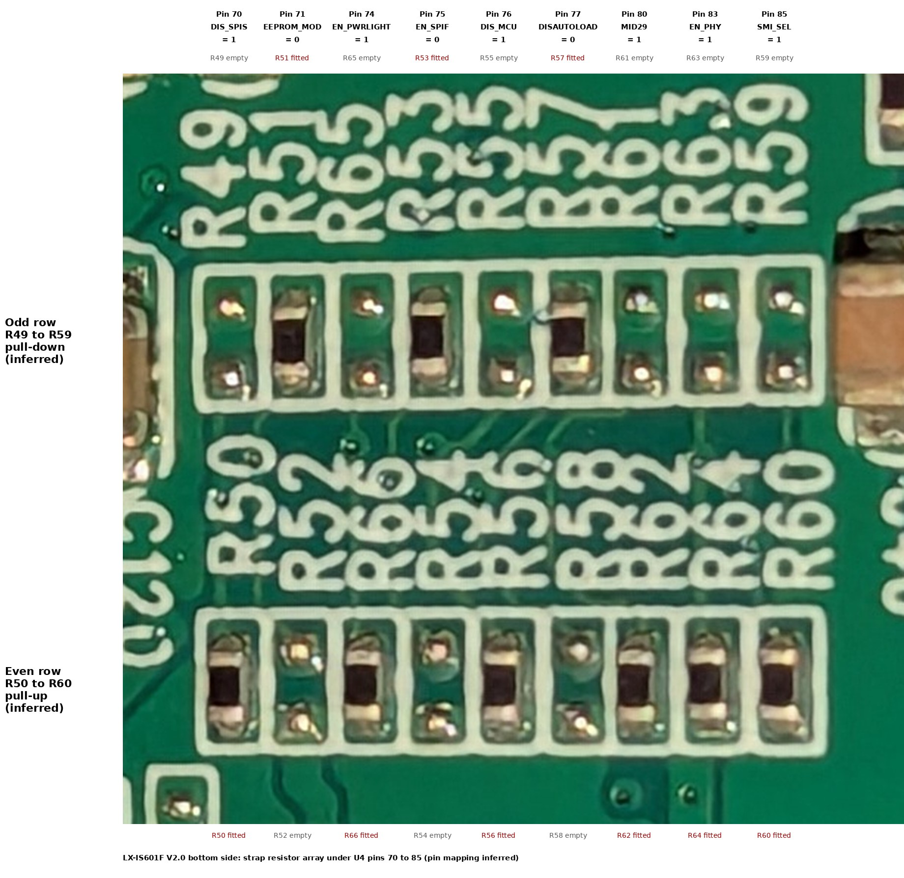

# Switch boards: strapping and major components

Covers the two switch boards in this project:

| Board | Switch IC | Origin | Evidence |
|---|---|---|---|
| LX-IS601F V2.0 | YT9215SCH | Bought PoE switch | Photos |
| wu-kou YT9215S V2.0 | YT9215S | OSHWHub open design | Netlist and BOM |

Each value below carries a source tag:

| Tag | Meaning |
|---|---|
| **R** | Read directly from the design files or from a photo |
| **D** | Taken from the datasheet of the matching chip variant |
| **I** | Inferred; the reasoning is in the prose under the table |
| **U** | Unknown; not traced |

The two chips have different pinouts, so each board is decoded with its own datasheet:
[YT9215SCH V1.03](../datasheets/motorcomm/YT9215SCH_Datasheet_V1.03_2025-02-10.pdf) for the LX-IS601F and
[YT9215S Draft_05](../datasheets/motorcomm/YT9215S_Datasheet_Draft_05_2023-02-21.pdf) for the wu-kou board.
Debug pins (UART, JTAG, flash) are in [motorcomm-debug-pins.md](motorcomm-debug-pins.md).

On both chips the strap pins are latched at reset and most of them double as LED outputs. Neither datasheet lists a strap for
port speed, port mode or the extension-port interface type; those are register settings.

## Summary

| Setting | LX-IS601F V2.0 | Tag | wu-kou YT9215S V2.0 | Tag |
|---|---|---|---|---|
| Embedded MCU | Disabled | I | Enabled | R |
| Start-up load | EEPROM to registers | I | None | I |
| SPI flash interface | Disabled | I | Disabled | R |
| EEPROM autoload | Enabled | I | Disabled | R |
| EEPROM fitted | HK24C08 | R | None | R |
| SPI flash fitted | None (U6 footprint empty) | R | None | R |
| Embedded PHYs | Enabled | I | Enabled | R |
| Internal 1.1 V regulator | Enabled | I | Enabled | R |
| Slave SMI address | 0x1d | I | Not strapped | D |
| Switch ID | 0 | I | 0 | R |
| LED mode | Parallel | I | Parallel | R |
| Power-on LED blink | Enabled | I | Enabled | R |

The LX-IS601F is strapped as a switch that loads its register settings from the I²C EEPROM at reset, with the RISC-V MCU held
off. The wu-kou board is strapped as a plain unmanaged switch: nothing is loaded, and the MCU is left enabled with nothing to
boot from.

## LX-IS601F V2.0 (YT9215SCH)

### Strap resistor array

The bottom side has two rows of nine 0402 footprints, R49 to R66, directly under U4 pins 65 to 96. They form nine pairs.
Each pair has exactly one resistor fitted.

| Position | Pin | Strap | Pull-up | Pull-up fitted | Pull-down | Pull-down fitted | Internal | Level | Selects |
|---|---|---|---|---|---|---|---|---|---|
| 1 | 70 | DIS_SPIS | R50 | Yes | R49 | No | Pull-up | 1 | Slave SPI off |
| 2 | 71 | EEPROM_MOD | R52 | No | R51 | Yes | Pull-up | 0 | EEPROM of 16 Kbit or less |
| 3 | 74 | EN_PWRLIGHT | R66 | Yes | R65 | No | Pull-up | 1 | Power-on LED blink on |
| 4 | 75 | EN_SPIF | R54 | No | R53 | Yes | Pull-up | 0 | SPI flash interface off |
| 5 | 76 | DIS_MCU | R56 | Yes | R55 | No | Pull-up | 1 | MCU disabled |
| 6 | 77 | DISAUTOLOAD | R58 | No | R57 | Yes | Pull-up | 0 | EEPROM autoload on |
| 7 | 80 | MID29 | R62 | Yes | R61 | No | Pull-up | 1 | Slave SMI address 0x1d |
| 8 | 83 | EN_PHY | R64 | Yes | R63 | No | Pull-up | 1 | Embedded PHYs on |
| 9 | 85 | SMI_SEL | R60 | Yes | R59 | No | Pull-up | 1 | EEPROM SMI interface |

| Column | Tag |
|---|---|
| Position | R |
| Pull-up and pull-down designators | R |
| Fitted | R |
| Internal | D |
| Selects | D |
| Pin | I |
| Which row is the pull-up row | I |
| Level | I |

What was read: which footprints carry a resistor, and their designators. Short traces run between the two rows, which fits
each pair sharing one signal on its inner pads with the outer pads on two rails, but the photo is not sharp enough to follow
each one. The resistors are unmarked 0402 parts, so
their value is not known. The datasheet's typical value is 4.7 kΩ.

What was inferred, and why:

- **Pin order.** The YT9215SCH has exactly nine latched strap pins on the LED side (70, 71, 74, 75, 76, 77, 80, 83, 85), and
  the array has exactly nine pairs. The array lies under that side of the chip and runs parallel to it, so the pairs are
  assigned to the nine pins in the order they sit along the package. The U6 flash footprint under the pin 33 to 64 side fixes
  which end is which.
- **Which row pulls up.** With the odd-numbered row as pull-downs, the three low straps are EEPROM_MOD, EN_SPIF and
  DISAUTOLOAD. All three agree with what is fitted: the EEPROM is a 24C08 (8 Kbit, below the 16 Kbit threshold), there is no
  flash chip, and there is an EEPROM to autoload from. With the rows swapped, all three would contradict the fitted parts.

Neither inference has been checked with a meter. The bottom-side photo does not show which of the two photographed boards it
is, so the table is for one board; the other is assumed to match.

### Other configuration pins

| Pin | Strap | Board connection | Tag | Internal | Level | Level tag | Selects |
|---|---|---|---|---|---|---|---|
| 46 | SWITCH_ID_1 | No trace leaves the pin | R | Pull-down | 0 | I | Switch ID bit 1 = 0 |
| 51 | SWITCH_ID_0 | Not traced | U | Pull-down | 0 | I | Switch ID bit 0 = 0 |
| 47 | RESERVED_0 | No trace leaves the pin | R | Pull-up | 1 | I | – |
| 48 | RESERVED_1 | Not traced | U | Pull-up | 1 | I | – |
| 50 | RESERVED_2 | R92 | R | Pull-down | Unknown | U | – |
| 49 | SPF_MUX_SEL | R93 | R | Pull-down | Unknown | U | Flash pin group |
| 60 | EN_SWR | Not traced | U | None | 1 | I | Internal regulator on |
| 89 | nRESET | Not traced | U | Pull-up | – | – | – |

- The datasheet says RESERVED_0, RESERVED_1 and RESERVED_2 must each be pulled high through an external 4.7 kΩ resistor.
  Pin 47 has no external part at all, so on this board it relies on its internal pull-up.
- R44, R89, R92 and R93 sit on pins 55, 54, 50 and 49, which are the four SPF0 flash pins. Where their far pads go is not
  traced, so it is not known whether they are pull-ups or series resistors to the empty U6 footprint. SPF_MUX_SEL only
  matters when EN_SPIF is high, which it is not.
- EN_SWR is taken as high because the regulator's inductor L3 (4.7 µH) is fitted on the LX pins 63 and 64.
- A group of option footprints (R39, R40, R45, R94 to R102, R108, R109) sits next to U6 and is partly populated. Its function
  is not traced.

### What the strapping selects

| DISAUTOLOAD | DIS_MCU | EN_SPIF | DIS_SPIS | SMI_SEL | Loads from | Loads to |
|---|---|---|---|---|---|---|
| 0 | 1 | 0 | 1 | 1 | EEPROM | Registers |

This is the third row of Table 25 ("Flexible Applications") in the YT9215SCH datasheet. At reset the chip reads U10 and
writes the contents into its registers; the MCU does not run. That is how the board can bring up its SFP port, which needs
the SerDes configured by register, without any firmware. Reading U10 would show exactly which registers the vendor sets.

LED polarity follows the strap level on each pin: a pin pulled up drives its LED active low, and a pin pulled down drives it
active high. Pins 71, 75 and 77 (P4LED0, P3LED0 and P2LED0) are therefore active high and the other six are active low.

### Major components

| Ref | Function | Part | Marking | Package | Value | Side | Tag |
|---|---|---|---|---|---|---|---|
| U4 | Switch IC | Motorcomm YT9215SCH | `YT9215SCH` | LQFP-128 with exposed pad | – | Top | R |
| Y6 | Crystal | – | `25.000 MHZ` | SMD 4-pad | 25 MHz | Top | R |
| U10 | I²C EEPROM | HK24C08 | `HK 24C08` | SOIC-8 | 8 Kbit | Bottom | R |
| U6 | SPI flash | Not fitted | – | 8-pin footprint | – | Bottom | I |
| PU1 | 3.3 V buck regulator | SCT2622 | `2622 SCT 6DC` | ESOP-8 | 3.3 V out | Top | R |
| PL3 | Buck inductor | – | `100` | SMD | 10 µH | Top | R |
| D40 | Buck catch diode | SS510 | `SS510` | SMA | – | Top | R |
| TC1 | 3.3 V output capacitor | – | `YX 220 16V` | Polymer can | 220 µF | Top | R |
| L3 | Core regulator inductor | – | `4R7` | SMD | 4.7 µH | Top | R |
| C4 | Input capacitor | – | `YX 47 63V` | Polymer can | 47 µF | Top | R |
| L2 | Input inductor | – | `701` | SMD | – | Top | R |
| D1 | Input diode | SS510 | `SS510` | SMA | – | Top | R |
| D4 | Input diode | SS510 | `SS510` | SMA | – | Top | R |
| D5 | Input diode | SS510 | `SS510` | SMA | – | Top | R |
| J2 | Power input | – | `POWER2` silkscreen | 2-pin through-hole | – | Top | R |
| DXFRM2 to DXFRM6 | Port magnetics | United-tek G2401PR | `G2401PR` | SMD 24-pin | – | Top | R |
| ED1 to ED10 | ESD arrays | – | `05U` | SOT-23-6 | – | Top | R |
| J1 | PoE ports 1 to 4 | 1×4 RJ45 block | – | Through-hole | – | Top | R |
| J3 | Uplink port | Single RJ45 | – | Through-hole | – | Top | R |
| U12 | SFP host connector | – | – | 20-pin SMD | – | Top | R |
| PIN1 | PoE module header | – | `PIN1` silkscreen | 8-pin through-hole | – | Top | R |
| Module U1 | PoE PSE controller | Not identified | `2184A 533AQ1H` | QFN-48 | 4 ports | Module | R |
| Module R8 | PoE sense resistor | – | `R250` | Chip resistor | 0.25 Ω | Module | R |
| Module R12 | PoE sense resistor | – | `R250` | Chip resistor | 0.25 Ω | Module | R |
| Module R13 | PoE sense resistor | – | `R250` | Chip resistor | 0.25 Ω | Module | R |
| Module R14 | PoE sense resistor | – | `R250` | Chip resistor | 0.25 Ω | Module | R |

- There is no separate MCU on the board. The only processor is the RISC-V core inside U4, which the straps disable.
- The 1.15 V core rail comes from U4's own switching regulator through L3, not from a second DC-DC.
- The board is PoE sourcing equipment (PSE): it feeds power out of ports 1 to 4. It has no powered-device front end.
- One of the two photographed boards has no PoE module and no SFP cage fitted; the mainboard parts above are the same on both.
- Parts whose marking has no datasheet (G2401PR, `05U`, `2184A`) are listed by marking only.

Sources: the two full-resolution photos [photo-u4-macro.jpg](lx-is601f-board/photo-u4-macro.jpg) and
[photo-u4-wide.jpg](lx-is601f-board/photo-u4-wide.jpg), the board notes in
[lx-is601f-board/README.md](lx-is601f-board/README.md), and the rest of the
[photo album](https://photos.app.goo.gl/f4gAaRwkkgGWYLGu9).

### Checks that would confirm the strapping

| # | Check | Confirms |
|---|---|---|
| 1 | Continuity from the outer pads of R50 and R49 to 3.3 V and ground | Which row pulls up |
| 2 | Continuity from each pair's inner pads to U4 pins 70 to 85 | Pin order |
| 3 | Read `PON_STRAP_VAL` (register 0x80324) over MDIO at address 0x1d | All latched levels |
| 4 | Read U10 with a clip | Registers loaded at reset |

## wu-kou YT9215S V2.0 (YT9215S)

Everything in this section is read from the design files in
[mithro/wu-kou-qian-zhao-jiao-huan-ji-_yt9215s_v2_0](https://github.com/mithro/wu-kou-qian-zhao-jiao-huan-ji-_yt9215s_v2_0):
the netlist [netlist-schematic.enet](https://github.com/mithro/wu-kou-qian-zhao-jiao-huan-ji-_yt9215s_v2_0/blob/main/schematic/netlist-schematic.enet),
the BOM [bom.csv](https://github.com/mithro/wu-kou-qian-zhao-jiao-huan-ji-_yt9215s_v2_0/blob/main/bom/bom.csv) and the
[KiCad project](https://github.com/mithro/wu-kou-qian-zhao-jiao-huan-ji-_yt9215s_v2_0/tree/main/kicad). The schematic symbol
is an RTL8367S-CG; the author fits a YT9215S on the same footprint, so the pin functions below use the YT9215S datasheet.

### Latched strap pins

| Pin | Strap | Net | Resistor | Value | Pulls to | Internal | Level | Selects |
|---|---|---|---|---|---|---|---|---|
| 45 | SWITCH_ID_1 | Unconnected | None | – | – | Pull-down | 0 | Switch ID bit 1 = 0 |
| 50 | SWITCH_ID_0 | Unconnected | None | – | – | Pull-down | 0 | Switch ID bit 0 = 0 |
| 48 | SPF_MUX_SEL | Unconnected | None | – | – | Pull-down | 0 | Flash pin group SPF1 |
| 46 | reserved_0 | Unconnected | None | – | – | Pull-up | 1 | – |
| 47 | reserved_1 | Unconnected | None | – | – | Pull-up | 1 | – |
| 49 | reserved_2 | Unconnected | None | – | – | Pull-down | 0 | – |
| 60 | EN_SWR | EN_SWR | R14 | 4.7 kΩ | 3V3 | None | 1 | Internal regulator on |
| 70 | EEPROM_MOD | P4_LED0 | R29 | 4.7 kΩ | 3V3 | Pull-up | 1 | EEPROM above 16 Kbit |
| 73 | EN_PWRLIGHT | EN_PWRLIGHT | R12 | 4.7 kΩ | 3V3 | Pull-up | 1 | Power-on LED blink on |
| 74 | EN_SPIF | P3_LED0 | R27 | 4.7 kΩ | GND | Pull-up | 0 | SPI flash interface off |
| 75 | DIS_MCU | P2_LED0 | R19 | 4.7 kΩ | GND | Pull-up | 0 | MCU enabled |
| 76 | DISAUTOLOAD | DISAUTOLOAD | R11 | 4.7 kΩ | 3V3 | Pull-up | 1 | EEPROM autoload off |
| 79 | EN_PHY | P1_LED0 | R17 | 4.7 kΩ | 3V3 | Pull-up | 1 | Embedded PHYs on |
| 81 | SMI_SEL | P0_LED0 | R15 | 4.7 kΩ | 3V3 | Pull-up | 1 | EEPROM SMI interface |

Net, resistor, value and rail are tagged **R**. The internal pull and the meaning are tagged **D**. The level on the pins
with no resistor is the internal default.

- The datasheet says reserved_0, reserved_1 and reserved_2 (pins 46, 47 and 49) must be pulled high through external 4.7 kΩ
  resistors. The board leaves all three unconnected, and pin 49 has an internal pull-down, so it latches low. The author
  reports that the board works.
- The datasheet asks for 1 kΩ on EN_SWR. The board uses 4.7 kΩ.
- EEPROM_MOD and SMI_SEL have no effect here, because there is no EEPROM and autoload is off.
- The YT9215S has no MID29 strap, so its slave SMI address is not set by a pin.
- Reset is R13 (4.7 kΩ to 3V3) with C51 (10 µF) and D1 (1N4148WQ) on NRST, with test point TP15.

### LED pins that are not latched

| Pin | LED signal | Net | Resistor | Value | Pulls to |
|---|---|---|---|---|---|
| 71 | P4LED1 | P4_LED1 | R30 | 4.7 kΩ | 3V3 |
| 72 | P3LED1 | P3_LED1 | R28 | 4.7 kΩ | GND |
| 77 | P2LED1 | P2_LED1 | R20 | 4.7 kΩ | GND |
| 78 | P1LED1 | P1_LED1 | R18 | 4.7 kΩ | 3V3 |
| 80 | P0LED1 | P0_LED1 | R16 | 4.7 kΩ | 3V3 |

### LED wiring per port

| Port | Jack | LED0 pin | LED1 pin | Pin pull | LED0 series | LED1 series | Value | LED common | Drive |
|---|---|---|---|---|---|---|---|---|---|
| P0 | RJ1 | 81 | 80 | Up | R21 | R22 | 470 Ω | 3V3 | Active low |
| P1 | RJ2 | 79 | 78 | Up | R23 | R24 | 470 Ω | 3V3 | Active low |
| P2 | RJ3 | 75 | 77 | Down | R25 | R26 | 470 Ω | GND | Active high |
| P3 | RJ4 | 74 | 72 | Down | R31 | R32 | 470 Ω | GND | Active high |
| P4 | RJ5 | 70 | 71 | Up | R33 | R34 | 470 Ω | 3V3 | Active low |

The pull direction on each LED0 pin is fixed by the strap level the designer wanted, so the LEDs on ports 2 and 3 are wired
to ground and driven high, and the others are wired to 3V3 and driven low. The LED1 pin of each port is pulled the same way
as its LED0 pin. The LED mode is parallel: the serial LED pins (80 and 81) drive jack LEDs directly.

### What the strapping selects

The YT9215S datasheet has no boot-mode table, so this uses Table 25 of the YT9215SCH datasheet, which describes the same
five straps (inferred to apply). DISAUTOLOAD = 1 falls in its "Others: no action" row. Nothing is loaded at reset and the
switch runs on its register defaults as an unmanaged five-port switch. The MCU is enabled but has no flash and no EEPROM to
boot from. The extension-port pins (45 to 56), the SerDes pins, the I²C pins (87 and 88) and the interrupt pin are all
unconnected, so there is no management interface on the board.

### Major components

| Ref | Function | Part | Maker | Package | Value | LCSC |
|---|---|---|---|---|---|---|
| U2 | Switch IC | YT9215S | Motorcomm | LQFP-128 | – | – |
| X1 | Crystal | XRCGB25M000F3M00R0 | Murata | 2.0 × 1.6 mm 4-pad | 25 MHz | C127893 |
| C49 | Crystal load capacitor | 0603CG4R0B500NT | FH | 0603 | 4 pF | C507053 |
| C50 | Crystal load capacitor | 0603CG4R0B500NT | FH | 0603 | 4 pF | C507053 |
| U1 | 3.3 V buck regulator | MT2492 | Xi'an Aerosemi | SOT-23-6 | 3.3 V out | C89358 |
| L1 | Buck inductor | SWPA4030S4R7MT | Sunlord | 4 × 4 mm | 4.7 µH | C57269 |
| R1 | Buck feedback, top | 0402WGF1802TCE | Uni-Royal | 0402 | 18 kΩ | C25762 |
| R3 | Buck feedback, bottom | 0402WGF2001TCE | Uni-Royal | 0402 | 2 kΩ | C4109 |
| R4 | Buck feedback, bottom | 0402WGF2001TCE | Uni-Royal | 0402 | 2 kΩ | C4109 |
| L2 | Core regulator inductor | SWPA4018S2R2MT | Sunlord | 4 × 4 mm | 2.2 µH | C50543 |
| L3 to L10 | Rail ferrite beads | BLM18KG221SN1D | Murata | 0603 | 220 Ω at 100 MHz | C88980 |
| RJ1 to RJ5 | RJ45 with magnetics | HR911130A | HanRun | Through-hole | – | C54408 |
| USB1 | USB-C power input | TYPE-C 6P | Shou Han | SMD 6-pin | – | C2887422 |
| R9 | USB-C CC1 pull-down | 0603WAF5101T5E | Uni-Royal | 0603 | 5.1 kΩ | C23186 |
| R10 | USB-C CC2 pull-down | 0603WAF5101T5E | Uni-Royal | 0603 | 5.1 kΩ | C23186 |
| DC1 | Barrel jack input | DC-005-20A | Hanrong | Through-hole | – | C136744 |
| F1 | Input resettable fuse | BSMD1206-075-30V | BHFuse | 1206 | 0.75 A | C976305 |
| H1 | 3V3 header | PZ254V-11-02P | XFCN | 2-pin 2.54 mm | – | C492401 |
| LED1 | Power LED | NCD0603W1 | Nationstar | 0603 | – | C84265 |
| D1 | Reset diode | 1N4148WQ | Yangjie | SOD-123 | – | C2942441 |
| TP1 to TP16 | Test points | – | – | 0.5 mm pad | – | – |

All rows are tagged **R** from the BOM and netlist, with two exceptions. The BOM line for U2 names the RTL8367S-CG (LCSC
C2760849) that the symbol was drawn for; the YT9215S is what the author's description says is fitted. The bead impedance is
the BLM18KG221 catalogue value.

- There is no PoE circuitry, no flash, no EEPROM and no external MCU.
- The magnetics are inside the HR911130A jacks, which also hold the two LEDs per port.
- The 1.1 V core rail comes from U2's internal switching regulator through L2. Two 0 Ω links, R5 and R6, feed it to AVDDL
  and DVDDL.
- The USB-C connector is power only: 5.1 kΩ on each CC pin and no data pins.
