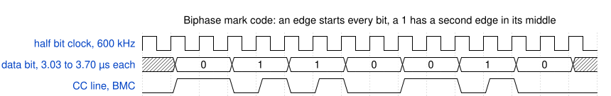
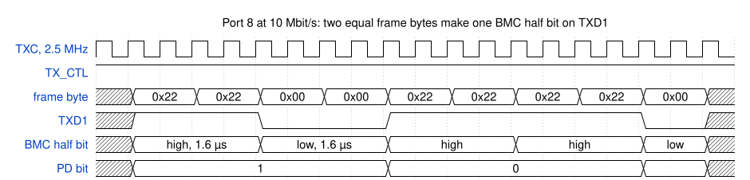
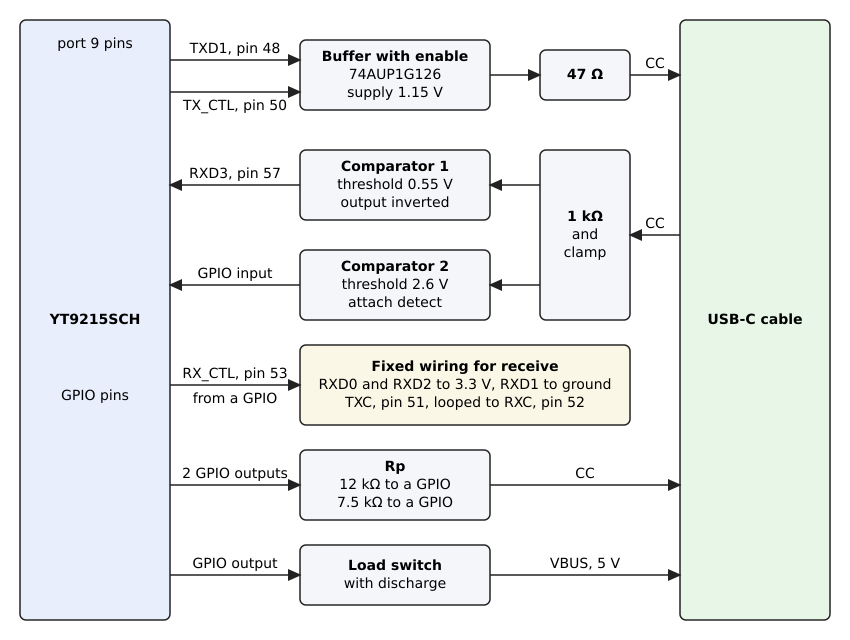

# USB-C PD from the YT9215 alone

Whether the Motorcomm YT9215 and its built-in RISC-V CPU can do the work of a USB-C Power Delivery (PD) controller, with no other microcontroller on the board, and what each way of doing it costs.

The adapter is the power **source**: it feeds a device such as a Raspberry Pi 5 through USB-C. [`usb-c-pd.md`](usb-c-pd.md) describes the standards and every PD number used here; the values it marks "(verify)" have the same status in this note. Pin numbers are those of the YT9215SCH, the part on the LX-IS601F boards ([`motorcomm-debug-pins.md`](motorcomm-debug-pins.md)). [`yt9215-embedded-cpu.md`](yt9215-embedded-cpu.md) describes the CPU.

The note assumes a **captive cable**: the adapter ends in a fixed USB-C cable, so there is one CC wire, no plug orientation and no cable marker to read. A receptacle has two CC pins and needs the CC parts of [option B](#option-b), [option C](#option-c) and [option D](#option-d) twice, with a switch that routes transmit and receive to the pin in use. A captive cable may also offer 5 A with no marker chip to read ([cable e-marker](usb-c-pd.md#54-cable-e-marker-for-advertising--3-a)).

## Summary

- The slow parts of a PD source fit the YT9215: attach detection, switching VBUS and the message logic run on millisecond time scales ([inferred](#evidence-codes)).
- The fast part fits no documented peripheral. PD signalling is a 300 kbit/s biphase mark code with 1.67 µs half bits and a 0 to 1.1 V swing. No public document gives the chip a comparator, an ADC, timer capture, PWM or a general SPI master ([unknown](#evidence-codes)). Its 3.3 V inputs need 2.0 V for a high level ([verified](#evidence-codes)), so they cannot read a 1.1 V swing ([inferred](#evidence-codes)).
- One documented block does clock out a bit stream under crystal timing: the MAC of extension port 9. A frame sent to port 9 at 10 Mbit/s puts a BMC waveform with valid bit timing, 312.5 kbit/s, on pin TXD1 ([shown by script](#evidence-codes)). This is [option C](#option-c).
- Option C is untested. Its transmit side depends on a frame-transmit function whose name is public and whose behaviour is not ([unknown](#evidence-codes)). Its receive side depends on a MAC behaviour that is not documented ([unknown](#evidence-codes)).
- The transmit waveform of option C can be tried without any firmware: an external host sets up port 9 over the management interface and a PC sends the frame through a copper port ([next steps](#what-to-find-out-next)).
- Every option that speaks PD waits until code runs on the CPU. Motorcomm's SDK shows that firmware for it exists (FreeRTOS, built for RV32EC) ([verified](#evidence-codes)). The boot image format and the CPU's peripheral registers are unpublished ([unknown](#evidence-codes)).
- Rp, VBUS and all PD signalling stay off until the PoE side has secured its power ([start-up order](#start-up-order)).
- [Option A](#option-a) is a PD transceiver with an I²C interface on the I²C master of the YT9215. The transceiver takes over every microsecond-scale task. Two such chips cost $0.26 to $0.42 at LCSC, and others list for less in other currencies ([transceiver chips](#transceiver-chips)).
- [Option B](#option-b) times the BMC signal in software on GPIO pins. A published design transmits this way on a 48 MHz RV32EC microcontroller; its receive side is untested. Options B and C need an analog front end that costs $0.19 to $0.50 ([cost](#cost)) ([inferred](#evidence-codes)).
- [Option D](#option-d) sends the message as a 10 Mbit/s frame out of a copper port that has no socket. The line signal is Manchester coded and cannot be put on CC as it is, so an external circuit of about three logic parts turns it into BMC levels ([inferred](#evidence-codes)). It transmits only; receive uses the parts of option B or C.
- The CH224K, HUSB238 and IP2721 are sink chips. They ask a charger for a voltage and cannot make this adapter a source. Source chips that need no host exist ([chips that need no host](#fixed-function-chips)).
- A Raspberry Pi 5 needs PD for one thing only: a 5 V, 5 A offer lifts its USB current limit. A PD source limited to 3 A gives the Pi nothing that a bare resistor does not ([Raspberry Pi 5](usb-c-pd.md#3-raspberry-pi-5-specifics)).

| Option | Firmware needed | PD signalling done by | Estimated cost, low | Estimated cost, high | Details |
|---|---|---|---|---|---|
| Resistor and attach comparator | No | None | $0.03 | $0.03 | [No PD](#option-0) |
| I²C PD transceiver | Yes | Transceiver chip | $0.26 | $0.42 | [Option A](#option-a) |
| GPIO bit-bang | Yes | CPU timing loops | $0.19 | $0.46 | [Option B](#option-b) |
| Port 9 MAC | Yes | Port 9 MAC | $0.23 | $0.50 | [Option C](#option-c) |
| Spare PHY port | Yes | PHY and decoder | $0.39 | $0.98 | [Option D](#option-d) |

The costs are the totals of the [cost tables](#cost). They count only the parts for USB-C signalling. The first row carries no PD messages.

## Evidence marks

Statements are marked with how well they are supported. Each mark links here.

| Mark | Meaning |
|---|---|
| Verified | Printed in a datasheet |
| Verified | Present in the vendor SDK source |
| Verified | Present in the Linux driver, as cited by the register guide |
| Shown by script | Result of [`mac_bmc_frame.py`](yt9215-usb-pd/mac_bmc_frame.py) |
| Inferred | Reasoned from other evidence, not found in a source |
| Unknown | In no public source |

The datasheet is [YT9215SCH V1.03](../datasheets/motorcomm/YT9215SCH_Datasheet_V1.03_2025-02-10.pdf). The vendor SDK is the public copy at [OpenEmbeddedBSP/motorcomm-yt9215-switch-sdk](https://github.com/OpenEmbeddedBSP/motorcomm-yt9215-switch-sdk/tree/d2c8d6fc721fdb7e04e815b4fe2a397a2817ee5e/switch_sdk), commit `d2c8d6fc721f`, the same one the [register guide](yt9215-registers/README.md) uses.

## Terms

| Term | Meaning |
|---|---|
| CC | Configuration channel, the USB-C wire that carries attach detection and PD messages |
| Rp | Pull-up on CC at the source; its value advertises the current on offer |
| Rd | 5.1 kΩ pull-down on CC at the sink |
| VCONN | 5 V supply for the marker chip inside a cable |
| E-marker | Chip in a cable plug that reports the cable's current rating |
| BMC | Biphase mark code, the line code of PD |
| UI | Unit interval, the duration of one bit |
| 4b5b | Coding that sends each 4 data bits as 5 line bits |
| SOP | Start of packet: four special 5-bit symbols that open a message |
| EOP | End of packet: one special 5-bit symbol that closes a message |
| MessageID | 3-bit counter in each message header |
| GoodCRC | Short message that acknowledges a received message |
| Hard Reset | Four special symbols that reset both ends; no payload |
| DR_Swap | Message that exchanges the USB host and device roles |
| Slicer | Comparator that turns the small BMC signal into a logic level |
| Strap pin | Pin whose level at reset selects a chip option |
| XIP | Execute in place: the CPU runs code directly from the SPI flash |
| DMA | Hardware that moves data between memory and a peripheral without the CPU |
| SMI | Serial management interface, the MDC and MDIO pair |
| FCS | Frame check sequence, the CRC-32 that ends an Ethernet frame |
| TCPCI | Type-C Port Controller Interface, a standard register set for PD transceivers |
| PHY | Circuit that turns MAC data into the signal on a cable |
| Manchester code | Line code of 10 Mbit/s Ethernet, with an edge in the middle of every bit |
| RV32EC | Smallest 32-bit RISC-V instruction set, with 16 registers and no multiply instruction |

## What a PD source has to do

The jobs fall into three speed classes. Only the last class is hard for the YT9215.

| Job | Time scale | Needs | More |
|---|---|---|---|
| Advertise current with Rp | Static | Resistor | [CC resistors](usb-c-pd.md#41-resistors) |
| Switch Rp between 3 A and 1.5 A | 1 ms | Output pin | [Messages](usb-c-pd.md#53-message-layer-essentials) |
| Detect attach | 100 ms | Voltage window | [CC windows](usb-c-pd.md#42-voltage-windows) |
| Detect detach | 10 ms | Voltage window | [CC windows](usb-c-pd.md#42-voltage-windows) |
| Switch VBUS on | 100 ms | Load switch | [Source states](usb-c-pd.md#43-source-state-machine-and-timing) |
| Discharge VBUS | 100 ms | Discharge path | [Source states](usb-c-pd.md#43-source-state-machine-and-timing) |
| Run the message sequence | 1 ms | CPU | [Messages](usb-c-pd.md#53-message-layer-essentials) |
| 4b5b and CRC-32 | Per message | CPU | [Framing](usb-c-pd.md#52-framing) |
| Send BMC | 1.67 µs half bit | Bit serialiser | [Waveform](#the-bmc-waveform) |
| Receive BMC | 1.67 µs half bit | Slicer and sampler | [Waveform](#the-bmc-waveform) |
| Reply with GoodCRC | 195 µs | Fast turnaround | [Turnaround](#goodcrc-turnaround) |
| Send and detect Hard Reset | 1.67 µs half bit | Same as BMC | [Framing](usb-c-pd.md#52-framing) |

A PD 3 source tells the sink when it may start a message sequence by switching Rp between the 3 A and the 1.5 A value, so Rp needs two values under CPU control.

A minimal source sends few message types: Source_Capabilities, GoodCRC, Accept, PS_RDY, Not_Supported or Reject, and Hard Reset. Each type has eight variants, one for each MessageID, and a second set of eight for a sink that speaks PD 2.0. Every waveform the source transmits can therefore be prepared in advance ([inferred](#evidence-codes)). The full set is about 80 waveforms of some 600 bytes each in the [option C](#option-c) coding, about 50 KB against 64 KB of RAM, so the set lives in flash or each waveform is built once the grant and its MessageID are known.

VCONN, e-marker reading and DR_Swap are not needed with a [captive cable](#captive-cable) and a power-only port.

### The BMC waveform

| Property | Minimum | Nominal | Maximum |
|---|---|---|---|
| Bit rate | 270 kbit/s | 300 kbit/s | 330 kbit/s |
| Half bit | 1.52 µs | 1.67 µs | 1.85 µs |
| Swing | 1.05 V | 1.125 V | 1.20 V |
| Driver impedance | 33 Ω | – | 75 Ω |
| Rise and fall time | 300 ns | – | – |

A transmitter must place edges about 100 ns accurately. A receiver must slice a signal that never rises above 1.2 V and then measure the gaps between edges well enough to tell 1.67 µs from 3.33 µs.

### GoodCRC turnaround

Every received message must be acknowledged with a GoodCRC that starts no later than 195 µs after the last bit of the message. Within that time the receiver has to notice the end of the message, check its CRC, read the MessageID and start transmitting. This limit, more than the bit rate, decides which options work.

The sender waits 0.9 to 1.1 ms for the complete GoodCRC, which itself lasts about 0.5 ms. A reply that starts up to about 0.4 ms after the message may therefore still be accepted by a real sink, although it breaks the 195 µs rule ([inferred](#evidence-codes)).

## Start-up order

The USB-C side stays off until the PoE side has secured its power, by classification or by LLDP ([PoE](poe.md)). The downstream switch ports stay off for the same time.

| Stage | Rp | VBUS | PD messages |
|---|---|---|---|
| PoE power not yet granted | Off | Off | None |
| Power granted with no sink attached | As the offer allows | Off | None |
| Sink attached | As the offer allows | On | As the offer allows |

Which Rp value is shown, and whether PD is spoken at all, follow from the [power budget](#power-budget).

With Rp off and VBUS off, a sink sees an unpowered port and waits. This has four consequences for the hardware ([inferred](#evidence-codes)):

- Rp must be switchable as a whole. Every Rp resistor is fed from a GPIO output, or from a rail that comes on with the grant, and none from the fixed 3.3 V rail.
- The VBUS load switch must stay off through reset. Its enable needs a pull-down, and whatever drives it waits for the grant.
- The BMC driver must stay off through reset, which the [strap pins](#pins-used) of option C do not give for free.
- The reset state of the GPIO pins decides whether all this holds before firmware runs. The datasheet gives the strap pulls and not the reset state of every GPIO ([unknown](#evidence-codes)). A pin with an internal pull-up is not fully off when it floats: it leaves a weak Rp.

### Power budget hand-off

What the port offers is derived from what the upstream PoE switch grants, so nothing is offered before the grant is known. The PoE side hands over three values:

| Value | Source |
|---|---|
| Granted power at the PoE input | Classification result or LLDP allocation |
| Efficiency of the 5 V converter | Converter design |
| Power the adapter uses itself | Measurement of the switch and its supplies |

The current available at 5 V is the granted power times the efficiency, less the adapter's own power, divided by 5 V. The [power budget per PoE class](poe.md#5-raspberry-pi-5-power-budget-against-poe-classes) gives the figures before the adapter's own use. What the port can offer follows from that current ([inferred](#evidence-codes)):

| Current available at 5 V | Largest Rp value allowed | Largest PD offer allowed |
|---|---|---|
| Under 1.5 A | Default USB current | 5 V at the available current |
| 1.5 A to under 3 A | 1.5 A | 5 V at the available current |
| 3 A to under 5 A | 3 A | 5 V at the available current |
| 5 A or more | 3 A | 5 V at 5 A |

- The table gives limits, not a decision. Whether the port speaks PD below 3 A, and whether it turns on at all below 1.5 A, are open choices. PD below 3 A gives a Raspberry Pi 5 nothing that Rp does not.
- The default-current Rp needs a third resistor of 36 kΩ, which the [front end](#front-end) does not have.
- An offer above 3 A relies on the [captive cable](#captive-cable).
- If an LLDP allocation changes while a sink is attached, the source sends a new Source_Capabilities message. If the new budget is below the running contract, the sink has to accept the lower offer before the adapter may count on it.
- A sink that ignores Rp or its contract is stopped only by a current limit on VBUS. The offer varies with the grant, so a fixed limit protects only the largest offer. Protecting the smaller ones needs a limit that firmware can select, because an overdraw makes the PoE switch cut the port.
- How the classification result reaches the firmware is open ([unknown](#evidence-codes)). The YT9215 has no power during classification, so the PoE front end has to hold the result on status lines, or the firmware learns the allocation by LLDP.

## What the YT9215 offers

### Documented resources

Every row is from the pin tables of the datasheet ([verified](#evidence-codes)). The xMII pins belong to Extension GMAC2, which is port 9 ([part table](yt9215-registers/docs/reference/parts.rst)). The datasheet names these pins `RG2_` in RGMII mode and `M2_` in MII mode. Port 9 is the only port of the YT9215SCH with such pins; port 8 has a SerDes interface only.

| Resource | Pin | Pin also used for |
|---|---|---|
| GPIO5 | 44 | Interrupt output |
| GPIO5 | 44 | Port 9 MII carrier sense |
| GPIO6 to GPIO17 | 46 to 57 | Port 9 |
| GPIO31 | 67 | LEDs |
| GPIO32 to GPIO43 | 70 to 81 | LEDs |
| GPIO44 to GPIO46 | 83 to 85 | LEDs |
| GPIO47 to GPIO50 | 90 to 93 | Management interface |
| UART0 receive | 46 | Port 9 |
| UART0 transmit | 47 | Port 9 |
| UART1 receive | 70 | Port 4 LED2 |
| UART1 transmit | 76 | Port 2 LED2 |
| I²C master 1 data | 72 | Port 4 LED1 |
| I²C master 1 clock | 73 | Port 3 LED1 |
| I²C master 2 data | 81 | Port 1 LED1 |
| I²C master 2 clock | 84 | Port 0 LED1 |
| SPI flash, group SPF0 | 49 | Port 9 TXD0 |
| SPI flash, group SPF0 | 50 | Port 9 TX_CTL |
| SPI flash, group SPF0 | 54 | Port 9 RXD0 |
| SPI flash, group SPF0 | 55 | Port 9 RXD1 |
| SPI flash, group SPF1 | 78 | Port 2 LED1 |
| SPI flash, group SPF1 | 79 | Port 1 LED2 |
| SPI flash, group SPF1 | 81 | I²C master 2 data |
| SPI flash, group SPF1 | 83 | Port 0 LED2 |
| Buzzer output | 67 | GPIO31 |

- The GPIO-capable pins number 33.
- The two SMI masters use the pins of the two I²C masters.
- The I²C masters run at 100 kHz to 1 MHz (Table 34 of the datasheet).
- The SPI flash interface runs at 31.25 MHz (Table 33) and is described only as a flash controller.
- UART baud rates are not given.
- [Figure 9 of the datasheet](../datasheets/motorcomm/YT9215SCH_Datasheet_V1.03_2025-02-10.pdf) shows the I²C master driving a PoE power-sourcing controller, so managing a power chip over I²C is a use Motorcomm intends.

### The CPU

| Item | Value | Source | Evidence |
|---|---|---|---|
| Core | Nuclei N205 | [Press release](yt9215-embedded-cpu.md#identity) | [Verified](#evidence-codes) |
| Instruction set of vendor builds | RV32EC | [`make.cfg`](https://github.com/OpenEmbeddedBSP/motorcomm-yt9215-switch-sdk/blob/d2c8d6fc721fdb7e04e815b4fe2a397a2817ee5e/switch_sdk/make/make.cfg#L29) | [Verified](#evidence-codes) |
| Compiler | `riscv-nuclei-elf-gcc` | [`.config`](https://github.com/OpenEmbeddedBSP/motorcomm-yt9215-switch-sdk/blob/d2c8d6fc721fdb7e04e815b4fe2a397a2817ee5e/switch_sdk/config/freeRTOS/.config) | [Verified](#evidence-codes) |
| Operating system | FreeRTOS | [`freert.cfg`](https://github.com/OpenEmbeddedBSP/motorcomm-yt9215-switch-sdk/blob/d2c8d6fc721fdb7e04e815b4fe2a397a2817ee5e/switch_sdk/make/env/freert.cfg) | [Verified](#evidence-codes) |
| Switch register access | Direct memory read and write | [`mem.c`](https://github.com/OpenEmbeddedBSP/motorcomm-yt9215-switch-sdk/blob/d2c8d6fc721fdb7e04e815b4fe2a397a2817ee5e/switch_sdk/core/drv/sw_ctrl/mem/mem.c) | [Verified](#evidence-codes) |
| Name of the frame transmit function | `eth_tx_by_portlist()` | [`fal_tiger_nic.c`](https://github.com/OpenEmbeddedBSP/motorcomm-yt9215-switch-sdk/blob/d2c8d6fc721fdb7e04e815b4fe2a397a2817ee5e/switch_sdk/core/fal/tiger/fal_tiger_nic.c) | [Verified](#evidence-codes) |
| Name of the frame receive function | `eth_rx_register()` | [`fal_tiger_nic.c`](https://github.com/OpenEmbeddedBSP/motorcomm-yt9215-switch-sdk/blob/d2c8d6fc721fdb7e04e815b4fe2a397a2817ee5e/switch_sdk/core/fal/tiger/fal_tiger_nic.c) | [Verified](#evidence-codes) |
| Behaviour of those two functions | Unpublished | – | [Unknown](#evidence-codes) |
| CPU port number | 10 | [Board profile](https://github.com/OpenEmbeddedBSP/motorcomm-yt9215-switch-sdk/blob/d2c8d6fc721fdb7e04e815b4fe2a397a2817ee5e/switch_sdk/common/boardprofile/bprofile_YT9215SC_default_demo.c#L50) | [Verified](#evidence-codes) |
| SRAM | 64 KB | [Datasheet](yt9215-embedded-cpu.md#memory) | [Verified](#evidence-codes) |
| Instruction cache | 2 KB | [Datasheet](yt9215-embedded-cpu.md#memory) | [Verified](#evidence-codes) |
| Clock frequency | Unpublished | – | [Unknown](#evidence-codes) |
| Timers | Unpublished | – | [Unknown](#evidence-codes) |
| GPIO registers | Unpublished | – | [Unknown](#evidence-codes) |
| GPIO interrupts | Unpublished | – | [Unknown](#evidence-codes) |
| Boot image format | Unpublished | – | [Unknown](#evidence-codes) |

Only RV32EC is confirmed by the vendor builds. Whether the core has more is not known ([unknown](#evidence-codes)).

The SDK calls the two frame functions and includes their header `eth_export.h`, but does not contain their code. Its build file [`freert.cfg`](https://github.com/OpenEmbeddedBSP/motorcomm-yt9215-switch-sdk/blob/d2c8d6fc721fdb7e04e815b4fe2a397a2817ee5e/switch_sdk/make/env/freert.cfg) adds include paths into a firmware tree named `switch_sw_lite_mgmt`, with folders for FreeRTOS and for `SoC/yt921x` support code ([verified](#evidence-codes)). That tree is the likely home of the frame functions, the timers, the GPIO registers, the interrupt numbers and the boot format ([inferred](#evidence-codes)). It is not public ([unknown](#evidence-codes)).

### Electrical limits of the pins

The values are for a 3.3 V pin supply. The port 9 pins have their own supply, DVDDIO_1, which may be 1.8 V, 2.5 V or 3.3 V; this note assumes 3.3 V.

| Parameter | Value | Evidence |
|---|---|---|
| Input high, minimum | 2.0 V | [Verified](#evidence-codes) |
| Input low, maximum | 0.8 V | [Verified](#evidence-codes) |
| Output high, minimum | 2.4 V | [Verified](#evidence-codes) |
| Output low, maximum | 0.4 V | [Verified](#evidence-codes) |
| Input voltage, absolute maximum | Supply plus 0.3 V | [Verified](#evidence-codes) |
| Drive strength | Not given | [Unknown](#evidence-codes) |
| Hysteresis | Not given | [Unknown](#evidence-codes) |

Three consequences follow ([inferred](#evidence-codes)):

- A BMC signal peaks at 1.2 V, below the 2.0 V input-high level. No pin can receive it directly, so a comparator is required.
- An attached sink pulls CC to about 1.7 V against a 3 A Rp. That lies between the two input thresholds, so attach detection also needs a comparator. Only the weakest Rp (36 kΩ to 3.3 V) gives a level a plain input reads as low, about 0.4 V, and it advertises the default USB current instead of 3 A.
- The pins are not 5 V tolerant. CC can touch VBUS through a faulty cable, so every pin that reaches CC needs a series resistor and a clamp.

### Interfaces that do not fit BMC

These look promising and do not work ([inferred](#evidence-codes)):

- **UART.** Every character is framed by a start and a stop bit, so a UART cannot emit or capture an unbroken bit stream.
- **I²C and SMI masters.** Both are open-drain and send fixed frame formats.
- **SPI flash master.** It is documented only as a flash controller, and in the XIP boot mode it is busy fetching code. Whether it can send raw bytes is unknown.
- **Serial LED output.** It repeats a short register-defined pattern at an unpublished clock rate ([LED guide](yt9215-registers/docs/leds.rst)).
- **Buzzer.** The SDK table [`LOOP_DETECT_TOP_CTRL`](yt9215-registers/sdk-tables.yaml) has a 2-bit mode and an enable for it. That describes a tone, not a data output.

## No PD: resistor and attach comparator

A 4.7 kΩ resistor from CC to 3.3 V advertises 3 A and is the only signalling part. The resistor, the comparator and the load switch are powered from rails that the PoE front end turns on only after classification, so the [start-up order](#start-up-order) holds without firmware. USB-C also requires the source to keep VBUS off until a sink is attached and to remove it on detach ([attach detection](usb-c-pd.md#43-source-state-machine-and-timing)). A comparator that watches CC does this by driving the enable of the VBUS load switch directly, because a plain input pin cannot read the attach level ([electrical limits](#electrical-limits-of-the-pins)). A Raspberry Pi 5 then boots and limits its USB ports to 600 mA, unless `usb_max_current_enable=1` is set on the Pi ([Raspberry Pi 5](usb-c-pd.md#3-raspberry-pi-5-specifics)). It needs no firmware, so it works with the YT9215 CPU switched off and no flash fitted. The price is a fixed offer: the Rp value cannot follow the class that was granted, and a grant by LLDP is out of reach because LLDP needs firmware ([power budget](#power-budget)).

## Option A: I²C PD transceiver

A PD transceiver contains the BMC transmitter and receiver, the CC comparators, a switchable Rp, and logic that checks the CRC, sends GoodCRC and retries by itself. The host reads and writes whole messages over I²C and runs the message logic. Such a chip replaces the whole [front end](#front-end).

### Transceiver chips

| Chip | Vendor | Register set | PD revision | Price, low | Price, high | Price basis | Price source |
|---|---|---|---|---|---|---|---|
| FUSB302B | onsemi | [FUSB302](#register-sets) | Not checked | $0.34 | $0.42 | 1,000 pieces | [LCSC C132291](https://www.lcsc.com/product-detail/C132291.html) |
| HUSB311 | Hynetek | [TCPCI](#register-sets) | 2.0 | $0.26 | $0.26 | 1,000 pieces | [LCSC C7471922](https://www.lcsc.com/product-detail/C7471922.html) |
| ET7304 | ETEK | [TCPCI](#register-sets) | 3.0 | €0.17 | €0.25 | 3,000 pieces | [DigiKey](https://www.digikey.de/en/products/detail/etek-microelectronics/ET7304/26227099) |
| ET7303A | ETEK | Not checked | 2.0 | €0.40 | €0.40 | 1 piece | [DigiKey](https://www.digikey.de/en/products/detail/etek-microelectronics/ET7303A/26485631) |
| AW35615FCR | Awinic | Not checked | 3.1 | ¥0.92 | ¥0.92 | 1,000 pieces | [Awinic](https://www.awinic.com/en/productDetail/AW35615FCR) |
| AW35615CSR | Awinic | Not checked | 3.1 | ¥2.15 | ¥2.15 | 1,000 pieces | [Awinic](https://www.awinic.com/en/productDetail/AW35615CSR) |
| RT1711P | Richtek | [TCPCI](#register-sets) | 2.0 | $1.23 | $1.23 | 1,500 pieces | [LCSC C3034209](https://www.lcsc.com/product-detail/C3034209.html) |

Notes on the table ([inferred](#evidence-codes)):

- All prices are unconfirmed list prices. The second ET7304 price is from [Bürklin](https://www.buerklin.com/en/p/etek-microelectronics/logic-devices/et7304/71S0574/).
- The Linux binding [`richtek,rt1711h.yaml`](https://www.kernel.org/doc/Documentation/devicetree/bindings/usb/richtek%2Crt1711h.yaml) gives the PD revisions of the RT1711H family, lists the ET7304 as compatible with the RT1715, and lists the HUSB311 as compatible with the RT1711H. A [kernel patch](https://lore.kernel.org/all/?q=tcpci_rt1711h+HUSB311) calls the HUSB311 a pin-compatible and register-compatible replacement for the RT1711H.
- The PD revision of the chip limits which messages its hardware accepts. A source that offers only 5 V needs none of the PD 3 extras. Whether a Raspberry Pi 5 raises its current limit for a 5 A offer from a PD 2.0 source is not known ([unknown](#evidence-codes)).
- The ETEK and Awinic parts have no LCSC price.
- The RT1711P is not named in the binding. Its register set and PD revision are taken from the RT1711H family.
- The FUSB302B exists in four order codes that differ only in I²C address, which matters for a design with two USB-C outputs.

### Register sets

Two register sets cover the chips whose interface is known. Both have open drivers that serve as a reference for firmware.

| Function | FUSB302 | TCPCI |
|---|---|---|
| Specification | onsemi datasheet | TCPCI specification of the USB-IF |
| Rp | Current source with three settings | `ROLE_CONTROL` register |
| Rp off | Pull-up switches open | `ROLE_CONTROL` set to open |
| Attach detection | Built-in DAC and comparator | `CC_STATUS` register |
| Transmit data | FIFO | Buffer |
| Transmit start | Token in the FIFO | `TRANSMIT` register |
| Receive data | FIFO | Buffer |
| CRC | Hardware | Hardware |
| GoodCRC reply | Hardware | Hardware |
| Retries | Hardware | Hardware |
| Hard Reset | Hardware | Hardware |
| Open driver | [`fusb302.c`](https://git.kernel.org/pub/scm/linux/kernel/git/torvalds/linux.git/tree/drivers/usb/typec/tcpm/fusb302.c) | [`tcpci.c`](https://git.kernel.org/pub/scm/linux/kernel/git/torvalds/linux.git/tree/drivers/usb/typec/tcpm/tcpci.c) |
| Chip-specific driver | None needed | [`tcpci_rt1711h.c`](https://git.kernel.org/pub/scm/linux/kernel/git/torvalds/linux.git/tree/drivers/usb/typec/tcpm/tcpci_rt1711h.c) |

The rows are not checked against the driver source ([inferred](#evidence-codes)). On the FUSB302 the firmware steps the DAC and reads the comparator to find the CC level.

### What the YT9215 has to provide

| YT9215 resource | Pin | Use |
|---|---|---|
| I²C master 1 data | 72 | Messages and control |
| I²C master 1 clock | 73 | Messages and control |
| GPIO output | Any free | VBUS load switch |
| GPIO input | Any free | Interrupt line of the transceiver |

- The interrupt line can be left out: the firmware can poll the status registers.
- Everything the firmware does is slower than a millisecond. The tightest deadline is answering a Request within 15 ms.
- A Source_Capabilities message with one power data object is about 12 bytes on I²C. At 100 kHz that takes about 1.5 ms, and at 400 kHz about 0.4 ms ([inferred](#evidence-codes)).
- A FreeRTOS task with polled I²C meets these times without any timer or interrupt knowledge ([inferred](#evidence-codes)).
- Using I²C master 1 gives up the LED1 outputs of ports 3 and 4 ([verified](#evidence-codes)).

### Unknowns

All of these are unpublished ([unknown](#evidence-codes)):

- **Firmware on the CPU.** This is common to options A, B and C.
- **Pin function.** The datasheet says pins 72 and 73 need "to enable the I2C function by software programming" and does not name the register.
- **Master registers.** The registers of the I²C master are unpublished. The I²C code in the SDK is the host side of the management interface, not a driver for this master.
- **Transaction format.** The datasheet shows this master only driving a PSE chip. The EEPROM reader on pins 91 and 92 is a separate interface. Whether the master can run the arbitrary reads and writes a transceiver needs is not stated.

I²C at 100 kHz can also be bit-banged on two GPIO pins. That needs the GPIO registers of [option B](#option-b) and none of its timing, because an I²C master sets its own pace.

## Option B: GPIO bit-bang

The firmware toggles a GPIO for transmit and reads a comparator output on a GPIO for receive. The external parts are those of the [front end](#front-end), connected to GPIO pins.

### Published designs without a PD chip

| Design | Direction | Timing by | Source |
|---|---|---|---|
| Chromium EC on STM32 | Transmit | SPI fed by DMA | [`usb_pd_phy.c`](https://chromium.googlesource.com/chromiumos/platform/ec/+/v2.2.0/chip/stm32/usb_pd_phy.c) |
| Chromium EC on STM32 | Receive | Comparator into timer capture | [`usb_pd_phy.c`](https://chromium.googlesource.com/chromiumos/platform/ec/+/v2.2.0/chip/stm32/usb_pd_phy.c) |
| g3gg0 on ESP32 | Transmit | RMT pulse generator | [Hackaday](https://hackaday.com/2025/01/10/bit-banging-the-usb-pd-protocol) |
| g3gg0 on ESP32 | Receive | RMT pulse timer | [Hackaday](https://hackaday.com/2025/01/10/bit-banging-the-usb-pd-protocol) |
| eeucalyptus on CH32V003 | Transmit | Counted CPU cycles | [Part 2](https://eeucalyptus.net/2024-05-13-usb-pd-2.html) |
| eeucalyptus on CH32V003 | Receive | Busy-wait sampling loop | [Part 2](https://eeucalyptus.net/2024-05-13-usb-pd-2.html) |

The CH32V003 design is the closest to this option, because that chip is also an RV32EC core and the BMC timing is pure software. Facts from its write-up:

| Item | Value |
|---|---|
| CPU clock | 48 MHz |
| Transmit rate | 600 kHz half bits |
| Transmit budget | 80 cycles per half bit |
| Receive sample rate | About 1.02 MHz |
| Start of receive | Falling-edge interrupt of the on-chip comparator |
| Transmit level | Resistor divider on two GPIO pins |
| State of transmit | Decoded on a logic analyser |
| State of receive | Not tested |
| Code | [ch32v003-usbpd](https://github.com/eeucalyptus/ch32v003-usbpd) |

It uses the comparator inside the CH32V003, which the YT9215 does not have, and it does not report a working exchange with a real PD device.

### Transmit

The half-bit levels of each message are worked out in advance ([message set](#what-a-pd-source-has-to-do)). Sending is then a loop that writes one level per half bit.

| Quantity | Value | Basis |
|---|---|---|
| Half bit | 1.52 to 1.85 µs | 270 to 330 kbit/s |
| Cycles per half bit at 125 MHz | 208 | 1.67 µs |
| Cycles per half bit at 48 MHz | 80 | 1.67 µs |
| Longest message from the source | About 0.6 ms | Source_Capabilities with one object |
| Time with interrupts off | About 0.6 ms | Whole message |

- The loop runs with interrupts off, so that every half bit has the same length. On a RISC-V core that is one write to the `mstatus` register, which needs no chip documentation ([inferred](#evidence-codes)).
- The loop has to run from RAM or from the 2 KB instruction cache. Code fetched from SPI flash would add pauses of unknown length ([inferred](#evidence-codes)).
- The bit rate may sit anywhere in the allowed range but must not drift within a message, so the loop is tuned once to the real CPU clock.
- The GPIO that enables the buffer is switched on just before the first half bit and off after the low hold at the end.

### Receive

| Step | Method | Needs |
|---|---|---|
| Notice the start | GPIO edge interrupt | Interrupt registers |
| Notice the start | Polling loop | GPIO input register |
| Sample | Counted loop | GPIO input register |
| Time edges | Cycle counter read | `mcycle` counter |
| Decode half bits | Run lengths | Nothing |
| Decode bytes | 4b5b table | Nothing |
| Check | CRC-32 | Nothing |
| Reply | Prepared GoodCRC | [Transmit](#transmit) |

- Sampling and edge timing are two ways to do the same step.
- The lowest useful sample rate is about 1 MHz, three samples per bit at 330 kbit/s, which is what the CH32V003 design uses. Sampling at four samples per half bit, 2.4 MHz, leaves about 52 cycles per sample at 125 MHz.
- A Request from the sink is 189 bits and lasts about 0.63 ms. At 2.4 MHz that is about 1,500 samples, or 190 bytes when packed.
- The standard RISC-V cycle counter `mcycle` is a free-running time base that needs no chip documentation, if the core implements it ([inferred](#evidence-codes)).
- The reply has to start within 195 µs of the last bit ([turnaround](#goodcrc-turnaround)). Decoding 1,500 stored samples after the message has ended takes on the order of 10,000 cycles, about 80 µs at 125 MHz. Decoding each run as it arrives leaves only the CRC comparison for the end ([inferred](#evidence-codes)).
- While the firmware waits for a message by polling, it does nothing else. With an edge interrupt it can run the switch and LLDP between messages, and the interrupt latency then eats into the preamble, which is 64 bits long and can absorb it.

### What is unknown

| Item | State | Evidence |
|---|---|---|
| GPIO output register | Unpublished | [Unknown](#evidence-codes) |
| GPIO input register | Unpublished | [Unknown](#evidence-codes) |
| GPIO direction and pin function registers | Unpublished | [Unknown](#evidence-codes) |
| GPIO edge interrupt | Unpublished | [Unknown](#evidence-codes) |
| CPU clock frequency | Unpublished | [Unknown](#evidence-codes) |
| `mcycle` counter present | Not known | [Unknown](#evidence-codes) |
| Bus delay of a GPIO write | Not known | [Unknown](#evidence-codes) |

If the CPU runs from the 125 MHz switch clock ([clock](yt9215-embedded-cpu.md#clock)), there are about 200 cycles per half bit ([inferred](#evidence-codes)). The CH32V003 design does the same job in 80.

## Option C: the port 9 MAC as serialiser

The MAC of extension port 9 shifts bytes out on pins under crystal timing. Run at 10 Mbit/s, it becomes the BMC transmitter. Port 9 must be in RGMII mode, or in the mode the register guide calls REVMII (MII as the PHY side), because in those two modes the chip itself drives the transmit clock. The [register guide](yt9215-registers/docs/ports.rst) shows the bring-up on port 8 of the YT9215RB, and the same fields exist for port 9.

### Transmit

- At 10 Mbit/s the RGMII transmit clock is 2.5 MHz ([verified](#evidence-codes)). Each cycle carries one nibble, low nibble first, as the RGMII and IEEE 802.3 standards define.
- Pin TXD1 carries bit 1 and then bit 5 of each byte. Two bytes of `0x22` hold it high for four nibbles, 1.6 µs, and two bytes of `0x00` hold it low.
- A half bit of 1.6 µs gives 312.5 kbit/s, inside the 270 to 330 kbit/s that PD allows ([shown by script](#evidence-codes)).
- TXD1 is low during the Ethernet preamble and start-of-frame delimiter, because bit 1 of the nibbles `0x5` and `0xD` is 0. TXD0 would be high there, which is why TXD1 is the pin to use.
- TX_CTL is high for the whole frame, preamble included. It enables an external buffer, so that the driver is off the CC line between frames ([strap pins](#pins-used) complicate this at reset). The buffer then pulls CC low for 6.4 µs before the first PD bit. PD allows the driver to start at most 1 µs before the first bit, so this breaks the specification, and whether sinks tolerate it is a bench question ([inferred](#evidence-codes)). [Enable from TXD3](#enable-from-txd3) is a way around it.
- PD wants the last bit closed by an edge and the line then held low before release. The frame ends with the closing edge and four extra bytes.
- The MAC appends a 4-byte FCS, which would put uncontrolled levels on TXD1. The four extra bytes are chosen so that TXD1 is low in them and in the FCS that results. The line is then low for 6.4 µs and released ([shown by script](#evidence-codes)).

[`mac_bmc_frame.py`](yt9215-usb-pd/mac_bmc_frame.py) builds the frames and checks each by replaying its nibbles through a BMC decoder ([shown by script](#evidence-codes)):

| Message | PD bits | Frame bytes, shortest | Frame bytes, longest | Time on the wire |
|---|---|---|---|---|
| GoodCRC | 149 | 604 | 608 | 0.49 ms |
| Accept | 149 | 604 | 608 | 0.49 ms |
| PS_RDY | 149 | 604 | 608 | 0.49 ms |
| Source_Capabilities, one offer | 189 | 764 | 768 | 0.62 ms |
| Hard Reset | 84 | 348 | 348 | 0.28 ms |

The frame length depends on the MessageID, because a message that ends on a low level needs one more bit time for its closing edge.

The frame as the MAC sends it, for a GoodCRC message ([shown by script](#evidence-codes)):

| Part of the frame | Bytes | Written by | TXD1 shows |
|---|---|---|---|
| Preamble and start delimiter | 8 | MAC | Low for 6.4 µs |
| PD preamble | 256 | Firmware | 64 bits of alternating 0 and 1 |
| Start of packet | 80 | Firmware | 4 symbols |
| Header | 80 | Firmware | 4 symbols |
| CRC | 160 | Firmware | 8 symbols |
| End of packet | 20 | Firmware | 1 symbol |
| Closing edge | 0 or 4 | Firmware | One high bit time |
| Quiet tail | 4 | Firmware | Low |
| FCS | 4 | MAC | Low |

- Each PD bit takes four bytes: two for each half bit.
- The closing edge is present only when the message ends on a low level.
- The frame byte counts of the table above leave out the 8 bytes of preamble and start delimiter.
- The frame has no Ethernet header of its own. Its first 14 bytes, which a switch reads as addresses and type, are the start of the PD preamble: `22 22 22 22 00 00`, `22 22 00 00 00 00`, `22 22`.
- A 0 bit holds its level for four bytes. A 1 bit changes level after two bytes. The first twelve bytes above are therefore the PD bits 0, 1, 0.
- [`mac_bmc_frame.py`](yt9215-usb-pd/mac_bmc_frame.py) with `--hex` prints a Source_Capabilities frame with MessageID 0 and without its FCS.

The two port modes that fit:

| Property | RGMII | REVMII |
|---|---|---|
| Transmit clock at 10 Mbit/s | 2.5 MHz | 2.5 MHz |
| Transmit clock driven by | YT9215 | YT9215 |
| Receive clock driven by | External source | YT9215 |
| TXC looped to RXC | Needed | Not needed |
| Frame start signal on pin 50 | TX_CTL | RXDV |
| Vendor bring-up in the register guide | Yes | No |

What the firmware does to send one message:

| Step | Register or function | Guide page | Evidence |
|---|---|---|---|
| Select the port 9 mode | `XMII` mode field | [Ports](yt9215-registers/docs/ports.rst) | [Verified](#evidence-codes) |
| Force 10 Mbit/s full duplex | `PORT_CTRL` | [Ports](yt9215-registers/docs/ports.rst) | [Verified](#evidence-codes) |
| Keep other traffic off port 9 | Port isolation | [Forwarding](yt9215-registers/docs/forwarding.rst) | [Inferred](#evidence-codes) |
| Send the prepared frame to port 9 | `eth_tx_by_portlist()` | [CPU tag](yt9215-registers/docs/cpu-tag.rst) | [Unknown](#evidence-codes) |

What is not known about transmit ([unknown](#evidence-codes)):

- Whether `eth_tx_by_portlist()` sends a frame unchanged, or adds a tag or padding.
- The delay from the CPU handing over a frame to its first nibble on the pins. It must fit in the 195 µs GoodCRC limit together with the receive side.
- Whether a sink accepts the waveform. This has not been tried on hardware.

### Receive

The same MAC can sample the line.

- Tie RXD0 high, RXD1 low and RXD2 high, and feed the **inverted** slicer output to RXD3.
- An idle CC line is high: about 1.7 V with a sink attached, above the 0.55 V slicer threshold. RXD3 is then low and the MAC sees the nibble `0x5`, which is Ethernet preamble.
- A PD transmitter starts by pulling the line low. RXD3 goes high, the nibble becomes `0xD`, and the MAC takes it as the start-of-frame delimiter.
- Every later nibble is `0x5` or `0xD`, so each received byte holds two samples of the CC line taken 400 ns apart. That is 4.2 samples per half bit, enough to tell half bits from full bits ([inferred](#evidence-codes)).
- While a partner transmits, its driver swings CC between 0 V and 1.1 V, so the fixed 0.55 V threshold sits in the middle of the signal.
- RX_CTL tells the MAC that data is valid. A GPIO holds it high while the port waits and pulses it low when the line has been idle for some microseconds, which ends the frame.

Five things have to hold, and none is documented ([unknown](#evidence-codes)):

- **Frames with a bad FCS must reach the CPU.** A captured PD message is not a valid Ethernet frame. The SDK counts such frames ([`RX_FCS_ERR`](https://github.com/OpenEmbeddedBSP/motorcomm-yt9215-switch-sdk/blob/d2c8d6fc721fdb7e04e815b4fe2a397a2817ee5e/switch_sdk/include/yt_stat.h#L37)), and the register tables hold no field that forwards them. If the MAC always drops them, this receive path is dead.
- **The MAC must accept a preamble of any length**, because the line can idle for seconds.
- **The firmware must see the end of a message** to pulse RX_CTL, which needs a readable GPIO and a time base, as in [option B](#option-b), though with looser timing.
- **The receive clock must run.** In RGMII mode the chip expects RXC from outside, so TXC is looped back to it.
- **The switch must not act on the addresses.** With RXD0 tied high, bit 0 of every captured byte is 1, so both the destination and the source address of the captured frame have the group bit set. Port 9 has to be isolated so that the frame goes to the CPU port only, and the switch must not discard a frame whose source is a group address.

What the firmware does with a captured frame:

| Step | Detail |
|---|---|
| Take the first sample of a byte | Bit 3 |
| Take the second sample of a byte | Bit 7 |
| Invert | 1 means CC low |
| Find the half bits | Runs of about 4 samples |
| Find the full bits | Runs of about 8 samples |
| Decode | 4b5b table |
| Check | CRC-32 |
| Reply | Prepared GoodCRC frame |

The frame reaches the CPU only after RX_CTL falls. The 195 µs budget is then spent on end-of-message detection, frame delivery, decoding about 800 bytes and queueing the reply.

A sink may send messages with several data objects. A message with six data objects, or five at the slowest bit rate, is longer than a 1518-byte frame, so port 9 must accept jumbo frames, which the chip supports up to 9216 bytes ([frame size](yt9215-registers/docs/ports.rst)) ([verified](#evidence-codes)).

### Pins used

Option C uses pins 46 to 57. They are free as long as nothing else is attached to port 9, which holds for a design with no external CPU. Four of them, 49, 50, 54 and 55, are also the SPF0 flash pins, so the flash must sit on group SPF1, the default. SPF1 takes pin 81 and with it I²C master 2. Pins 46 and 47 are also UART0, so a serial console has to use UART1.

Several of these pins are strap pins, read at reset ([verified](#evidence-codes)):

| Pin | Port 9 signal | Strap | Level needed at reset |
|---|---|---|---|
| 46 | TXD3 | `SWITCH_ID_1` | Either |
| 47 | TXD2 | `RESERVED_0` | High |
| 48 | TXD1 | `RESERVED_1` | High |
| 49 | TXD0 | `SPF_MUX_SEL` | Low |
| 50 | TX_CTL | `RESERVED_2` | High |
| 51 | TXC | `SWITCH_ID_0` | Either |

The datasheet asks for an external 4.7 kΩ pull-up on each of pins 47, 48 and 50. Two problems follow ([inferred](#evidence-codes)):

- **The buffer is enabled from power-on.** With pins 48 and 50 pulled high, the buffer drives CC to 1.15 V until firmware puts port 9 into its 10 Mbit/s mode, and Rp does not work during that time. The enable therefore has to be gated by a second signal that is low at reset, such as a GPIO with a pull-down through an AND gate. The [front end](#front-end) includes that gate.
- **The clock loop joins two pins with opposite pulls.** Pin 51 has an internal pull-down and is a strap; pin 52 has an internal pull-up. An external strap resistor on pin 51 has to set the level. The REVMII mode needs no loop.

Four more rules apply ([inferred](#evidence-codes)):

- Pins 54 to 56 are tied to their fixed levels through resistors, because they are also GPIO and flash pins and can be driven.
- Port 9 must have flow control off, so that the MAC never sends a pause frame onto CC.
- The firmware starts a transmit only when no receive is in progress.
- The receive path also captures the adapter's own transmissions, because CC going low starts a frame. The firmware ends that frame before the partner replies, or accepts that the partner's GoodCRC arrives in the same captured frame.

### Enable from TXD3

A variant takes the buffer enable from TXD3, pin 46, in place of TX_CTL ([inferred](#evidence-codes)). The script does not cover it.

- TXD3 is 0 in every preamble nibble and 1 in the last nibble of the start-of-frame delimiter, so the buffer turns on 400 ns before the first PD bit, inside the 1 µs that PD allows.
- The data bytes become `0xAA` for high and `0x88` for low, which hold TXD3 high through the message.
- The tail has to keep TXD3 high and TXD1 low through the FCS. That is 16 conditions in place of 8, which uses all 16 free bits of a four-byte tail and leaves exactly one solution. Dropping TXD3 after the low hold, so that the buffer is off through the FCS, is the looser alternative.
- Pin 46 has an internal pull-down as a strap, so the buffer is off at reset and the AND gate goes away, provided the board strap for `SWITCH_ID_1` is low.
- The level of TXD3 between frames is not documented ([unknown](#evidence-codes)).

## Option D: a spare PHY port at 10 Mbit/s

Each of the five copper ports has its own PHY ([verified](#evidence-codes)). A board that fits fewer than five sockets has PHYs with nothing attached. A PHY forced to 10 Mbit/s sends every frame its MAC is given as a 10BASE-Te signal on two pairs. This option uses that signal as the PD transmitter. It does not receive ([receive](#option-d-receive)).

### What the PHY puts on its pins

| Property | Value | Evidence |
|---|---|---|
| Line code | Manchester | [Verified](#evidence-codes) |
| Pairs used at 10 Mbit/s | MDIA and MDIB | [Verified](#evidence-codes) |
| Crossover between the pairs | Automatic | [Verified](#evidence-codes) |
| Bit time | 100 ns | [Inferred](#evidence-codes) |
| Signal for a run of equal bits | 10 MHz square wave | [Inferred](#evidence-codes) |
| Signal for alternating bits | 5 MHz square wave | [Inferred](#evidence-codes) |
| Signal type | Differential | [Inferred](#evidence-codes) |
| Peak differential voltage, minimum | 1.54 V | [Inferred](#evidence-codes) |
| Peak differential voltage, maximum | 1.96 V | [Inferred](#evidence-codes) |
| Common-mode voltage | Not given | [Unknown](#evidence-codes) |
| Start of every frame | 62 alternating bits and two 1 bits | [Inferred](#evidence-codes) |
| End of every frame | Positive pulse of 250 ns or more | [Inferred](#evidence-codes) |
| Between frames | Silence with one 100 ns pulse every 16 ms | [Inferred](#evidence-codes) |

The verified rows are from section 3 of the datasheet. The inferred rows are IEEE 802.3 values for 10BASE-T and 10BASE-Te, not checked against the text of the standard.

### Why the line signal is not BMC

- A Manchester signal has an edge in every 100 ns bit. A BMC half bit holds one level for 1.6 µs. The pair never holds a level that long, and its average is zero, so a filter recovers nothing ([inferred](#evidence-codes)).
- Switching the whole signal on and off is too slow. The shortest frame lasts 57.6 µs with its preamble, and the gap between frames is 9.6 µs ([inferred](#evidence-codes)).
- The frame contents are free, as in [option C](#option-c). An external circuit therefore has to turn chosen byte values into a high and a low level.

### Turning the line signal into a level

Two circuits do this ([inferred](#evidence-codes)). Neither has been built for this note.

| Property | Manchester decoder | Edge-interval discriminator |
|---|---|---|
| Principle | Recovers the data bits | Tells 10 MHz from 5 MHz |
| Byte for a high level | `0xFF` | `0xFF` |
| Byte for a low level | `0x00` | `0x55` |
| Output during the Ethernet preamble | 5 MHz toggling | Low |
| Effect of swapped pair polarity | Inverted output | None |
| Timing part | 75 ns one-shot | 75 ns one-shot |
| Other logic parts | Flip-flop | Edge detector and flip-flop |

- **Manchester decoder.** A flip-flop samples the line 75 ns after each mid-bit edge, which is the classic decoder. The preamble aligns it to the mid-bit edges.
- **Edge-interval discriminator.** Edges are 50 ns apart in a 10 MHz section and 100 ns apart in a 5 MHz section. An XOR gate with a short delay makes a pulse at every edge. The pulse starts a 75 ns one-shot and clocks a flip-flop that stores whether the one-shot from the edge before was still running.
- Two equal bytes last 16 bit times, 1.6 µs, so the bit rate is 312.5 kbit/s and each PD bit takes four bytes. The frames have the lengths of the [option C frames](#frame-layout). [`mac_bmc_frame.py`](yt9215-usb-pd/mac_bmc_frame.py) does not build them.
- Level changes fall on the 100 ns bit grid of the PHY, which is crystal timed. The one-shot tolerance adds some tens of nanoseconds to an edge.
- A low-pass filter and a Schmitt-trigger gate after the flip-flop remove pulses of one or two bit times. The same filter slows the edges, which PD wants at 300 ns or more ([front end](#front-end)).
- The output feeds the buffer of the [front end](#front-end) in place of TXD1.

### Start and end of the frame

- **Preamble.** The 62 alternating bits are a 5 MHz section, so the discriminator output stays low for 6.2 µs. The two closing 1 bits make one 100 ns pulse, which the filter has to remove. The Manchester decoder toggles for the whole preamble.
- **Buffer enable.** A PHY port has no signal like TX_CTL. An activity detector on the pair can enable the buffer, which then drives CC low 6.4 µs before the first PD bit, the same break of the 1 µs rule as in [option C](#option-c). A GPIO is the other source of the enable.
- **FCS.** All 32 bits of the FCS show at the output, where option C shows 8 of them. Three ways exist to keep them off CC ([inferred](#evidence-codes)):
  - A tail built only from the bytes `0x55` and `0xAA` is low throughout. About 28 such bytes give enough freedom to make the FCS a low pattern too. The line is then driven low for about 26 µs after the last PD edge, and PD allows 23 µs ([packet end](usb-c-pd.md#51-signalling)).
  - A GPIO switches the buffer off during a low tail. The firmware has to hit a window of about 20 µs after the last PD edge.
  - A latch switches the buffer off after the first low period longer than a BMC bit and keeps it off until the frame ends. That adds parts.
- **End pulse and link pulses.** Both are single pulses with no 50 ns edge pair, so the discriminator reads them as low.

### Making the PHY transmit

| Requirement | Means | Evidence |
|---|---|---|
| Speed of 10 Mbit/s | PHY register 0 | [Verified](#evidence-codes) |
| Full duplex | PHY register 0 | [Verified](#evidence-codes) |
| Auto-negotiation off | PHY register 0 | [Verified](#evidence-codes) |
| Link up with no partner | Pairs MDIA and MDIB joined on the board | [Inferred](#evidence-codes) |
| Auto crossover off | Vendor register | [Unknown](#evidence-codes) |
| Looped frames discarded | Port isolation | [Inferred](#evidence-codes) |
| Frame sent to the port | `eth_tx_by_portlist()` | [Unknown](#evidence-codes) |

- PHY register 0 is the standard control register, reached over the internal management bus ([PHY access](yt9215-registers/docs/phy.rst)). The verified mark covers the access and the standard bit layout; the write has not been tried on this PHY.
- A 10BASE-T transmitter is held off while the link test fails. The link test passes when the receiver sees link pulses or frames. With the transmit pair wired to the receive pair, the PHY hears its own link pulses ([inferred](#evidence-codes)).
- With auto crossover on, the PHY may swap the two pairs at any time, and the loop then has no fixed transmit pair. The register that fixes the pair assignment is a vendor register, which the [register guide](yt9215-registers/docs/phy.rst) does not cover.
- A vendor bit that forces the link up would remove the loop. No public document shows one ([unknown](#evidence-codes)).
- The port has to be full duplex. In half duplex a PHY that hears its own frame reports a collision.
- Every frame the port sends comes back into the switch through the loop. Its first bytes are PD data, so the address fields are meaningless. The port is isolated and address learning on it is off.
- IEEE 802.3 defines transmitter test modes for 1000BASE-T only, and none of them sends a chosen pattern. Whether this PHY has 10 Mbit/s test modes is not published ([unknown](#evidence-codes)).
- The frame transmit function has the same unknowns as in [option C](#option-c): tags, padding and latency.

### Analog parts

- **Line receiver.** A fast comparator or a logic gate turns the pair into a logic signal with a delay of a few nanoseconds.
- **Coupling.** The datasheet does not give the common-mode voltage of the pairs, or say whether the driver works without a transformer ([unknown](#evidence-codes)). Two coupling capacitors make the receiver independent of the first point.
- **Termination.** A 100 Ω resistor across the pair stands in for the cable.

### Receive

The receiver of the PHY cannot take a BMC signal ([inferred](#evidence-codes)):

- A 10BASE-T receiver ignores signals that are too slow or too small. BMC edges come at 300 kHz and 600 kHz.
- A Manchester encoder in front of the PHY would need a 10 MHz clock, and the MAC accepts data only after a preamble and a start delimiter, which the encoder would also have to make.

Receive therefore uses the slicer on a GPIO ([option B receive](#b-receive)) or on port 9 ([option C receive](#c-receive)). With GPIO receive, option D needs the GPIO registers of option B and replaces only its software transmit loop.

### Ports

| Design | RJ45 sockets | USB-C outputs | Spare PHYs |
|---|---|---|---|
| Two sockets and one USB-C | 2 | 1 | 3 |
| Three sockets and two USB-C | 3 | 2 | 2 |

- All YT9215 variants have five PHYs ([selection guide](../datasheets/motorcomm/Motorcomm_Product_Selection_Guide_2023-03-08.pdf)) ([verified](#evidence-codes)).
- Each USB-C output can have a spare PHY of its own as its transmitter. Port 9 exists once.
- A PHY used this way cannot serve a socket.
- Option D leaves the port 9 pins free.

### What is unknown

| Item | State | Evidence |
|---|---|---|
| Link with looped pairs | Not tried | [Unknown](#evidence-codes) |
| Register that switches auto crossover off | Unpublished | [Unknown](#evidence-codes) |
| Forced-link bit | Unpublished | [Unknown](#evidence-codes) |
| Driver without a transformer | Not given | [Unknown](#evidence-codes) |
| Common-mode voltage | Not given | [Unknown](#evidence-codes) |
| Decoder circuit | Not built | [Unknown](#evidence-codes) |
| Frame sent unchanged | Unpublished | [Unknown](#evidence-codes) |
| Transmit latency | Not known | [Unknown](#evidence-codes) |

## Front end for options B and C

The figure shows the option C wiring with a [captive cable](#captive-cable). Option B uses the same parts on GPIO pins and has no fixed receive wiring. The AND gate and the last three rows of the table apply to option C only. Option B needs a pull-down on the GPIO that enables the buffer.

| Part | Example | Quantity | Job |
|---|---|---|---|
| Buffer with enable | 74AUP1G126 | 1 | BMC driver |
| AND gate | 74AUP1G08 | 1 | Keeps the buffer off at reset |
| Capacitor | 200 to 600 pF | 1 | Receiver capacitance of the port |
| Series resistor | 47 Ω | 1 | Driver impedance |
| Dual comparator | Not chosen | 1 | Slicer and attach detector |
| Divider resistors | – | 4 | Two thresholds |
| Series resistor | 1 kΩ | 1 | CC protection |
| Clamp diode | – | 1 | CC protection |
| Rp, first | 12 kΩ | 1 | Advertises 1.5 A |
| Rp, second | 7.5 kΩ | 1 | Raises it to 3 A |
| Slow comparator | LM393 class | 1 | VBUS at 0 V |
| Divider resistors | – | 2 | VBUS threshold |
| Tie resistors | – | 3 | Fixed levels on pins 54 to 56 |
| Strap resistor | – | 1 | Reset level of pin 51 |
| Pull-down resistor | – | 1 | Holds the AND gate input low at reset |

Notes on the parts ([inferred](#evidence-codes)):

- The buffer is powered from the 1.15 V core rail of the switch, DVDDL, so its output swings 0 to 1.15 V with no divider that would load CC.
- Pins 48 and 50 are also strap pins. The buffer inputs are high impedance, so they do not disturb the straps.
- Rp holds CC at 3.3 V with no sink attached and at about 1.7 V with one, while the buffer is off and powered from 1.15 V. The buffer must be a type whose disabled output accepts a voltage above its supply. Otherwise it clamps CC and attach detection fails.
- Each Rp resistor hangs on its own GPIO, which is either driven high or left floating. Both resistors together make about 4.6 kΩ. With both GPIOs floating, Rp is off ([start-up order](#start-up-order)).
- The slicer needs a propagation delay of about 200 ns or less and matched rising and falling delays. An LM393-class part is too slow.
- A load switch with a built-in discharge path covers VBUS discharge. Confirming that VBUS has reached 0 V needs a third comparator, because the chip has no ADC. The figure leaves it out, with the AND gate and the capacitor.

Open points of the transmit driver ([unknown](#evidence-codes)):

- The output resistance of a 74AUP1G126 at a 1.15 V supply may be far above 47 Ω, so the 33 to 75 Ω driver impedance is not assured.
- PD wants rise and fall times of at least 300 ns. The capacitance on CC is limited to 600 pF, which with a 75 Ω driver gives about 100 ns. A plain buffer therefore makes edges that are too fast, and meeting the limit needs a driver with a controlled slew rate ([BMC electrical](usb-c-pd.md#51-signalling)).
- The buffer output is not protected against VBUS on CC. A 1 kΩ series resistor is not possible in the transmit path, so it needs a clamp of its own or a switch ([CC protection](usb-c-pd.md#44-protection-on-cc)).
- DVDDL may be anywhere from 1.08 to 1.32 V ([verified](#evidence-codes)). Above 1.20 V the swing is out of the PD range.

## Cost

All figures are for quantities of about 1,000 ([inferred](#evidence-codes)). Each table counts only the parts that exist because of USB-C signalling. The VBUS load switch, the protection of CC against electrostatic discharge, the 5 V converter and the SPI flash for the firmware are not part of it.

| Option | Cost, low | Cost, high | Parts |
|---|---|---|---|
| [No PD](#option-0) | $0.03 | $0.03 | [Table](#cost-no-pd) |
| [A](#option-a) with HUSB311 | $0.26 | $0.26 | [Table](#cost-a) |
| [A](#option-a) with FUSB302B | $0.34 | $0.42 | [Table](#cost-a) |
| [B](#option-b) | $0.19 | $0.46 | [Table](#cost-b) |
| [C](#option-c) | $0.23 | $0.50 | [Table](#cost-c) |
| [D](#option-d) | $0.39 | $0.98 | [Table](#cost-d) |

"Estimate" in a basis column means a typical price for the kind of part, with no listing behind it. "List price" means an unconfirmed price of the linked listing.

### No PD

| Part | Example | Quantity | Cost, low | Cost, high | Basis |
|---|---|---|---|---|---|
| Rp resistor | 4.7 kΩ | 1 | $0.001 | $0.001 | Estimate |
| Attach comparator | LM393 class | 1 | $0.03 | $0.03 | Estimate |
| Divider resistors | – | 2 | $0.002 | $0.002 | Estimate |
| **Total** | | | **$0.03** | **$0.03** | |

### Option A

With the HUSB311:

| Part | Example | Quantity | Cost, low | Cost, high | Basis |
|---|---|---|---|---|---|
| Transceiver | [HUSB311](https://www.lcsc.com/product-detail/C7471922.html) | 1 | $0.26 | $0.26 | List price |
| I²C pull-up resistors | 4.7 kΩ | 2 | $0.002 | $0.002 | Estimate |
| **Total** | | | **$0.26** | **$0.26** | |

With the FUSB302B:

| Part | Example | Quantity | Cost, low | Cost, high | Basis |
|---|---|---|---|---|---|
| Transceiver | [FUSB302BMPX](https://www.lcsc.com/product-detail/C132291.html) | 1 | $0.34 | $0.42 | List price |
| I²C pull-up resistors | 4.7 kΩ | 2 | $0.002 | $0.002 | Estimate |
| **Total** | | | **$0.34** | **$0.42** | |

The other chips of the [transceiver table](#transceiver-chips) give the same table with their own price.

### Option B

| Part | Example | Quantity | Cost, low | Cost, high | Basis |
|---|---|---|---|---|---|
| Buffer with enable | [74AUP1G126GW](https://www.lcsc.com/product-detail/C2935392.html) | 1 | $0.04 | $0.11 | List price |
| Fast dual comparator | Not chosen | 1 | $0.10 | $0.30 | Estimate |
| Slow comparator | LM393 class | 1 | $0.03 | $0.03 | Estimate |
| Resistors | – | 11 | $0.01 | $0.01 | Estimate |
| Clamp diode | – | 1 | $0.01 | $0.01 | Estimate |
| Capacitor | 200 to 600 pF | 1 | $0.002 | $0.002 | Estimate |
| **Total** | | | **$0.19** | **$0.46** | |

### Option C

| Part | Example | Quantity | Cost, low | Cost, high | Basis |
|---|---|---|---|---|---|
| Buffer with enable | [74AUP1G126GW](https://www.lcsc.com/product-detail/C2935392.html) | 1 | $0.04 | $0.11 | List price |
| AND gate | 74AUP1G08 | 1 | $0.03 | $0.03 | Estimate |
| Fast dual comparator | Not chosen | 1 | $0.10 | $0.30 | Estimate |
| Slow comparator | LM393 class | 1 | $0.03 | $0.03 | Estimate |
| Resistors | – | 15 | $0.015 | $0.015 | Estimate |
| Clamp diode | – | 1 | $0.01 | $0.01 | Estimate |
| Capacitor | 200 to 600 pF | 1 | $0.002 | $0.002 | Estimate |
| **Total** | | | **$0.23** | **$0.50** | |

### Option D

The table is for the edge-interval discriminator with receive on a GPIO.

| Part | Example | Quantity | Cost, low | Cost, high | Basis |
|---|---|---|---|---|---|
| Parts of [option B](#cost-b) | – | 1 set | $0.19 | $0.46 | Option B total |
| Line receiver | Not chosen | 1 | $0.05 | $0.30 | Estimate |
| XOR gate | 74LVC1G86 | 1 | $0.03 | $0.03 | Estimate |
| One-shot | 74LVC1G123 | 1 | $0.08 | $0.15 | Estimate |
| Flip-flop | 74LVC1G79 | 1 | $0.03 | $0.03 | Estimate |
| Coupling capacitors | – | 2 | $0.004 | $0.004 | Estimate |
| Resistors and capacitors | – | 5 | $0.005 | $0.005 | Estimate |
| **Total** | | | **$0.39** | **$0.98** | |

Notes on options B, C and D:

- These parts exist because the pins of the YT9215 can neither read nor drive the 0 to 1.1 V signal on CC ([electrical limits](#electrical-limits-of-the-pins)). The job of each part is in the [front end](#front-end) table.
- The buffer price of $0.11 is the 10-piece list price. The low figure is an estimate for a full reel.
- The fast comparator is the largest and least certain figure, because no part is chosen.
- A receptacle in place of the [captive cable](#captive-cable) adds a second set of CC parts to options B and C. The transceivers of option A have both CC pins built in.

## Chips that need no host

These chips run PD by themselves. The YT9215 would at most switch them on.

| Chip | Vendor | Role | Offer in the listing | Price | Price basis | Price source |
|---|---|---|---|---|---|---|
| HUSB305 | Hynetek | Source | 5 V at 3 A | $0.26 | Lowest tier | [LCSC C7471916](https://www.lcsc.com/product-detail/C7471916.html) |
| XPD319BP | Fuman | Source | Up to 12 V at 3 A | $0.11 | Lowest tier | [LCSC C2937661](https://www.lcsc.com/product-detail/USB-ICs_Shenzhen-Fuman-Elec-XPD319BP_C2937661.html) |
| IP2726 | Injoinic | Source | Up to 20 V | $0.56 | 1,000 pieces | [LCSC C2930955](https://www.lcsc.com/product-detail/C2930955.html) |
| HUSB350 | Hynetek | Source | Up to 5 A | Not found | – | [Datasheet](https://www.hynetek.com/uploadfiles/site/219/news/fd876f09-e18a-43c1-8a90-2eab427f8259.pdf) |
| CH32X035 | WCH | Source or sink | Set by its firmware | $0.27 | Lowest tier | [LCSC C42442062](https://www.lcsc.com/product-detail/C42442062.html) |
| CH224K | WCH | Sink | Not applicable | $0.27 | 1,000 pieces | [LCSC C970725](https://www.lcsc.com/product-detail/C970725.html) |
| HUSB238 | Hynetek | Sink | Not applicable | $0.29 | Lowest tier | [LCSC C7471904](https://www.lcsc.com/product-detail/C7471904.html) |
| IP2721 | Injoinic | Sink | Not applicable | $0.38 | 1,000 pieces | [LCSC C603176](https://www.lcsc.com/product-detail/C603176.html) |

Prices are unconfirmed list prices ([inferred](#evidence-codes)).

- **Sink chips.** The CH224K, HUSB238 and IP2721 request a voltage from a charger. They suit a device that is powered from USB-C. This adapter is powered from PoE and supplies USB-C, so they cannot do its job.
- **Source chips.** The HUSB305 has a load switch built in. The IP2726 is made for a charger with one USB-A and one USB-C output. The HUSB350 datasheet lists up to six fixed offers and 5 A. How each chip is told its current limit, and whether a host can change the limit to follow the [power budget](#power-budget), is not checked ([unknown](#evidence-codes)).
- **Offers above 5 V.** A source chip that offers 9 V or more expects to control the voltage of the converter. This adapter has a fixed 5 V rail, so such a chip has to be limited to its 5 V offer.
- **3 A against 5 A.** A Raspberry Pi 5 raises its USB current limit only for a 5 V offer at 5 A ([Raspberry Pi 5](usb-c-pd.md#3-raspberry-pi-5-specifics)). A 3 A offer gives it the same as the [Rp resistor](#option-0).
- **CH32X035.** It is a microcontroller with a PD transceiver built in and runs its own firmware. The design direction is no microcontroller besides the YT9215 ([project overview](../README.md)).

## What to find out next

| Question | Needs CPU firmware | Decides |
|---|---|---|
| [Does port 9 put the waveform on TXD1?](#q-waveform) | No | [Option C](#option-c) transmit |
| [Does a Pi 5 accept the 312.5 kbit/s waveform?](#q-pi) | No | [Option C](#option-c) transmit |
| [What does the MAC do with a bad FCS?](#q-fcs) | No | [Option C](#option-c) receive |
| [Does a PHY port with looped pairs transmit at 10 Mbit/s?](#q-phy) | No | [Option D](#option-d) |
| [Which comparator is fast and cheap enough?](#q-comparator) | No | [Front end](#front-end) |
| [Can code run on the CPU?](#q-code) | – | Every option with firmware |
| [How is the I²C master enabled and driven?](#q-i2c) | Yes | [Option A](#option-a) |
| [Where are the GPIO registers and timers?](#q-gpio) | Yes | [Option B](#option-b) |
| [How long from frame hand-over to the first nibble?](#q-latency) | Yes | [Option C](#option-c) transmit |
| [Do captured frames reach the CPU?](#q-capture) | Yes | [Option C](#option-c) receive |

How to answer each:

- **Waveform on TXD1.** On a board with the port 9 pins exposed, an external host sets port 9 to RGMII at 10 Mbit/s over the management interface, as the [register guide](yt9215-registers/README.md) describes. A PC on a copper port sends a frame from [`mac_bmc_frame.py`](yt9215-usb-pd/mac_bmc_frame.py), the switch forwards it to port 9, and an oscilloscope on pin 48 shows the result. The `--hex` switch of the script prints such a frame. Its destination address is an unknown unicast address, so the switch floods it to port 9.
- **Pi 5.** Add the transmit half of the [front end](#front-end), send Source_Capabilities the same way, and look for the GoodCRC of the Pi on CC.
- **Bad FCS.** Feed a frame with a wrong FCS into port 9 and see whether the switch forwards it to another port or only raises the error counter. Looping the port back needs no equipment: TX_CTL to RX_CTL, TXD3 to RXD3, TXC to RXC, and RXD0 to RXD2 tied as in the [receive scheme](#option-c). The transmit delay of the port is switched on, so that the looped data meets the set-up time. A frame sent out of the port then returns as `0x5` and `0xD` nibbles with a wrong FCS and group addresses. A rising `RX_FCS_ERR` counter shows that the MAC received it; whether it is forwarded answers the FCS and the address question together.
- **Looped PHY port.** On a board with a spare copper port, join its two 10 Mbit/s pairs, force the port to 10 Mbit/s full duplex from an external host and read the link bit. A PC on another port then sends a frame of `0xFF` and `0x55` bytes with an unknown destination address, and an oscilloscope on the pair shows the 10 MHz and 5 MHz sections.
- **Comparator.** Bench test candidates against a real PD sink.
- **Code on the CPU.** Obtain the firmware tree, or read the flash image of a managed switch that uses a YT9215 and work out the image format from it. The [boot modes](yt9215-embedded-cpu.md#boot) say where the chip loads code from.
- **I²C master.** The pin function register, the master's own registers and its transaction format come from the firmware tree, or from tracing a vendor image.
- **GPIO and timers.** From the firmware tree.
- **Transmit latency.** Send a frame from the CPU to port 9 and time TX_CTL against a GPIO edge.
- **Captured frames.** Repeat the bad-FCS test with the CPU as the destination.

The first five questions can be answered on a bench now. The rest wait for code on the CPU.

## Files

| File | Contents |
|---|---|
| [`mac_bmc_frame.py`](yt9215-usb-pd/mac_bmc_frame.py) | Builds and checks the Ethernet frames that carry PD messages |
| [`bmc-coding.json`](yt9215-usb-pd/bmc-coding.json) | WaveDrom source of the BMC coding figure |
| [`goodcrc-turnaround.json`](yt9215-usb-pd/goodcrc-turnaround.json) | WaveDrom source of the turnaround figure |
| [`mac-serialiser.json`](yt9215-usb-pd/mac-serialiser.json) | WaveDrom source of the serialiser figure |
| [`render_wavedrom.py`](yt9215-usb-pd/render_wavedrom.py) | Renders the WaveDrom sources to SVG |
| [`make_front_end.py`](yt9215-usb-pd/make_front_end.py) | Draws the front-end figure |
