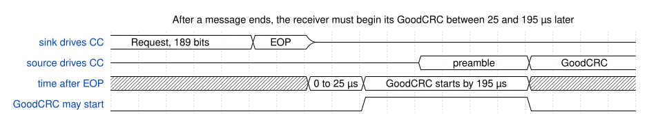

# USB-C PD from the YT9215 alone

Whether the Motorcomm YT9215 and its built-in RISC-V CPU can do the work of a USB-C Power Delivery controller, with no other microcontroller on the board, and what it costs to fall back on a dedicated chip.

The adapter is the power **source**: it feeds a device such as a Raspberry Pi 5 through USB-C. [`usb-c-pd.md`](usb-c-pd.md) describes the standards and every PD number used here; the values it marks "(verify)" have the same status in this note. Pin numbers are those of the YT9215SCH, the part on the LX-IS601F boards ([`motorcomm-debug-pins.md`](motorcomm-debug-pins.md)).

## Summary

- The slow parts of a PD source fit the YT9215 easily: attach detection, switching VBUS and the message logic all run on millisecond time scales [**I**](#evidence-codes).
- The fast part does not fit any documented peripheral. PD signalling is a 300 kbit/s biphase mark code with 1.67 µs half bits and a 0 to 1.1 V swing. The chip has no comparator, ADC, timer capture, PWM or general SPI master in any public document [**V**](#evidence-codes), and its 3.3 V inputs cannot read a 1.1 V swing [**V**](#evidence-codes).
- One documented block can clock out an arbitrary bit stream with crystal timing: the MAC of the extension port. A frame sent from the CPU to port 8 at 10 Mbit/s leaves pin TXD1 as a valid BMC waveform at 312.5 kbit/s. This is [option C](#option-c). The transmit side rests on documented functions and a script here proves the frame arithmetic [**C**](#evidence-codes); the receive side depends on one undocumented MAC behaviour [**U**](#evidence-codes).
- Nothing can be tried until code runs on the CPU. Motorcomm's SDK shows that firmware for it exists (FreeRTOS, built for RV32EC) [**V**](#evidence-codes), but the boot image format and the CPU's peripheral registers are unpublished [**U**](#evidence-codes).
- The safe design is [option A](#option-a): a PD transceiver with an I²C interface, driven by the documented I²C master of the YT9215. An FUSB302B costs about $0.34 to $0.41 in quantity and takes over every microsecond-scale task.
- The CH224K, HUSB238 and IP2721 are sink chips. They ask a charger for a voltage and cannot make this adapter a source, so they are not a fallback for it ([fixed-function chips](#fixed-function-chips)).
- A Raspberry Pi 5 needs PD for one thing only: a 5 V, 5 A offer lifts its USB current limit. A PD source limited to 3 A gives the Pi nothing that a bare Rp resistor does not ([`usb-c-pd.md`](usb-c-pd.md#3-raspberry-pi-5-specifics)).

| Option | Extra parts | Extra cost | Firmware risk | Details |
|---|---|---|---|---|
| Rp resistor only, no PD | 1 | $0.01 | None | [No PD](#option-0) |
| I²C PD transceiver | 1 | $0.34 to $0.41 | Low | [Option A](#option-a) |
| GPIO bit-bang | 3 | $0.10 | High | [Option B](#option-b) |
| Port 8 MAC as serialiser | 3 | $0.10 | High | [Option C](#option-c) |

The extra parts counted for options B and C are a transmit buffer, a dual comparator and a series resistor; their cost is an estimate [**I**](#evidence-codes). Every option also needs the Rp resistor, the VBUS load switch and CC protection, which are left out of the table.

## Evidence codes

| Code | Name | Evidence |
|---|---|---|
| **V** | Verified | Printed in a datasheet |
| **V** | Verified | Present in the vendor SDK source |
| **V** | Verified | Present in the Linux driver, as cited by the register guide |
| **C** | Computed | Result of [`mac_bmc_frame.py`](yt9215-usb-pd/mac_bmc_frame.py) |
| **I** | Inferred | Reasoned from other evidence |
| **U** | Unknown | Not in any public source found |

The datasheet is [YT9215SCH V1.03](../datasheets/motorcomm/YT9215SCH_Datasheet_V1.03_2025-02-10.pdf). The vendor SDK is the public copy at [OpenEmbeddedBSP/motorcomm-yt9215-switch-sdk](https://github.com/OpenEmbeddedBSP/motorcomm-yt9215-switch-sdk/tree/d2c8d6fc721fdb7e04e815b4fe2a397a2817ee5e/switch_sdk), commit `d2c8d6fc721f`, the same one the [register guide](yt9215-registers/README.md) uses.

## What a PD source has to do

The jobs fall into three speed classes. Only the last class is hard for the YT9215.

| Job | Time scale | Needs | More |
|---|---|---|---|
| Advertise current with Rp | Static | Resistor | [CC resistors](usb-c-pd.md#41-resistors) |
| Detect attach | 100 ms | Voltage window | [CC windows](usb-c-pd.md#42-voltage-windows) |
| Detect detach | 10 ms | Voltage window | [CC windows](usb-c-pd.md#42-voltage-windows) |
| Switch VBUS | 100 ms | Load switch | [Source states](usb-c-pd.md#43-source-state-machine-and-timing) |
| Run the message sequence | 1 ms | CPU | [Messages](usb-c-pd.md#53-message-layer-essentials) |
| 4b5b and CRC-32 | Per message | CPU | [Framing](usb-c-pd.md#52-framing) |
| Send BMC | 1.67 µs half bit | Bit serialiser | [Transmit](#the-bmc-waveform) |
| Receive BMC | 1.67 µs half bit | Slicer and sampler | [Receive](#the-bmc-waveform) |
| Reply with GoodCRC | 195 µs | Fast turnaround | [Turnaround](#goodcrc-turnaround) |

A minimal source sends a small, fixed set of messages: Source_Capabilities, GoodCRC, Accept, PS_RDY, and Not_Supported or Reject. Each differs only in its 3-bit MessageID, so every waveform the source ever transmits can be prepared in advance [**I**](#evidence-codes).

VCONN, cable e-marker reading and DR_Swap are optional for this product. Offering 5 A needs either a captive cable or an e-marker read on SOP', which adds a VCONN switch ([`usb-c-pd.md`](usb-c-pd.md#5-usb-pd-physical-layer-bmc-on-cc), section 5.4). DR_Swap matters only if the adapter also becomes a USB device ([`usb-network-card.md`](usb-network-card.md)).

### The BMC waveform

| Property | Minimum | Nominal | Maximum |
|---|---|---|---|
| Bit rate | 270 kbit/s | 300 kbit/s | 330 kbit/s |
| Half bit | 1.52 µs | 1.67 µs | 1.85 µs |
| Swing | 1.05 V | 1.125 V | 1.20 V |
| Driver impedance | 33 Ω | – | 75 Ω |

A transmitter must place edges about 100 ns accurately. A receiver must slice a signal that never rises above 1.2 V and then measure the gaps between edges well enough to tell 1.67 µs from 3.33 µs.

### GoodCRC turnaround

Every received message must be acknowledged with a GoodCRC that starts no later than 195 µs after the last bit of the message. Within that time the receiver has to notice the end of the message, check its CRC, read the MessageID and start transmitting. This limit, more than the bit rate, decides which options work.

## What the YT9215 offers

### Documented resources

| Resource | Count | Pins | Limit | Evidence |
|---|---|---|---|---|
| GPIO-capable pins | 33 | GPIO5 to GPIO17 | Shared with port 8 | [**V**](#evidence-codes) |
| GPIO-capable pins | 33 | GPIO31 to GPIO50 | Shared with LEDs and straps | [**V**](#evidence-codes) |
| UART | 2 | 46, 47 | Baud rates unpublished | [**V**](#evidence-codes) |
| UART | 2 | 70, 76 | Baud rates unpublished | [**V**](#evidence-codes) |
| I²C master | 2 | 72, 73 | 100 kHz to 1 MHz | [**V**](#evidence-codes) |
| I²C master | 2 | 81, 84 | 100 kHz to 1 MHz | [**V**](#evidence-codes) |
| SMI master | 2 | Same as I²C | MDIO frames only | [**V**](#evidence-codes) |
| SPI flash master | 1 | 78, 79, 81, 83 | 31.25 MHz, flash commands | [**V**](#evidence-codes) |
| Port 8 MAC | 1 | 46 to 57 | RGMII, MII or RMII | [**V**](#evidence-codes) |
| LED outputs | 16 | 67 to 85 | Parallel or serial | [**V**](#evidence-codes) |
| Buzzer output | 1 | 67 | Loop-detect alarm | [**V**](#evidence-codes) |
| Interrupt output | 1 | 44 | To an external CPU | [**V**](#evidence-codes) |
| Temperature sensor | 1 | None | Internal | [**V**](#evidence-codes) |

The datasheet's example for the I²C master shows it driving a PoE power-sourcing controller, so managing a power chip over I²C is the use Motorcomm had in mind (Figure 9) [**V**](#evidence-codes).

### The CPU

| Item | Value | Source | Evidence |
|---|---|---|---|
| Core | Nuclei N205 | Press article | [**I**](#evidence-codes) |
| Instruction set of vendor builds | RV32EC | [`make.cfg`](https://github.com/OpenEmbeddedBSP/motorcomm-yt9215-switch-sdk/blob/d2c8d6fc721fdb7e04e815b4fe2a397a2817ee5e/switch_sdk/make/make.cfg#L29) | [**V**](#evidence-codes) |
| Compiler | `riscv-nuclei-elf-gcc` | [`.config`](https://github.com/OpenEmbeddedBSP/motorcomm-yt9215-switch-sdk/blob/d2c8d6fc721fdb7e04e815b4fe2a397a2817ee5e/switch_sdk/config/freeRTOS/.config) | [**V**](#evidence-codes) |
| Operating system | FreeRTOS | [`freert.cfg`](https://github.com/OpenEmbeddedBSP/motorcomm-yt9215-switch-sdk/blob/d2c8d6fc721fdb7e04e815b4fe2a397a2817ee5e/switch_sdk/make/env/freert.cfg) | [**V**](#evidence-codes) |
| Switch register access | Direct memory read and write | [`mem.c`](https://github.com/OpenEmbeddedBSP/motorcomm-yt9215-switch-sdk/blob/d2c8d6fc721fdb7e04e815b4fe2a397a2817ee5e/switch_sdk/core/drv/sw_ctrl/mem/mem.c) | [**V**](#evidence-codes) |
| Frame transmit to chosen ports | `eth_tx_by_portlist()` | [`fal_tiger_nic.c`](https://github.com/OpenEmbeddedBSP/motorcomm-yt9215-switch-sdk/blob/d2c8d6fc721fdb7e04e815b4fe2a397a2817ee5e/switch_sdk/core/fal/tiger/fal_tiger_nic.c) | [**V**](#evidence-codes) |
| Frame receive | `eth_rx_register()` | [`fal_tiger_nic.c`](https://github.com/OpenEmbeddedBSP/motorcomm-yt9215-switch-sdk/blob/d2c8d6fc721fdb7e04e815b4fe2a397a2817ee5e/switch_sdk/core/fal/tiger/fal_tiger_nic.c) | [**V**](#evidence-codes) |
| CPU port number | 10 | [Board profile](https://github.com/OpenEmbeddedBSP/motorcomm-yt9215-switch-sdk/blob/d2c8d6fc721fdb7e04e815b4fe2a397a2817ee5e/switch_sdk/common/boardprofile/bprofile_YT9215SC_default_demo.c#L48) | [**V**](#evidence-codes) |
| SRAM | 64 KB | Datasheet, "Embedded RISC-V" | [**V**](#evidence-codes) |
| Instruction cache | 2 KB | Datasheet, "Embedded RISC-V" | [**V**](#evidence-codes) |
| Clock frequency | Unpublished | – | [**U**](#evidence-codes) |
| Timers | Unpublished | – | [**U**](#evidence-codes) |
| GPIO registers | Unpublished | – | [**U**](#evidence-codes) |
| GPIO interrupts | Unpublished | – | [**U**](#evidence-codes) |
| Boot image format | Unpublished | – | [**U**](#evidence-codes) |

RV32EC has 16 registers and no multiply instruction. The vendor builds may be conservative, so the core could have more, but firmware should assume RV32EC until the chip says otherwise [**I**](#evidence-codes). [`switch-embedded-cpu.md`](switch-embedded-cpu.md) has the background on the core and its press sources.

The SDK refers to a firmware tree named `switch_sw_lite_mgmt` that holds FreeRTOS, the `SoC/yt921x` support code and the `eth_export.h` driver. That tree is not in the public copy and a web search found no other copy [**U**](#evidence-codes). It is where the timers, GPIO registers, interrupt numbers and boot format are defined.

### Electrical limits of the pins

| Parameter | Value at 3.3 V | Evidence |
|---|---|---|
| Input high, minimum | 2.0 V | [**V**](#evidence-codes) |
| Input low, maximum | 0.8 V | [**V**](#evidence-codes) |
| Output high, minimum | 2.4 V | [**V**](#evidence-codes) |
| Output low, maximum | 0.4 V | [**V**](#evidence-codes) |
| Input voltage, absolute maximum | Supply plus 0.3 V | [**V**](#evidence-codes) |
| Drive strength | Not given | [**U**](#evidence-codes) |
| Hysteresis | Not given | [**U**](#evidence-codes) |

Three consequences follow [**I**](#evidence-codes):

- A BMC signal peaks at 1.2 V, below the 2.0 V input-high level. No pin can receive it directly, so a comparator is required.
- An attached sink pulls CC to about 1.7 V against a 3 A Rp. That lies between the two input thresholds, so attach detection also needs a comparator, or an Rp value that moves the level into a defined range.
- The pins are not 5 V tolerant. CC can touch VBUS through a faulty cable, so every pin that reaches CC needs a series resistor and a clamp.

## How each job maps to the chip

| Job | YT9215 resource | External parts | Status |
|---|---|---|---|
| Rp advertisement | None | Resistor | Certain |
| Attach and detach | GPIO input | Comparator | Needs GPIO access |
| VBUS switch | GPIO output | Load switch | Needs GPIO access |
| Message logic | CPU | None | Needs firmware access |
| BMC transmit | [Option A](#option-a), [B](#option-b) or [C](#option-c) | Per option | Per option |
| BMC receive | [Option A](#option-a), [B](#option-b) or [C](#option-c) | Per option | Per option |
| GoodCRC | [Option A](#option-a), [B](#option-b) or [C](#option-c) | Per option | Per option |

The interfaces that look promising but do not work for BMC [**I**](#evidence-codes):

- **UART.** Every character is framed by a start and a stop bit, so a UART cannot emit or capture an unbroken bit stream.
- **I²C and SMI masters.** Both are open-drain and send fixed frame formats.
- **SPI flash master.** It is documented only as a flash controller, and in the execute-in-place boot mode it is busy fetching code. Whether it can send raw bytes is unknown.
- **Serial LED output.** It repeats a short register-defined pattern at an unpublished clock rate.
- **Buzzer.** [`LOOP_DETECT_TOP_CTRL`](yt9215-registers/sdk-tables.yaml) has a 2-bit mode and an enable, which is a tone, not a data output.

## No PD: Rp only

A 4.7 kΩ resistor from CC to 3.3 V advertises 3 A and is all that USB-C requires of a 5 V source. A Raspberry Pi 5 then boots and limits its USB ports to 600 mA, unless `usb_max_current_enable=1` is set on the Pi ([`usb-c-pd.md`](usb-c-pd.md#3-raspberry-pi-5-specifics)). This is the baseline every other option has to beat, and it works with the YT9215 CPU switched off.

## Option A: I²C PD transceiver

A PD transceiver such as the onsemi FUSB302B contains the BMC transmitter and receiver, the CC comparators, switchable Rp current sources, a VCONN switch, and logic that sends GoodCRC and retries by itself. The host reads and writes whole messages through FIFOs over I²C.

| YT9215 resource | Pins | Use |
|---|---|---|
| I²C master 1 | 72, 73 | Message FIFOs and control |
| GPIO input | Any free | Interrupt line, or poll instead |
| GPIO output | Any free | VBUS load switch |

Everything the firmware does is then slower than a millisecond: the tightest deadline is answering a Request before the sink's timer of about 24 ms runs out. A FreeRTOS task with polled I²C meets that without any timer or interrupt knowledge [**I**](#evidence-codes). The pins of I²C master 1 double as the port 3 and port 4 LED1 outputs, so those two LEDs are given up [**V**](#evidence-codes).

The remaining risks are the ones common to all options: getting firmware onto the CPU, and the register sequence that switches pins 72 and 73 to I²C, which the datasheet says "needs to enable the I2C function by software programming" without naming the register [**U**](#evidence-codes).

## Option B: GPIO bit-bang

The firmware toggles a GPIO for transmit and times the edges of a comparator output for receive.

Published designs that run PD without a PD chip all lean on a hardware timing peripheral, not on counted CPU cycles:

| Design | Transmit | Receive | Source |
|---|---|---|---|
| Chromium EC on STM32 | SPI with DMA, clocked by a timer | Comparator into timer capture with DMA | [`usb_pd_phy.c`](https://chromium.googlesource.com/chromiumos/platform/ec/+/v2.2.0/chip/stm32/usb_pd_phy.c) |
| g3gg0 on ESP32 | RMT peripheral | RMT peripheral | [Hackaday](https://hackaday.com/2025/01/10/bit-banging-the-usb-pd-protocol) |

The YT9215 has no documented equivalent of SPI with DMA, timer capture or RMT [**U**](#evidence-codes). Pure software timing would need all of the following, none of which is published:

- GPIO data registers that the CPU can write and read in a few cycles.
- A clock fast enough to sample at 2.4 MHz or more, with interrupts off and the loop in RAM or in the 2 KB cache.
- A free-running counter to time edges.

If the CPU runs from the 125 MHz switch clock, as the [`SYS_CLK` register](switch-embedded-cpu.md) suggests, there are about 200 cycles per half bit, which is enough [**I**](#evidence-codes). This option stays open until the firmware tree is found or the registers are traced on a running chip.

## Option C: the port 8 MAC as serialiser

The MAC of extension port 8 is a documented block that shifts bytes out on pins under crystal timing. Run at 10 Mbit/s, it becomes the BMC transmitter.

### Transmit

- At 10 Mbit/s the RGMII transmit clock is 2.5 MHz [**V**](#evidence-codes). Each cycle carries one nibble, low nibble first, as the RGMII and IEEE 802.3 standards define.
- Pin TXD1 carries bit 1 and then bit 5 of each byte. Two bytes of `0x22` hold it high for four nibbles, 1.6 µs, and two bytes of `0x00` hold it low.
- A half bit of 1.6 µs gives 312.5 kbit/s, inside the 270 to 330 kbit/s that PD allows [**C**](#evidence-codes).
- TXD1 is low during the Ethernet preamble and start-of-frame delimiter, because bit 1 of the nibbles `0x5` and `0xD` is 0. TXD0 would be high there, which is why TXD1 is the pin to use.
- The MAC appends a 4-byte frame check sequence. Four chosen bytes before it make TXD1 stay low through those bytes and the check sequence, so the line is held low for 6.4 µs after the message and then released, as PD requires [**C**](#evidence-codes).
- TX_CTL is high for exactly the length of the frame. It enables an external buffer, so the driver is off the CC line at all other times.

[`mac_bmc_frame.py`](yt9215-usb-pd/mac_bmc_frame.py) builds such a frame for a GoodCRC message and checks it by replaying the nibbles: 149 PD bits become a 600-byte frame that lasts 490 µs [**C**](#evidence-codes). A Source_Capabilities message with one power offer is 189 bits and needs 760 bytes, well inside a standard frame.

| Step | Register or function | Guide page | Evidence |
|---|---|---|---|
| Select RGMII or MII on port 8 | `XMII` mode field | [Ports](yt9215-registers/docs/ports.rst) | [**V**](#evidence-codes) |
| Force 10 Mbit/s full duplex | `PORT_CTRL` | [Ports](yt9215-registers/docs/ports.rst) | [**V**](#evidence-codes) |
| Keep other traffic off port 8 | Port isolation | [Forwarding](yt9215-registers/docs/forwarding.rst) | [**I**](#evidence-codes) |
| Send the prepared frame to port 8 | `eth_tx_by_portlist()` | [CPU tag](yt9215-registers/docs/cpu-tag.rst) | [**V**](#evidence-codes) |

What is not known about transmit [**U**](#evidence-codes):

- The delay from the CPU handing over a frame to its first nibble on the pins. It must fit in the 195 µs GoodCRC limit together with the receive side.
- Whether TXD1 idles low between frames. The buffer enable makes this harmless.
- Whether the CPU path adds a tag or pads the frame.

### Receive

The same MAC can sample the line. Tie RXD0 high, RXD1 low and RXD2 high, and feed the comparator output to RXD3. While the line is low the MAC sees the nibble `0x5`, which is preamble. The first high level makes `0xD`, the start-of-frame delimiter. Every later nibble is `0x5` or `0xD`, so each received byte holds two samples of the CC line taken 400 ns apart. That is 4.2 samples per half bit, enough to tell half bits from full bits [**I**](#evidence-codes).

Three things have to hold, and none is documented [**U**](#evidence-codes):

- **Frames with a bad check sequence must reach the CPU.** A captured PD message is not a valid Ethernet frame. The SDK counts such frames ([`RX_FCS_ERR`](https://github.com/OpenEmbeddedBSP/motorcomm-yt9215-switch-sdk/blob/d2c8d6fc721fdb7e04e815b4fe2a397a2817ee5e/switch_sdk/include/yt_stat.h#L37)) and no register found so far forwards them. If the MAC always drops them, this receive path is dead.
- **Something must drive RX_CTL** high at the start of a message and low at its end: a GPIO, or a diode, resistor and capacitor that follow the activity of the comparator.
- **The receive clock must run.** In RGMII the chip expects RXC from outside, so TXC is looped back to it. In reverse MII the chip drives both clocks itself.

The frame reaches the CPU only after RX_CTL falls, so the whole 195 µs budget is spent on end-of-message detection, frame delivery, decoding about 800 bytes and queueing the reply.

### Front end

| Part | Example | Job | Estimated cost |
|---|---|---|---|
| Buffer with enable | 74AUP1G126 | Drives CC at 1.15 V while TX_CTL is high | $0.04 |
| Series resistor | 47 Ω | Sets the driver impedance | $0.001 |
| Dual comparator | Fast, rail-to-rail input | BMC slicer and attach detector | $0.05 |
| Rp | 4.7 kΩ | Advertises 3 A | $0.001 |

The costs are estimates and no part has been chosen [**I**](#evidence-codes). Notes on the parts [**I**](#evidence-codes):

- The buffer is powered from the 1.15 V core rail of the switch (DVDDL, 1.08 to 1.32 V [**V**](#evidence-codes)). Its output then swings 0 to 1.15 V, inside the 1.05 to 1.20 V that PD asks for at the nominal rail voltage, with no divider that would load CC.
- Pins 48 and 50 are also strap pins. The buffer inputs are high impedance, so they do not disturb the straps.
- The slicer comparator needs a propagation delay well under 400 ns and matched rising and falling delays. An LM393-class part is too slow.
- Option B uses the same front end with GPIO pins in place of the port 8 pins.

Option C uses pins 46 to 57. They are free as long as nothing else is attached to port 8, which holds for a design with no external CPU.

## Fixed-function chips

| Chip | Role | Needs a host | 5 V 5 A offer | Price | Quantity | Fit |
|---|---|---|---|---|---|---|
| Rp resistor | Source | No | No | $0.001 | – | [Baseline](#option-0) |
| onsemi FUSB302B | Source or sink | Yes, I²C | Host decides | $0.34 to $0.41 | 1,000 | [Option A](#option-a) |
| WCH CH32X035 | Source or sink | No, it is an MCU | Firmware decides | $0.27 | Lowest listed | [Note](#chip-notes) |
| FM XPD319BP | Source | Not stated | Not listed | $0.11 | Lowest listed | [Note](#chip-notes) |
| WCH CH224K | Sink | No | Not applicable | $0.27 | 1,000 | None |
| Hynetek HUSB238 | Sink | No | Not applicable | $0.29 | Lowest listed | None |
| Injoinic IP2721 | Sink | No | Not applicable | $0.38 | 1,000 | None |

Prices are LCSC list prices as returned by a web search on 2026-11-19; the live pages could not be read, so check them before costing a BOM: [FUSB302BMPX](https://www.lcsc.com/product-detail/C132291.html), [CH32X035F8U6](https://www.lcsc.com/product-detail/C42442062.html), [XPD319BP](https://www.lcsc.com/product-detail/USB-ICs_Shenzhen-Fuman-Elec-XPD319BP_C2937661.html), [CH224K](https://www.lcsc.com/product-detail/C970725.html), [HUSB238](https://www.lcsc.com/product-detail/C7471904.html), [IP2721](https://www.lcsc.com/product-detail/C603176.html).

- **Sink chips.** The CH224K, HUSB238 and IP2721 request a voltage from a charger. They would be the right parts for an adapter that is powered from USB-C. This adapter is powered from PoE and supplies USB-C, so they do not apply.
- **Standalone source chips.** The XPD319BP listing describes a source with 5 V, 9 V and 12 V offers at 3 A. For a Raspberry Pi 5 a 3 A offer is no better than the [Rp resistor](#option-0), so such a chip is worth its cost only if it can offer 5 V at 5 A. No standalone source chip with a confirmed 5 A offer was found.
- **CH32X035.** It is cheaper than the FUSB302B and has a PD transceiver built in, but it is a second microcontroller with its own firmware, which the project direction rules out. It is listed as the price to beat.
- **FUSB302B.** It is the cheapest part found that keeps all firmware on the YT9215.

## What to find out next

| Question | How | Decides |
|---|---|---|
| Can code run on the CPU? | Find the firmware tree, or read a flash image from a managed YT9215 switch | Everything |
| Which register enables I²C on pins 72 and 73? | Firmware tree, or trace a vendor image | [Option A](#option-a) |
| Where are the GPIO registers and timers? | Firmware tree | [Option B](#option-b) |
| How long from frame hand-over to the first nibble? | Scope on TX_CTL | [Option C](#option-c) transmit |
| Can frames with a bad check sequence reach the CPU? | Send one into port 8 and watch the counters | [Option C](#option-c) receive |
| Does a Pi 5 accept the 312.5 kbit/s waveform? | Send Source_Capabilities from a board with port 8 pins exposed | [Option C](#option-c) |
| Which comparator is fast and cheap enough? | Bench test against a real PD sink | [Option B](#option-b) and [C](#option-c) |

The first question blocks all the others. Until it is answered, a board should carry the [Rp resistor](#option-0) and the footprint of an [I²C PD transceiver](#option-a), with the port 8 pins brought out to test points so that [option C](#option-c) can be tried on the same board.

## Files

| File | Contents |
|---|---|
| [`mac_bmc_frame.py`](yt9215-usb-pd/mac_bmc_frame.py) | Builds and checks the Ethernet frame that carries a PD message |
| [`bmc-coding.json`](yt9215-usb-pd/bmc-coding.json) | WaveDrom source of the BMC coding figure |
| [`goodcrc-turnaround.json`](yt9215-usb-pd/goodcrc-turnaround.json) | WaveDrom source of the turnaround figure |
| [`mac-serialiser.json`](yt9215-usb-pd/mac-serialiser.json) | WaveDrom source of the serialiser figure |
| [`render_wavedrom.py`](yt9215-usb-pd/render_wavedrom.py) | Renders the WaveDrom sources to SVG |
| [`make_front_end.py`](yt9215-usb-pd/make_front_end.py) | Draws the front-end figure |
